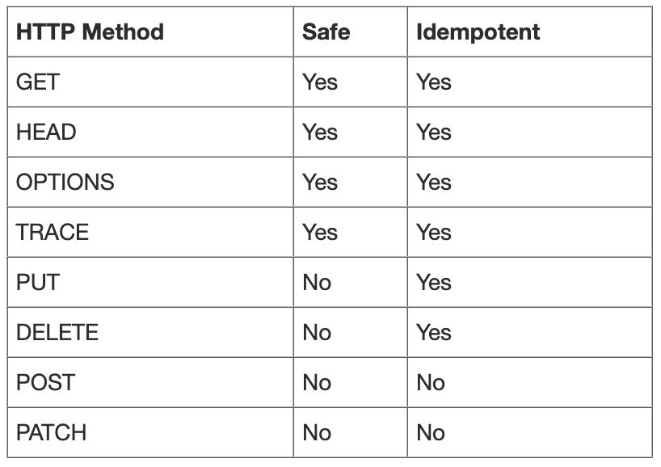
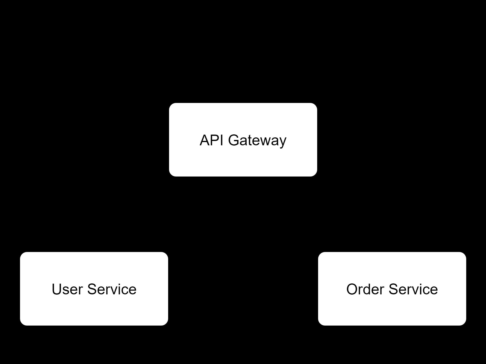
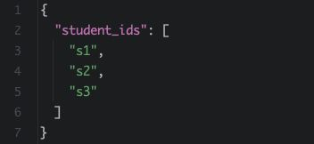
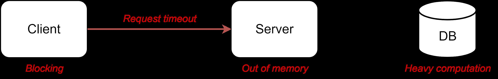
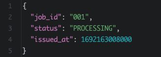
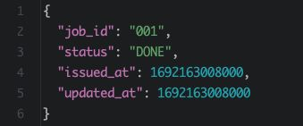
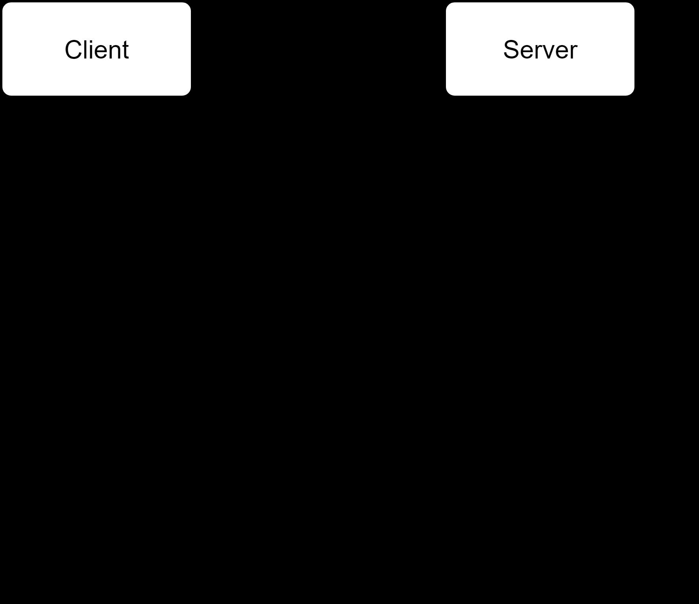
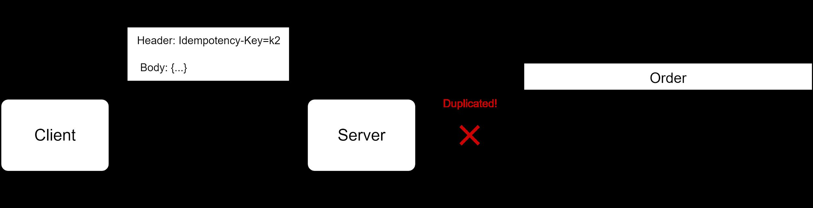
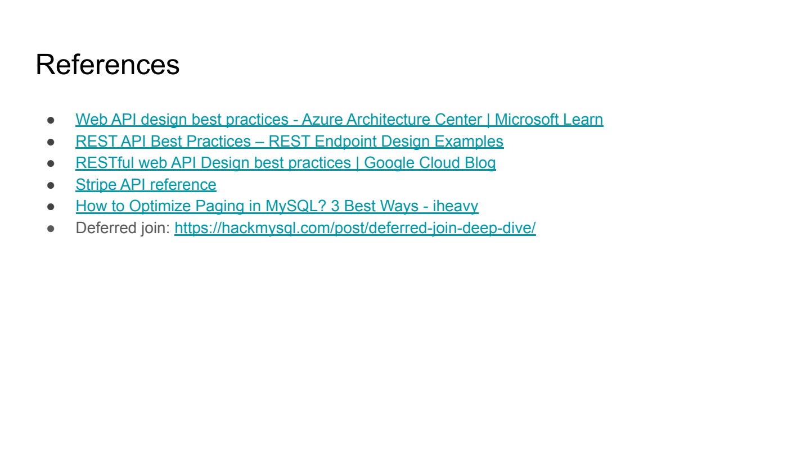

# 1. REST API Design

> **Tổng số trang:** 30 slide | **Thư mục ảnh/sơ đồ:** `assets/1_REST_API_Design/`

---

## Trang 1: REST API Design

### REST API Design
“Let your plans be dark and impenetrable as night,
and when you move, fall like a thunderbolt.”
- Sun Tzu

---

## Trang 2: Outline

### Outline
### 1. Fundamentals
### 1.1. Mindset
### 1.2. REST API Conventions
### 2. Case Studies
### 3. Writing API Document

---

## Trang 3: 1. Mindset

### 1. Mindset

---

## Trang 4: 1.1. Why Design First?

### 1.1. Why Design First?
- Think how it works at high level
→ Cover almost cases
→ Reduce resources
- Better coordination among other teams
- Good designs make you a good engineer, a potential employee

---

## Trang 5: 1.2. Mindset

### 1.2. Mindset
- Scalable
- Consistency
- Inspect every single aspect
- No one fits all (Trade-offs)

---

## Trang 6: 2. REST Conventions

### 2. REST Conventions

---

## Trang 7: 2.1. HTTP Methods

### 2.1. HTTP Methods
Properties:
- Safety: do not alter the server state/data
- Idempotency: a same request is sent once or
multiple times, the response is the same.
Operations:
- Create: POST
- Read: GET
- Update Totally: PUT
- Delete/Disable: DELETE
- Update Partially: PATCH

---

## Trang 8: 2.2. RESTful API Conventions

### 2.2. RESTful API Conventions
- Use Nouns Instead of Verbs
- Plural Nouns
- Use Nesting to Show Relationships
- Versioning
- Slug-case for URL
- Snake_case for request, response body
Example: https://ronin-engineer.com/api/v1/posts/<post_id>/comments

---

## Trang 9: 2.3. Exercise 1

### 2.3. Exercise 1
Write Method + URL for:
### 1. Create Order
### 2. Get the detail of order 145
### 3. Update age of user 34 only
### 4. Disable user 34

---

## Trang 10: 2.3. Exercise 1

### 2.3. Exercise 1
Write Method + URL for:
- Create Order:
  - POST /order-service/api/v1/orders
- Get the detail of order 145:
  - GET /order-service/api/v1/orders/145
- Update age of user 34 only:
  - PATCH /user-service/api/v1/users/34
- Disable user 34:
  - DELETE /user-service/api/v1/users/34
- Note: Prefix paths make routing easier.

---

## Trang 11: 2.4. Pagination

### 2.4. Pagination
2 ways:
- Page, size parameters:
  - Example: GET /users?page=0&size=10
  - Use case: management portal
  - Must document: Page start counting with 0 or 1
- Offset, limit parameters:
  - Example: GET /users?offset=0&limit=10
  - Use case: a infinite scrollable list, newsfeed, logging events, …

---

## Trang 12: SELECT * FROM users OFFSET 100 LIMIT 10 ?

SELECT * FROM users OFFSET 100 LIMIT 10 ?

---

## Trang 13: 2.4. Problem 01

### 2.4. Problem 01
2 problems:
- Performance issue for a large dataset in relational DB
  - Take time to count all rows
  - Offset scan through rows to know how many should be skipped
- Resource skipping
  - Firstly, get page 1: [1 … 10]
  - Then delete X records in page 1: [3 … 10] and expectation: page 2: [11 … 20]
  - Get page 2 → the X first records in page 2 moved to page 1
■ Page 1: [3 … 10, 11, 12]
■ Page 2: [13 … 24]

---

## Trang 14: 2.4. Problem 01

### 2.4. Problem 01
Solutions:
- Deferred join: (Performance issue)
SELECT * FROM
(SELECT id FROM users ORDER BY id LIMIT 100, 10) a USING id
JOIN users b ON a.id = b.id;
- Cursor: (Resource skipping)
  - SELECT * FROM users WHERE id > last_id ORDER BY id LIMIT 10;
- Note:
  - Each solution has its own pros and cons → based on requirements to choose the right
solution.
  - Cursor is not suitable for random ID.

---

## Trang 15: 2.5. Sorting

### 2.5. Sorting
- Examples:
  - GET /products?sort=price:asc,name:desc
  - GET /products?sort=+price,-name
  - GET /products?sort=price asc,name desc
- Note: White list of sortable fields
- Ref:
  - Common design patterns | Cloud API Design Guide | Google Cloud
  - REST API | GitLab
  - Stripe API Reference

---

## Trang 16: 2.6. Relations

### 2.6. Relations
One-To-Many
- Get all comments of an article 123
  - GET /articles/123/comments
Many-To-Many
- Get students in a class
  - GET /classes/<class_id>/students
- Add a student into a class
  - POST /classes/<class_id>/students/<student_id>
  - Note: Using PUT here is ok because of idempotence
- Add students into a class
  - POST /classes/<class_id>/students
Body for add students into a class

---

## Trang 17: 3. Case Studies

### 3. Case Studies

---

## Trang 18: 3.1. Problem 02: Exporting a large file

### 3.1. Problem 02: Exporting a large file
Design API for exporting a file with the size of 500MB.
Process:
### 1. Query DB
### 2. Write file
### 3. Response file to client directly
Issues:
- Request timeout
- Client is blocked
- Out of Mem
- Heavy computation, Large result of the query

---

## Trang 19: 3.1. Solution: Polling (Async API)

### 3.1. Solution: Polling (Async API)
Use case: export file
### 1. API request to export
- Endpoint: GET /products/jobs/export?name=pen
### 2. API check status
- Endpoint: GET /jobs/001
### 3. API get job result
- Endpoint: GET /jobs/001/result

---

## Trang 20: 3.1. Solution: Polling (Async API)

### 3.1. Solution: Polling (Async API)
Use case: export file
### 1. API request to export
- Endpoint: GET /products/jobs/export?name=pen
### 2. API check status
- Endpoint: GET /jobs/001
### 3. API get job result
- Endpoint: GET /jobs/001/result

---

## Trang 21: Polling Callback

Polling Callback

---

## Trang 22: 3.2. Types of Async API

### 3.2. Types of Async API
- Polling:
  - Pros: Easy to implement
  - Cons: Waste resource
  - Use case: small load, import/export file
- Callback / Webhook:
  - Pros: Optimize the resource
  - Cons: Complex to implement in both client
side and server side
  - Use case: large load, payment

---

## Trang 23: 3.3. Problem 03

### 3.3. Problem 03
Problem: A request might be sent twice due to network issue or replay attack.
This problem is sensitive to use cases such as payment, order.
Solution:
- Client generates and adds an Idempotency Key to the request header.
- Server checks Idempotency Key with unique constraint in DB.

---

## Trang 24: 4. REST API Document

### 4. REST API Document

---

## Trang 25: What info is important to REST API document?

What info is important to REST API document?

---

## Trang 26: 4.1. API Document

### 4.1. API Document
Resources:
- REST API Document
- REST API Map
Note:
- Describe request, response body clearly
- Show all errors and their meanings
- Nice to have cURL samples

---

## Trang 27: Recap

### Recap
- Scalable
- Consistency
- Inspect every single aspect
- No one fits all (Trade-offs)

---

## Trang 28: References

### References
- Web API design best practices - Azure Architecture Center | Microsoft Learn
- REST API Best Practices – REST Endpoint Design Examples
- RESTful web API Design best practices | Google Cloud Blog
- Stripe API reference
- How to Optimize Paging in MySQL? 3 Best Ways - iheavy
- Deferred join: https://hackmysql.com/post/deferred-join-deep-dive/

---

## Trang 29: Thank you

Thank you

---

## Trang 30: Homework

### Homework
Airline Booking, API documents:
- API search flights
- API book a flight
- API get history of booking

---
