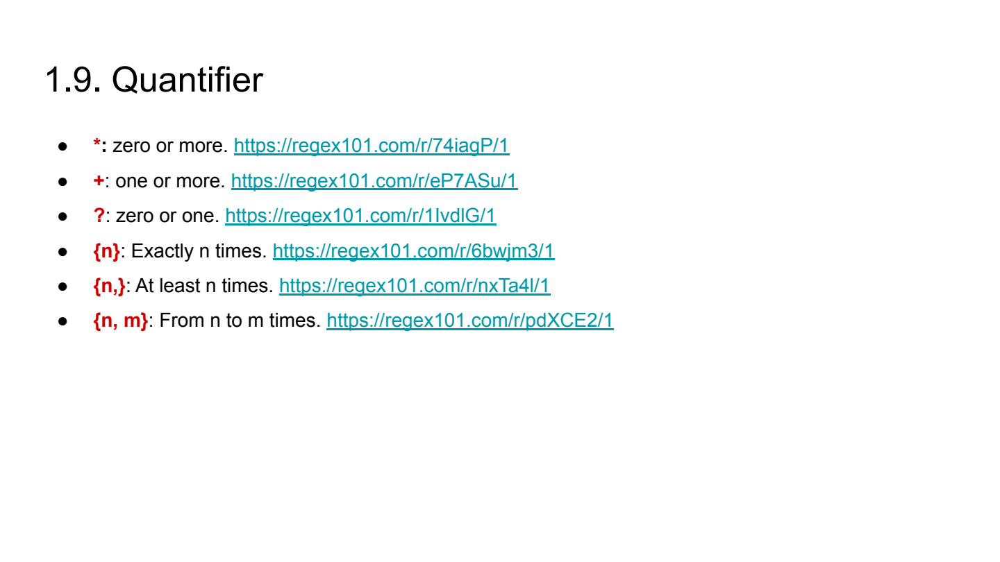
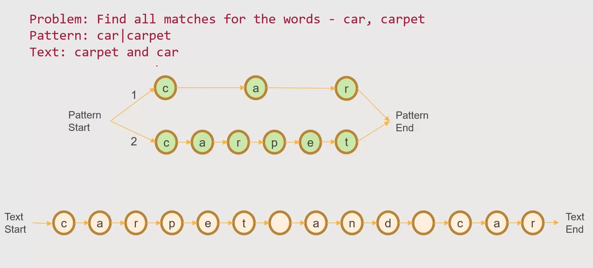
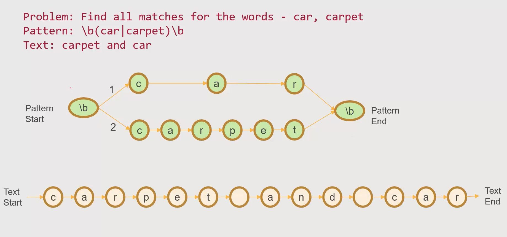
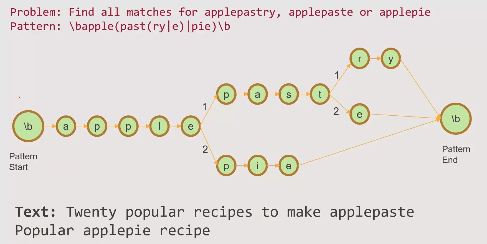
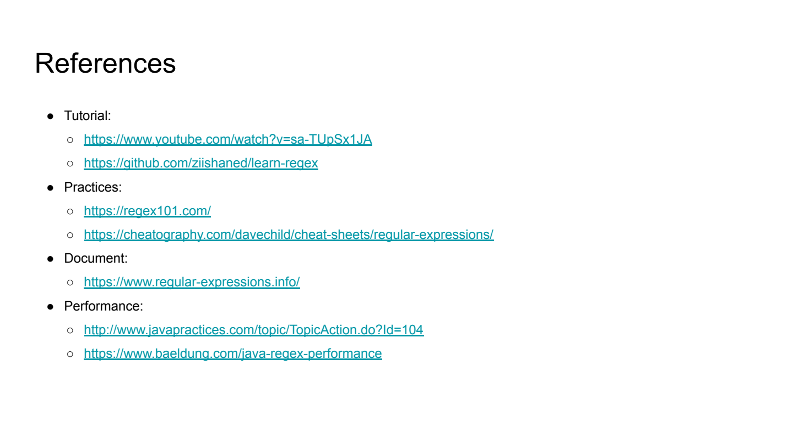
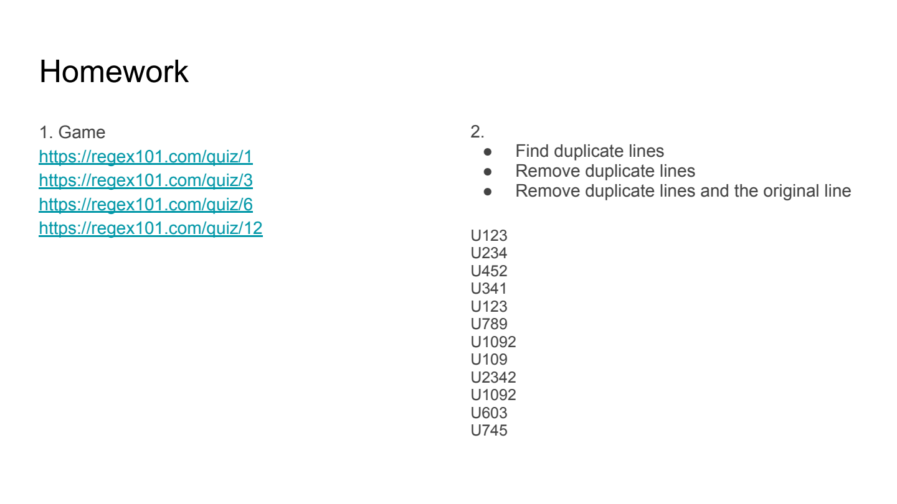

# 11. Regex

> **Tổng số trang:** 33 slide | **Thư mục ảnh/sơ đồ:** `assets/11_Regex/`

---

## Trang 1: Regex

### Regex
“Women and children can be careless, not men”
- Mario Puzo, The Godfather

---

## Trang 2: Outline

### Outline
### 1. Regex Language
  - Group
  - Anchor
  - Shorthand Class
  - …
### 2. Practices
### 3. Regex Engine
  - How Regex Engine Works
  - Best Practices

---

## Trang 3: 1. Regex Language

### 1. Regex Language

---

## Trang 4: 1.1. Introduction

### 1.1. Introduction
- Regular expression (regex) is powerful tool for pattern matching within strings.
- Use cases:
  - Data validation
  - Search operations
  - Parsing
  - Text manipulation
- Each language has its own regex engine and they are not the same at all
  - Regex is like a interface
  - Regex engine is like a implementation

---

## Trang 5: 1.2. Matches

### 1.2. Matches
- Input:
  - String
  - Regular Expression (Regex)
- Output:
  - Match(es)
Example: https://regex101.com/r/nAIn2B/1

---

## Trang 6: 1.3. Group

### 1.3. Group
- Grouping part of regex
- Use (...) to group
- To name the group: (?<group_name>expression)
Example: https://regex101.com/r/FiNWUT/1

---

## Trang 7: 1.4. Alternation

### 1.4. Alternation
- Match a single regular expression out of several possible
regular expressions
- Use | to separate alternatives
Example: https://regex101.com/r/PXkj2Q/1

---

## Trang 8: 1.5. Optional Item

### 1.5. Optional Item
- Regex: a|b|c = [abc]
- Range: [a-z], [0-9], [a-zA-Z0-9]
Example: https://regex101.com/r/3wx3UI/1

---

## Trang 9: 1.6. Negation

### 1.6. Negation
- A character not in the range
- Syntax: [^...]
Example: https://regex101.com/r/LjCGqB/1

---

## Trang 10: 1.7. Anchors

### 1.7. Anchors
- ^: Start of line
  - Ex: https://regex101.com/r/nPuQHa/2
- $: End of line
  - Ex: https://regex101.com/r/U0MT13/1
- \b: Word boundary
  - Ex: https://regex101.com/r/HCgJVG/1

---

## Trang 11: 1.8. Shorthand Class

### 1.8. Shorthand Class
- \d: any digit. = [0-9]
- \w: any word character. = [A-Za-z0-9_]
- \s: any whitespace character. = [ \t\r\n\f]
- .: any single character
- \: escape special characters. Ex: [a-z\.]

---

## Trang 12: 1.9. Quantifier

### 1.9. Quantifier
- *: zero or more. https://regex101.com/r/74iagP/1
- +: one or more. https://regex101.com/r/eP7ASu/1
- ?: zero or one. https://regex101.com/r/1IvdlG/1
- {n}: Exactly n times. https://regex101.com/r/6bwjm3/1
- {n,}: At least n times. https://regex101.com/r/nxTa4l/1
- {n, m}: From n to m times. https://regex101.com/r/pdXCE2/1

---

## Trang 13: 1.10. Flags

### 1.10. Flags
- g (global): returns all matches, do not return after first match
- i (insensitive): regex is case sensitive by default
- m (multi line): scan on multiple lines
Example: https://regex101.com/r/Rjl8tu/2

---

## Trang 14: 2. Practices

### 2. Practices

---

## Trang 15: 2.0. Practices

### 2.0. Practices
- https://regex101.com/
- Cheat Sheets: https://cheatography.com/davechild/cheat-sheets/regular-expressions/
- Google for solutions
- Note:
  - Choose the regex engine of javascript
  - The regex engine of Java works not well
  - If regex on regex101 does not work, then try it on real code

---

## Trang 16: 2.1. Exercise 1: Image File Names

### 2.1. Exercise 1: Image File Names
- Find names of image files
- Ex: https://regex101.com/r/mzxKHU/2

---

## Trang 17: 2.2. Exercise 2: Number

### 2.2. Exercise 2: Number
- Find numbers
- Ex: https://regex101.com/r/cO5Bsk/3

---

## Trang 18: 2.3. Exercise 3: Emails

### 2.3. Exercise 3: Emails
- Validate email
- Ex: https://regex101.com/r/KSnBDi/1

---

## Trang 19: 2.4. Exercise 4: Network Configuration

### 2.4. Exercise 4: Network Configuration
- Extract network configurations
- Ex: https://regex101.com/r/ubTXiV/1

---

## Trang 20: 2.5. Case Study 1: Transform logs into CSV

### 2.5. Case Study 1: Transform logs into CSV
- Ex: https://regex101.com/r/OxMoHy/1
- Requirement:
  - Extract voucher info only
  - Format: CSV
  - Output example: 2023-09-12T13:23:48.796+07:00, U56, V12
- Use VScode

---

## Trang 21: 2.6. Challenge

### 2.6. Challenge
- Ex: https://regex101.com/r/Tcgfo2/1
- Match Passport Number Only
- Passport number and citizen id is the same pattern
- Allow to google
- Not allow to ask ChatGPT
- Hint: Apply an operation that is not taught yet

---

## Trang 22: 2.6. Look around

### 2.6. Look around
- Look ahead: what is coming up next without consuming the characters
  - Example: https://regex101.com/r/fBhwIN/1
- Look behind: what came before current character
- IF condition THEN expression

---

## Trang 23: 3. Regex Engine

### 3. Regex Engine

---

## Trang 24: 3.1. Regex Engine

### 3.1. Regex Engine
- One character at a time
- Left to right
  - Regex Engine use backtracking to evaluate other paths
- Greedy
  - Quantifier *, + are greedy. They try to match as much of input text as possible
- Lazy
  - Lazy matches as few times as possible and attempts to match rest of patterns
  - Turn to lazy by adding ? after the quantifier (*?, +?)

---

## Trang 25: 3.2.1. Regex Engine / Left to Right

### 3.2.1. Regex Engine / Left to Right

---

## Trang 26: 3.2.2. Regex Engine / Left to Right

### 3.2.2. Regex Engine / Left to Right

---

## Trang 27: 3.3. Regex Engine / Backtracking

### 3.3. Regex Engine / Backtracking

---

## Trang 28: 3.4. Best Practices

### 3.4. Best Practices
- Compile regular expressions once
- Avoid Making Everything Optional. It is more important to consider what it should not match, than
what it should
- Use The *, + Sparingly (greedy). The regex also matches in cases where it should not match.
- Leverage lazy processing +?
- Use Negated Character Classes Instead of the Dot
- Group capture is expensive → non-capturing group (?:)
- Avoid exponential. Ex: ^(\w*)*$
- Add a timeout to against unexpected scenarios (if possible)

---

## Trang 29: Read more

### Read more
- Regex Engine:
  - Greedy
  - Lazy
- Lookaround (Lookahead & Lookbehind)

---

## Trang 30: Recap

### Recap
- Syntax
- How regex engine work
- Practices
  - Start with small regex

---

## Trang 31: References

### References
- Tutorial:
  - https://www.youtube.com/watch?v=sa-TUpSx1JA
  - https://github.com/ziishaned/learn-regex
- Practices:
  - https://regex101.com/
  - https://cheatography.com/davechild/cheat-sheets/regular-expressions/
- Document:
  - https://www.regular-expressions.info/
- Performance:
  - http://www.javapractices.com/topic/TopicAction.do?Id=104
  - https://www.baeldung.com/java-regex-performance

---

## Trang 32: Homework

### Homework
### 1. Game
https://regex101.com/quiz/1
https://regex101.com/quiz/3
https://regex101.com/quiz/6
https://regex101.com/quiz/12
### 2.
- Find duplicate lines
- Remove duplicate lines
- Remove duplicate lines and the original line
U123
U234
U452
U341
U123
U789
U1092
U109
U2342
U1092
U603
U745

---

## Trang 33: Thank you

Thank you

---
