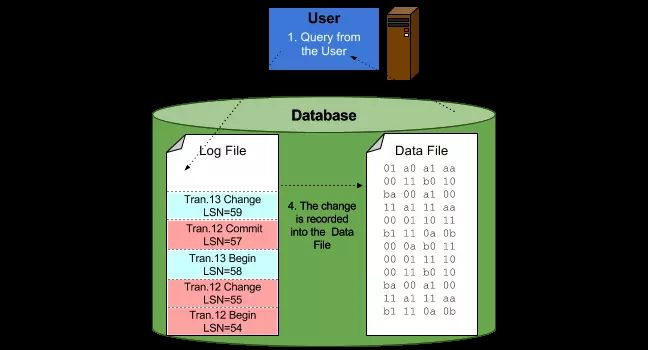
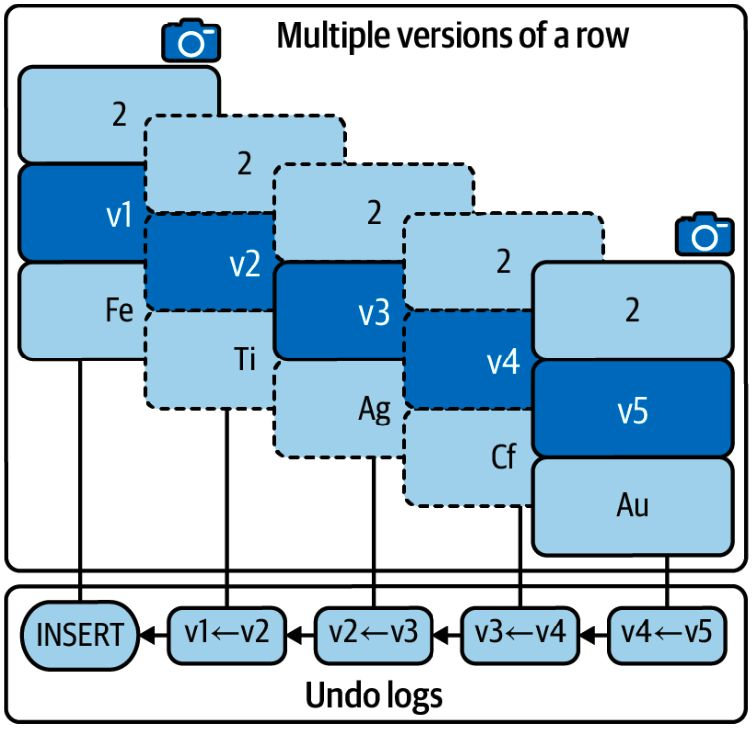
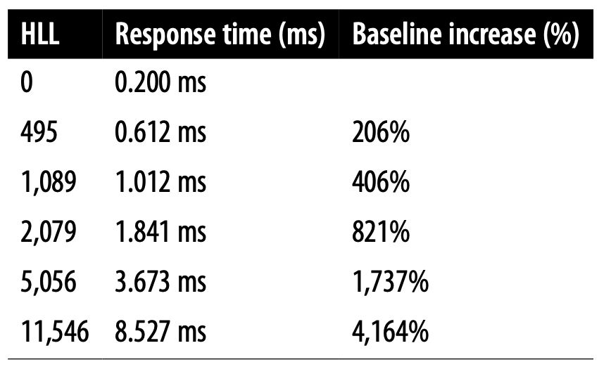
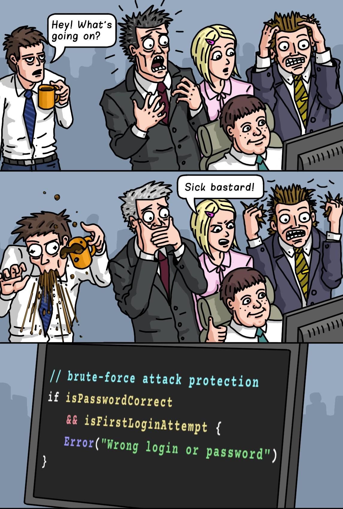

# 12. Transaction

> **Tổng số trang:** 26 slide | **Thư mục ảnh/sơ đồ:** `assets/12_Transaction/`

---

## Trang 1: Transaction

### Transaction
“Stop thinking, and end your problems.”
- Lao Tzu

---

## Trang 2: Outline

### Outline
### 1. Introduction
  - Definition
  - ACID
  - Isolation Levels
### 2. How Transactions Work?
### 3. Common Problems

---

## Trang 3: 1. Introduction

### 1. Introduction

---

## Trang 4: 1.1. Definition

### 1.1. Definition
- A transaction is a group of SQL queries that are treated atomically, as
a single unit of work.
- All or Nothing
- Syntax:
  - START TRANSACTION / BEGIN: start transaction
  - a group of queries
  - COMMIT: Apply changes
  - ROLLBACK: Discard the changes

---

## Trang 5: 1.2. ACID

### 1.2. ACID
- ACID are properties of transaction in SQL DB
- Atomicity: a group of SQL queries is like a query. all or nothing.
- Consistency:
  - Data should be valid according to all predefined rules.
  - The database should always move from one consistent state to the another, maintaining all
predefined rules, including SQL constraints, business rule, data types
- Isolation:
  - Multiple concurrent transactions do not affect each others.
  - The results of a transaction are usually invisible to other transactions until the transaction is
complete.
- Durability: Committed data would be not lost, even after power failure.

---

## Trang 6: 1.3. Isolation Levels

### 1.3. Isolation Levels

---

## Trang 7: 1.3.1. Read Uncommitted

### 1.3.1. Read Uncommitted
- Transactions can view the results of uncommitted transactions
- Problem: Dirty Read → Buggy
- Rarely used in practice
- Use case: A high-frequency logging system
  - Requirement: performance is prioritized over the accuracy of the log data

---

## Trang 8: 1.3.2. Read Committed

### 1.3.2. Read Committed
- Transactions can view the results of committed transactions
- Solve the Dirty Read problem
- In Postgresql, Read Committed is the default isolation level
- Use case: financial system
  - Requirement: each transaction must only see committed data to prevent anomalies but can
tolerate non-repeatable reads.
- Problem: Read Skew (Non-repeatable read) - get different value on re-read of a row if another
concurrent transaction updates the same row and commits.

---

## Trang 9: 1.3.3. Repeatable Read

### 1.3.3. Repeatable Read
- Repeatable Read guarantees that any rows a transaction reads will “look the same” in subsequent
reads within the same transaction
- Solve the non-repeatable read problem
- In MySQL, Repeatable Read is the default isolation level
- Problem: Phantom Read - get different rows after re-execution of a range query if another
transaction adds or removes some rows in the range and commits.
  - A new row appears without knowing where it comes from. It sounds like a phantom.
- Use case: An online retail system
  - Requirement: maintain a consistent view of item prices and availability throughout the session

---

## Trang 10: 1.3.4. Serializable

### 1.3.4. Serializable
- SERIALIZABLE solves the phantom read problem by forcing transactions to be ordered so that they
can’t possibly conflict
- In a nutshell, SERIALIZABLE places a lock on every row it reads
- Problem: Decreasing concurrency
- Serializable is rarely used in practice.
- Use case: real estate system
  - Requirement: ensures full isolation, preventing phantom reads

---

## Trang 11: 2. How Transactions Work?

### 2. How Transactions Work?

---

## Trang 12: 2.1. Transaction Logging

### 2.1. Transaction Logging
- Write Operation:
  - Write-ahead logging: The storage engine can then
write a record of the change to the transaction log
on disk (durable, sequential I/O).
  - The storage engine can change its in-memory
copy of the data. This is very fast.
  - Later, storage engine update the real data on disk.

---

## Trang 13: 2.2. Multiversion Concurrency Control (MVCC)

### 2.2. Multiversion Concurrency Control (MVCC)
- InnoDB uses multiversion concurrency control
(MVCC) and undo logs to accomplish the A, C, and
I properties of ACID
- Multiversion concurrency control means that
changes to a row create a new version of the
row.
A version of the row is called Undo log.
- Undo logs record how to reconstruct old row
versions and used on REPEATABLE READ and
ROLLBACK
- A snapshot is created when SELECT
T1
T2
T3
T4
T1

---

## Trang 14: 2.2. Multiversion Concurrency Control (MVCC)

### 2.2. Multiversion Concurrency Control (MVCC)
- When the original transaction commits and no other
active transaction are holding old snapshot, MySQL
purges the related undo logs
- Undo logs are saved in the InnoDB buffer pool.
Since undo logs reside in buffer pool pages, they
use memory and are periodically flushed to disk.
- A transaction can hold many locks and undo logs
→ performance impact

---

## Trang 15: 2.2. Multiversion Concurrency Control (MVCC)

### 2.2. Multiversion Concurrency Control (MVCC)
- MVVC in Postgres

---

## Trang 16: 2.3. History list length (HLL)

### 2.3. History list length (HLL)
- History list length (HLL) gauges the amount of old
row versions not purged or flushed.
- Monitor and keep HLL short

---

## Trang 17: 3. Common Problems

### 3. Common Problems

---

## Trang 18: 3.1. Large Transaction

### 3.1. Large Transaction
- Problem: A transaction modifies too many rows
- Solution:
  - Find the large transaction query
  - Why it’s modifying too many rows?
  - Change them to modify fewer rows
  - Note: depend business logic

---

## Trang 19: 3.2. Long-Running Transactions

### 3.2. Long-Running Transactions
- Problem: A transaction takes too long to complete
- Causes:
  - The queries in the transaction are too slow
  - App executes too many queries in a transaction
- Solution:
  - (1) Find the root cause. Maybe data locks
  - (2) Limit fewer queries in the transaction

---

## Trang 20: 3.3. Stalled Transaction

### 3.3. Stalled Transaction
- Problem: A transaction is waiting too long between queries in a transaction
- For example:
BEGIN;
SELECT FROM table1 … ;
– App takes it too long here
SELECT FROM table2 …;
COMMIT;
- Solution:
  - Depending on app logic
  - Do these queries need to be a transaction?
  - Can we use READ COMMITTED to disable gap locking?

---

## Trang 21: 3.4. Abandoned Transaction

### 3.4. Abandoned Transaction
- Problem: Client connection vanished during active transaction
- Causes:
  - App connection leaks
  - Half-closed connections: rarely
- Solution:
  - Fix app logic
  - Generate a report to find abandoned transactions

---

## Trang 22: 3.5. Notes

### 3.5. Notes
- Set transaction isolation level apply the next transaction only. After the next transaction, subsequent
transactions use the default transaction isolation level.
- In MySQL, Autocommit is enabled by default.
- Alert on History List Length
- …

---

## Trang 23: Recap

### Recap
- Each isolation level solves the problem of the previous level.
Read Committed and Repeatable Read are used in practice.
- Transaction works based on MVCC and undo logs. Optimize transaction.
- Transaction and Locking are 2 different mechanism solving 2 different problems

---

## Trang 24: Homework

### Homework
- Replay Isolation Level script

---

## Trang 25: References

### References
- https://blog.lawrencejones.dev/state-machines/index.html
- https://vladmihalcea.com/optimistic-vs-pessimistic-locking/
- https://faculty.kutztown.edu/schwesin/spring2022/csc343/lectures/Locking.pdf

---

## Trang 26: Thank you

Thank you

---
