# 13. Clean Code

> **Tổng số trang:** 39 slide | **Thư mục ảnh/sơ đồ:** `assets/13_Clean_Code/`

---

## Trang 1: Clean Code

### Clean Code
“Tìm những người mày mang ơn trả.
Mọi thứ cứ để nhân quả”
– Mở Mắt (Lil Wuyn, Đen)

---

## Trang 2: Outline

### Outline
### 1. Clean Code
  - What is Clean Code?
  - Objectives
  - How to Write Clean Code
### 2. Practices
  - Conventions
  - Tips
  - Code Reviews
### 3. Code Review

---

## Trang 3: Is She Pretty?

Is She Pretty?

---

## Trang 4: Is It Clean, Neat?

Is It Clean, Neat?

---

## Trang 5: Is This Clean?

Is This Clean?

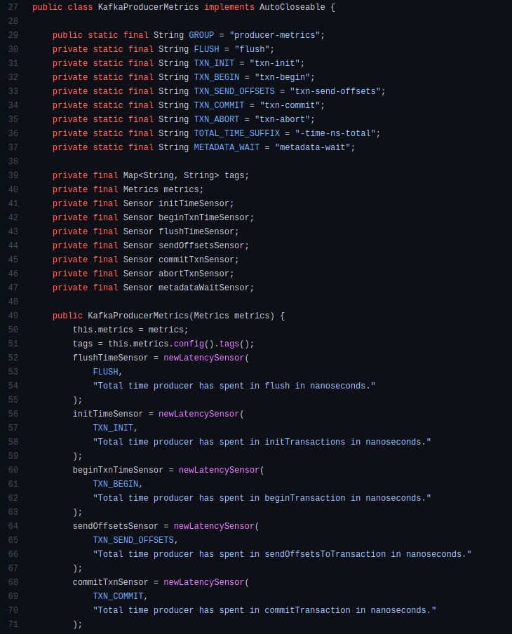

---

## Trang 6: Congrats! You can write clean code!

Congrats! You can write clean code!

---

## Trang 7: 1.1. Why Clean Code?

### 1.1. Why Clean Code?
“If you think good architecture is expensive,
try bad architecture”
- Brian Foote and Joseph Yoder
Software Development Problems:
- Buggy
- Slow to market

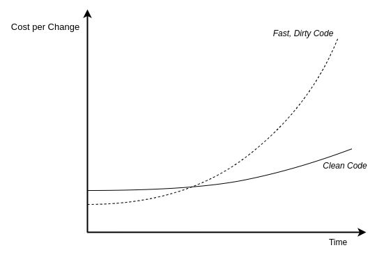

---

## Trang 8: 1.2. What is Clean Code?

### 1.2. What is Clean Code?
Clean code is code that very easy to understand and change

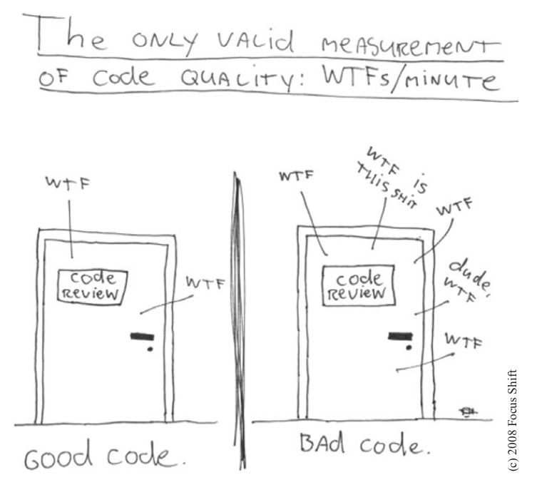

---

## Trang 9: 1.3. Objectives/Mindset

### 1.3. Objectives/Mindset
Fourable:
- Readable
- Maintainable
- Testable
- Scalable
Objectives: same to clean architect
“to minimize the human resources required to build and maintain the required system”
Trade-offs:
- Clean Code vs Performance
- Clean Code vs Speed of Market Delivery

---

## Trang 10: 1.4. Causes of Code Smell

### 1.4. Causes of Code Smell

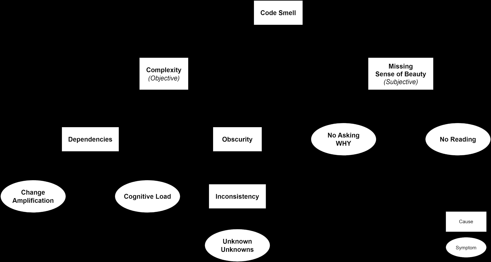

---

## Trang 11: 1.5. How To Write Clean Code

### 1.5. How To Write Clean Code
Practice Ways:
- Read → Got the sense of beauty
  - Codes of others (distinguish clean code vs smell code)
  - Books (Tech & Non-Tech)
- Be Disciplined and Be pragmatic
  - Think of objectives, principles and conventions first
- Practices → Handle with complexity
  - Understand fundamentals and the domain
  - Fix symptoms
  - Refactor frequently
  - Pair programming
Abstract Ways:
- Easy to understand: Naming, Conventions, Format, Code Review, Static Scanning, …
- Easy to change: Principles, Design Patterns, Unit Test, Refactoring, …

---

## Trang 12: 1.6. Principles

### 1.6. Principles
- KISS
  - Break down the problem into small enough or understandable enough pieces
  - Don’t start with over-engineering
- SOLID
  - Single Responsibility Principle
  - Open-Closed Principle
  - Liskov Substitution Principle
  - Interface Segregation Principle
  - Dependency Inversion Principle
  - “If the Open-Closed Principle states the goal of OO architecture,
the Dependency Inversion Principle states the primary mechanism”

---

## Trang 13: 2. Practices

### 2. Practices

---

## Trang 14: 2.0. Coding Steps

### 2.0. Coding Steps
### 1. Abstract the main steps
### 2. Write code according to the main steps
### 3. Before running and self-testing, review code again and
refactor partially.
### 4. Self-test & unit test → OK
### 5. Merge Request (minor) → Tester test
### 6. Optional: refactor
a. Clean
b. Performance

---

## Trang 15: 2.1. Name Things

### 2.1. Name Things
- “There are only two hard things in Computer Science:
cache invalidation and naming things” - Phil Karlton
- Meaningful names
  - Simple: a noun that express its function/goal
■ DiscountCalculator
  - Distinction
■ Using attribute
- Interface: Cache
- Impl: LocalCache, RemoteCache
  - Avoid vague names. Ex:
■ Data
■ Msg1, msg2

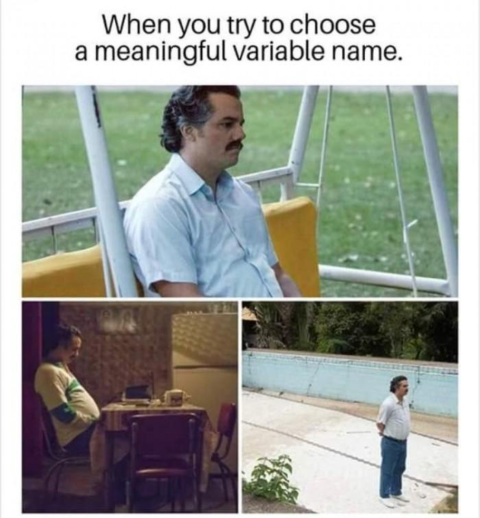

---

## Trang 16: 2.1. Name Things

### 2.1. Name Things
- Exercise:
boolean scope = checkScope();
boolean isScope = checkScope();
- Use pronounceable names
- Don't use prefix to the name of container
- Consistent Spelling

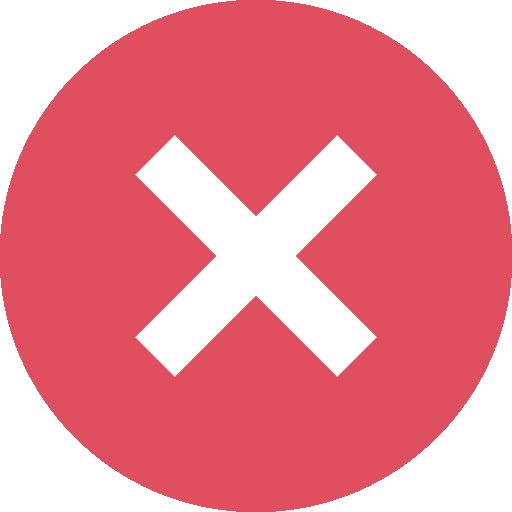

---

## Trang 17: 2.2. Function

### 2.2. Function
- Top to Bottom Rule, Tell a story → Easy to read
- Do one thing, SRP → Easy to maintain
  - Have no side effects
  - Command Query Separation
- Keep it small → Easy to test
  - <= 40 lines
  - 1 switch-case
  - <= 3 params
- Prefer pure functions
- Avoid deep nesting: condition nesting, callback nesting, …
- Don’t repeat yourself → Avoid duplication

---

## Trang 18: 2.3. Class

### 2.3. Class
- Keep it small
- Single Responsibility Principle
  - To find out if class has too much
responsibility is how it is named
- Open-Closed Principle - Organizing for Change
  - An existing class A is used to generate SQL
select statement
  - Requirement: Generating SQL update
statement
  - Approach: Creating a subclass B of class A

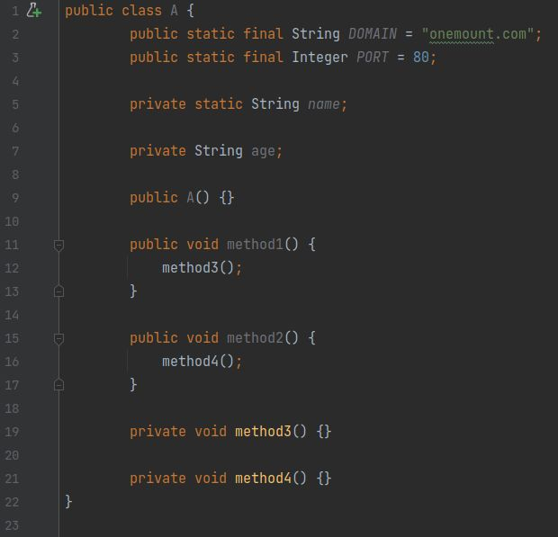

---

## Trang 19: 2.4. Abstract

### 2.4. Abstract
Step 1. prepare
Step 2. bake
Step 3. Box
Step 2.1. heat
Step 2.2. bake

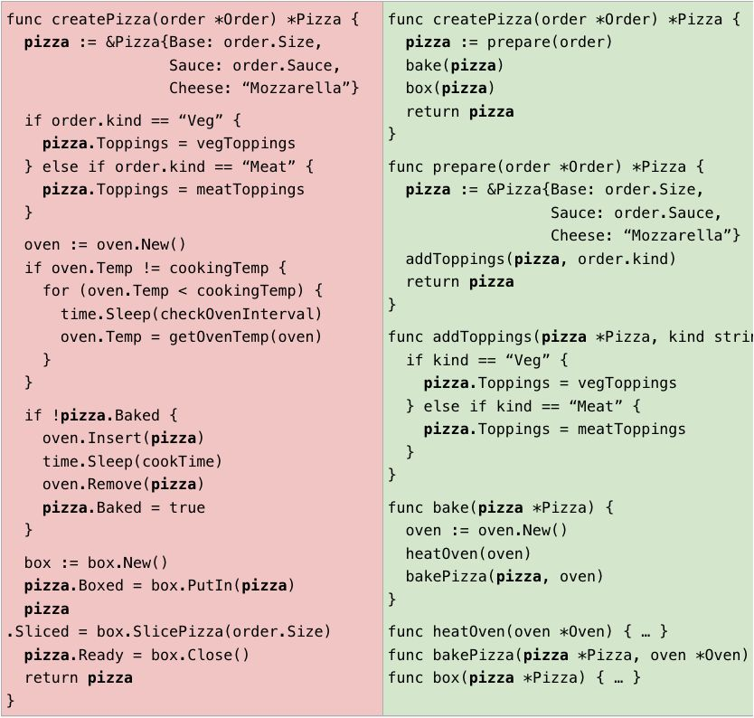

---

## Trang 20: 2.5. Simplify Your Control Flow

### 2.5. Simplify Your Control Flow
- Early returns to handle edge/corner cases

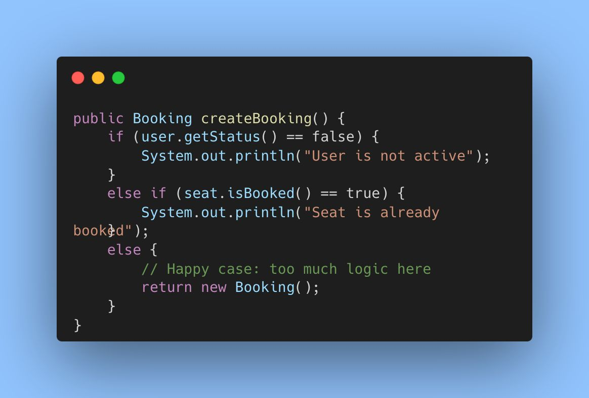

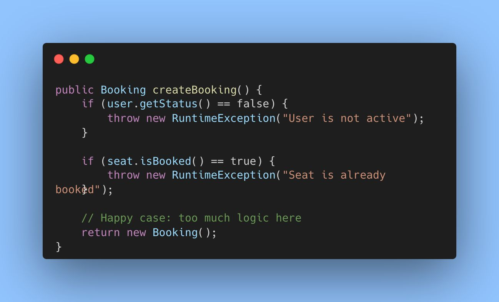

---

## Trang 21: 2.5. Simplify Your Control Flow

### 2.5. Simplify Your Control Flow

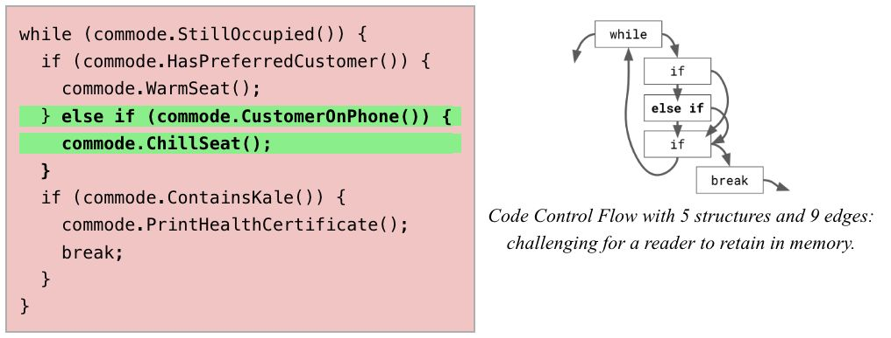

---

## Trang 22: 2.5. Simplify Your Control Flow

### 2.5. Simplify Your Control Flow

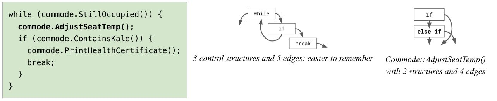

---

## Trang 23: 2.6. Error Handling

### 2.6. Error Handling
- Write try-catch-final statement first
- Try blocks should be treated like transactions
- Catch blocks leaves your code in a consistent
state
- Provide context with exceptions,
add error messages:
  - Type of failure, level
  - Where failed: subject + verb + object
  - Why it did
- Checked Exception vs Unchecked exception
- Centralized Handling
Checked Exception Unchecked exception
Definitio
n
- Checked at compile time.
- Represent errors outside the
control of the program.
- If some code within a method
throws a checked exception,
then the method must either
handle the exception or it
must specify the exception
using the throws keyword
- Unchecked at compile time.
- Reflect errors inside the
program logic
- Don’t have to declare
unchecked exceptions in a
method with throws
keyword
Pros ● Remind of handling
exceptions
- Preserve encapsulation
- Low Cost
Cons ● Violate Open/Closed Principle
- Break encapsulation
- Forget to handle exceptions
When to
use
Building a critical library Building general, robust apps

---

## Trang 24: 2.7. Comments & Formating

### 2.7. Comments & Formating
- Comments:
  - Do:
■ Complex algorithms
■ Summaries on interfaces
  - Don’t:
■ Explain methods → Self-explain
- Formating:
  - Linting

---

## Trang 25: 2.8. Test

### 2.8. Test
- Include only relevant details in tests
- Don’t overuse mocks in tests

---

## Trang 26: 2.9. Boundary

### 2.9. Boundary
- Boundaries are points within your code where
it meets others’ code.
A boundary is an unpredictable area.
- Avoid passing a third party object around within
your own system
- Do not return a function from it or accept it as an
argument to your public APIs
- Buffer code boundaries using adapters
  - Limiting dependency on external software
  - Future maintenance will be easier
- Write tests that explore your understanding of such
codes based on its intended usage (learning tests)

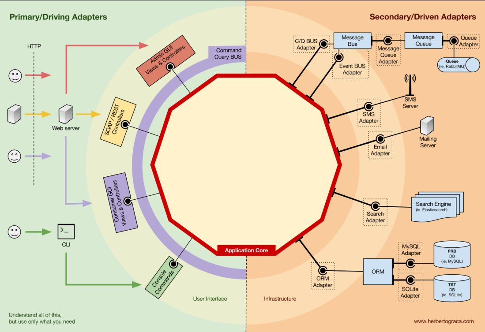

---

## Trang 27: 2.10. Refactoring

### 2.10. Refactoring
- Techniques:
  - Composing Methods
  - Moving features between objects
  - Organizing Data
  - Dealing with generalization
- Best Practices:
  - 3 in-depth classes
  - 10 files
  - Unit tests

---

## Trang 28: 3. Code Review

### 3. Code Review

---

## Trang 29: 3.1. The Goal of Code Review

### 3.1. The Goal of Code Review
- Quality Control
  - Products
  - Codebase
- Self Growth
  - Hard Skills
  - Soft Skills
■ Presentation
■ Listening

---

## Trang 30: 3.2. Code Review Points

### 3.2. Code Review Points
- Functionality
- Design
- Readability
- Consistency
- Testing
- Documentation
- Good Things

---

## Trang 31: 3.3. Code Review Process

### 3.3. Code Review Process
- Types:
  - Peer Review: Minor Changes
  - Group Review: Major Changes
- Process:
### 1. Reviewee (developer) completes feature / fix bugs
### 2. Reviewee create MR (with context)
### 3. Reviewee make sure that code is compiled, tested successfully
### 4. Reviewee inform reviewer(s) to schedule code review
### 5. Reviewer create checklist
### 6. (optional) Reviewee implements fixes that is agreed in both sides
### 7. Reviewer approves MR

---

## Trang 32: 3.4. Attitude

### 3.4. Attitude
- Polite
- Contribution
- Education without criticism

---

## Trang 33: 3.5. How to Write Code Review Comments

### 3.5. How to Write Code Review Comments
- Be Polite
- Tell why
- Show approaches
- Labeling comments:
  - TODO (Critical)
  - NIT (Nitpick)
  - OPTIONAL
  - FYI (For Your Information)

---

## Trang 34: 3.6. Best Practices

### 3.6. Best Practices
- Less is more. Small Commit → Short Review → Better Code
  - Google: ~250 lines of code / CR
  - < 400 lines of code / CR
- Checklist
- Leverage Tools such as Static Code Analysis
- Speed up code review

---

## Trang 35: 3.7. Resolving Conflicts

### 3.7. Resolving Conflicts
- Listen and understand ideas of both sides
- Analyse pros and cons of solutions
- Determine the context
  - Ordering the priorities of characteristics,
requirements at the moment
- Choose the right solution according to the context
  - PoC (Proof of Concept)
  - Expose the problem to:
■ The whole team
■ Tech Lead / SA
■ Head of Engineer
- What if both sides still have no same view?

---

## Trang 36: Recap

### Recap
- Fourable:
  - Readable
  - Maintainable
  - Testable
  - Scalable
- Abstraction reduces complexity
- Inconsistency → Unknown unknowns
- Read, practice and practice
- Clean Code is not goal, consider other factors: speed of market delivery, collaboration, …

---

## Trang 37: References

### References
- 2 Hard Things: https://martinfowler.com/bliki/TwoHardThings.html
- Quotes: Quotes on Design -
- Principles:
  - SOLID: https://www.freecodecamp.org/news/solid-principles-explained-in-plain-english/
  - KISS: https://people.apache.org/~fhanik/kiss.html
- Books:
  - Best tips and tricks in the world of Clean Coding: https://libgen.rocks/ads.php?md5=481473f6104d2f187dfcc11c340ca4f3
  - Clean Code: https://libgen.rocks/ads.php?md5=838cc6ac8cb0d8ddb98fdb1ae0c8a443
  - https://testing.googleblog.com/2023/11/write-clean-code-to-reduce-cognitive.html
- Talks:
  - https://www.youtube.com/watch?v=YtQGQ9Eg0Lo
  - https://www.youtube.com/watch?v=UjhX2sVf0eg
  - https://www.youtube.com/watch?v=c40HPauhawQ

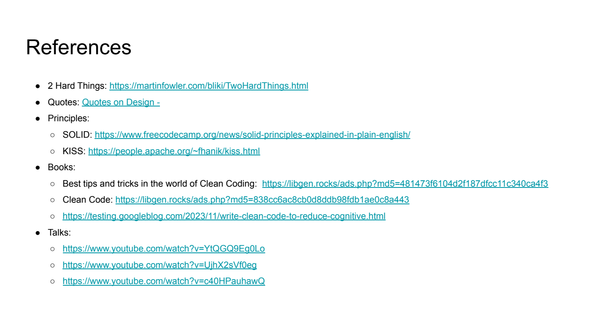

---

## Trang 38: Homework

### Homework
- Refactor then show >= 300 lines of code in your
project ? (any project).
- Nice to have:
  - Multiple class
  - Functions
  - Domain business or complex logic
  - The less comments, the better
- Note:
  - Do not include trivial code such as getter,
setter, …
  - Do not include sensitive info of
projects/companies

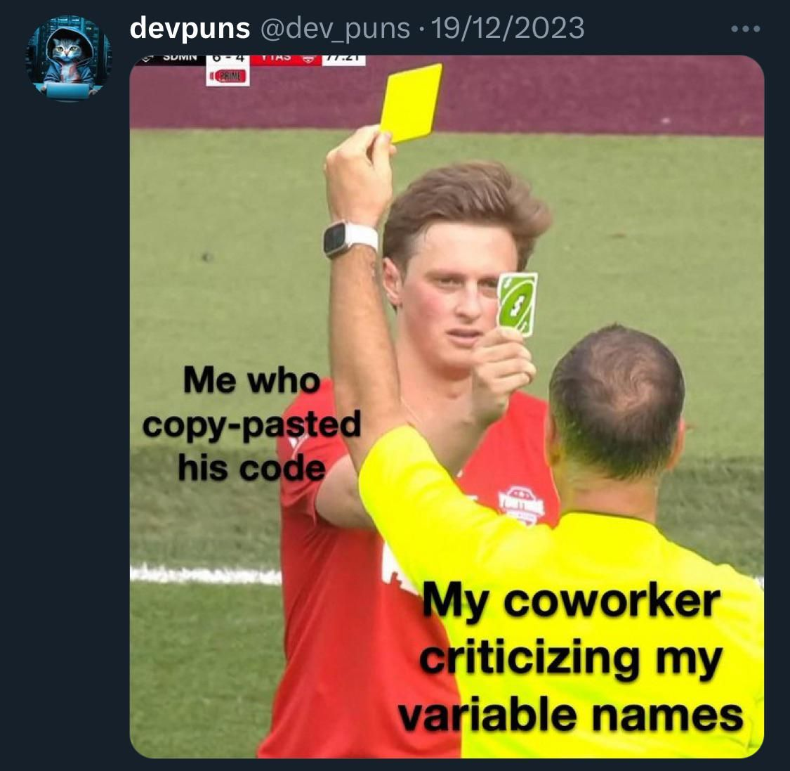

---

## Trang 39: Thank you

Thank you

---
