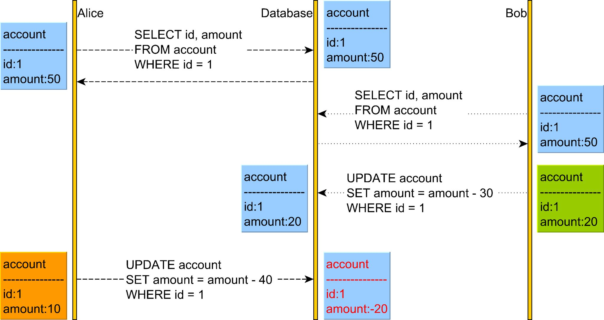
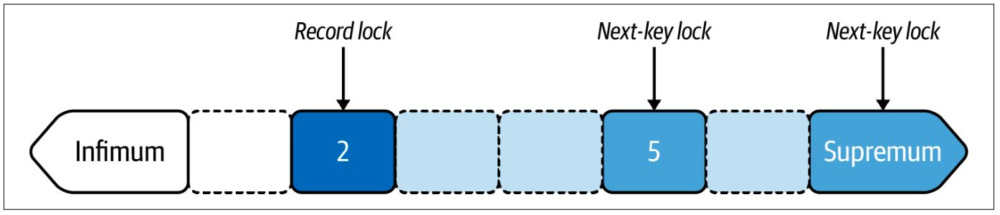
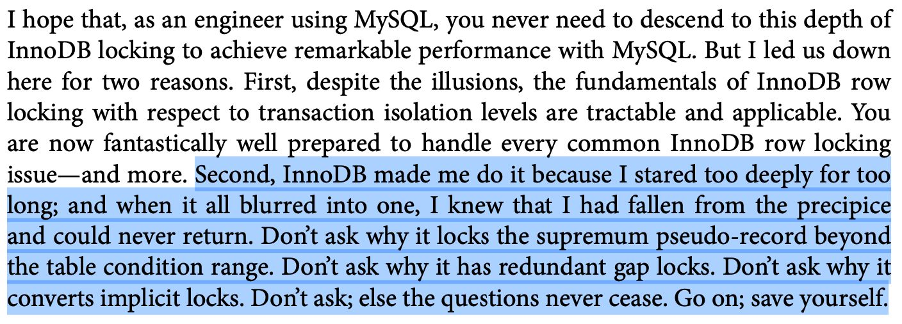
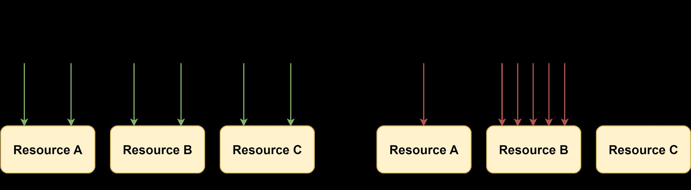
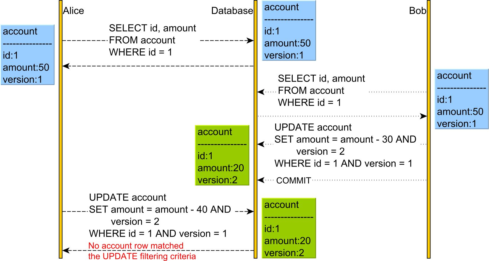

# 14. Locking

> **Tổng số trang:** 24 slide | **Thư mục ảnh/sơ đồ:** `assets/14_Locking/`

---

## Trang 1: Locking

### Locking
Nhiều vấn đề nó nằm ở tâm lý,
những cái định kiến sẽ là rào cản tâm lý.

---

## Trang 2: 3.1. Problem Context

### 3.1. Problem Context
Context: Fund Transfer (write operation)
Problem: Race Condition
Ordering in Concurrency
- Balance of A: 50
- 2 requests at the same time
  - A → B: 30
  - A → C: 40
- A: 50 - 30 = 20 → 20 - 40 = -20 (X)
- Valid balance of A >= 0
→ Locking

---

## Trang 3: 3.2.1. Types of Locks in MySQL

### 3.2.1. Types of Locks in MySQL
Classified based on operation-level:
- Shared (Read): Allow to read but lock to write
- Exclusive (Update): Lock to read and write
Shared (S) Exclusive (X)
Shared (S)
Exclusive (X)
Example 1:
### 1. Transaction A locks row X for read (S)
### 2. Transaction B can lock row X for read (S)
Example 2:
### 1. Transaction A locks row X for read (S)
### 2. Transaction B can’t lock row X for update (X)
Example 3:
### 1. Transaction A locks row X for update (X)
### 2. Transaction B can’t lock row X for read (S)

---

## Trang 4: Question: What is operation type of lock

### Question: What is operation type of lock
used to solve the problem?

---

## Trang 5: Question: What is operation type of lock

### Question: What is operation type of lock
used to solve the problem?
Answer: Exclusive Lock (SELECT … FOR UPDATE)

---

## Trang 6: 3.2.2. Types of Locks in MySQL

### 3.2.2. Types of Locks in MySQL
Classified based on row-level (MySQL):
- Global Lock
- Table Lock
  - Lock table. Example: lock tables <table_name> read
  - Intention Lock
  - AUTO-INC lock is a special table lock mechanism
■ Is improved in new versions
- Row Level
  - Record lock
  - Gap Lock
  - Next-Key Lock
  - Insert Intention Lock

---

## Trang 7: 3.3. Row Lock

### 3.3. Row Lock
Lock Abbreviation Locks gap Description
Record lock REC_NOT_GAP Locks a single record
Gaplock GAP Locks the gap before (less than) a record
Next-key lock Locks a single record and the gap before it
Insert intention lock INSERT_INTENTION Allows INSERT into gap
update account_balance set balance = balance + 10
where account_number between 2 and 5;

---

## Trang 8: Question: What is type of row lock

### Question: What is type of row lock
used to solve the problem?

---

## Trang 9: Question: What is type of row lock

### Question: What is type of row lock
used to solve the problem?
Answer: Record lock
- locking a single record at a time.

---

## Trang 10: 3.4. Query to show lock info

### 3.4. Query to show lock info
SELECT thread_id, index_name, lock_type, lock_mode, lock_status, lock_data
FROM performance_schema.data_locks
WHERE object_name = ‘<table_name>’;

---

## Trang 11: 3.6. Go on; Save Yourself

### 3.6. Go on; Save Yourself
Efficient MySQL Performance - Daniel Nichter
This is blackbox!
Brief answer: to ensure Repeatable Read isolation level
Why it locks redundant rows?

---

## Trang 12: 3.7. Lock Contention

### 3.7. Lock Contention

---

## Trang 13: 3.8. Pessimistic Locking vs Optimistic Locking

### 3.8. Pessimistic Locking vs Optimistic Locking
(classified by implementation)

---

## Trang 14: 3.8.1. Pessimistic Locking

### 3.8.1. Pessimistic Locking
- Pessimistic Locking avoids conflicts by using locking
- Example:
  - SELECT … FOR SHARE;
  - SELECT … FOR UPDATE;
  - Keyword synchronized (heavy weight)
- Pros:
  - Data Integrity
- Cons:
  - Heavyweight Lock: Concurrency bottlenecks in low contention
  - Potential Deadlocks
- Use case: high concurrency + high contention

---

## Trang 15: 3.8.2. Optimistic Locking

### 3.8.2. Optimistic Locking
- No locks, allows a conflict to occur,
but it needs to detect, resolve it at write time.
- Implementation:
  - Compare And Swap (CAS)
■ Version
  - Timestamp (not recommended)

---

## Trang 16: 3.8.2. Optimistic Locking

### 3.8.2. Optimistic Locking
- Pros:
  - Lightweight Lock: Reduced Lock Overhead
→ Higher Concurrency
  - Avoid Deadlocks
- Cons:
  - Risk of Conflicts. If handling multiple requests
concurrently, then just one request will be processed
successfully, others will be rejected.
  - Conflict Resolution may be complex.
- Use case: High concurrency + low contention

---

## Trang 17: 4. Practices

### 4. Practices

---

## Trang 18: 4.1. Implement Optimistic Locking

### 4.1. Implement Optimistic Locking
- Add version column
- SELECT to get current info
- Update and increase version by 1
(version++)
- SET amount = <new_value>,
version = <new_version>
WHERE id = <id>
AND version = <old_version>
- Note: this acquires a lock for a
row while updating the row only

---

## Trang 19: 4.2. Notes

### 4.2. Notes
- Transaction and Locking are 2 different mechanism solving 2 different problems
- DB has its own locking mechanism != programming language’s locking mechanism.
- …

---

## Trang 20: 4.3. Best Practices

### 4.3. Best Practices
- Subtract first, add later
- Use record lock by leveraging primary key
- Avoid to use secondary index in UPDATE
- Examine row locks
- Leverage Optimistic Locking
- Combine Distributed Locking + Optimistic Locking
- …

---

## Trang 21: Recap

### Recap
- When mention to ordering, remember queue and locking.
Locking solve the race condition problem.
- Low contention vs High contention.
- Pessimistic Locking are quite costly.
Leverage Optimistic Locking.

---

## Trang 22: Homework

### Homework
- Implement flight booking
  - Logic
■ Create a booking
■ Decrease the number of available seats in a flight
  - Using locking mechanisms
■ Basic:
- Pessimistic Locking Only in DB
■ Advanced: combine
- Optimistic Locking (version)
- Distributed Lock
- 4 conditions for deadlock → simple way to avoid deadlock.

---

## Trang 23: References

### References
- https://blog.lawrencejones.dev/state-machines/index.html
- https://vladmihalcea.com/optimistic-vs-pessimistic-locking/
- https://faculty.kutztown.edu/schwesin/spring2022/csc343/lectures/Locking.pdf

---

## Trang 24: Thank you

Thank you

---
