# 15. Operating System

> **Tổng số trang:** 49 slide | **Thư mục ảnh/sơ đồ:** `assets/15_Operating_System/`

---

## Trang 1: Operating System

### Operating System
“Nên tránh những cuộc tranh luận
không có tính xây dựng, vô bổ”

---

## Trang 2: Outline

### Outline
### 1. Introduction
  - Operating System
  - Kernel
### 2. Core Functions
  - Process Management
  - Memory Management
  - I/O
  - Bottlenecks
### 3. Shell Script

---

## Trang 3: 1. Introduction

### 1. Introduction

---

## Trang 4: 1.1. Operating System

### 1.1. Operating System
- Operating System (OS) is system software that
manages hardware and software resources and
provides common services for programs
- OS is acts as a bridge between hardware and
user. It provides a user interface and controls the
hardware so that software can function

---

## Trang 5: 1.2. Kernel*

### 1.2. Kernel*
- The core of the operating system is the kernel.
- A bridge between applications and hardware
devices.
- Kernel is programs.
- Why Kernel?
  - Computers are composed of various
hardware devices: CPU, mem, disk, network,
…
  - Every app implement communication protocol
with hardware devices

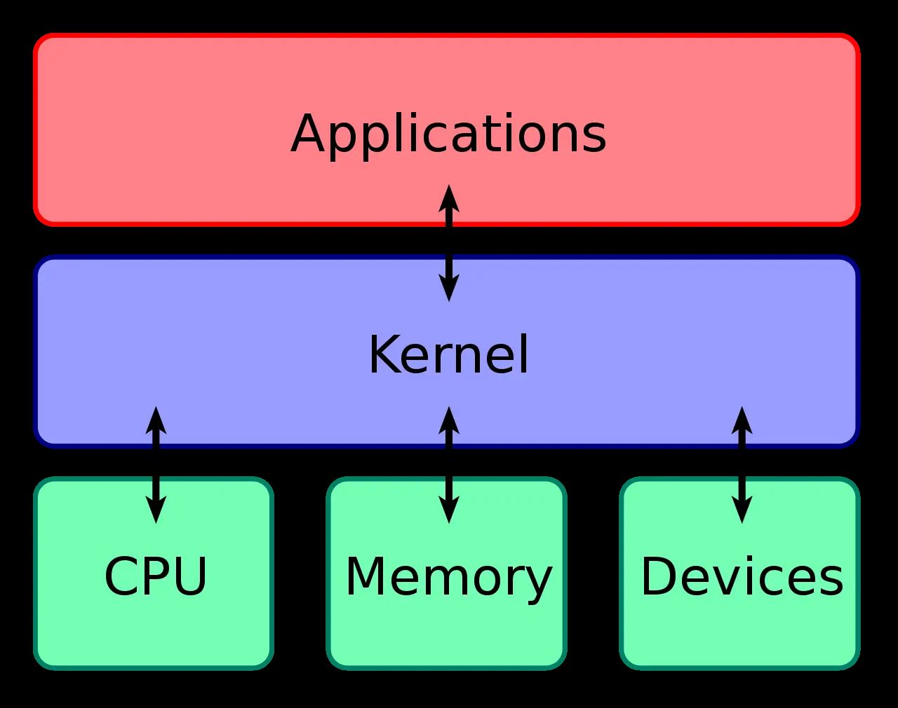

---

## Trang 6: 1.2. Kernel

### 1.2. Kernel
- Applications only need to care about interacting
with the kernel.
- The kernel has very high permissions and can
control hardware such as CPU, memory, hard
disk, etc. While applications have very small
permissions.

---

## Trang 7: 1.3. How The Kernel Works?*

### 1.3. How The Kernel Works?*
- Most operating systems divide the memory into two areas:
  - Kernel space: this memory space can only be accessed by kernel programs
  - User space: this memory space is exclusively used by applications
- When a program uses kernel space, the program is executed in kernel mode.
- When an application uses a system call, an interrupt is generated. After an interrupt occurs,
CPU will execute the kernel program.

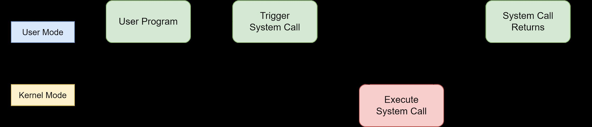

---

## Trang 8: 1.4. What Capabilities Does the Kernel Have?

### 1.4. What Capabilities Does the Kernel Have?
- Manage processes and threads
- Manage memory
- Manage hardware devices
- Provide system calls. If the application wants to run
services that run with higher privileges, then a
system call is required

---

## Trang 9: 1.5. Linux Design

### 1.5. Linux Design
- MultiTask: multiple tasks can be executed at the same time
- SMP (Symmetric Multiprocessing): each CPU has an equal status and has the same rights to use
resources.
- ELF: Executable File Link Format. is the storage format of executable files in the Linux operating
system
- Monolithic Kernel (Macro kernel): all modules of the system kernel run in the kernel state.
- Linux is a macro kernel, Window is a hybrid kernel.

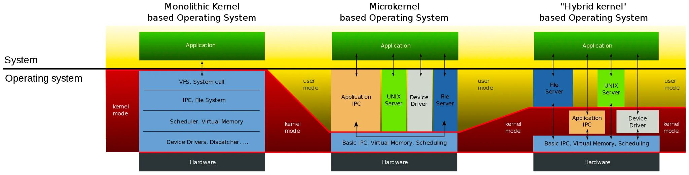

---

## Trang 10: 2. Process Management

### 2. Process Management

---

## Trang 11: 2.1. Concepts

### 2.1. Concepts
- Program: An executable file that contains code and
is stored as a file on disk
- Process: When we run the program file, it will be
loaded into memory and CPU will execute each
instructions in the program
- Thread: A thread is an execution flow within a
process.

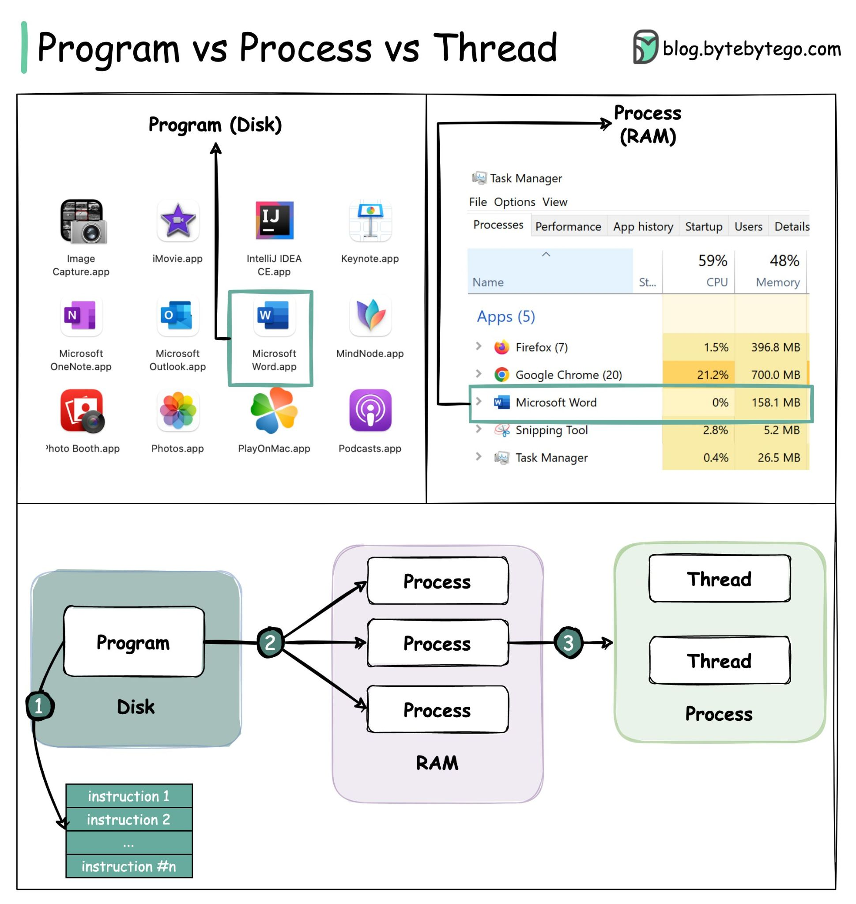

---

## Trang 12: 2.2. Process

### 2.2. Process
- Although a single-core CPU can only run one
process at a certain moment. But during 1 second,
it may be running multiple processes. This is called
concurrency.
- The process control block (PCB) data structure is
used to describe the process:
  - Process ID
  - User Id
  - Current Status
  - Priority
  - Memory address space, opened files, …
  - The values of each register in CPU

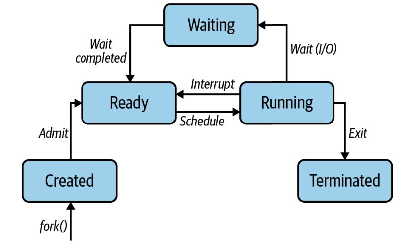

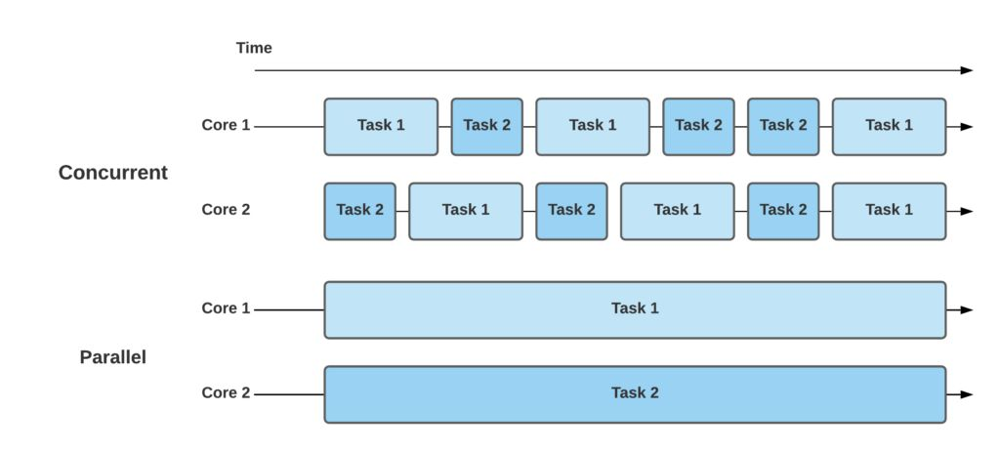

---

## Trang 13: 2.3. Process Context Switching

### 2.3. Process Context Switching
- Before each task is run, the CPU needs to know where the task is loaded and where it starts to run.
  - The CPU register
  - The program counter (PC) is used to store the location of the next instruction to be executed.
- Context Switching is very critical.

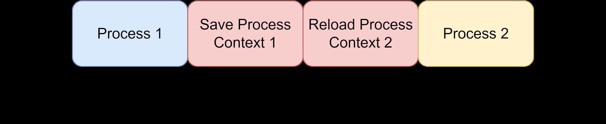

---

## Trang 14: 2.4. Thread

### 2.4. Thread
- A thread is an execution flow within a process.
- A process can have multiple threads. Each thread
can execute concurrently
- Multiple threads in the same process can share
resources such as code segments, data process
(heap), open files, etc.
- Each thread has an independent set of registers
and stacks
- The context switching between threads is
much cheaper than between processes.

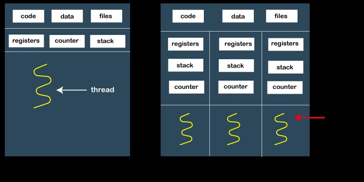

---

## Trang 15: 2.5. Principle

### 2.5. Principle
- For one core, executing A and B sequentially will always be faster than executing A and B
concurrently through time-slicing.

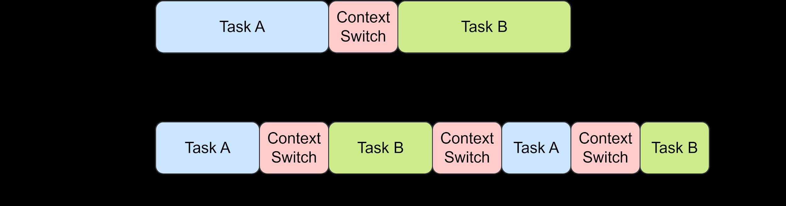

---

## Trang 16: 2. Memory Management

### 2. Memory Management

---

## Trang 17: 2.1. Problem of Memory Management

### 2.1. Problem of Memory Management
Problem:
- Two programs use the same memory space.
- The first program writes a new value at location
0x00002000. The second program overwrite value
at that location → Conflict

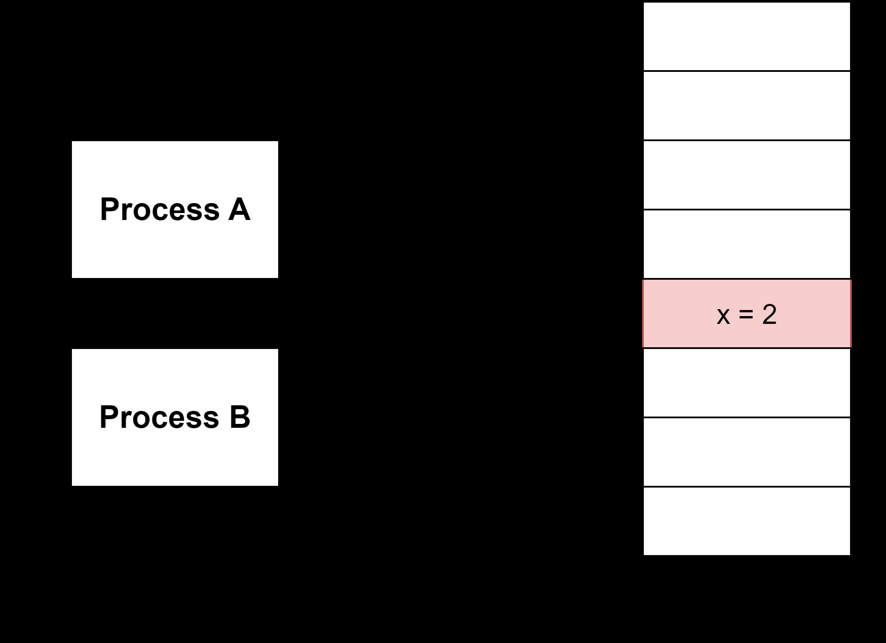

---

## Trang 18: 2.2. Virtual Memory

### 2.2. Virtual Memory
Solution: Virtual Memory
- Virtual Memory Address: each program has its
own virtual address space
- Physical Memory Address: the address space
exists in the hardware actually
- The virtual address is converted into a physical
address using the Memory Management Unit
(MMU) in the CPU chip.
- Entries in the page table also have some bits that
mark attributes, such as controlling the read and
write permissions of a page → better security

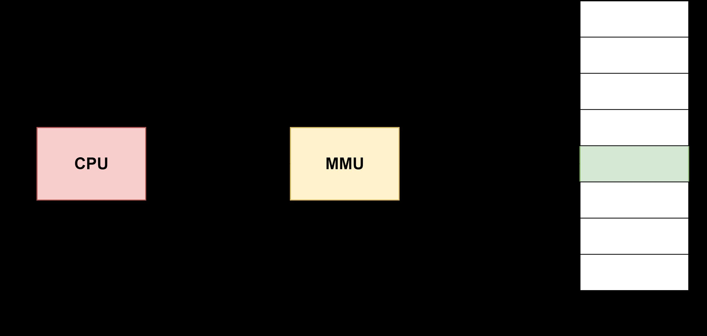

---

## Trang 19: 2.2. Virtual Memory

### 2.2. Virtual Memory

---

## Trang 20: 2.3. Problem of Virtual Memory

### 2.3. Problem of Virtual Memory
- Problem: processes can use more running
memory than the physical memory size

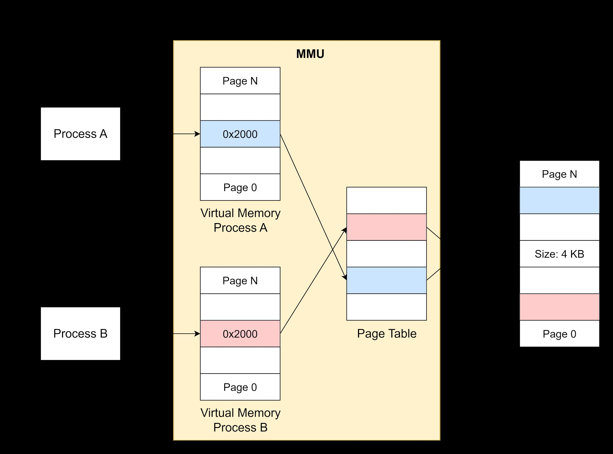

---

## Trang 21: 2.3. Swap Partition

### 2.3. Swap Partition
Solution: Reclaiming memory
- Virtual Memory = Physical Memory + Swap
memory (hard disk memory)
- For those memories that are not frequently used,
we can Swap it out of physical memory, such as
the swap area on the hard disk.
- Drawback?
- Performance impacts

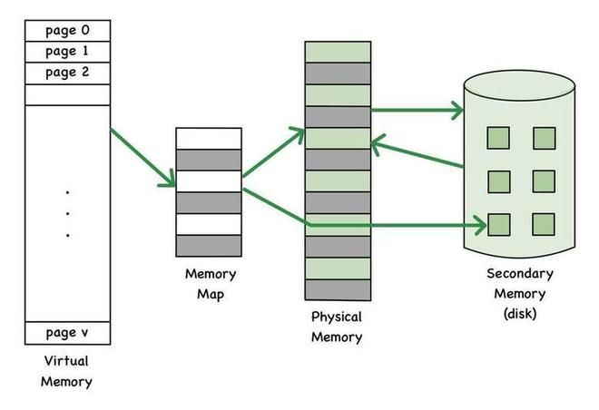

---

## Trang 22: 2.4. Memory Model*

### 2.4. Memory Model*
- Hot data or share data in memory could have a copy in L1, L2, L3 cache.
- Data in L1 - Core 1 and L1 - Core 3 and Memory might be different.
→ need a sync mechanism.

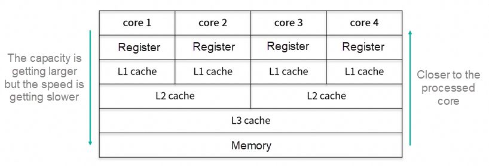

---

## Trang 23: 3. I/O

### 3. I/O

---

## Trang 24: 3.1. What is I/O operation?*

### 3.1. What is I/O operation?*
- I/O operation: transferring data between a computer and
the external environment.
- Types:
  - Disk I/O
  - Network I/O
  - Peripheral I/O: keyboards, mice, printers, …
- Accessing RAM is not a I/O operation

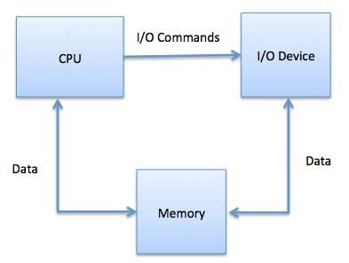

---

## Trang 25: 3.2. Bottlenecks*

### 3.2. Bottlenecks*
- What are bottleneck groups that a backend app can have?
- Bottleneck groups can be:
  - CPU
■ Context switches
■ IO waits
  - Memory
■ Size
  - Disk
■ I/O:
- IOPS depends on hardware
- Sequential I/O >> Random I/O
■ Fragmentation
  - Network
■ Bandwidth
■ I/O models

---

## Trang 26: 3.3. How I/O Operations Work?

### 3.3. How I/O Operations Work?
### 1. An application makes a request for an I/O operation.
### 2. The application issues a system call to the OS, asking it to
perform the I/O operation.
### 3. The OS talk with the hardware through drivers/kernel
### 4. Data Transfer
### 5. Once the I/O operation is completed, the device informs
the CPU, through an interrupt.
### 6. Return Control to Application
- Note: Direct Memory Access (DMA) is a Hardware feature
to transfer data between memory and a peripheral device
without involving CPU

---

## Trang 27: 3.4. Why can I/O operations be bottlenecks*

### 3.4. Why can I/O operations be bottlenecks*
- Blocking I/O

---

## Trang 28: 3.5. Types of I/O Operations

### 3.5. Types of I/O Operations
Blocking Non-blocking

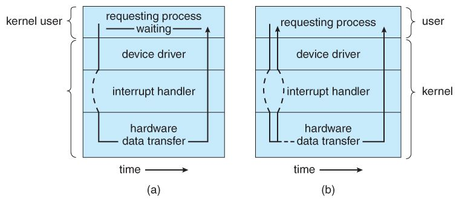

---

## Trang 29: 3.6. Non-Blocking I/O (Synchronous)

### 3.6. Non-Blocking I/O (Synchronous)

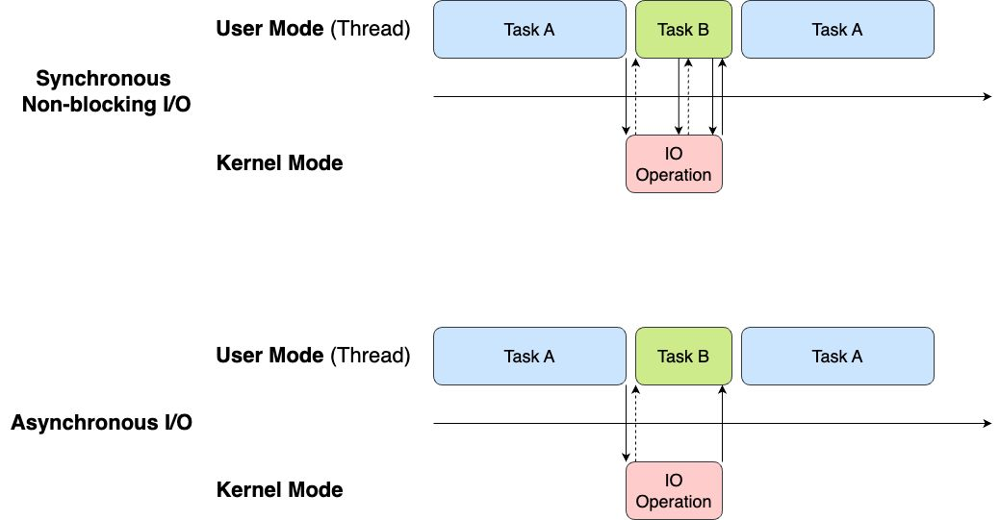

---

## Trang 30: 3.7. Blocking IO Implementation*

### 3.7. Blocking IO Implementation*

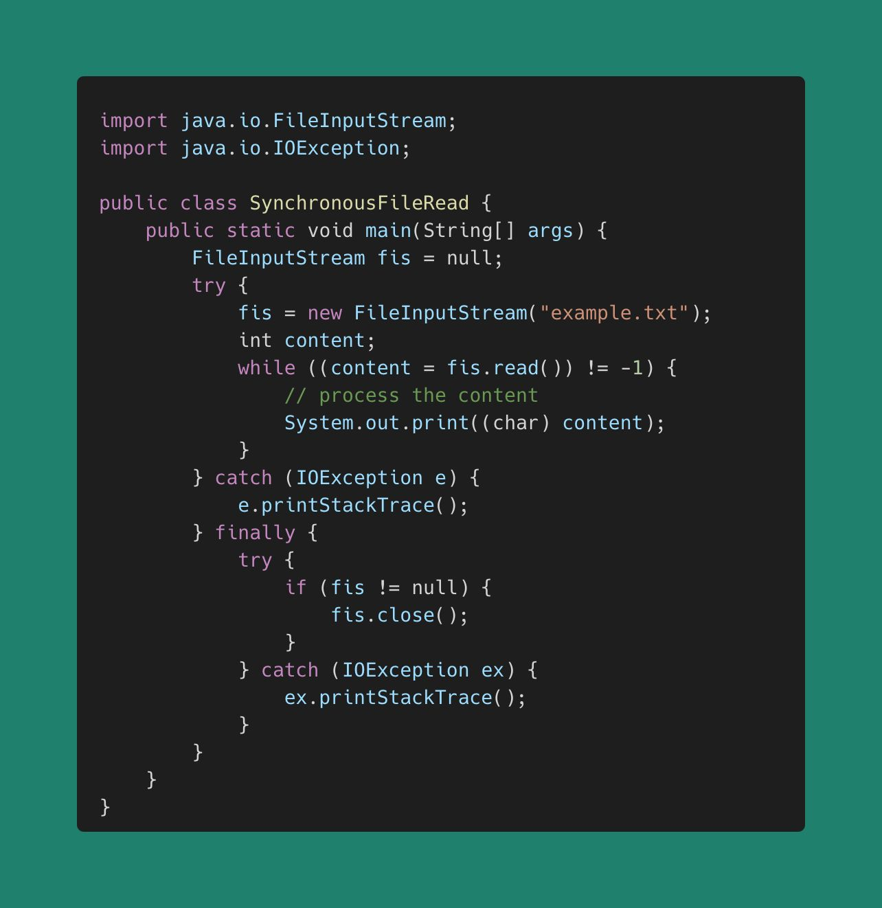

---

## Trang 31: 3.8. Nonblocking IO Implementation*

### 3.8. Nonblocking IO Implementation*

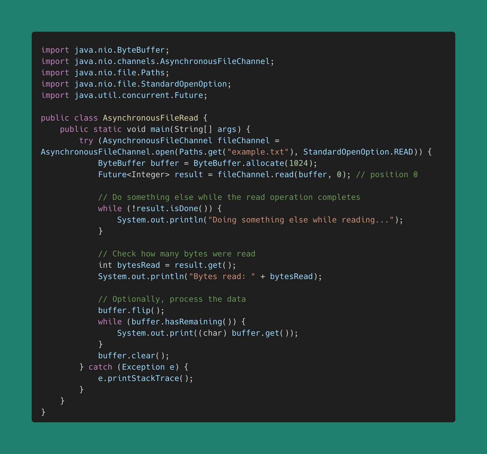

---

## Trang 32: 3.9. File Access*

### 3.9. File Access*
- A wide misconception: disks are slow
- Disk rotates in one direction
- Sequential access is much faster than random access
(x3 - 4), which jumps to many different locations on disk
- Understanding I/O: Random vs Sequential | flashdba
- Are Disk Accesses slow or fast?

---

## Trang 33: 4. File System

### 4. File System

---

## Trang 34: 4.1. Introduction*

### 4.1. Introduction*
- The file system is the subsystem of the OS
responsible for managing persistent data.
- In Linux, "Everything is a file."
- File descriptor is the identifier of a opening file, a
socket connection, device, pipe (IPC).
- There is a limited number of File Descriptors per
process, usually 1024 per process. But we can
configure it.

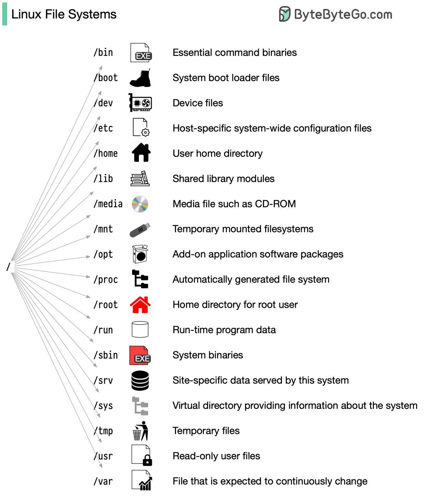

---

## Trang 35: 4.2. Inode

### 4.2. Inode
- Index nodes (Inodes) are used to record
meta-information of files, such as inode
number, file size, data location on disk, etc.
- The index node is the unique identifier of the
file.
- Directory entries (aka filenames) are used
to record file names, index node pointers, and
hierarchical relationships with other directory
entries.

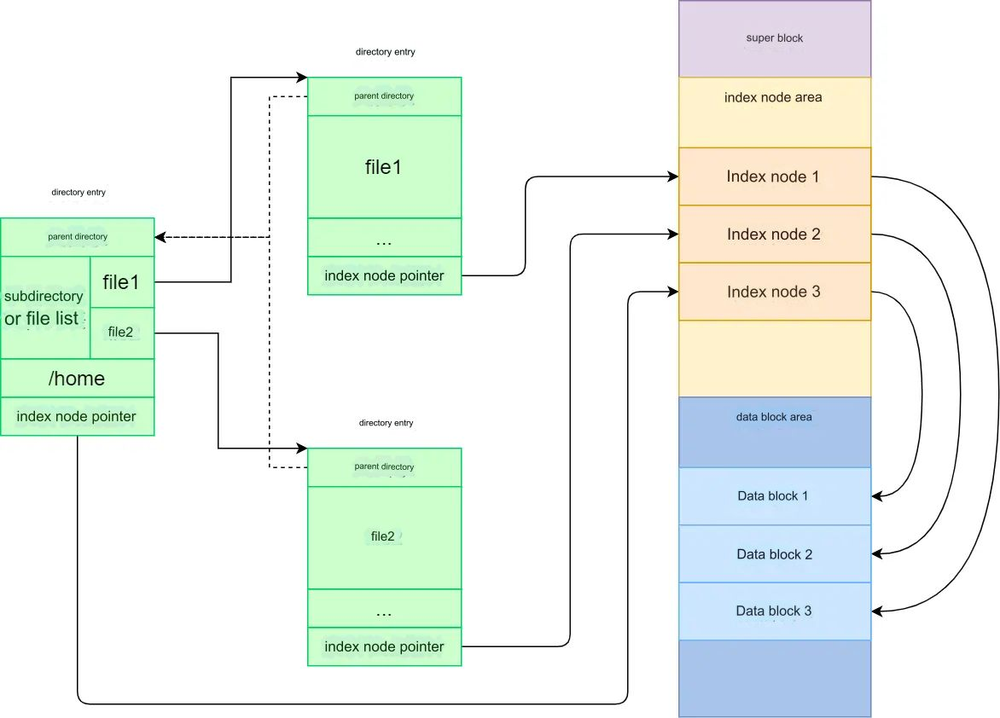

---

## Trang 36: 4.3. Hard Link

### 4.3. Hard Link
- A hard link: multiple filenames (directory entries) that
points to the same file (to the same inode) on disk.
- Inode Sharing: Hard links share the same inode number
as the original file
- Deleting a hard link does not delete the actual file data;
the data remains accessible as long as there is at least
one hard link or the original file name pointing to it.

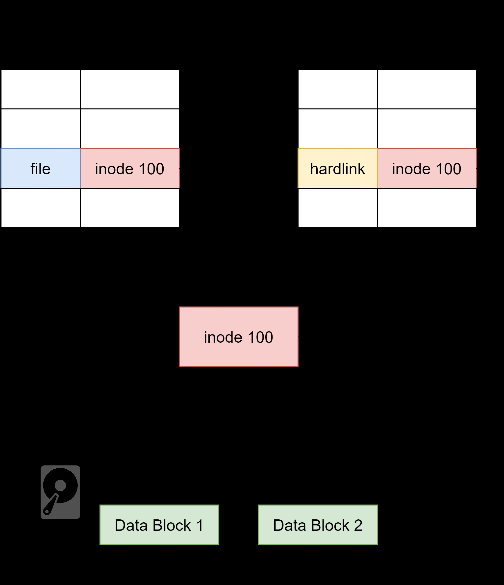

---

## Trang 37: 4.4. Soft Link

### 4.4. Soft Link
- A soft link is another file, a reference to another file
- Soft links have their own inode number and store
the path of the original file they link to.
- If the original file is deleted, moved, or renamed,
the soft link will break

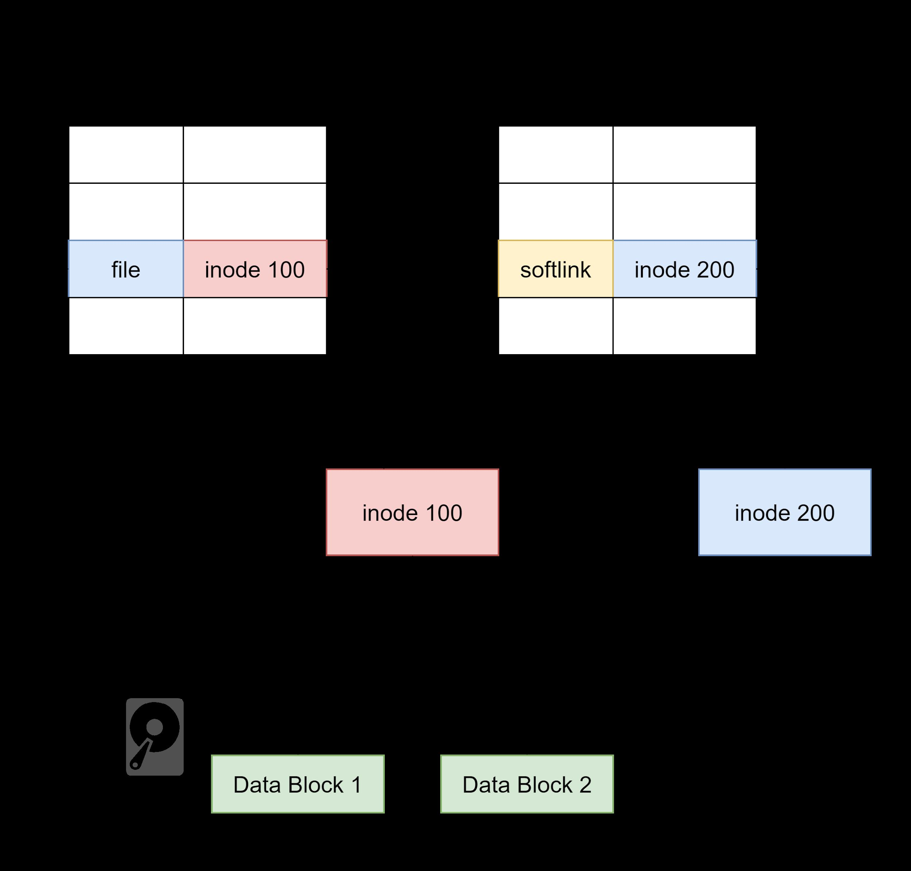

---

## Trang 38: 4.6. Access Control

### 4.6. Access Control
- Scopes of permissions:
  - User: The owner of the file
  - Group: Has one or more members
  - Other: The category for everyone else
- Types of access:
Permission Pattern Representation
None - - - 0
Execute - - x 1
Write - w - 2
Read r - - 4

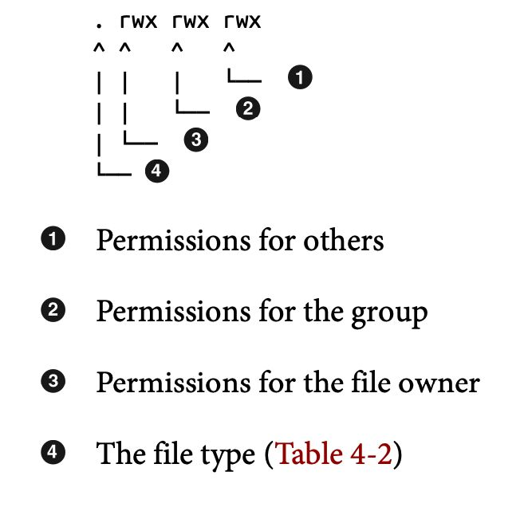

---

## Trang 39: 4.6. Access Control

### 4.6. Access Control
- Why 0, 1, 2, 4?
Permission Pattern Representation
None - - - 0
Execute - - x 1
Write - w - 2
Read r - - 4
- Deny all permissions: $ sudo chmod 000 <file_name>
- Ex 1:
  - User: full permissions
  - Group: read + execute
  - Other: deny all permissions

---

## Trang 40: 5. Linux Commands

### 5. Linux Commands

---

## Trang 41: 5.1. Common Commands

### 5.1. Common Commands
- head: shows the first lines of a file
- tail: shows the last lines of a file
- sed: stream editor
- awk: it's a programming language designed for text processing.
- curl: a tool to make HTTP requests.
- wget: a tool for retrieving files using HTTP, HTTPS , or FTP.
- …

---

## Trang 42: 5.2. Shell

### 5.2. Shell
- Shell: command-line
- Common types of shells on Linux:
  - sh
  - Bash (default)
  - Csh
  - Zsh (recommended)
- Exercise 1: Rename image files with date prefix

---

## Trang 43: 6. Network

### 6. Network

---

## Trang 44: 6.1. How Many Connections Can a Server Serve?*

### 6.1. How Many Connections Can a Server Serve?*
- It will be mainly limited by multiple factors:
  - File descriptor: The default value is 1024, but we can increase the number of file descriptors
  - System memory: each connection will occupy a certain amount of memory
  - Threading Design Pattern
- Traditional threading pattern: a connection → a thread.
  - A thread handles I/O operations, serialization, processing → it’s inefficient
  - If threads are frequently created and destroyed, the system overhead will be considerable.
→ Solution: thread pool, but it’s inefficient (the reason will be discussed later)
- Context switching between threads is still heavy.

---

## Trang 45: 6.2. Multiplexing I/O

### 6.2. Multiplexing I/O
- I/O multiplexing can handle the I/O of multiple
sockets/files in only one process.
- The process can obtain multiple events from the
kernel through a system call function epoll_wait()
- select/poll: When a network event occurs, the
kernel needs to traverse the process concerned
Socket collection
- epoll uses "red-black tree" + event-driven
mechanism

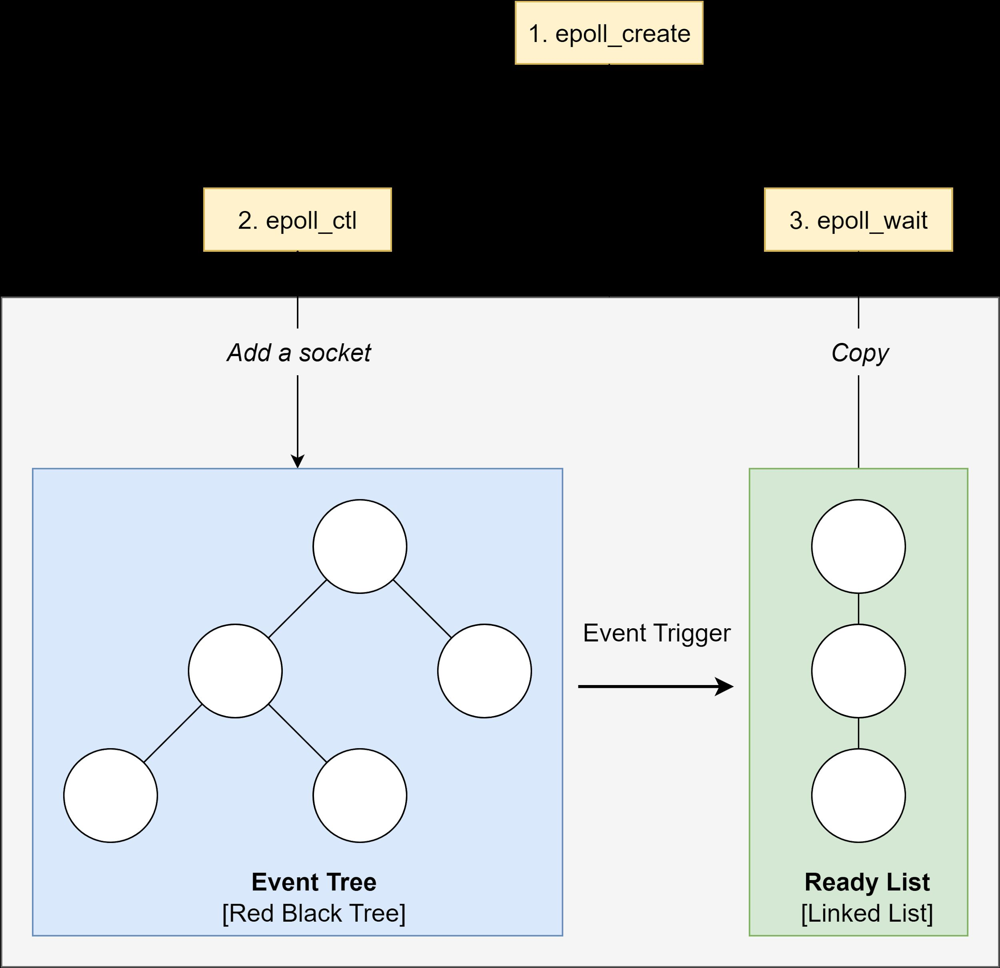

---

## Trang 46: Recap

### Recap
- Context switch is costly
  - System call (Kernel Mode)
  - For one core, executing A and B sequentially will always be faster than executing A and B
concurrently.
- Optimize I/O operations: Find how I/O operations work under lib?
  - Non-blocking >> Blocking
  - Disk: Sequential I/O >> Random I/O
  - Network: Multiplexing I/O
- In Linux, everything is file

---

## Trang 47: Homework

### Homework
- Exercise 1: Replace env var in a manifest file
  - “Image: $IMAGE_TAG” in file deployment.yaml
  - Replace $IMAGE_TAG by using sed, awk to edit
(value: ronin:v0.0.1)
- Exercise 2: Write shell script to open your workspace
  - Editor
  - Browser
  - Postman
  - Containers: mysql, redis, …
  - Ex: ./container.sh mysql up

---

## Trang 48: References

### References
- https://www.cs.uic.edu/~jbell/CourseNotes/OperatingSystems/13_IOSystems.html
- https://highscalability.com/big-list-of-20-common-bottlenecks/

---

## Trang 49: Thank you

Thank you

---
