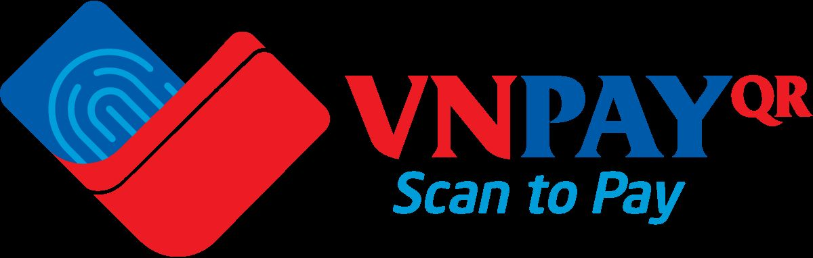
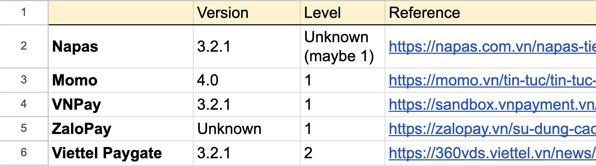
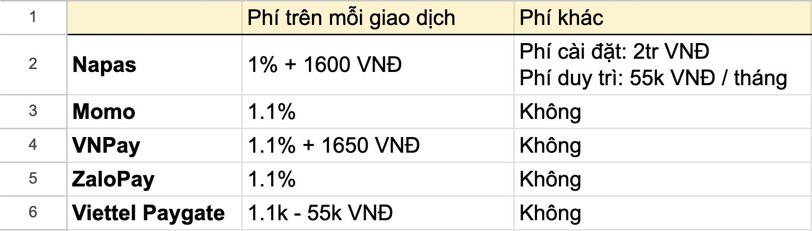
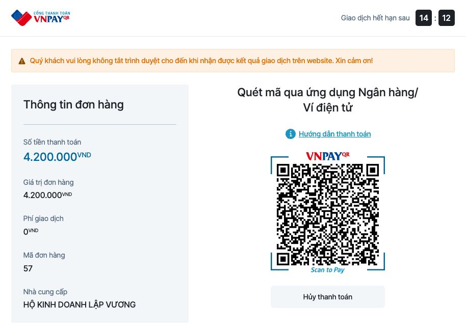
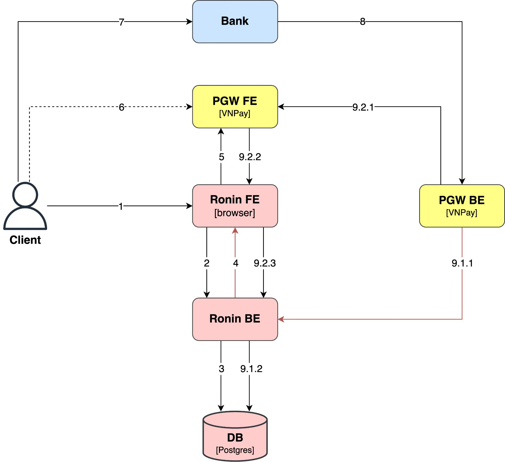
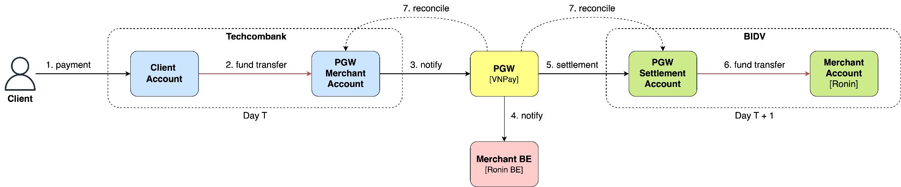

# 16. Integration

> **Tổng số trang:** 42 slide | **Thư mục ảnh/sơ đồ:** `assets/16_Integration/`

---

## Trang 1: Integration

### Integration
Nhiều khi tiền không giải quyết được vấn đề,
mà là quan hệ và chữ tín.

---

## Trang 2: Nội Dung

### Nội Dung
### 1. Phân Tích Yêu Cầu
### 2. Thiết Kế
### 3. Triển Khai
  - Review Code Mẫu
  - Bảo Mật
  - Xử Lý Lỗi
  - Tracing
  - Kiểm Thử
### 4. Tổng Kết
roninhub.com

---

## Trang 3: 1. Phân Tích Yêu Cầu

### 1. Phân Tích Yêu Cầu

---

## Trang 4: Khi triển khai tích hợp, chúng ta nên đánh giá

### Khi triển khai tích hợp, chúng ta nên đánh giá
những yếu tố, tính chất của hệ thống?
và thứ tự nào?

---

## Trang 5: 1. Security

### 1. Security
### 2. Reliability
### 3. Performance
- Throughput
- Latency
### 4. Complexity
…

---

## Trang 6: 1.1. Phân Tích Yêu Cầu

### 1.1. Phân Tích Yêu Cầu
- (Automation) Một giải pháp thanh toán tự động
roninhub.com
- (Security) Tính bảo mật cao
- (Pricing) Phí giao dịch thấp
- (Scalability) Hỗ trợ nhiều phương thức thanh toán
- Độ ổn định, hỗ trợ khách hàng, khuyến mãi, giao diện, tốc
độ tích hợp, quản lý và các tính năng khác, …

---

## Trang 7: 1.2. Giải Pháp

### 1.2. Giải Pháp
- Giải pháp: tích hợp cổng thanh toán
roninhub.com

---

## Trang 8: Tại Sao là VNPay QR?

Tại Sao là VNPay QR?

---

## Trang 9: 1.3. Tại Sao là VNPay QR?

### 1.3. Tại Sao là VNPay QR?
- Bên mình không quảng cáo cho VNPay.
- Mỗi bên cung cấp giải pháp đều có ưu nhược điểm.
- Mỗi bên cần tích hợp có thể có yêu cầu khác nhau.
- Việc chọn bên cung cấp phụ thuộc vào yêu cầu cụ thể.
roninhub.com
- Tiếp theo: một số thông tin để bạn tham khảo

---

## Trang 10: 1.3.1. Bảo Mật

### 1.3.1. Bảo Mật
- Quan điểm: nên chọn nhà cung cấp lớn và uy tín vì khả năng có tính bảo mật cao.
- Các bên cung cấp đều tuân thủ tiêu chuẩn bảo mật PCI - DSS.
roninhub.com

---

## Trang 11: 1.3.2. Phí

### 1.3.2. Phí
- Bảng giá của một số cổng thanh toán với phương thức thanh toán là QR mobile banking (nội địa)
roninhub.com

---

## Trang 12: 1.3.3. Yếu Tố Khác

### 1.3.3. Yếu Tố Khác
- Tốc độ xử lý giao dịch nhanh và ổn định.
- Sale và hỗ trợ kỹ thuật đều nhiệt tình hỗ trợ.
- Giao diện không quá đẹp nhưng thân thiện.
- Liên kết với nhiều ngân hàng.
- Thỉnh thoảng có khuyến mãi hấp dẫn.
- Tính năng quản lý đầy đủ.
roninhub.com

---

## Trang 13: 2. Thiết Kế

### 2. Thiết Kế

---

## Trang 14: 2.0. Tài Liệu Tích Hợp

### 2.0. Tài Liệu Tích Hợp
- Tài liệu
roninhub.com

---

## Trang 15: 2.1. Luồng Thanh Toán QR

### 2.1. Luồng Thanh Toán QR
roninhub.com
### 1. Payment

---

## Trang 16: 2.1. Luồng Thanh Toán QR

### 2.1. Luồng Thanh Toán QR
roninhub.com
### 2. Payment request

---

## Trang 17: 2.1. Luồng Thanh Toán QR

### 2.1. Luồng Thanh Toán QR
roninhub.com
### 3. Create transaction

---

## Trang 18: 2.1. Luồng Thanh Toán QR

### 2.1. Luồng Thanh Toán QR
roninhub.com
### 4. Create the payment URL

---

## Trang 19: 2.1. Luồng Thanh Toán QR

### 2.1. Luồng Thanh Toán QR
roninhub.com
### 5. Redirect

---

## Trang 20: 2.1. Luồng Thanh Toán QR

### 2.1. Luồng Thanh Toán QR
roninhub.com
### 6. Payment QR

---

## Trang 21: 2.1. Luồng Thanh Toán QR

### 2.1. Luồng Thanh Toán QR
roninhub.com
### 7. Fund transfer

---

## Trang 22: 2.1. Luồng Thanh Toán QR

### 2.1. Luồng Thanh Toán QR
roninhub.com
### 8. Notify

---

## Trang 23: 2.1. Luồng Thanh Toán QR

### 2.1. Luồng Thanh Toán QR
roninhub.com
### 9.1.1. IPN

---

## Trang 24: 2.1. Luồng Thanh Toán QR

### 2.1. Luồng Thanh Toán QR
roninhub.com
### 9.1.2. Update transaction status

---

## Trang 25: 2.1. Luồng Thanh Toán QR

### 2.1. Luồng Thanh Toán QR
roninhub.com
### 9.2.1. Redirect

---

## Trang 26: 2.1. Luồng Thanh Toán QR

### 2.1. Luồng Thanh Toán QR
roninhub.com
### 9.2.2. Redirect

---

## Trang 27: 2.1. Luồng Thanh Toán QR

### 2.1. Luồng Thanh Toán QR
roninhub.com
### 9.2.3. Check the
transaction status

---

## Trang 28: 2.2. Luồng Tiền

### 2.2. Luồng Tiền
roninhub.com

---

## Trang 29: 3. Triển Khai

### 3. Triển Khai

---

## Trang 30: 3.1. Bảo Mật

### 3.1. Bảo Mật

---

## Trang 31: 3.1.1. Data integrity & Authenticity

### 3.1.1. Data integrity & Authenticity
- Data integrity: Làm sao đảm bảo tính đúng đắn của dữ
liệu? Do payment request được tạo ra ở BE và được gửi
về cho FE để client thực hiện thanh toán. Tuy nhiên, phía
client là phía dễ bị can thiệp nên chúng ta cần đảm bảo
thông tin của payment request không bị sửa đổi trong quá
trình vận chuyển từ BE → FE → VNPay.
- Authenticity: Làm sao để xác thực rằng đầu tạo payment
request là Ronin merchant và đầu gửi IPN là VNPay?
- Liệu có thể sử dụng 1 cơ chế để giải quyết được đồng
thời 2 bài toán trên?
roninhub.com

---

## Trang 32: 3.1.1. Data integrity & Authenticity

### 3.1.1. Data integrity & Authenticity
- HTTPS không đáng tin cậy 100%
→ cần kết hợp thêm một cơ chế nữa
- 1 chế cơ giải quyết 2 vấn đề
  - Digital signature
■ asymmetric key
  - Message Authentication Code
■ Key-based hash function + 1 secret
■ symmetric key
- Giải pháp: HMACSHA512
roninhub.com

---

## Trang 33: 3.1.1. Data integrity & Authenticity

### 3.1.1. Data integrity & Authenticity
- Payment Payload: Amount, Transaction Ref, Method, …
- Payment Request =
Payload + HMACSHA512(Payload, secret)
roninhub.com

---

## Trang 34: 3.1.2. Whitelist

### 3.1.2. Whitelist
- Cung cấp whitelist danh sách địa chỉ IP được phép gọi
vào API IPN.
roninhub.com

---

## Trang 35: 3.1.3. Version

### 3.1.3. Version
- Best practice: nên sử dụng version mới nhất.
- Kiểm tra lỗ hổng và update version của thư viện
roninhub.com

---

## Trang 36: 3.2. Xử Lý Lỗi

### 3.2. Xử Lý Lỗi

---

## Trang 37: 3.2.1. Response Code

### 3.2.1. Response Code
- Ít nhất cần phải có try catch
- Cần trả đúng mã lỗi theo hướng dẫn
  - Xử lý giao dịch thành công thì trả về RspCode: ‘00’
  - Nếu không tìm được order thì trả về RspCode: ‘01’
roninhub.com

---

## Trang 38: 3.2.2. Retry

### 3.2.2. Retry
- VNPAY bật cơ chế retry IPN với RspCode: 01, 04, 97, 99
hoặc IPN timeout
  - tối đa 10 lần, trong vòng 5 phút
- Retry → duplicate IPN calls
  - Duplication: 1 request first, 1 request later
  - Race condition: 2 requests at the same time
roninhub.com

---

## Trang 39: 3.2.2. Idempotent Handler

### 3.2.2. Idempotent Handler
- IPN API:
  - Idempotent logic
■ Kiểm tra trạng thái giao dịch trước khi xử lý
tiếp.
  - Not Idempotent logic
- Giả sử:
  - 2 requests IPN đến đồng thời
  - Cập nhật trạng thái giao dịch
  - Trừ số tồn kho
- Giải pháp?
roninhub.com

---

## Trang 40: 3.3. Tracing

### 3.3. Tracing
- Nên đặt log ở đầu vào, đầu ra từng bước trong luồng
thanh toán, cả case thành công, lẫn case thất bại,
exception.
- Show log ở đầu nginx (bước 9.2.2)
roninhub.com

---

## Trang 41: 4. Cải thiện

### 4. Cải thiện
- 9.1.1 IPN có thể bị miss → 9.2.3 có thể chủ động gọi
sang VNPay để kiểm tra trạng thái giao dịch (xong thực
hiện logic IPN).
- Trong trường hợp cả 9.1 và 9.2 bị miss, Ronin BE định kỳ
quét trạng thái giao dịch.
- Refund
roninhub.com

---

## Trang 42: Tổng Kết

### Tổng Kết
- Đánh giá nhiều yếu tố khi chọn giải pháp thanh toán như
độ bảo mật, phí, độ ổn định, tính năng, tốc độ tích hợp.
- Bảo mật là yếu tố quan trọng khi tích hợp và đặc biệt
quan trọng đối với các hệ thống tài chính.
- Xử lý lỗi là việc làm cần thiết
  - Response Code
  - Retry
  - Idempotent Handler
roninhub.com

---
