# 2. Caching Design

> **Tổng số trang:** 44 slide | **Thư mục ảnh/sơ đồ:** `assets/2_Caching_Design/`

---

## Trang 1: Caching Design

### Caching Design
“A man who doesn't spend time with his family can never be a real man.”
- Mario Puzo, The Godfather

---

## Trang 2: What are Cache Challenges in Your Work?

What are Cache Challenges in Your Work?

---

## Trang 3: Outline

### Outline
### 1. Cache Introduction
### 2. Caching Strategies
  - Read Strategies
  - Write Strategies
  - Cache Invalidation
### 3. Challenges
  - Reliability Challenges
  - High Traffic Challenges

---

## Trang 4: The journey of Dũng, my best friend.

### The journey of Dũng, my best friend.
Good Habit: Ask “What is it? Why?” always

---

## Trang 5: 1. Cache Introduction

### 1. Cache Introduction

---

## Trang 6: 1.1. Cache Introduction

### 1.1. Cache Introduction
- A cache is a hardware or software component that temporarily stores data
- Future requests for that data can be served faster
- The data in cache:
  - A copy of data from data source
  - The result of an earlier computation
- Cache is a shield for DB

---

## Trang 7: 1.1. Cache Note

### 1.1. Cache Note
- Trade-off
  - Performance vs Cost (Space, Operation)
  - Performance vs Consistency (sometime)
- Cache is more suitable for hotspot data.
- The cache hit rate is the most important metric for caching.
  - Follow 80/20 principles to achieve a high hit rate.
- Cache != buffer
  - The buffer is an area for temporary storage (memory or disk) of data,
which will be transmitted to other component later.
  - Buffer is like a queue.

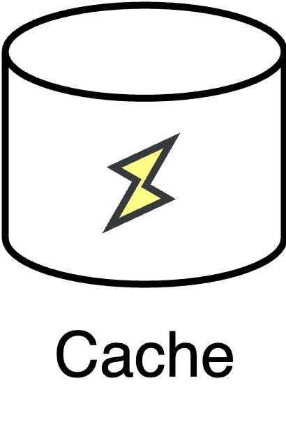

---

## Trang 8: 1.2. Where Is Cache Used

### 1.2. Where Is Cache Used

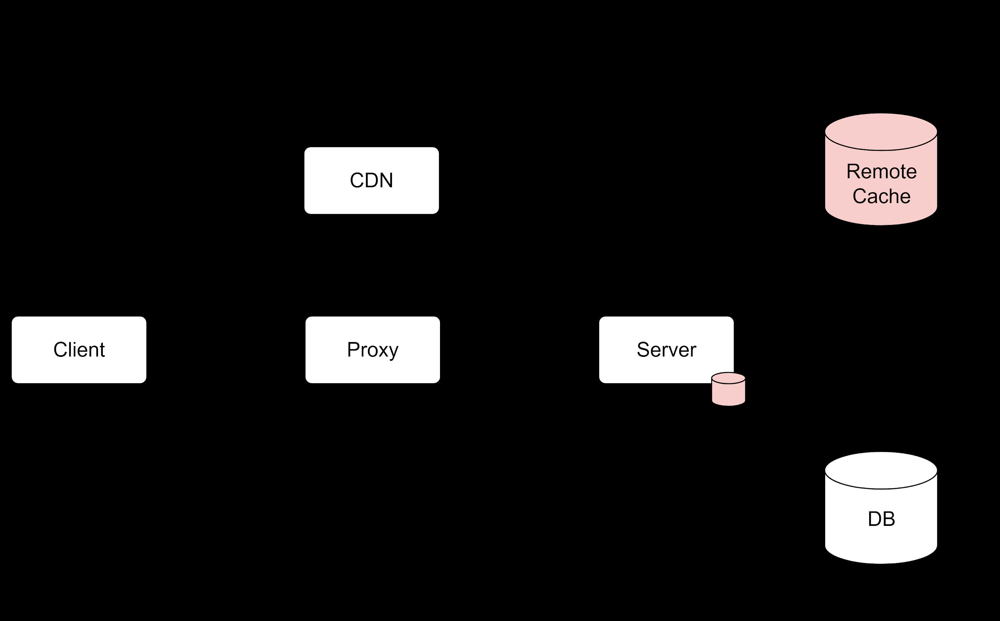

---

## Trang 9: 2. Cache Strategies

### 2. Cache Strategies

---

## Trang 10: 2.1. Read Strategies

### 2.1. Read Strategies
- Read strategies
  - Read-Through
  - Read-Aside
- Read-Aside
  - Pros:
■ Tolerate cache failures
■ Flexible for data models
  - Cons:
■ Complex for app
■ Data inconsistency

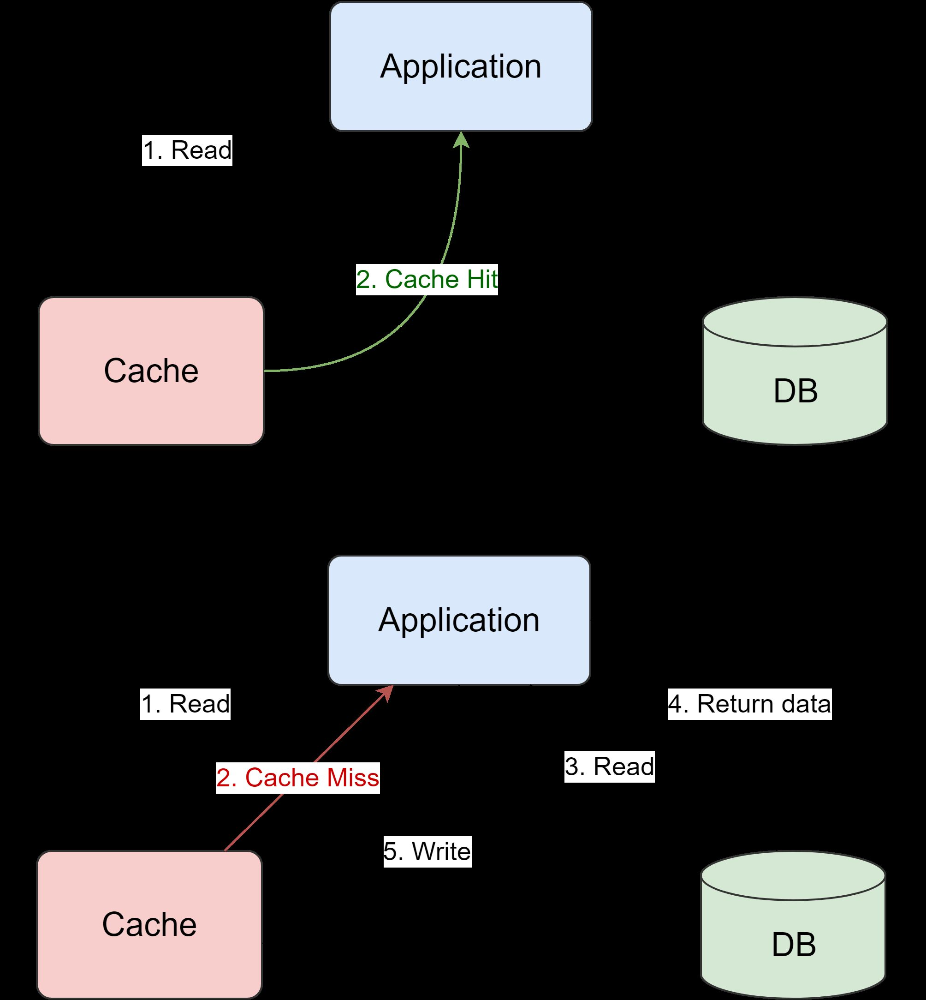

---

## Trang 11: 2.2. Write Strategies

### 2.2. Write Strategies
- Write strategies:
  - Write-Through
  - Write-Back (computer architecture)
  - Write-Around
- Write-Around
  - Invalid cache asynchronously
  - Pros:
■ Decoupling cache and storage systems
  - Cons:
■ Inefficient for Frequently Updated Data
■ Data inconsistency

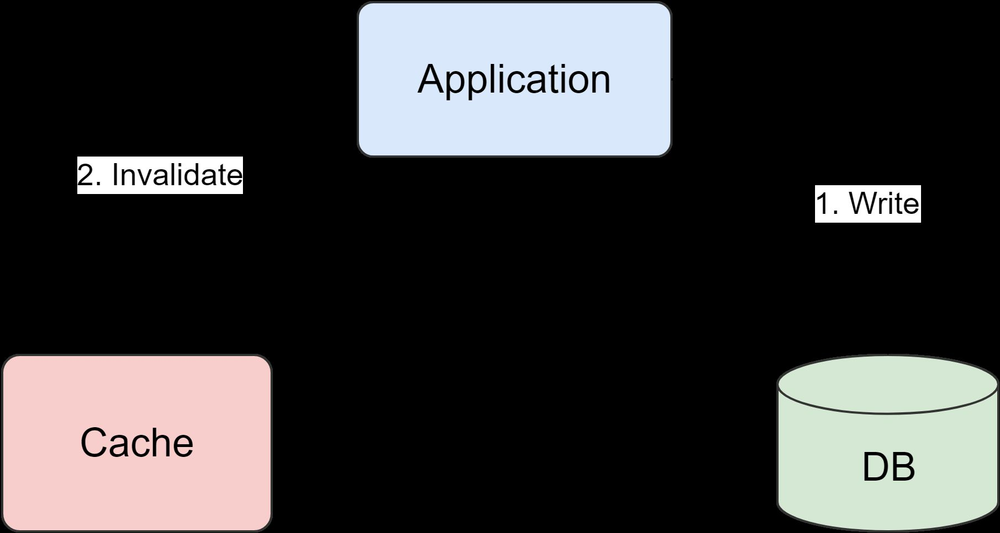

---

## Trang 12: What is The Common Problem?

What is The Common Problem?

---

## Trang 13: 2.3. Data Inconsistency

### 2.3. Data Inconsistency
- The common problem: Data Inconsistency
- Solution: Cache Invalidation
- Cache Invalidation is removing data that is no longer
valid or useful
- Types of Cache Invalidation:
  - Time-based
  - Command-based
  - Event-based
  - Group-based

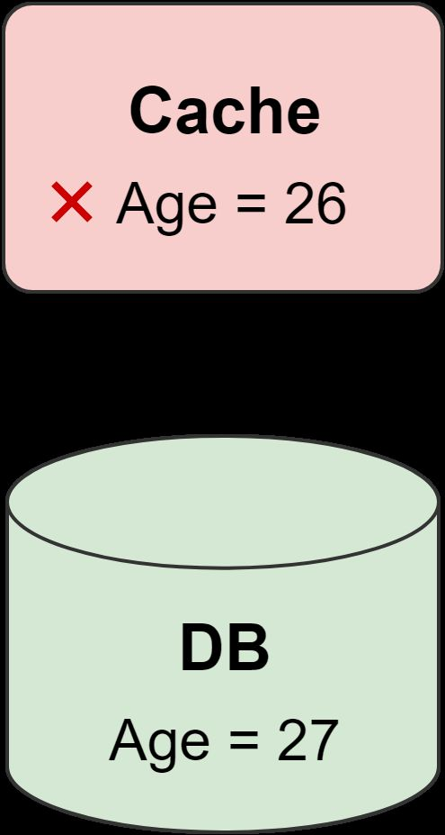

---

## Trang 14: 2.3. Why Cache Invalidation is Hard?

### 2.3. Why Cache Invalidation is Hard?
The reason is the complexity of:
- Timing
  - How long enough for Time-To-Live (TTL)?
- Concurrency
  - Race condition
- Data relationships
- Unlike Database, Cache can be everywhere and anywhere.
- Hard to finding root causes.
  - Things can go wrong in a million different ways …

---

## Trang 15: Let’s Try to Solve Data Inconsistency

Let’s Try to Solve Data Inconsistency

---

## Trang 16: No more deal with Read-Aside

No more deal with Read-Aside

---

## Trang 17: Dive into Write-Around

Dive into Write-Around

---

## Trang 18: 2.4. Write-Around

### 2.4. Write-Around
- Command-based Cache Invalidation (OR):
  - Update (replace)
  - Delete
→ The First Try: Update Cache

---

## Trang 19: 2.5. The First Try: Update Cache

### 2.5. The First Try: Update Cache
Update Cache First or Update Cache Later?

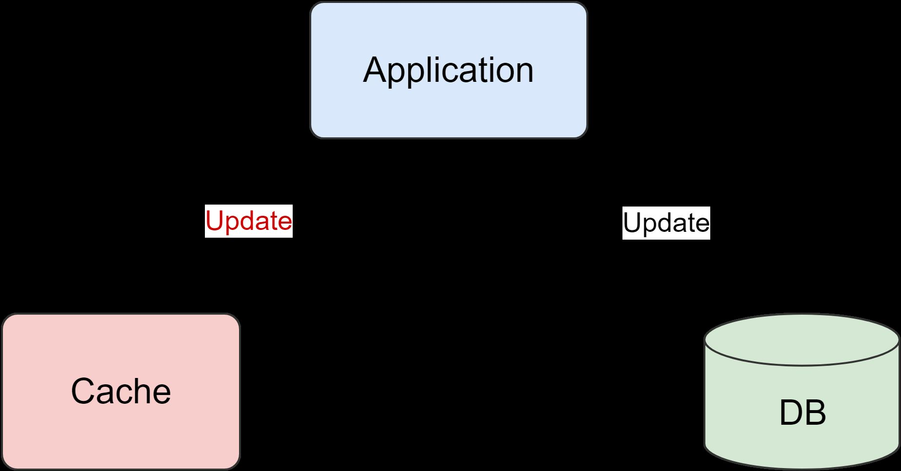

---

## Trang 20: 2.5.1. Update Cache First

### 2.5.1. Update Cache First
Race condition:
- 2 write requests
→ DB is wrong

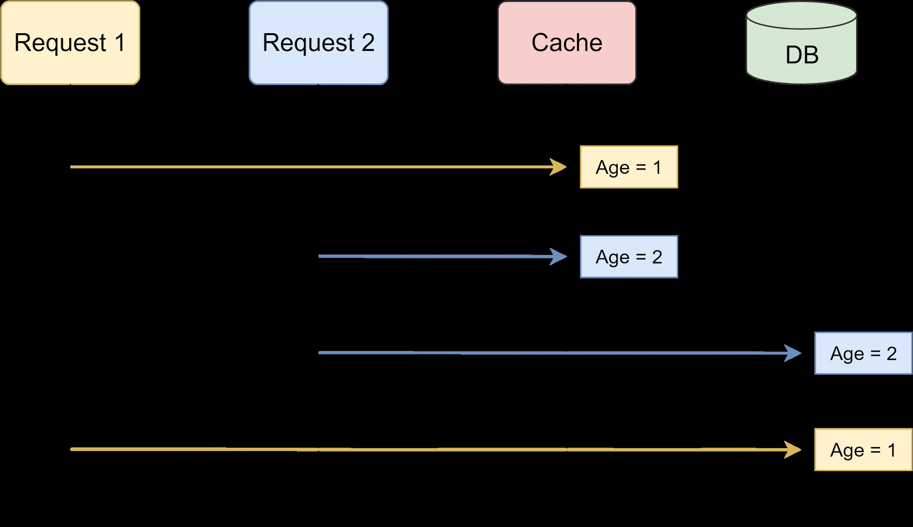

---

## Trang 21: 2.5.2. Update Cache Later

### 2.5.2. Update Cache Later
→ Cache is wrong
Race condition:
- 2 write requests

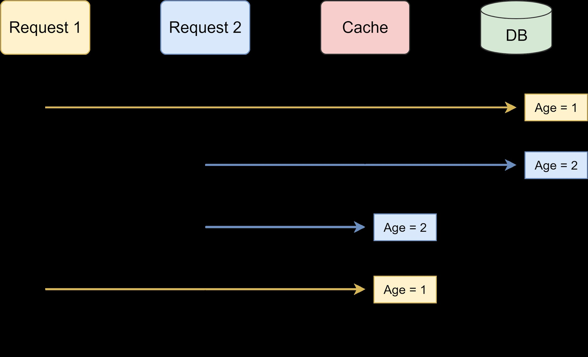

---

## Trang 22: 2.5.3. The First Try: Update Cache

### 2.5.3. The First Try: Update Cache
→ Updating cache first or later does not solve
the problem Data Inconsistency at all.
→ The Second Try: Delete cache?

---

## Trang 23: 2.6. The Second Try: Delete cache

### 2.6. The Second Try: Delete cache
- 2 write-around requests in a race condition with
deleting cache in any order
→ DB is right, no data in cache after 2 writes
→ The third try: Read-Aside + Write-Around
with Deleting cache (called RA+DWA)

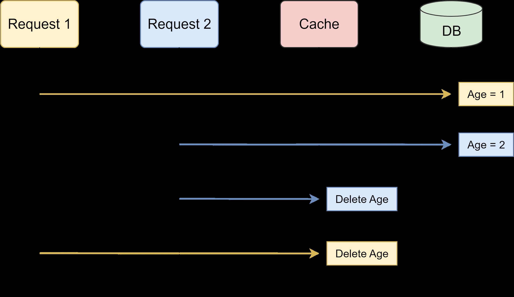

---

## Trang 24: 2.7. The Third Try: Read Aside + Delete Write Around

### 2.7. The Third Try: Read Aside + Delete Write Around

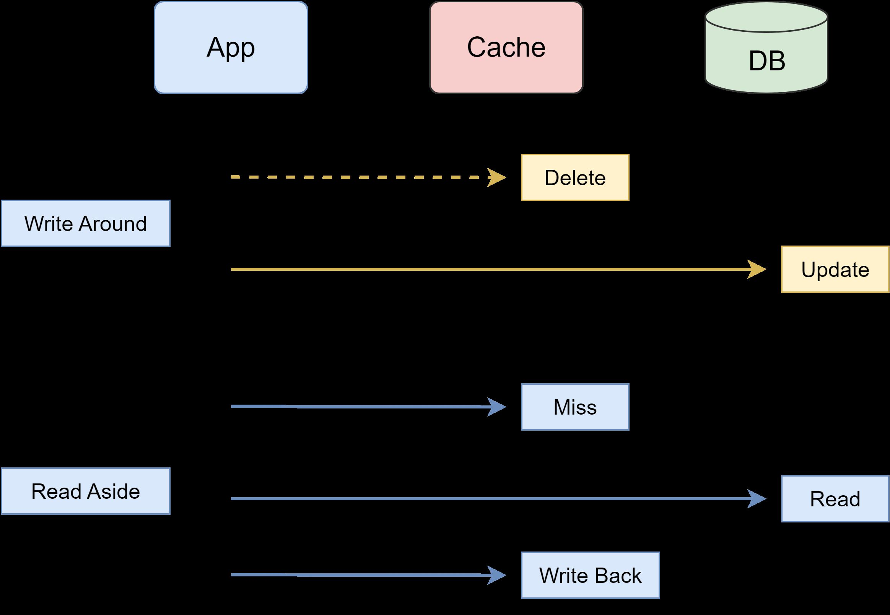

---

## Trang 25: 2.7. The Third Try: Delete Cache First

### 2.7. The Third Try: Delete Cache First
Race Condition:
- Request 1: Write
- Request 2: Read
→ DB is right, cache is wrong

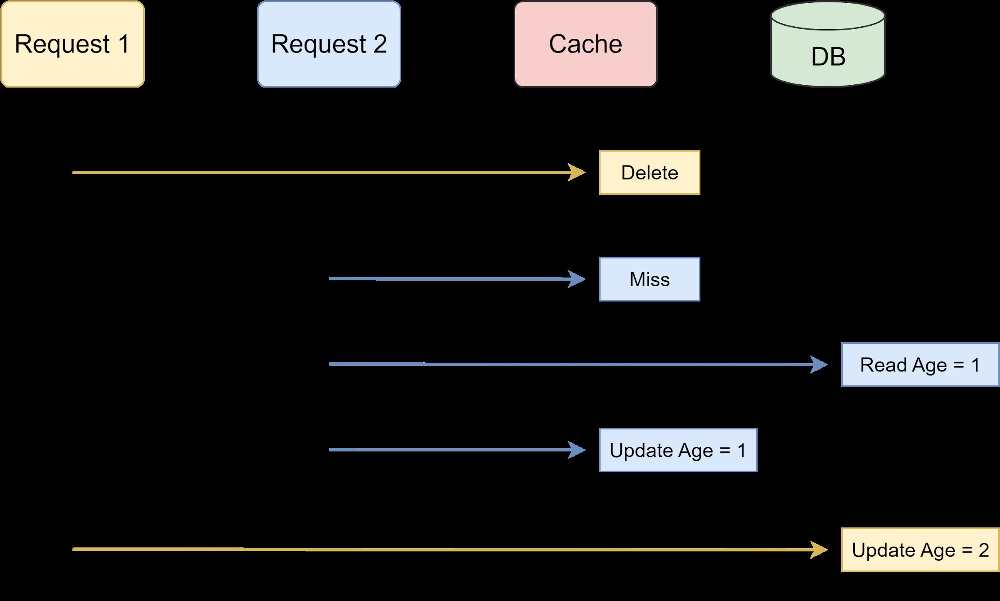

---

## Trang 26: 2.7. The Third Try: Delete Cache Later

### 2.7. The Third Try: Delete Cache Later
Race Condition:
- Request 1: Write
- Request 2: Read
→ DB is right, cache is wrong

---

## Trang 27: 2.7. The Third Try: DWA+RA

### 2.7. The Third Try: DWA+RA
- Data Inconsistency still!
- Choose one appropriate write strategy? Why?
1 2

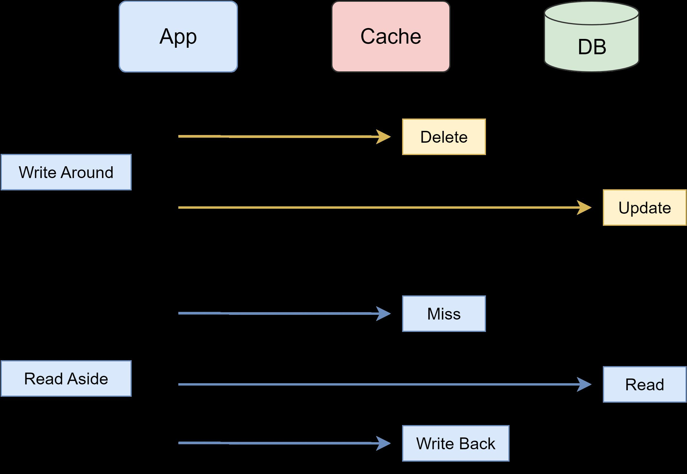

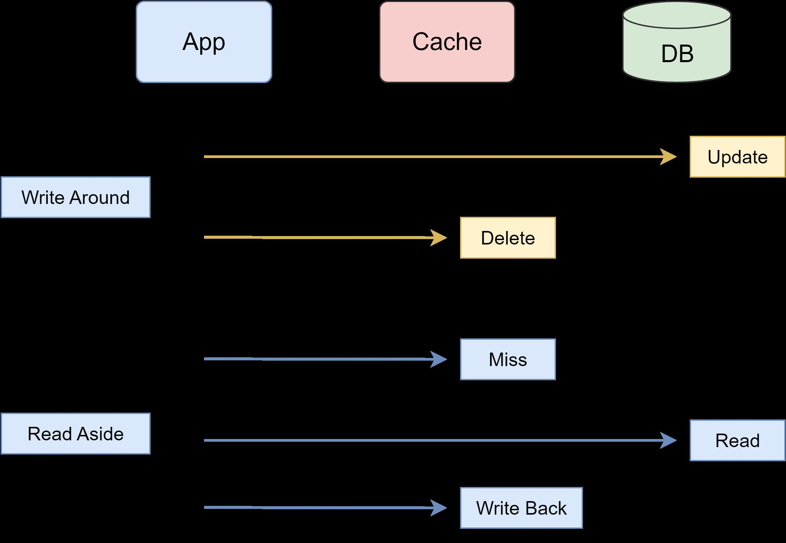

---

## Trang 28: 2.7. The Third Try: RA+DWA

### 2.7. The Third Try: RA+DWA
Answer:
- Update DB first, delete cache later
- Popular combination: Read Aside + Write Around
(deleting cache)
- Because in practice, cache writes are usually much
faster than DB writes
→ the probability that write operators is between
read operators is very low !

---

## Trang 29: 2.7. The Third Try: RA+DWA

### 2.7. The Third Try: RA+DWA
- How can we mitigate the impact?
- Add short TTL to cache data

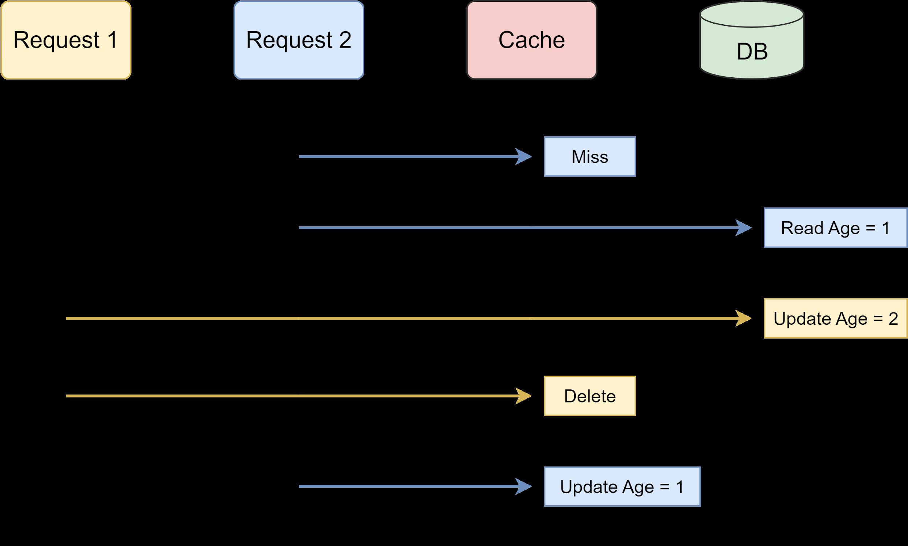

---

## Trang 30: 3. Challenges

### 3. Challenges

---

## Trang 31: 3.1. Reliability Challenges

### 3.1. Reliability Challenges

---

## Trang 32: 3.1.1. Problem 01: No Atomicity

### 3.1.1. Problem 01: No Atomicity
Problem Context:
- Customer X updates age from 33 → 34
- But customer X complains that it needs some time
to take effect.
- Use Read-Aside + Write-Around
- The profile of customer X in cache
Solutions:
- Retry
- Subscribe to binlog of DB
Cause: Updating DB is done, but invalidating cache failed.
→ Old value is in cache still, taking some time to take effect
due to TTL

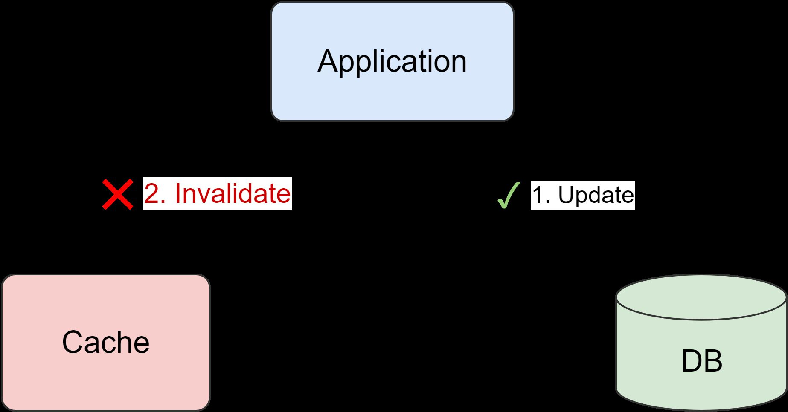

---

## Trang 33: 3.1.2. Problem 02: Cache Avalanche

### 3.1.2. Problem 02: Cache Avalanche
Problem:
- Cache goes down for some reason
- There are a large number of requests at this time
→ DB down
Solutions:
- Cache Cluster → High Availability
- Rate Limit / Circuit breaker
- Cache Recovery

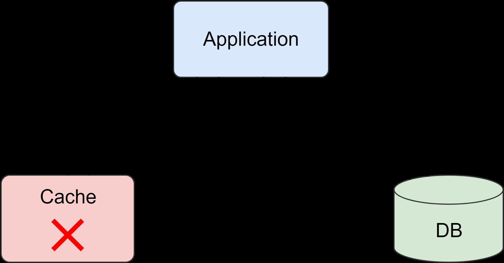

---

## Trang 34: 3.1.2. Problem 02: Cache Avalanche

### 3.1.2. Problem 02: Cache Avalanche
Problem:
- A large amount of cached data expires at the same
time
- There are a large number of requests at this time
→ DB down
Solutions:
- Even distribution for the expiration time

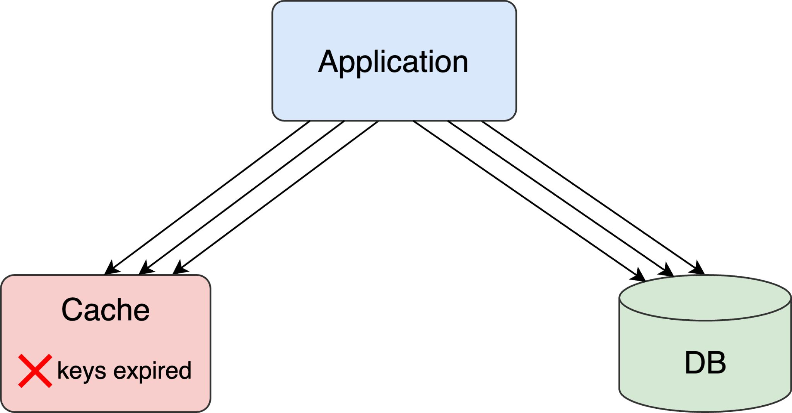

---

## Trang 35: 3.1.3. Problem 03: Cache Breakdown

### 3.1.3. Problem 03: Cache Breakdown
Problem:
- A hotspot data in the cache expires
→ DB down
Solutions:
- Do not set an expiration time for the hotspot data
- Background job to update cache periodically
or before the cache expires
- Locking / Mutex

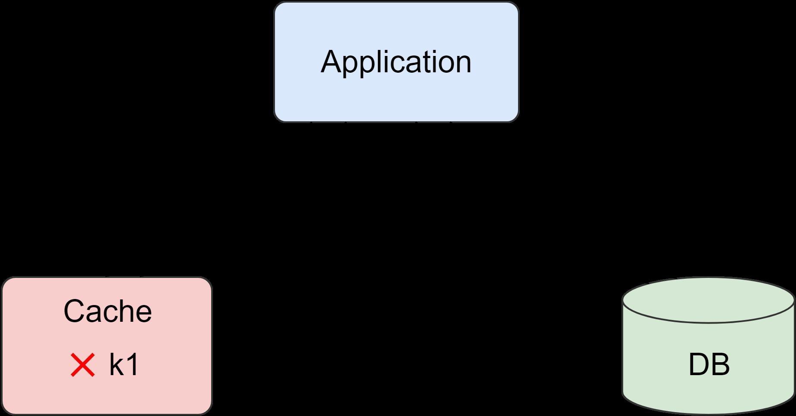

---

## Trang 36: 3.1.4. Problem 04: Cache Penetration

### 3.1.4. Problem 04: Cache Penetration
Problem: There is data neither in cache nor in DB. When
a large number of requests hit that data (maybe made by
attacker)
→ cache miss → DB miss → DB down
Solutions:
- Set default value. Example: 0
- Validate requests
- Use the Bloom filter to quickly determine whether
the data does not exist

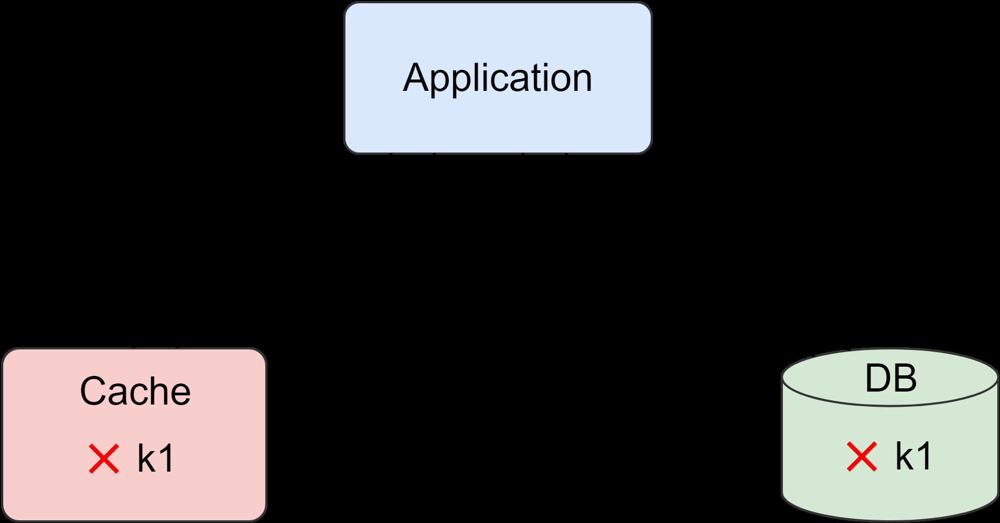

---

## Trang 37: 3.2. High Traffic Challenges

### 3.2. High Traffic Challenges

---

## Trang 38: 3.2.1. Problem 05: Hot Keys

### 3.2.1. Problem 05: Hot Keys
Problem: A few keys have a lot of traffic
Solutions:
- Copy a hot key into multiple keys and
distribute the keys across multiple nodes
- Local cache to hot keys

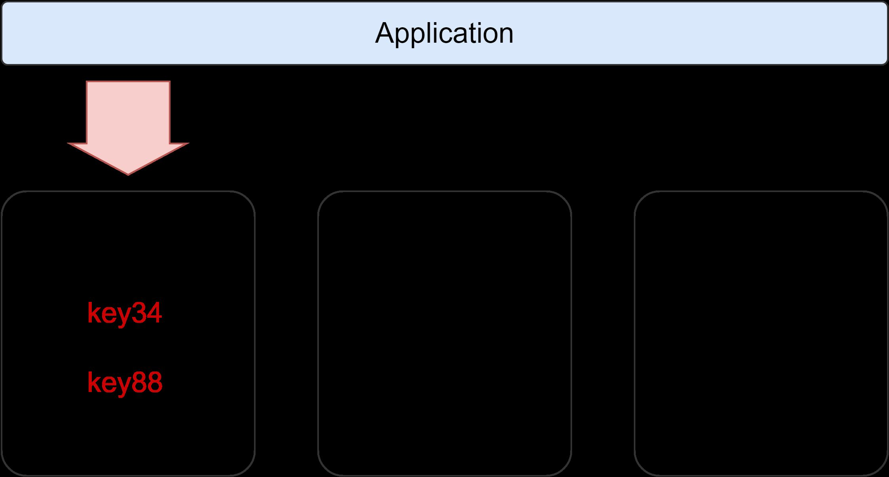

---

## Trang 39: 3.2.2. Problem 06: Large Key

### 3.2.2. Problem 06: Large Key
Problem: The size of value is significantly large
Solutions:
- Compress
- Split
- Set a longer TTL for large keys
- Limit the number of large keys
- Choose the right storage for large keys

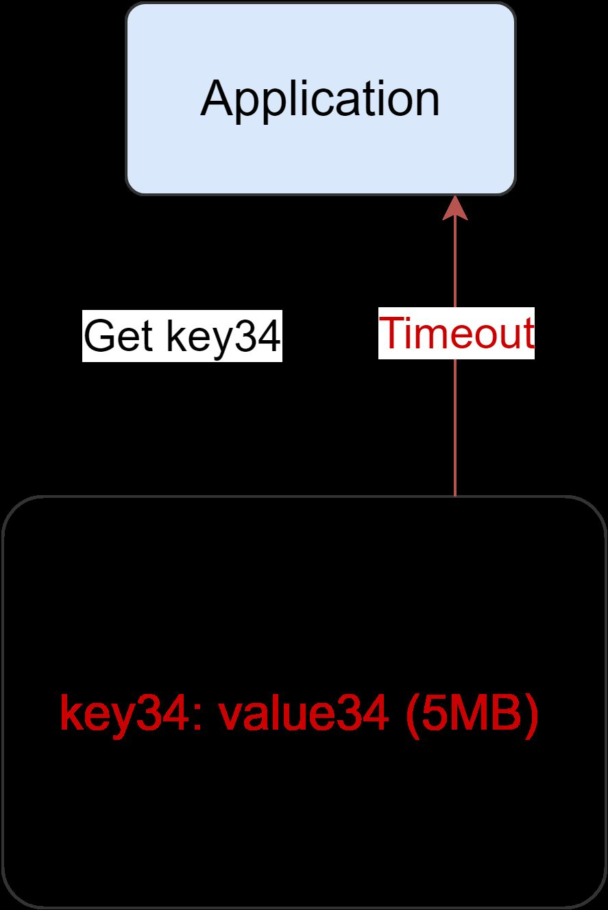

---

## Trang 40: 3.3. Cache Replacement

### 3.3. Cache Replacement
- What if the cache is running out of memory?
- Least Recently Used (LRU)
  - Use case: hot keys
- Least Frequently Used (LFU)
  - Use case: hot tweets
- LRU + LFU

---

## Trang 41: Recap

### Recap
- Evaluate data access patterns first
- Popular combination: Read Aside + Write Around
- Cache Invalidation is hard because of the complexity
in many aspects:
  - Timing
  - Concurrency
  - Cache can be anywhere
  - …

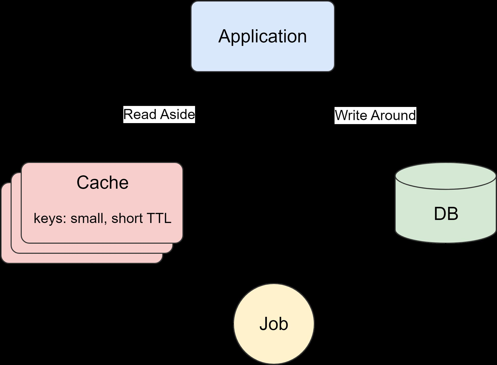

---

## Trang 42: References

### References
- https://redis.com/glossary/cache-invalidation/
- https://blog.the-pans.com/cache-invalidation/

---

## Trang 43: Homework

### Homework
Implement local cache:
- Content: List of Airports (Code, Name) with TTL
- Allow to use libs
- No need a source DB
- Read Aside

---

## Trang 44: Thank you

Thank you

---
