# 3. Index

> **Tổng số trang:** 42 slide | **Thư mục ảnh/sơ đồ:** `assets/3_Index/`

---

## Trang 1: Index

### Index
“Appear weak when you are strong, and strong when you are weak.”
- Sun Tzu

---

## Trang 2: Outline

### Outline
### 1. Index Introduction
### 2. Classification
  - Data Structure
  - Physical Storage Index
  - Characteristics
  - Composite Index
### 3. Practices
  - Index Failures
  - Best Practices

---

## Trang 3: 1. Introduction

### 1. Introduction

---

## Trang 4: 1.1. Index

### 1.1. Index
- An index is a data structure that improves the speed
of data retrieval operations.
- Indexes are typically stored on disk.

---

## Trang 5: 2. Classification

### 2. Classification

---

## Trang 6: 2.0. Classification

### 2.0. Classification
- By data structure: B+ tree index, Hash index, Fulltext (inverted) index, LSM Tree, …
- By physical storage: Clustered Index, Non-clustered Index (Secondary Index)
- By number of columns: Single-column Index, Composite index
- By characteristics: Primary Key Index, Unique Index, Prefix Index

---

## Trang 7: 2.1. Data Structure

### 2.1. Data Structure

---

## Trang 8: 2.1. Data Structure

### 2.1. Data Structure
- What factors should be considered when mentioning
data structure and algorithm?
- Use case
- Time Complexity
- Space Complexity
- Complexity of Implementation
- …

---

## Trang 9: 2.1.1. B-Tree (Balanced Tree)

### 2.1.1. B-Tree (Balanced Tree)
- All leaves are at the same level. Each node contains a sorted list of keys.
- A non-leaf node with k children contains k-1 keys. This means if a node has three children (k=3), it
will hold two keys (k-1)
- Insertion, deletion, and search operations can be performed in O(Log N) time

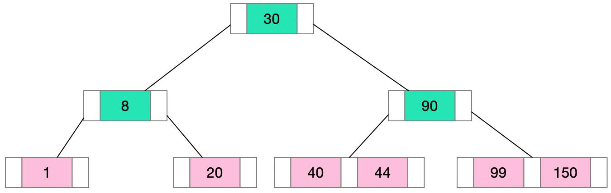

---

## Trang 10: 2.1.2. B+Tree

### 2.1.2. B+Tree
- The B+ Tree is a variant of the B-Tree
- The pointers to the actual records are stored only at the leaf nodes.
- The internal nodes only contain keys and pointers to other nodes. Many keys can be stored in internal
nodes
→ Reducing the overall height of the tree.
→ Decreases the number of disk accesses
- All leaf nodes are linked together in a linked list → efficient for range queries

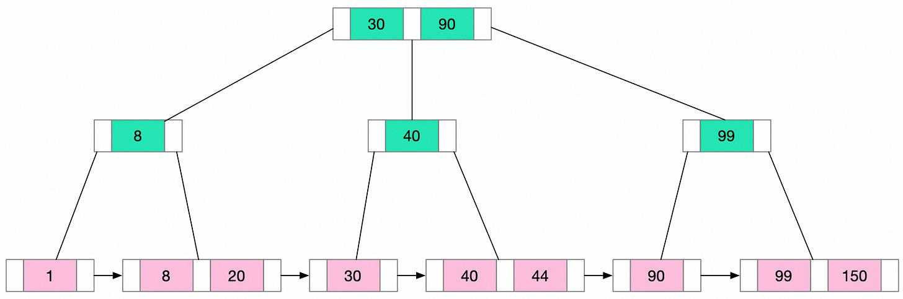

---

## Trang 11: 2.1.3. B-Tree vs B+Tree

### 2.1.3. B-Tree vs B+Tree

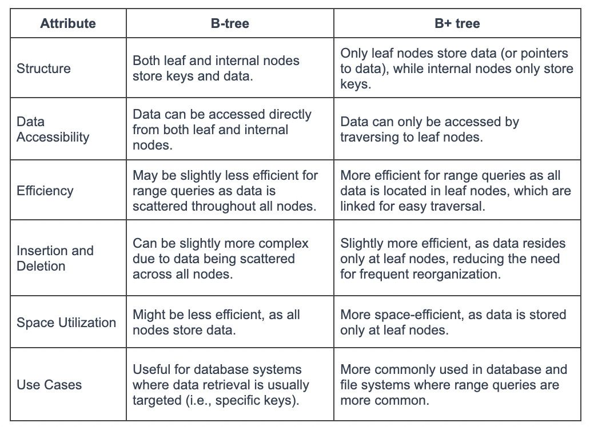

---

## Trang 12: 2.1.4. Hash Index

### 2.1.4. Hash Index
- Hash Index uses a hash function to map keys to specific locations
- Hash Index well-suited for equality comparisons, such as "=".
- Limitations:
  - Range-based queries, sorting
  - Collision

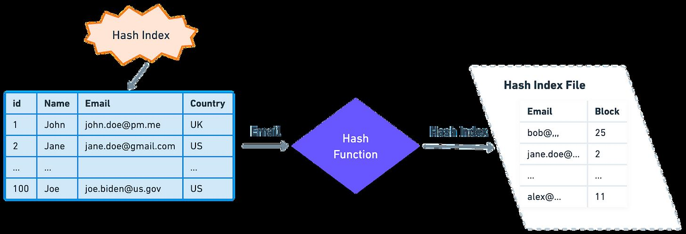

---

## Trang 13: 2.2. Physical Storage Index

### 2.2. Physical Storage Index

---

## Trang 14: 2.2.1. Clustered Index

### 2.2.1. Clustered Index
- Clustered Index is a type of index that determines the physical order of the data in a table.
- A table can have only one clustered index.
- The leaf nodes of the B+Tree of the clustered index store actual data
- By default, primary key is used for clustered index. But we can choose different column(s) for the
clustered index, separate from the primary key.
- In InnoDB, cluster index use B+Tree structure, can not use Hash.

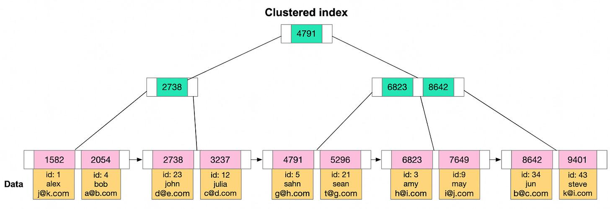

---

## Trang 15: 2.2.2. Non-clustered Index

### 2.2.2. Non-clustered Index

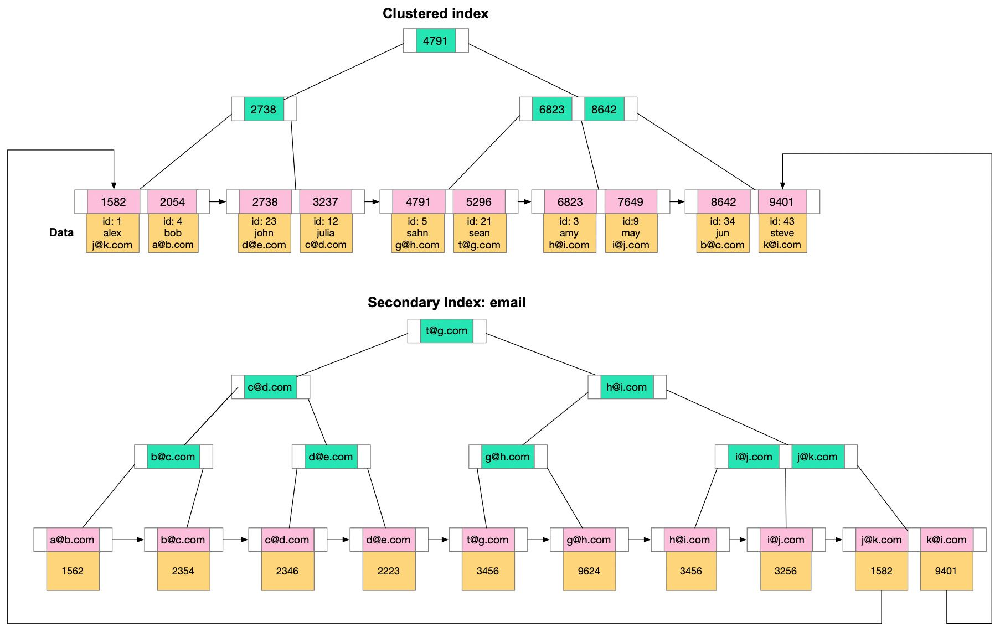

---

## Trang 16: 2.2.2. Non-clustered Index

### 2.2.2. Non-clustered Index
- Indexes are not clustered index, then non-clustered (secondary) indexes.
- The value (the leaf node of B+ Tree) of secondary index is the primary key value
- A table can have multiple secondary indexes
- Accessing data using a secondary index involves at least two disk reads. One to access the
secondary index and another to access the clustered index to get actual data.

---

## Trang 17: 2.2.2. Non-clustered Index

### 2.2.2. Non-clustered Index
What are disadvantages of indexes?
- Slowing down write operations
- Occupying physical space
- It takes time to create and maintain indexes
Why leaf node of secondary index point to the primary key value, not the disk address?
→ The disk address of records might be change during table operating, defragment, …

---

## Trang 18: 2.3. Characteristics

### 2.3. Characteristics

---

## Trang 19: 2.3.1. Characteristics

### 2.3.1. Characteristics
What is the difference between key & index?
- Key means a constraint imposed on the behaviour of the column.
Example: primary key is non nullable field which uniquely identifies each row.
- Index is a special data structure that facilitates data search across the table.

---

## Trang 20: 2.3.2. Primary Index

### 2.3.2. Primary Index
- Primary Index is a specific type of index that serves
as a unique identifier for each row in a table.
- If the key is sequential, writing to the table is
generally efficient.

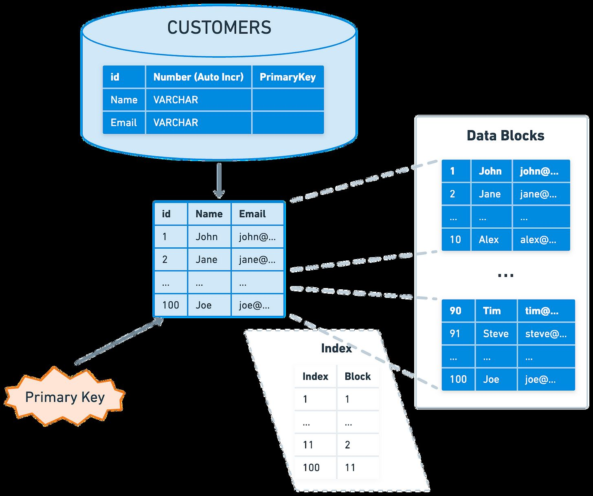

---

## Trang 21: 2.3.3. Unique Index

### 2.3.3. Unique Index
- The value of the index column must be unique, but null
values are allowed.
- Command:
CREATE UNIQUE INDEX index_name ON
table_name(index_column_1,index_column_2, ...);

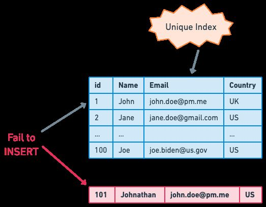

---

## Trang 22: 2.4. Number of Columns

### 2.4. Number of Columns

---

## Trang 23: 2.4.1. Composite Index

### 2.4.1. Composite Index
- Composite Index is a multi-column index.
- The more columns in a composite index,
The more storage space in used

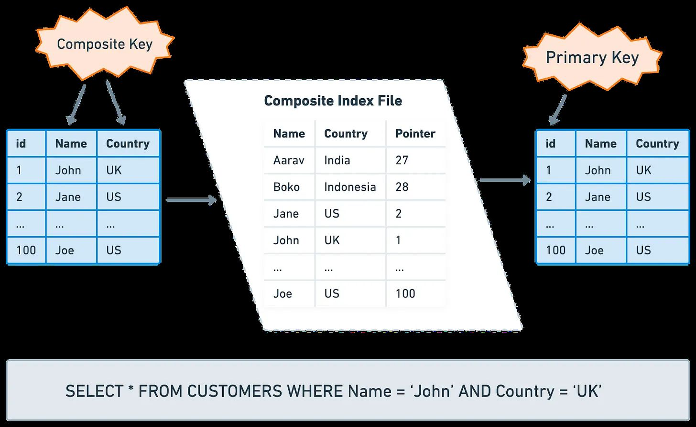

---

## Trang 24: 2.4.1. Composite Index

### 2.4.1. Composite Index

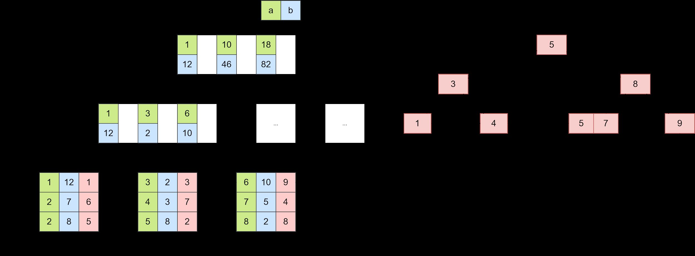

---

## Trang 25: 2.4.1. Composite Index

### 2.4.1. Composite Index
Composite index: (country, provine, name). Which one uses index?
### 1. SELECT * FROM customers WHERE provine = ‘Texas’ AND country = ‘US’;
### 2. SELECT * FROM customers WHERE provine = ‘Texas’;
### 3. SELECT * FROM customers WHERE name = ‘JANE’ AND provine = ‘Texas’;
### 4. SELECT * FROM customers WHERE country = ‘US’;
→ The filter conditions must include the first column in the composite index.
The order of the filter conditions does not matter.

---

## Trang 26: 2.4.1. Composite Index

### 2.4.1. Composite Index
Is composite index (country, provine, name) effective?
How do we determine the order in a composite index?
Approach: Columns with high cardinality (the high number of distinct values) first.
→ The B+Tree has more branches → Node has less keys
→ Time complexity decreases
Example: Composite index: (name, provine, country)

---

## Trang 27: 2.4.1. Composite Index

### 2.4.1. Composite Index
Composite Index (a, b)
Q1: SELECT * FROM table WHERE a > 1 AND b = 2
Q2: SELECT * FROM table WHERE a >= 1 AND b = 2
Q3: SELECT * FROM table WHERE a BETWEEN 2 AND 8 AND b = 2
Question:
- Does each query use the index?
- How many columns are used?
Answer:
- Q1: yes, use (a)
- Q2: yes, use (a, b)
- Q3: yes, use (a, b)

---

## Trang 28: 2.4.2. Covering Index

### 2.4.2. Covering Index
- A covering index is an index that contains all
the columns in the SELECT
- Answering the query by using the index alone,
reducing disk I/O operations
→ improve the performance significantly
- Recommended: =< 5 columns

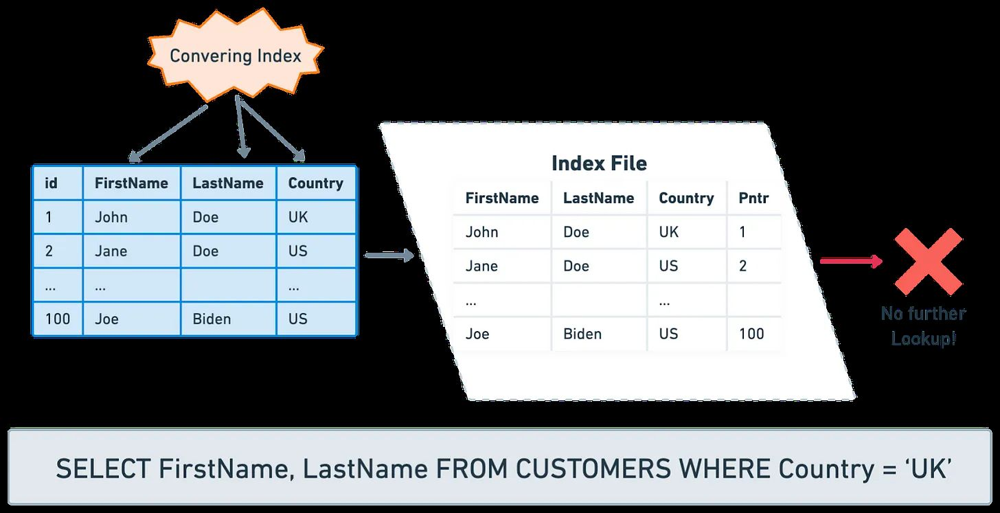

---

## Trang 29: 2.5. Other Indexes

### 2.5. Other Indexes
Classified by data structure:
- Fulltext Index (Inverted index)
- Spatial Index: R-Tree (GIST - Postgres)
- Bitmap Index:
  - Use case: Read heavy on counting low-cardinality column.
  - Example: Count the number of orders in PROCESSING status.

---

## Trang 30: 3. Practices

### 3. Practices

---

## Trang 31: 3.1. Indexes in Use

### 3.1. Indexes in Use
When to use indexes?
When to not use indexes?
- Read heavy: Frequent queries with WHERE, JOIN, GROUP BY, ORDER BY
- Find small set of records
- Fields with unique restrictions, such as product_id
- Table has too little data
- Very low cardinality. For example: gender
- Only write heavy, no read much

---

## Trang 32: 3.2.1. Index Failures 01

### 3.2.1. Index Failures 01
Index on ‘name’ column
### 1. SELECT * FROM users WHERE name LIKE ‘%ronin’;
### 2. SELECT * FROM users WHERE name LIKE ‘%ronin%’;
### 3. SELECT * FROM users WHERE name LIKE ‘ronin%’;

---

## Trang 33: 3.2.2. Index Failures 02

### 3.2.2. Index Failures 02
Index on ‘id’ column
SELECT * FROM users WHERE id = 1 OR age = 18;

---

## Trang 34: 3.2.3. Index Failures 03

### 3.2.3. Index Failures 03
### 1. Column ‘id’: int
SELECT * FROM users WHERE id = ‘10’;
### 2. Column ‘id’: varchar
SELECT * FROM users WHERE id = 10
Because automatically convert the string to a number, and then compare it

---

## Trang 35: 3.2.4. Index Failures 04

### 3.2.4. Index Failures 04
Index on column ‘name’
SELECT * FROM users WHERE length(name) = 6;
→ Because the index saves the original value of the index field,
not the value calculated by the function.
Oracle, Postgres, MySQL 8.0+ support function index, but be careful with it!

---

## Trang 36: 3.2.5. Index Failures 05

### 3.2.5. Index Failures 05
Index on ‘id’ column:
SELECT * FROM users WHERE id + 1 = 10;
SELECT * FROM users WHERE id + 0 = 10 - 1;
→ Because the index saves the original value of the index field,
not the value calculated by expressions

---

## Trang 37: 3.3. Best Practices

### 3.3. Best Practices
- Limit the Number of Indexes
- The primary key index is preferably self-incrementing
  - No need to move the existing data
  - Reduce page split, fragmentation
- The index is best set to NOT NULL
  - Value comparison more complicated
  - NULL value is a meaningless value, but it will occupy physical space
- Covering Index
  - Reduce a lot of I/O operations
- Prefix index
  - Reduce the size of the index storage
- Regularly Monitor and Optimize the Indexes
  - B+ Tree might become imbalance overtime → rebuild index
- Prevent index failures

---

## Trang 38: 3.4. Note

### 3.4. Note
- Index helps to reduce the number of search operations
- Index helps to reduce the number of disk I/O
- MySQL != Postgresql
  - Architecture
  - In postgres, columns in a row might be included in internal nodes and leaf nodes.

---

## Trang 39: Recap

### Recap
- All leaf nodes are linked together in a linked list → efficient for range queries
- Accessing data using a secondary index involves at least two disk reads. One to access the
secondary index and another to access the clustered index to get actual data.
- Leverage composite index, covering index. And high cardinality first.

---

## Trang 40: Appendix

### Appendix
- https://www.freecodecamp.org/news/database-indexing-at-a-glance-bb50809d48bd/
- Best practices:
  - Indexing Very Large Tables. A short guide to the best practices… | by Kovid Rathee | Towards
Data Science
- Index Guideline:
  - MySQL: Building the best INDEX for a given SELECT
  - What every developer should know about SQL performance

---

## Trang 41: Homework

### Homework
- Dataset Setup Instructions
- Verify (3) theories in this lecture
  - Theory statement
  - SQL(s)
  - Result, explain

---

## Trang 42: Thank you

Thank you

---
