# 4. Codebase Structure

> **Tổng số trang:** 33 slide | **Thư mục ảnh/sơ đồ:** `assets/4_Codebase_Structure/`

---

## Trang 1: Codebase Structure

### Codebase Structure
“Being deeply loved by someone gives you strength,
while loving someone deeply gives you courage.”
- Lao Tzu

---

## Trang 2: Outline

### Outline
### 1. Architectural Patterns
  - Layer Architecture
  - Hexagonal Architecture
  - Onion Architecture
  - Clean Architecture
  - Functional Architecture
### 2. Project Structure
### 3. Domain Driven Design (DDD)

---

## Trang 3: Problems:

### Problems:
- Have you even asked why the project structure is like this/that?
- When codebase grow bigger, is it hard to manage?
Is it hard to find and place code logic?
- How to make architectural theories practical?

---

## Trang 4: 1. Architectural Patterns

### 1. Architectural Patterns

---

## Trang 5: 1. Flow of Control

### 1. Flow of Control

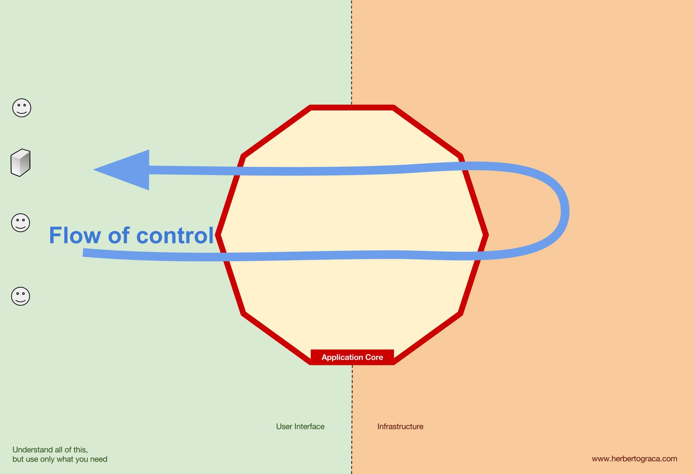

---

## Trang 6: 1.1. Layer Architecture

### 1.1. Layer Architecture
- Software architecture contains of several
separate horizontal layers that function
together as a single unit of software.
- No predefined number of layers
- Closed: the request cannot skip any layer
- Layers of isolation:
  - Tell what belongs to which layers and how
they works as a single unit
  - Layers can be modified and the change
won’t affect other layers

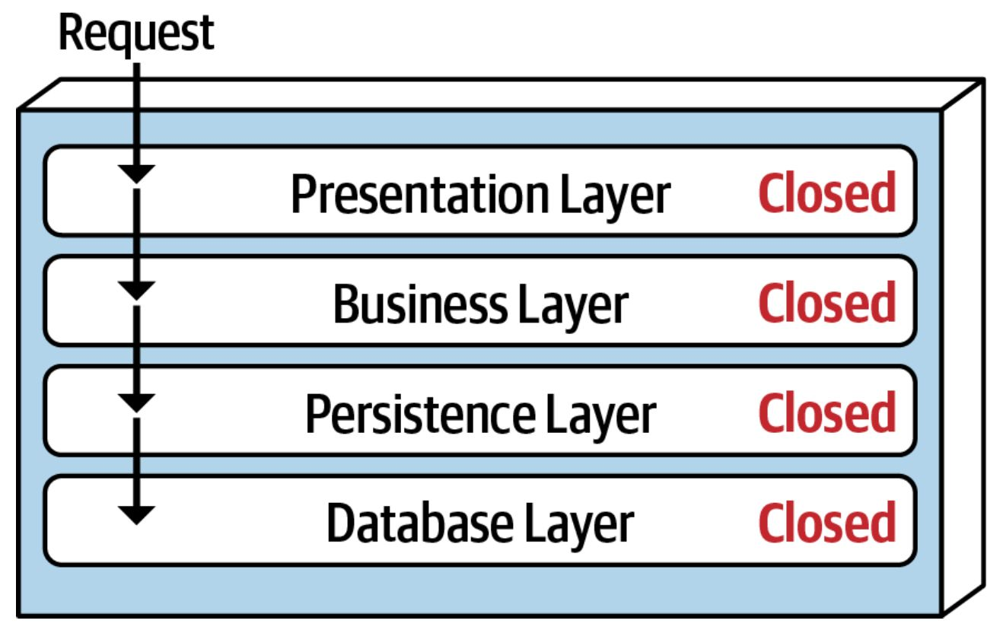

---

## Trang 7: 1.1. Layer Architecture

### 1.1. Layer Architecture
Problem: There are many share objects/components
within the business layer?
Solution: Adding a new service layer (open)

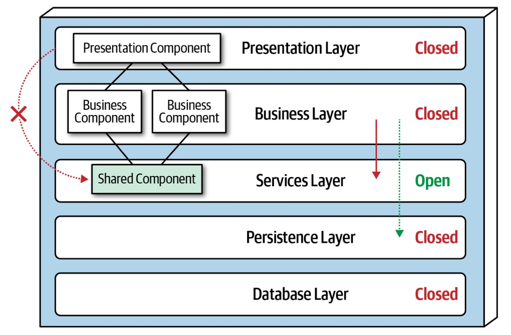

---

## Trang 8: 1.1. Layer Architecture

### 1.1. Layer Architecture
- Pros:
  - Simple and easy to implement
  - Testable
- Cons:
  - Difficult to scale
  - Interdependence between layers

---

## Trang 9: 1.2. Hexagonal Architecture

### 1.2. Hexagonal Architecture
- Idea: Put inputs and outputs at the edges to create
loosely coupled application components
- The Hexagonal Architecture is an architectural
pattern that allows input by users or external
systems to arrive into the application logic
at a Port via an Adapter
  - Port: interface
  - Adapter: implementation of the that interface
  - Creating a factory for adapters for a given
service

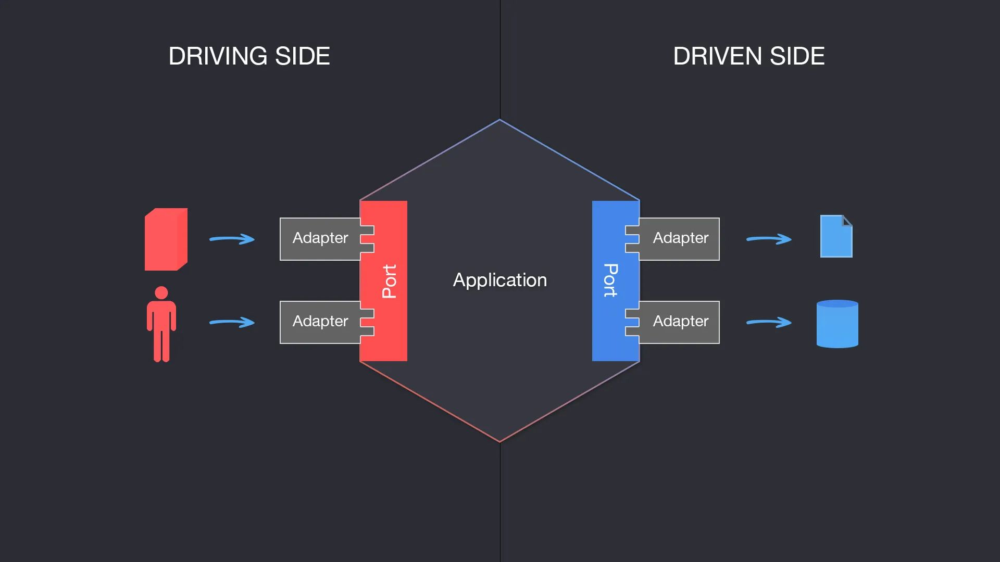

---

## Trang 10: 1.2. Hexagonal Architecture

### 1.2. Hexagonal Architecture
- Pros:
  - Loose Coupling
  - The core logic can be tested independent of
outside services.
  - Flexibility. Easy to change adapter (external
services)
- Cons:
  - Learning Curve

---

## Trang 11: 1.3. Onion Architecture

### 1.3. Onion Architecture
- Evolution of layer architecture.
Solving 2 problems of layer architecture:
  - Interdependence between layers
  - Coupling to various infrastructure
- The database (infrastructure) is not the center. It is
external. Business Domain is the center
- The Dependency Inversion
  - Nothing in an inner layer can know anything
at all about something in an outer layer.
  - Isolation between layers. Changes in a layer
do not affect to other layers.

---

## Trang 12: 1.3. Onion Architecture

### 1.3. Onion Architecture
- Pros:
  - Focus on the Domain
  - Loose Coupling
  - Testability
- Cons:
  - Complexity
  - Learning Curve

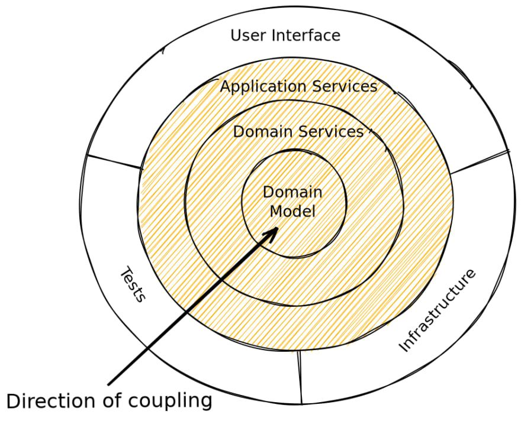

---

## Trang 13: 1.4. Clean Architecture

### 1.4. Clean Architecture
- Nothing new, just repack:
  - Hexagonal Architecture
  - Onion Architecture
  - …
- Note:
  - Never violate Dependency Inversion
  - No predefined number of layers

---

## Trang 14: 1.4. Clean Architecture

### 1.4. Clean Architecture

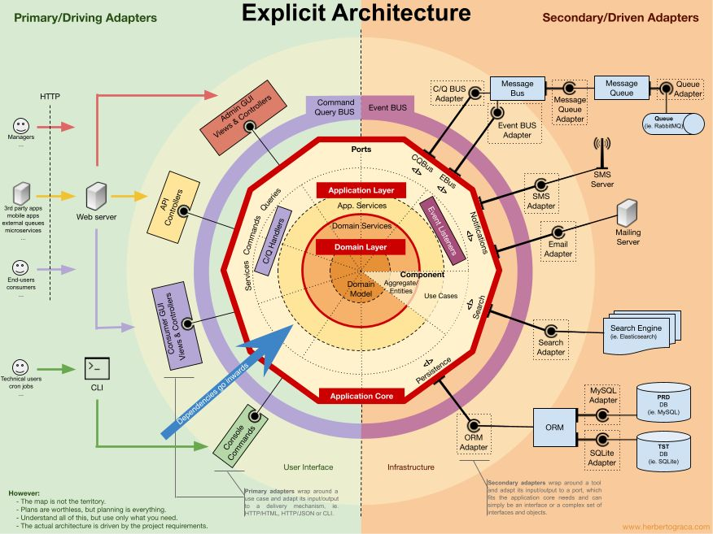

---

## Trang 15: 1.4. Crossing Boundary

### 1.4. Crossing Boundary
- Problem:
  - Controller → Entity
  - Controller returns Entity to client
- Solution:
  - Use DTO (Data Transfer Object) in Domain Layer

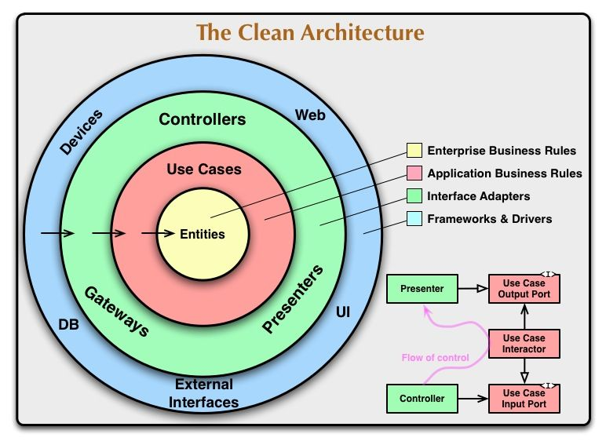

---

## Trang 16: 1.4. Crossing Boundary

### 1.4. Crossing Boundary
- Problem:
  - Domain Layer needs to save entity into DB Layer
  - This call must not be direct because that would
violate The Dependency Inversion
Solution:
- Declare Repository Interface in the inner Repository layer
(that wraps entity layer)
- Have the implementation of Repository Interface in the
outer layer

---

## Trang 17: 1.4. Clean Architecture

### 1.4. Clean Architecture
- Pros
  - Independent on frameworks, DB, external
  - Maintainable, Enhanced Collaboration
  - Testable
  - Flexible
  - Scalable
- Cons
  - Take time to set up a clean architecture
  - Violating the rules at some points by
using frameworks
  - Complexity → Learning curve, do it
wrong
- Apply it if:
  - Apps carry a lot of business logic
  - Large, long-live projects, large team
size
- Do not apply it if:
  - Small project, small team (1-3)
  - Tools, core lib
(having no / a few of business logic)

---

## Trang 18: 1.5. Functional Architecture

### 1.5. Functional Architecture
Functional Programming
- Core domain: pure business logic
- External dependencies are one-way only and I/O
is kept at the edges
Where to call I/O?
Pure function: f(x) → y
- A given input always results in the same
output (Deterministic)
- No side effects (Mutation or I/O)

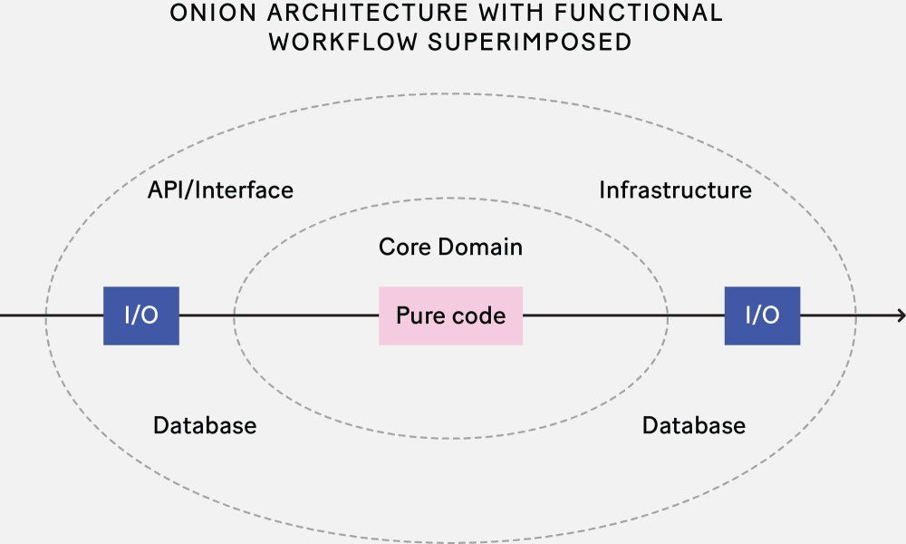

---

## Trang 19: 1.5. Functional Architecture

### 1.5. Functional Architecture
Pros:
- Distinction between unit testing and
integration testing
  - Unit testing for domain layer
  - Integration testing for application layer
- Isolation of business domain from
infrastructure
Cons:
- Transforming imperative or object-oriented to
functional programming takes time
- Learning Curve → Limited Industry Adoption

---

## Trang 20: 2. Project Structure

### 2. Project Structure

---

## Trang 21: How to define/divide domains?

How to define/divide domains?

---

## Trang 22: 3. Domain Driven Design

### 3. Domain Driven Design

---

## Trang 23: 3.1. Introduction

### 3.1. Introduction
- Domain-Driven Design is a software design approach focusing
on modeling software to match a domain, business
problems, and a constantly evolving model, leaving aside
irrelevant details like programming languages, infrastructure
technologies, etc…
- Under domain-driven design, the structure and language of
software code (class names, class methods, class
variables) should match the business domain
- It is also a working methodology

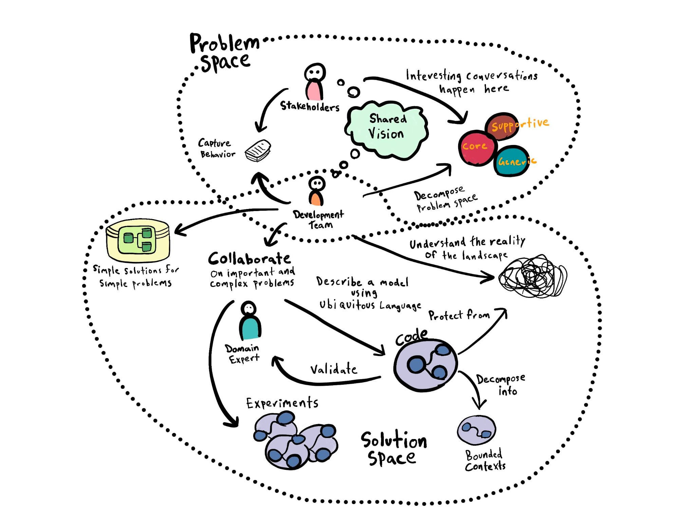

---

## Trang 24: 3.2. Bounded Context

### 3.2. Bounded Context
- A bounded context is a grouping of related functionality, components and concepts.
- Within the context, we share a common language
  - Example 1: a “letter” could mean 2 very different things
■ Post office: a message written on paper
■ Education: a character
  - Example 2: credit could have 2 meanings
■ Lending: the ability of a customer to obtain goods or services before payment, based on
the trust that payment will be made in the future.
■ Payment: the account receiving money
- Bounded contexts can continue operating independently

---

## Trang 25: 3.2. Collaborative Modeling

### 3.2. Collaborative Modeling
- Developers collaborate with domain experts to refine
the Domain Model
- Force developers understand business problem
- To collaborate effectively between business and technical
teams
→ Ubiquitous Language
- Ubiquitous Language will be embedded in the code.

---

## Trang 26: 3.3.1. Tactical Design

### 3.3.1. Tactical Design
- Entity:
  - Entity is an object that has ID and lifecycle
  - Entity is not defined solely by their attributes
  - For example: User, Flight, Booking, …
- Value Object:
  - Object is only identifiable by its value
  - Value objects describe characteristics, dont have ID and immutable.
  - Value Objects are attributes of, and can be shared by multiple entities
  - For example:
■ Address: Street, Postal Code
■ Money: Currency, Amount
■ Configuration, Enum, …

---

## Trang 27: 3.3.2. Tactical Design

### 3.3.2. Tactical Design
- Aggregate
  - An aggregation of Entities and Value Objects to restrict the violation of business invariants
  - Requires transactional consistency
  - Each Aggregate has an Aggregate Root that faces outwards and controls all access to the
objects inside the boundary
  - Example: User, Booking, …
- Service
  - Service should be stateless
  - Example: BookingService
- Repository
  - All repository interface definitions should reside in the Domain Layer, but their concrete
implementations belong in the Infrastructure Layer.
  - Example: BookingRepository in Domain layer, BookingRepositoryImpl in Infrastructure layer

---

## Trang 28: 3.3.2. Tactical Design

### 3.3.2. Tactical Design

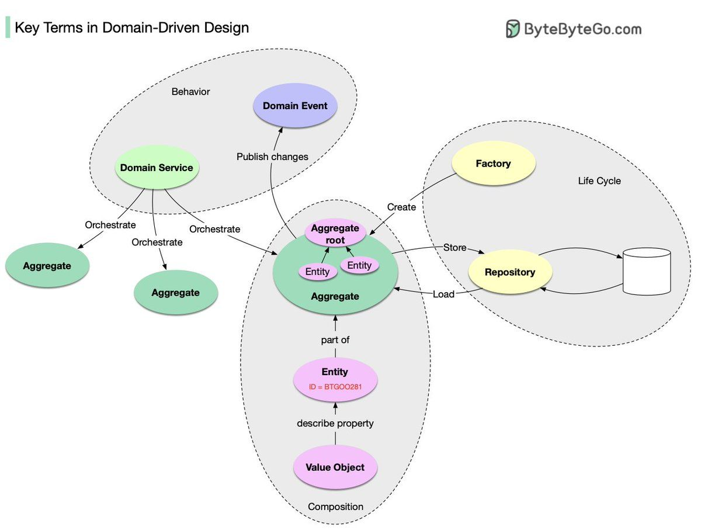

---

## Trang 29: 3.4. Layers

### 3.4. Layers
- DDD proposes a Layered Architecture, separating
domain logic from all other functionality will reduce the
leakage and will avoid confusion in a large and complex
system.
  - User Interface Layer
  - Application Layer: an orchestrator of domain
work, it does not know domain rules
  - Domain Layer: holds the business logic, rules and
Domain Model
  - Infrastructure Layer: implements all the technical
functionalities the application needs. For example:
utility, persistence, messaging, …

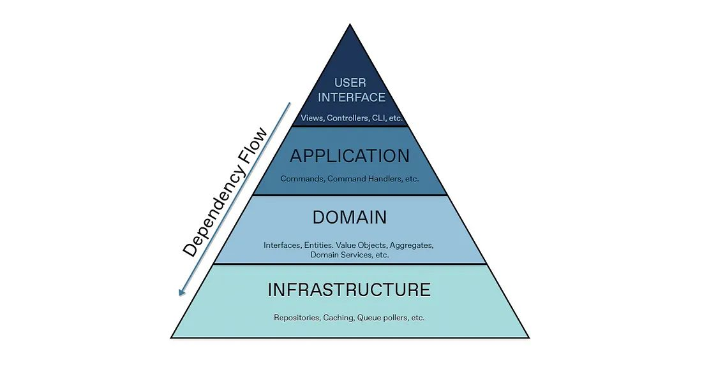

---

## Trang 30: Recap

### Recap
- Isolation of layers
- Dependency Inversion vs Dependency Injection
- Developers understand business problem → code match business domain

---

## Trang 31: References

### References
- https://blog.cleancoder.com/uncle-bob/2012/08/13/the-clean-architecture.html
- https://increment.com/software-architecture/primer-on-functional-architecture/
- https://herbertograca.com/2017/11/16/explicit-architecture-01-ddd-hexagonal-onion-clean-cqrs-how-i-put-it-all-together
- https://beyondxscratch.com/2020/08/23/hexagonal-architecture-example-digging-a-spring-boot-implementation/
- https://medium.com/ssense-tech/hexagonal-architecture-there-are-always-two-sides-to-every-story-bc0780ed7d9c
- https://medium.com/kayvan-kaseb/the-layered-architecture-pattern-in-software-architecture-324922d381ad
- https://netflixtechblog.com/ready-for-changes-with-hexagonal-architecture-b315ec967749
- DDD:
  - https://medium.com/ssense-tech/domain-driven-design-everything-you-always-wanted-to-know-about-it-but-were-af
raid-to-ask-a85e7b74497a
  - https://medium.com/raa-labs/part-1-domain-driven-design-like-a-pro-f9e78d081f10
  - https://medium.com/tacta/a-decade-of-ddd-cqrs-and-event-sourcing-74edc8211039
  - https://github.com/heynickc/awesome-ddd
  - https://www.youtube.com/watch?v=fO2T5tRu3DE&list=PLYpjLpq5ZDGtR5nMKGDCa031hx1jVuHXn

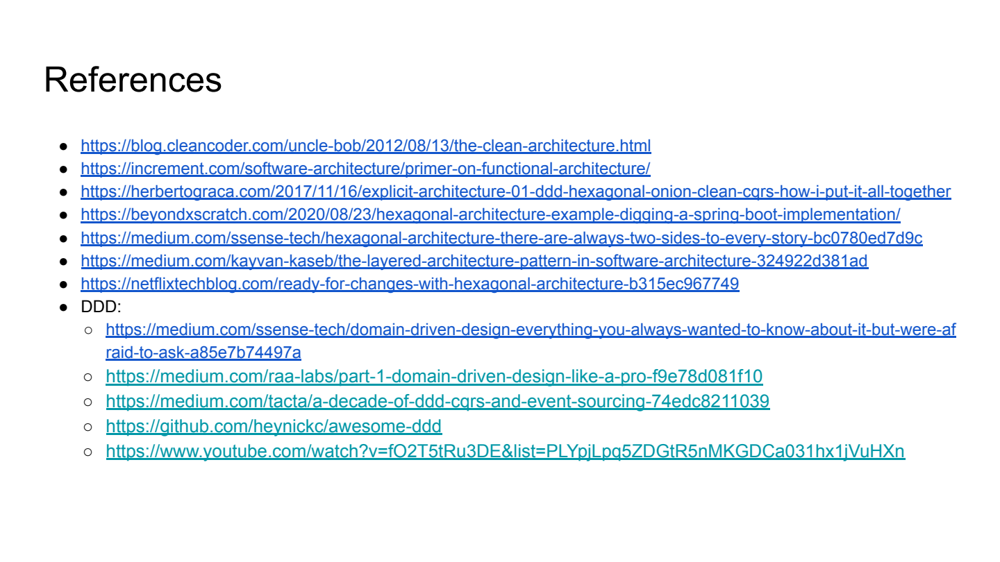

---

## Trang 32: Homework

### Homework
- Create a codebase
  - Apply Clean Architecture + DDD
  - Use case: Flight Booking
  - Implement in high-level
■ Create packages, classes only
■ Dont code

---

## Trang 33: Thank you

Thank you

---
