# 5. Networking

> **Tổng số trang:** 36 slide | **Thư mục ảnh/sơ đồ:** `assets/5_Networking/`

---

## Trang 1: Computer Network

### Computer Network
“Life is struggle” - Karl Marx

---

## Trang 2: Outline

### Outline
### 1. Fundamentals
  - History
  - Network Types
  - OSI Model
  - Protocols
### 2. Network Topology
### 3. Web
  - What happens when you type in a URL on a browser?
  - HTTP Routing

---

## Trang 3: 1. Fundamentals

### 1. Fundamentals

---

## Trang 4: 1.1. History

### 1.1. History
Year Event
1961 Leonard Kleinrock proposed the earliest computer networks, which was the idea of
ARPANET.
1969 On ARPANET, the first data transmission was sent by using it.
1973 Robert Metcalfe developed the Ethernet
1978 The TCP/IP protocol was developed and invented by Bob Kahn for networks
1981 IPv4 was officially defined in RFC 791
1991 Tim Berners-Lee invented the World Wide Web (WWW)
1996 IPv6 was introduced
1997 Wi-Fi was introduced
2004 Tim O'Reilly and Dale Dougherty popularize the term of Web 2.0
roninhub.com

---

## Trang 5: 1.2. Network Types

### 1.2. Network Types
- Intranet
  - Connections inside an organization
  - Any services within an intranet are restricted
  - These services remain private and inaccessible
from the Internet.
  - Example: network in a bank
- Extranet
  - Extends intranet
  - Connects to partners, customers, …
  - Example: a bank connects to a merchant partners via leased lines
- Internet
  - Services that are publicly available or computer outside of our own networks
  - Example: Gmail, Youtube, Facebook, …

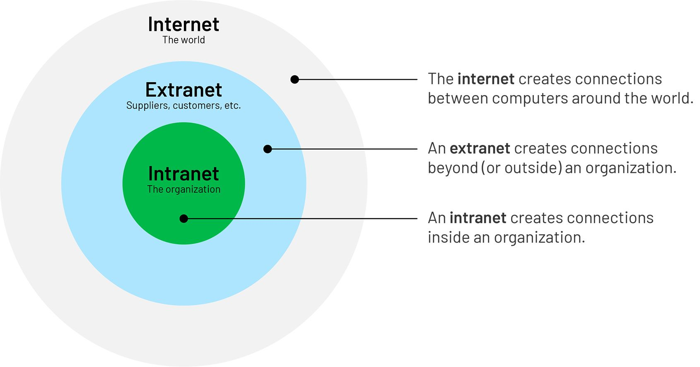

---

## Trang 6: 1.3. OSI Model

### 1.3. OSI Model
roninhub.com

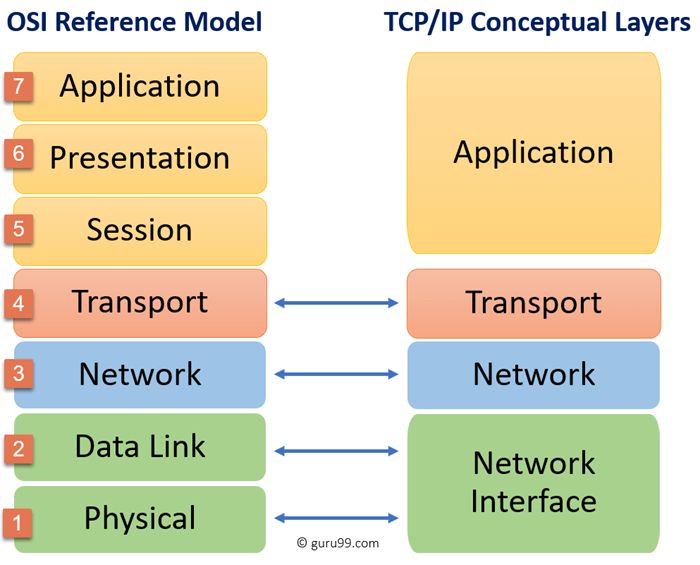

---

## Trang 7: 1.3. OSI Model

### 1.3. OSI Model
### 1. Physical Layer
- This layer converts data in the form of digital bits into physical signals (electrical, radio, or
optical signals) to create the physical connection between devices.
### 2. Data Link Layer
- Is responsible for the host-to-host transfers
on the same local network
- Error detection and error correction
- Identification: MAC (Media Access Control) address
- Protocols: Ethernet, WiFi, PPP
roninhub.com

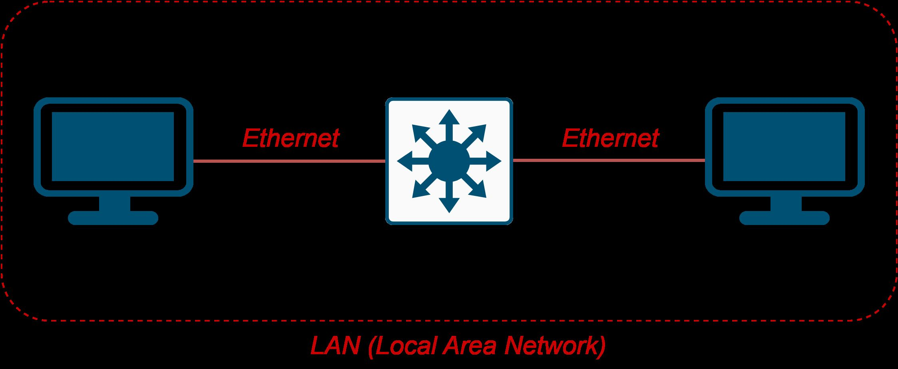

---

## Trang 8: 1.3. OSI Model

### 1.3. OSI Model
### 3. Network Layer
- Transferring data flows from a host on one network to a host on another network
- Unreliable
  - Delivery of packets
  - In-order packets
  - Integrity of data
- Identification: IP Address
- Protocol: IP
roninhub.com

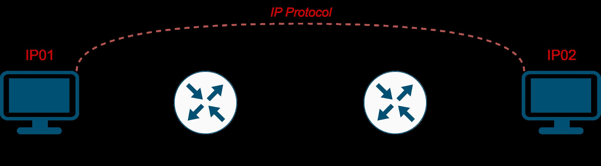

---

## Trang 9: 1.4. OSI Model

### 1.4. OSI Model
### 4. Transport Layer
- Transferring data between applications/processes
- Providing reliable data transfer services to the upper layers
  - Flow Control
  - Segmentation
  - Error Control
- Identification: Port. There might be many processes receiving or transmitting data on an OS,
so Port number is needed to distinguish processes.
- Protocols: TCP, UDP

---

## Trang 10: 1.3. OSI Model

### 1.3. OSI Model
### 5. Session Layer
- Sending and receiving data at the same time
- Establishing procedures for performing checksum, suspending, restarting, and terminating a
session
- Identification: Socket
### 6. Presentation Layer
- Converting data into a format that applications can understand
- Encryption: TLS/SSL
### 7. Application Layer
- Providing application functions for users
- Protocols: HTTP, FTP, DNS, SMTP, Telnet, …

---

## Trang 11: 1.3. OSI Model

### 1.3. OSI Model
The data that the application need to transmit, might be very large, so it is difficult to transmit directly.
What mechanism to handle this situation?
→ Data packet must be divided into blocks, so that even if there is a If a block is lost or corrupted, only
that one block needs to be resent instead of the entire packet.
- Challenge: What identical information to establish a socket?
- Source IP, Source Port
- Destination IP, Destination Port
- Transport Protocol: TCP / UDP

---

## Trang 12: 1.3. OSI Model

### 1.3. OSI Model
Layer
Number
Layer Name Function Overview Protocol(s) Identification Device Data Unit
7 Application Providing application functions for users HTTP, FTP, DNS,
SMTP, Telnet, …
User Identity Computer Data
6 Presentation Converting data into a format that applications
can understand; Encryption
TLS/SSL CA Certs Computer,
Firewall
Data
5 Session Establishing sessions Socket Firewall Data
4 Transport Transferring data between
applications/processes reliably
TCP, UPD Port Firewall Segment
3 Network Transferring data from a host on one network
to a host on another network
IP IP Router Packet
2 Data Link Host-to-host transfers
on the same local network
Ethernet,
WiFi,
PPP
MAC Switch,
Hub
Frame
1 Physical Creating the physical connection between
devices
Cable Port, … Cable, … Bit

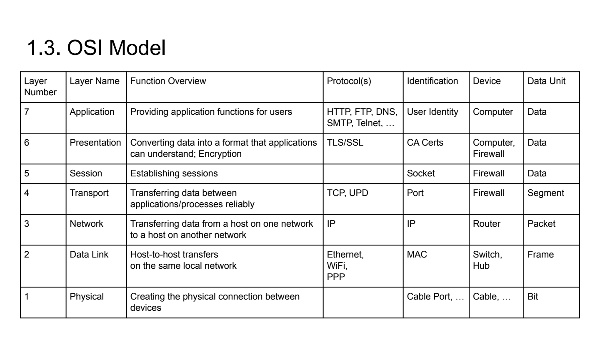

---

## Trang 13: 1.4. Encapsulation

### 1.4. Encapsulation
- Each layer adds its own protocol header
- Each layer has its own data unit
- Maximum transmission unit (MTU) of Frame
is 1500 B by default
- Trade off: MTU vs Throughput

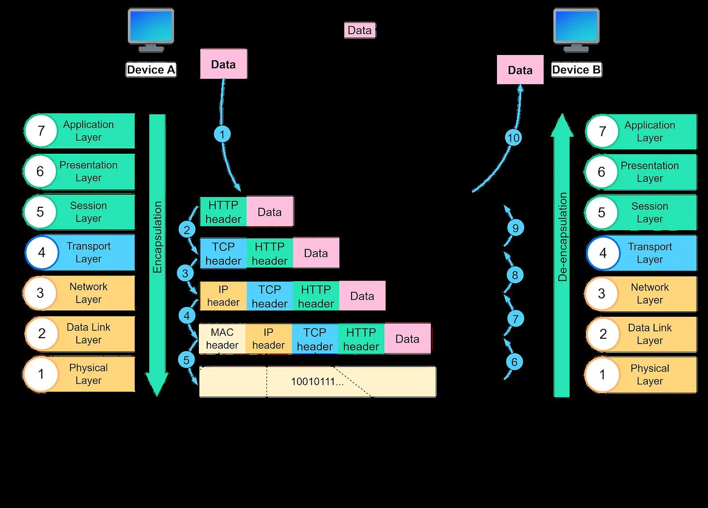

---

## Trang 14: 1.5. IP

### 1.5. IP
- IP is responsible for communication between two devices not connected directly
  - Example: Lang Son – train → Noi Bai Airport – aircraft → HCM
- IPv4: 32 bit, 4 groups of 8 bits are separated by “.”
  - Example: 192.168.0.1
- ~ 4.3 billion IPv4 address
- IP address is assigned to network card, a host/device can have multiple IP addresses
→ Problem: IPv4 exhausted
- Solution:
  - Multiple hosts use a IP address (private / public IP)
  - Extend the range of IP address (IPv6)

---

## Trang 15: 1.5.2. Public / Private IP

### 1.5.2. Public / Private IP
- Public IP address
  - It is unique on the global internet and can
be used to identify a device or network on
the internet.
  - Is managed by ISP (Internet Service
Provider)
- Private IP address
  - Is used within a private network (LAN)
  - Not unique globally and can be duplicated
in different private networks.
  - 192.168.x.x, 172.16.x.x to 172.31.x.x, and
### 10.x.x.x
- NAT Overload (PAT) rescues IPv4

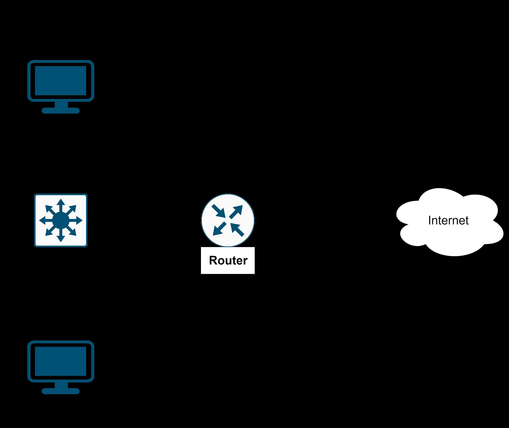

---

## Trang 16: 1.5.3. IP Classes

### 1.5.3. IP Classes
- Class A, B, C are divided into 2 parts: network
number and host number
  - Example: Network ID is a department,
host ID is an employee
- Class D is often used for multicast
- Class E is a reserved classification that is not
used temporarily
Disadvantages:
- Not flexible, not even distribution
  - Example: a B network can have ~ 65k host.
On other hand, a C network can have 254 hosts only
- Difficile to manage
→ Classless Inter-Domain Routing (CIDR)

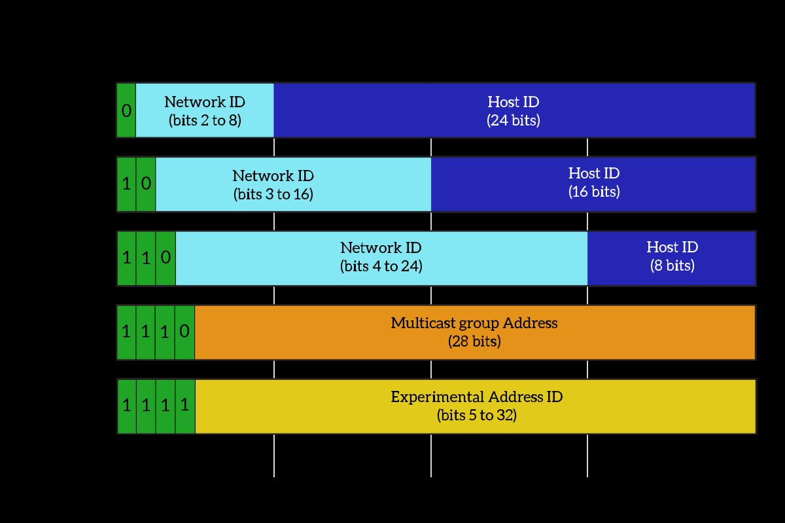

---

## Trang 17: 1.5.4. CIDR

### 1.5.4. CIDR
- 32-bit IP address is 2 parts:
Network ID and Host ID
- Prefix length means the first x bits belong to
network ID
- Number of available addresses for the network
### 192.168.1.0/24
= 2^(32-24) - 2
= 2^8 - 2
= 254 (hosts)
- Why subtract 2?
- The first address for network ID
- The last address for broadcasting
  - Broadcast packet is prevent from other networks
by router

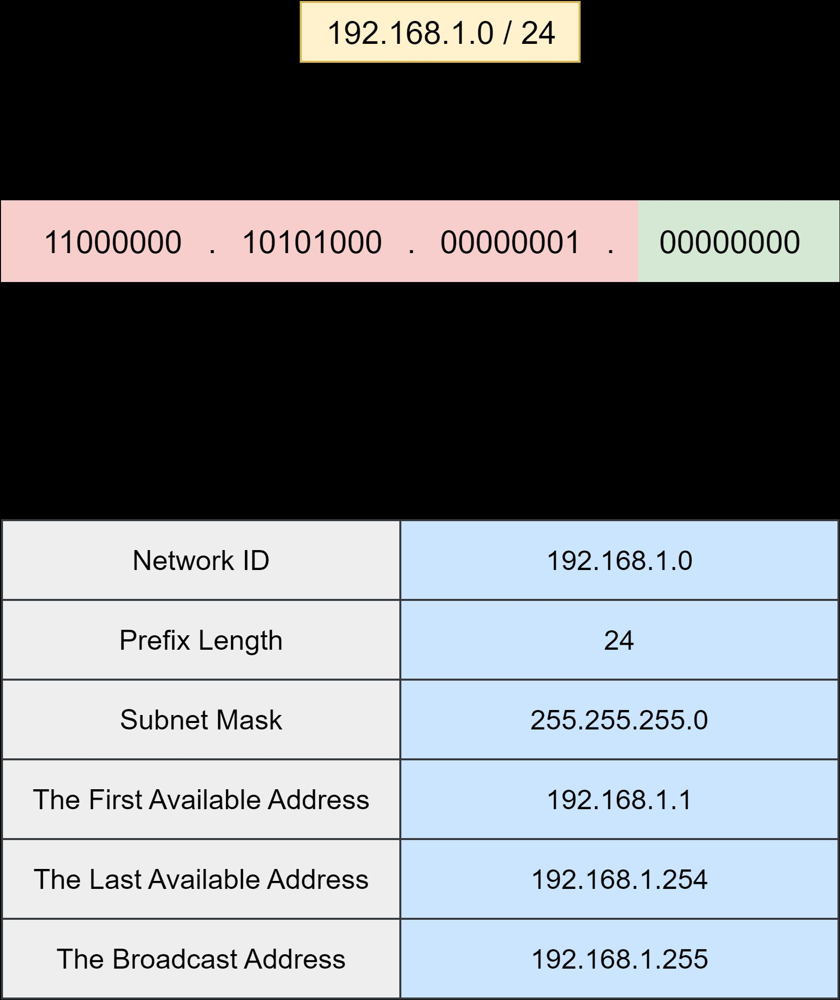

---

## Trang 18: 1.6. TCP vs UDP

### 1.6. TCP vs UDP
TCP UDP
Connection
Type
Connection-Oriented
Establishing a connection
beforehand
Connectionless
No establishing a connection
beforehand
Error Checking Robust: Flow Control, ACK Basic: checksums
Retransmission Yes No
Sequence Yes: Transmission Control No
Header Length 20-60 B 8B
Broadcasting No Yes
Speed Slower Faster
Reliability Yes No
Application Email, web, … VoIP, video streaming, …

---

## Trang 19: 1.7. TLS/SSL Handshake

### 1.7. TLS/SSL Handshake
### 0. Create a TCP connection
### 1. Client says hello to server
### 2. Server sends to client: SSL Certificate
(Public Key + Signature) + server random
### 3. Client verifies server’s certificate
### 4. Client generate and encrypt a client random
### 5. Server decrypted message to get client random
### 6. The session key is generated based on server
random + client random.
Transferred data is encrypted by session key as a
symmetric key

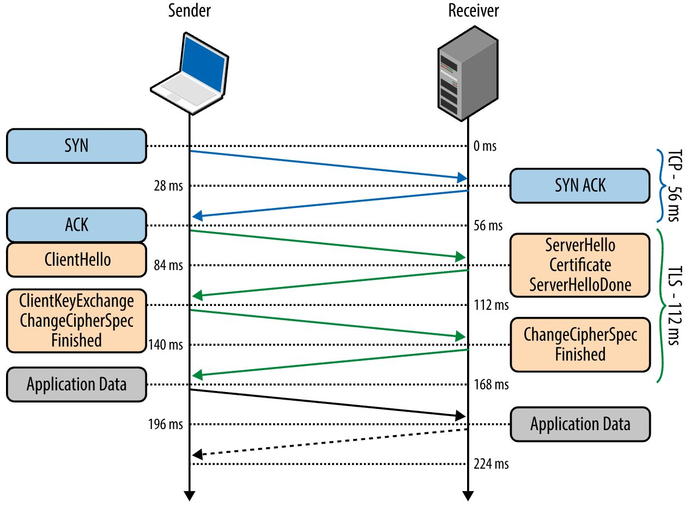

---

## Trang 20: 1.7. TLS/SSL Handshake

### 1.7. TLS/SSL Handshake
- Asymmetric encryption is more secure than symmetric encryption.
- Client and server use asymmetric encryption to change cipher.
- Why do client and server use a session key (symmetric key) to transfer data?
→ Symmetric encryption is less secure but cheaper and faster than asymmetric encryption.
- To improve security, we can change symmetric key while transferring data

---

## Trang 21: 2. Network Topology

### 2. Network Topology

---

## Trang 22: 2.1. Network Services

### 2.1. Network Services
- DHCP Servers
  - Automatically assigns and manages IP addresses and other network configuration settings to
devices on a local network
- DNS server
  - Translate human-readable domain names into IP addresses
- Firewall
  - Monitor and filter incoming and outgoing network traffic based on an organization's previously
established security policies.
- Proxy Server
  - An intermediary server act as a gateway, forwarding requests and responses between the
user and the target server
- FTP Server

---

## Trang 23: 2.2. Network Topology

### 2.2. Network Topology

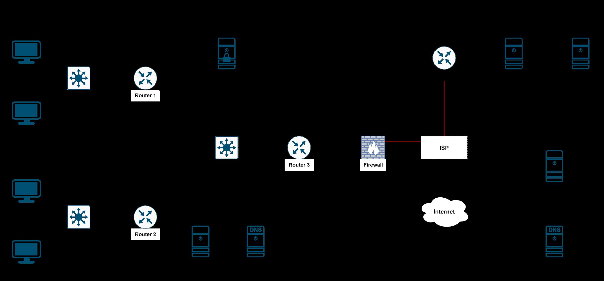

---

## Trang 24: 2.3. Network Topology At Home

### 2.3. Network Topology At Home
What are functions of the modem in your home network?
- Switch
- Wireless Access Point
- Router
- DHCP
- Firewall
- Web server

---

## Trang 25: 3. What happens when you type in a URL on a browser?

### 3. What happens when you type in a URL on a browser?

---

## Trang 26: 3.1. Browser parses URL

### 3.1. Browser parses URL
- Browser parses URL
- If path of the resource is missing → default file: index.html
- Browser makes a HTTP request

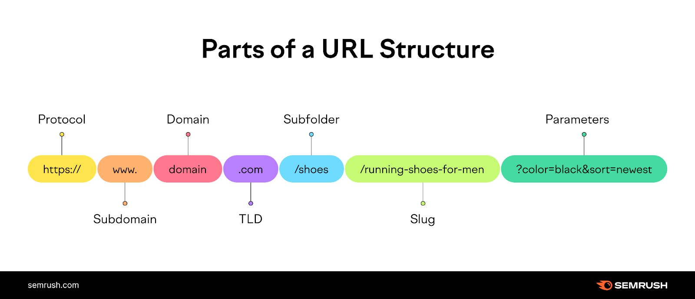

---

## Trang 27: 3.2. DNS Lookup

### 3.2. DNS Lookup
### 1. DNS Cache in browser
### 2. Hosts file of OS
### 3. DNS server / resolver:
### 3.1. Root Server (.)
### 3.2. Top Level Domain (TLD) Server (.com.)
### 3.3. Authoritative Server (example.com.)

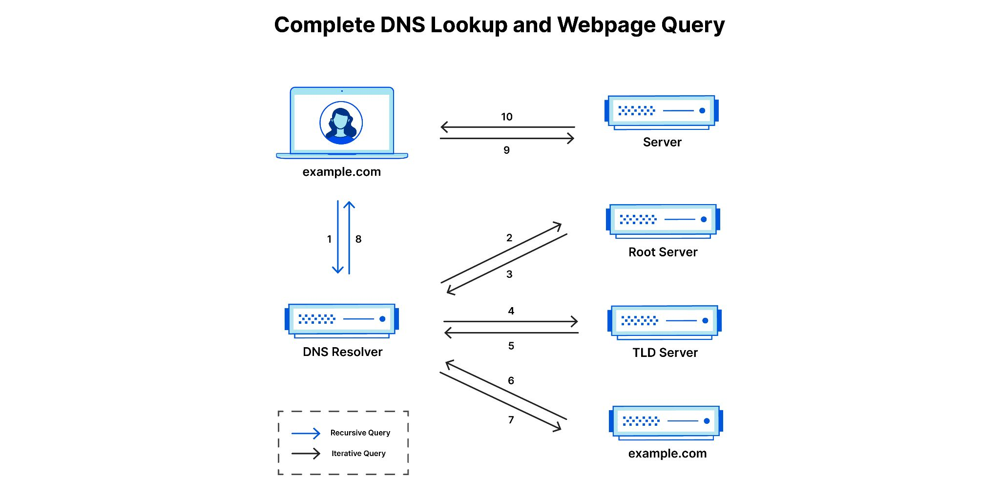

---

## Trang 28: 3.3. IP

### 3.3. IP
- Question:
  - Assuming that the client has multiple network cards.
  - Each network interface has a IP address.
  - Which IP should be selected as the source address? Which route should be selected?
- The routing table contains information that is used
to determine the best possible path for data packets
to travel across a network.
- Based on the routing table rules
- $ route -n

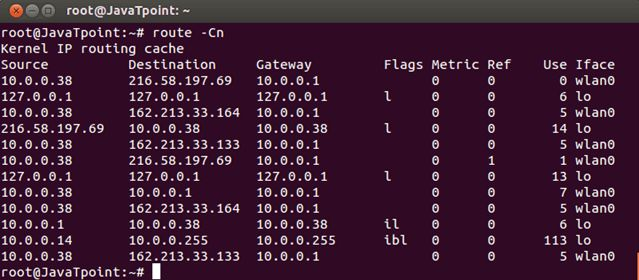

---

## Trang 29: 3.4. Protocol Stack

### 3.4. Protocol Stack
- In each layer, message add another headers.
- Data is split in unit length based on each
layer.

---

## Trang 30: 3.5. Routing

### 3.5. Routing
- Internet is a bunch of connected routers.
And it contains many region.
- In a region, each router know the way to
reach others (based on routing table
generated by routing protocol).

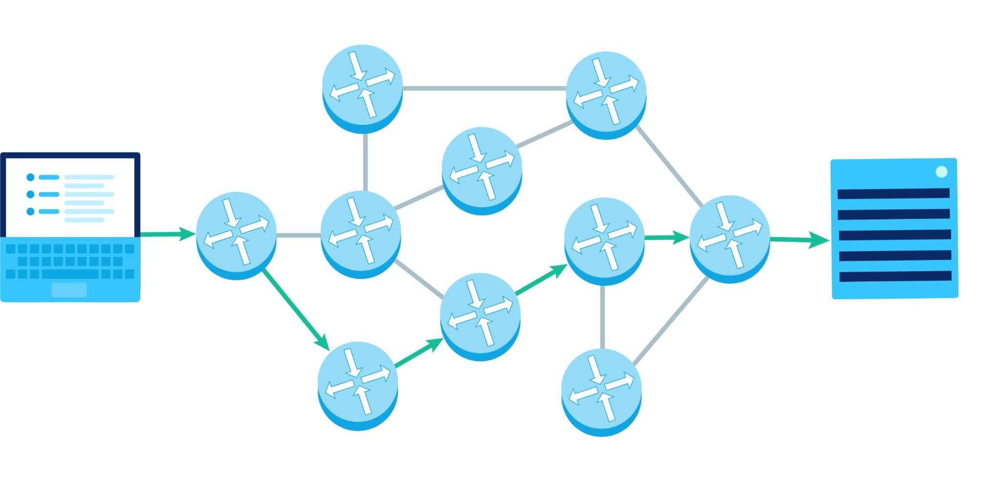

---

## Trang 31: 3.6. Three Way Handshake

### 3.6. Three Way Handshake

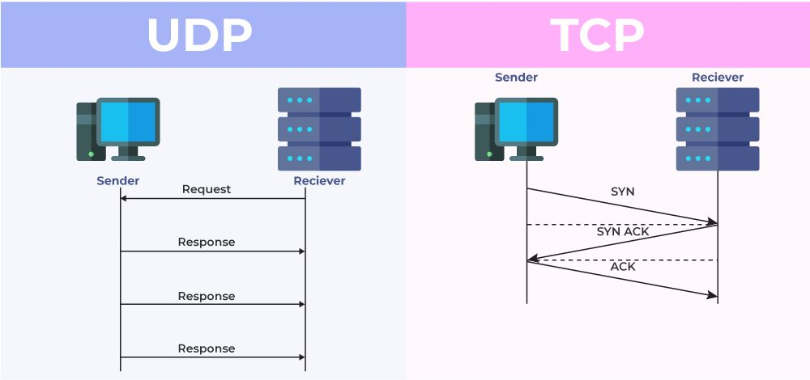

---

## Trang 32: Recap

### Recap
- Internet is a bunch of connected routers.
- TCP is reliable, establishing a connection/handshake beforehand
- Use hosts file to fake DNS lookup

---

## Trang 33: Read More

### Read More
- TCP retransmission, sliding window, flow control, congestion control
  - Batching package
- NAT
- IPv6
- TLS/SSL Handshake

---

## Trang 34: References

### References
- https://hpbn.co/transport-layer-security-tls/
- https://auth0.com/blog/the-tls-handshake-explained/

---

## Trang 35: Homework

### Homework
Take one of the two following:
Install Nginx and configure:
- Reversed Proxy (nginx) :80 → BE :3000
- gw-routing

---

## Trang 36: Thank you

Thank you

---
