# 6. Redis

> **Tổng số trang:** 46 slide | **Thư mục ảnh/sơ đồ:** `assets/6_Redis/`

---

## Trang 1: Redis

### Redis
“It does not matter how slowly you go as long as you do not stop.”
- Confucius

---

## Trang 2: Outline

### Outline
### 1. Introduction
### 2. How Redis Works?
  - Why is Redis So Fast?
  - How Redis store data?
  - Expired Deletion
  - Data Persistence
### 3. In Practices
  - Data Structures
  - Practices

---

## Trang 3: 1. Introduction

### 1. Introduction

---

## Trang 4: 1.1. Definition

### 1.1. Definition
- Redis is an open-source, in-memory database.
- Redis provides a variety of data structures to support different business
scenarios.
- Redis also supports many features: transactions, persistence, Lua
scripts, multiple cluster solutions, publish/subscribe mode, memory
elimination mechanism, …
- Use cases: caching, key-value database, message queue, …

---

## Trang 5: 1.2. Redis vs Memcached

### 1.2. Redis vs Memcached
- Similarities:
  - In-memory databases and generally used as cache.
  - Expiration policies
  - High performance
- Differences:
  - Redis (single-thread) runs on single core. Memcached runs multiple cores.
  - Redis is better on read operations and memory efficient.
Memcached is better on write operations.
> 16 GB impact to the performance of a single Redis instance.
  - Redis supports more data structures.
  - Redis supports data persistence. Memcached does not.
  - Redis supports cluster mode. Memcached does not.
  - Redis provides other features: transaction, pub/sub, lua script, …

---

## Trang 6: 1.3.1. Architecture / Master-Slave

### 1.3.1. Architecture / Master-Slave
- Replication: Data is written to a master instance. The
main instance sends copies of those commands to a
replica asynchronously
- Pros:
  - Scalable for reads
- Cons:
  - Data inconsistency
  - Failover. If master is down, which slave would
become the new master?
- To solve failover:
  - Sentinel
  - Cluster

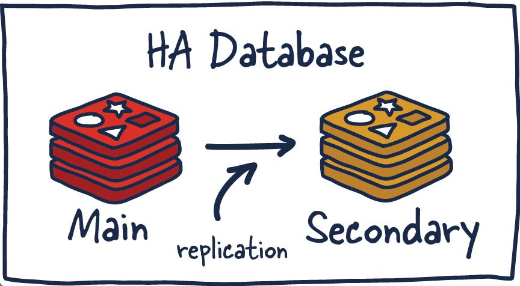

---

## Trang 7: 1.3.2. Architecture / Sentinel

### 1.3.2. Architecture / Sentinel
- Sentinel mode can monitor the master and slave servers
- In addition, sentinel node serves a role in service discovery
- When master goes down, sentinels node elect 1 node as
leader to decide which slave becomes master and configure
other slaves to follow the new master.
- Pros:
  - Solve Failover
- Cons:
  - Data inconsistency
  - Operational Overhead
  - Not scale for writes. All writes go to master

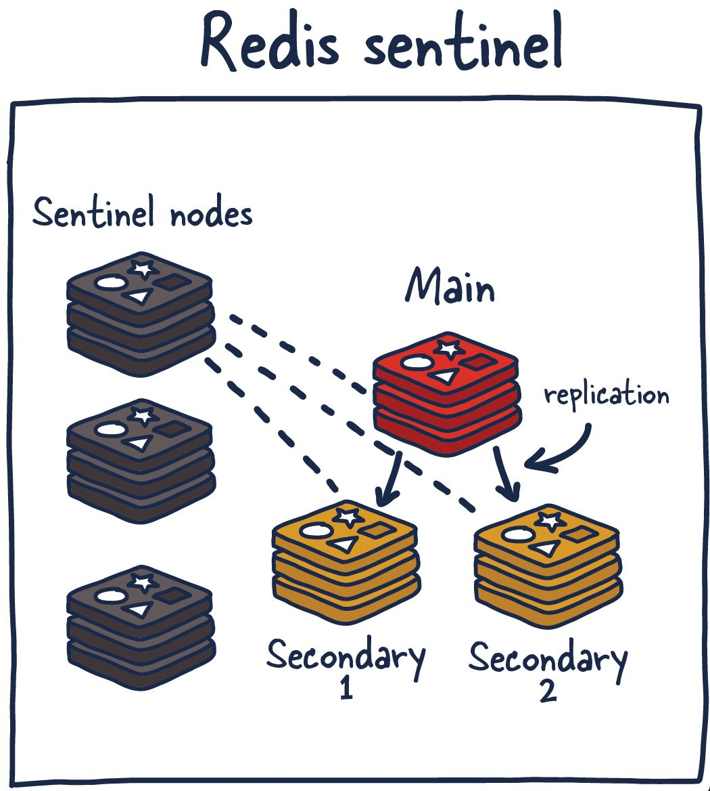

---

## Trang 8: 1.3.3. Architecture / Cluster

### 1.3.3. Architecture / Cluster
- Distributes the data on different servers
- Pros:
  - Solve Failover
  - Reduce the system's dependence on a single
master node
  - Scalable for read and write
- Cons:
  - Data inconsistency
  - Operational Overhead
- Choose one of modes:
  - Master-Slave
  - Sentinel
  - Cluster (recommended)

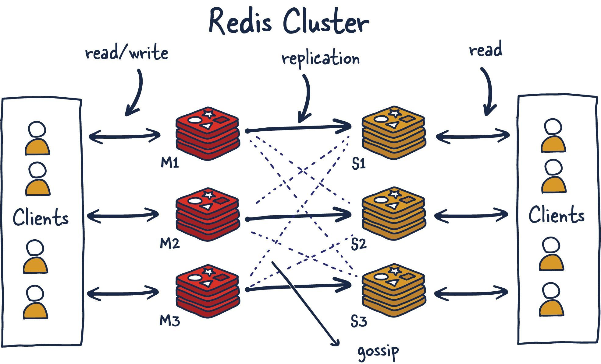

---

## Trang 9: 1.3.3. Architecture / Cluster

### 1.3.3. Architecture / Cluster
- Hash Slots handle the mapping relationship between data and nodes
- A cluster has a total of 16384 hash slots
- Even distribution on nodes in a cluster
- One hash slots can have multiple keys

---

## Trang 10: 2. How Redis Works?

### 2. How Redis Works?

---

## Trang 11: 2.1. Why is Redis So Fast?

### 2.1. Why is Redis So Fast?

---

## Trang 12: 2.1.1. Redis Bottleneck

### 2.1.1. Redis Bottleneck
- What are bottlenecks of Redis?
  - Memory
  - Network bandwidth
  - Not CPU

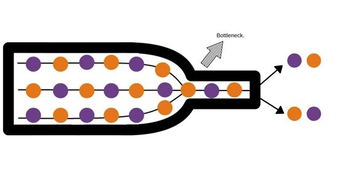

---

## Trang 13: 2.1.2. Why is Redis So Fast?

### 2.1.2. Why is Redis So Fast?
- In-Memory
- Single Thread Model
  - CPU is not the bottleneck
  - Avoid context switching for multi-threads
  - Multi-threading app require locks or other synchronization mechanisms
→ complexity, bug prone → difficult to gain performance
- Multiplexing I/O
  - One thread processes multiple IO streams
- Efficient Data Structures

---

## Trang 14: 2.1.3. Note

### 2.1.3. Note
- How to maximize CPU usage?
- Run multiple instances of Redis in the same server/machine
- After version 6.0, Redis is not single-threaded actually
  - Main thread execute commands
  - Other threads handle data persistence, network I/O

---

## Trang 15: 2.2. How Redis Store Data?

### 2.2. How Redis Store Data?

---

## Trang 16: 2.2. How Redis Store Data?

### 2.2. How Redis Store Data?
- A dictionary is a hash table → quick search O(1)

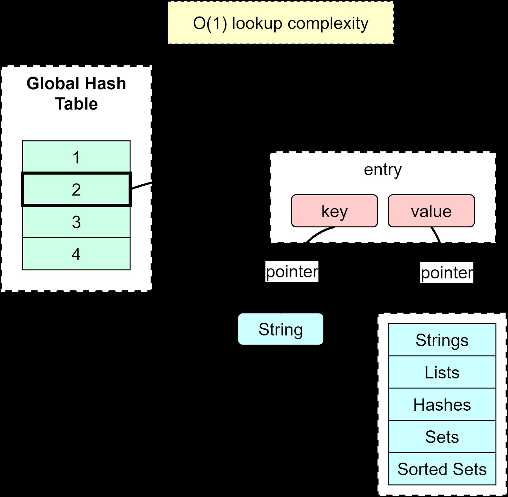

---

## Trang 17: 2.3. Expired Deletion

### 2.3. Expired Deletion

---

## Trang 18: 2.3.1. How to determine if the key has expired?

### 2.3.1. How to determine if the key has expired?
- 2 dictionaries:
  - Key dictionary
  - Expire dictionary
- When accessing a key, Redis first check if the key
exists in the expire dictionary
  - If not, read the key value normally
  - If it exists, then compare with current time.
  - If it is smaller than the current time
→ expired
→ return null

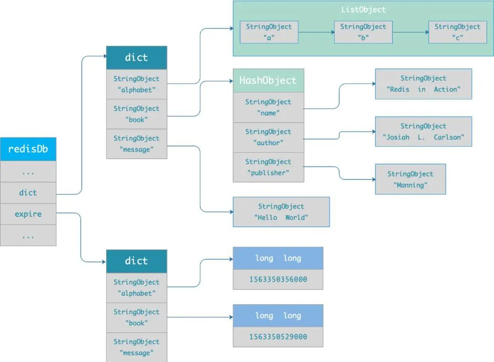

---

## Trang 19: 2.3.2. What are the expiration deletion strategies?

### 2.3.2. What are the expiration deletion strategies?
- Passive Way:
  - Key is not deleted immediately right after
expiration.
  - When the key is accessed, if it expires,
then delete the key asynchronously.
→ Problem: some keys is never accessed after they are
created
→ memory space wasted

---

## Trang 20: 2.3.2. What are the expiration deletion strategies?

### 2.3.2. What are the expiration deletion strategies?
- Active Way: Periodic job (activeExpireCycle): 10 times/s
  - Randomly select 20 keys from the expired dictionary
  - Check whether these 20 keys have expired and delete the expired keys
  - If the number of expired keys exceeds 25% of the number of randomly selected keys, continue
to repeat step 1. If it does not, then the current job stops and wait for the next round
→ Problem: if the active job is long, active job will block other requests.
→ Set timeout for active jobs

---

## Trang 21: 2.3.2. What are the expiration deletion strategies?

### 2.3.2. What are the expiration deletion strategies?
- Combine 2 ways: passive way + active way
- New Approach: Expiration of keys is stored in a Sorted Set (ZSET)
→ find expired keys more effectively
- Problem: Finding expired keys is not effective

---

## Trang 22: What happens when Redis memory is full?

What happens when Redis memory is full?

---

## Trang 23: 2.4. Memory Eviction

### 2.4. Memory Eviction
- Noeviction: The default memory eviction
- Random
- TTL: prioritize the elimination of key values that expire earlier
- LRU (Least Recently Used)
- LFU (Least Frequently Used)

---

## Trang 24: 2.4. Data Persistence

### 2.4. Data Persistence

---

## Trang 25: 2.4.1. AOF (Append Only File)

### 2.4.1. AOF (Append Only File)
- Pros:
  - Avoid additional checking overhead
  - Do not block the execution of the current write
operation command
  - Less data loss
- Cons:
  - Data loss
  - May block other operations
  - If too many AOF logs → slow recovery

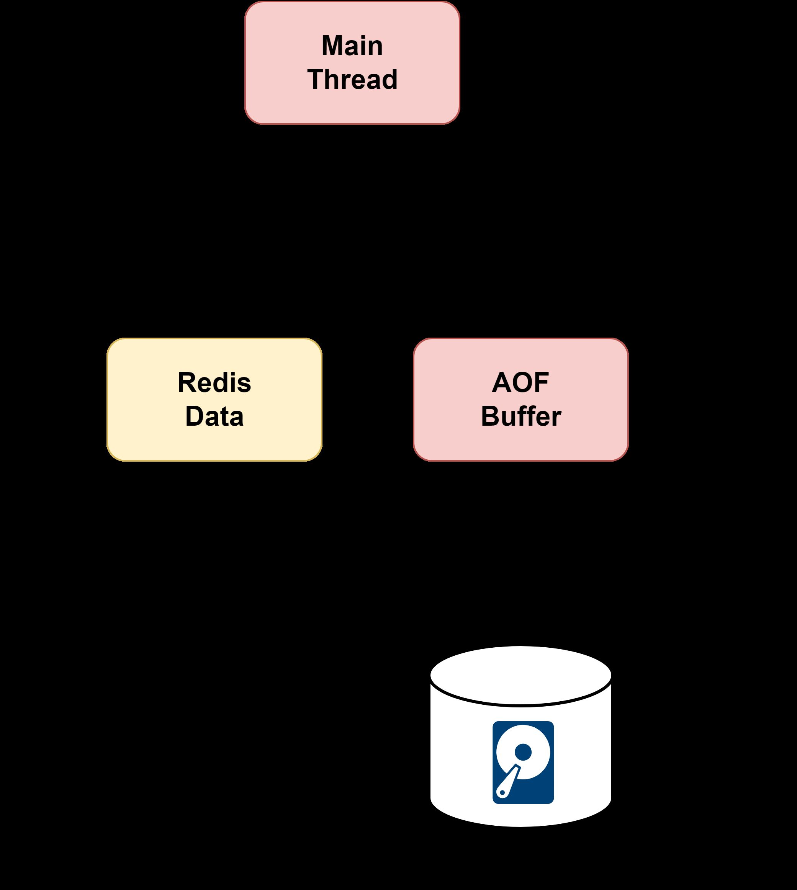

---

## Trang 26: 2.4.2. RDB (Redis Database)

### 2.4.2. RDB (Redis Database)
- The default mode
- 2 ways to generate RDB files:
  - Save command: RDB is generated in the
main thread → blocking the main thread
  - Bgsave command: a child process generates
RDB → avoid blocking the main thread
- Pros:
  - Fast Recovery
- Cons:
  - Data loss
  - A relatively heavy operation

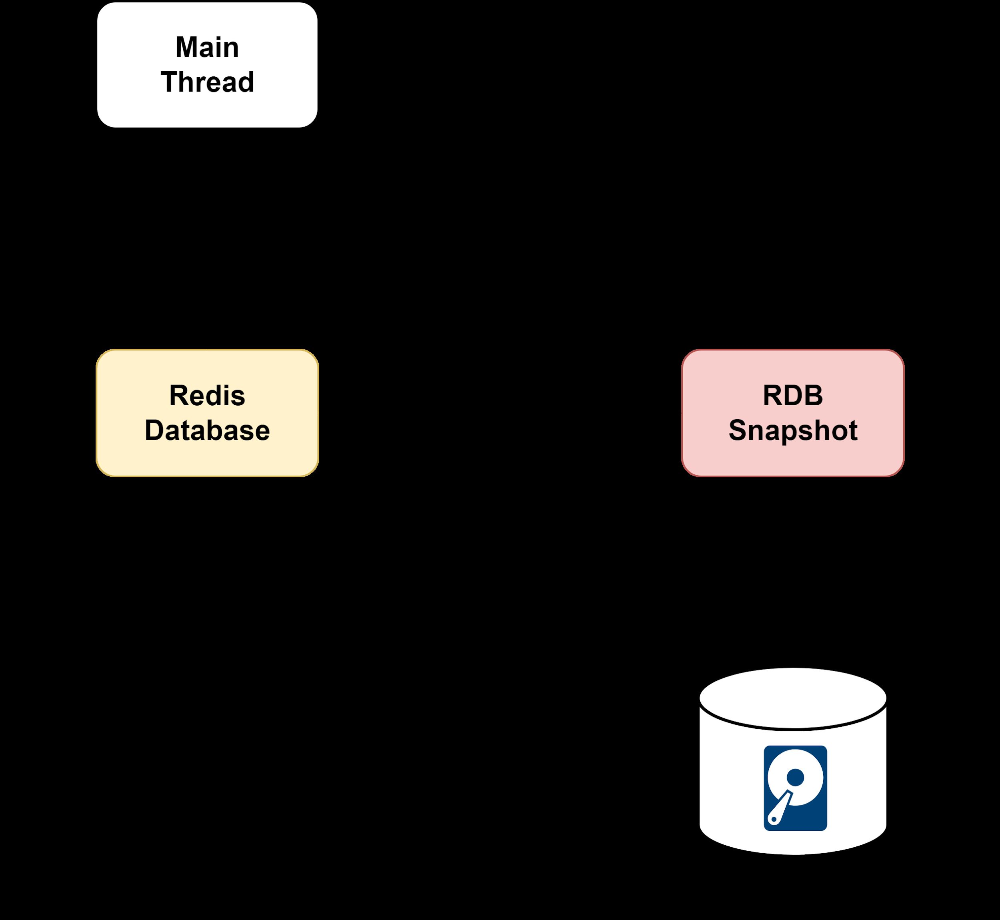

---

## Trang 27: 2.4.3. Hybrid

### 2.4.3. Hybrid
- Pros:
  - Less data loss
  - Fast recovery
- Cons:
  - Poor readability
  - Poor compatibility. Hybrid persistence AOF file
cannot be used in versions prior to Redis 4.0

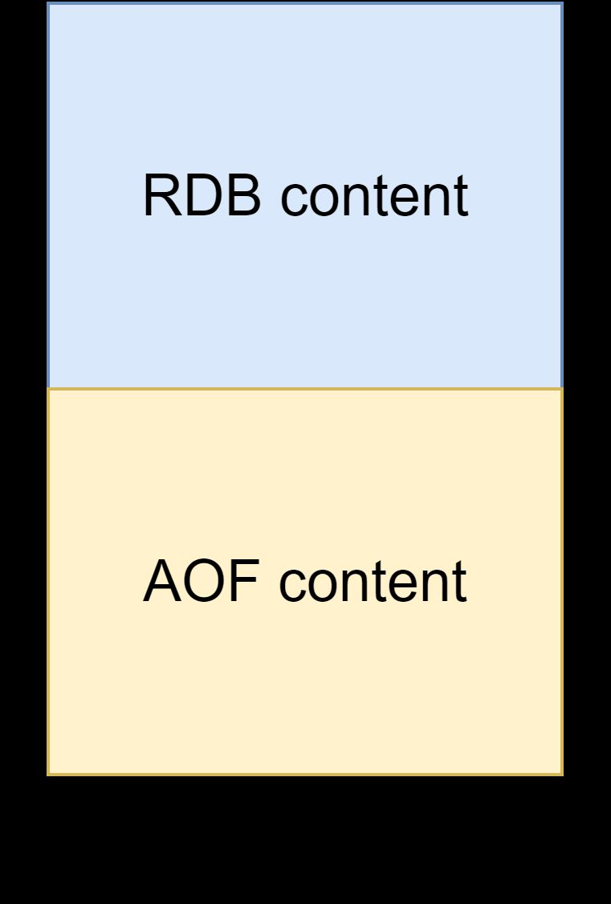

---

## Trang 28: 3. In Practices

### 3. In Practices

---

## Trang 29: 3.1. Data Structures

### 3.1. Data Structures

---

## Trang 30: 3.0. Question

### 3.0. Question
- User object: {uid, username, email, age}
- Requirements:
  - C1: access username only
  - C2: update age only
  - C3: get all fields
- Which data structure should we apply for the above 3 cases?
  - Hash
  - String Json

---

## Trang 31: 3.1.1. String

### 3.1.1. String
- Implementation: SDS (Simple Dynamic String)
  - SDS can save not only text data, but also binary data
  - SDS is safe, concatenating strings will not cause buffer overflow
- Applications
  - Cache objects (JSON)
  - Count
  - Share session
  - Distributed Lock*

---

## Trang 32: 3.1.2. List

### 3.1.2. List
- List is a simple list of strings, sorted in insertion order
- Elements can be added to the head or tail of List.
- Applications
  - Store list of elements
  - Message Queue
- Limitation:
  - The maximum length of List is 2^32 - 1
  - List does not support multiple consumers
  - Weak order preservation

---

## Trang 33: 3.1.3. Hash

### 3.1.3. Hash
- Implementation: hash table
- Applications
  - Storing objects if frequently access or update attributes in objects
  - Shopping cart
■ Add item: HSET cart:{user_id} {product_id} 1
■ Increase Quantity: HINCRBY cart:{user_id} {product_id} 1
■ Total number of items: HLEN cart:{user_id}
■ Delete item: HDEL cart:{user_id} {product_id}
■ Get an item: HGET cart:{user_id} {product_id}
■ Get all items in the shopping cart: HGETALL cart:{user_id}

---

## Trang 34: 3.1.4. Set

### 3.1.4. Set
- Set is an unordered and unique set of key values, and its storage order will not be stored in the
order of insertion.
- Implementation: hash table
- Applications
  - Deduplication of data and ensuring the uniqueness
  - Function on sets: difference, union and intersection
  - Likes, common followers, …
- Limitations:
  - Max: 2^32-1 elements
  - The calculation complexity of functions on sets is relatively high. → block the main thread

---

## Trang 35: 3.1.5. Sorted Set (ZSET)

### 3.1.5. Sorted Set (ZSET)
- Set is an ordered and unique set of key values, and its storage order will not be stored in the order
of insertion.
- Implementation: Skip List
- Applications
  - Sorting
  - Ranking, Leaderboard

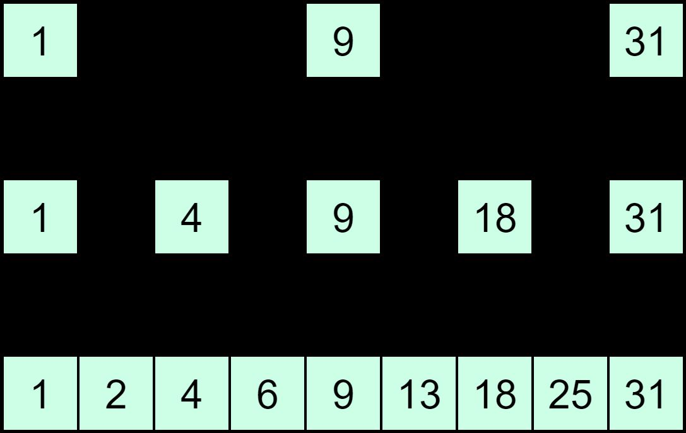

---

## Trang 36: 3.2. Practices

### 3.2. Practices

---

## Trang 37: 3.2.1. How to implement a delay task?

### 3.2.1. How to implement a delay task?
- Context:
  - When ordering a taxi, if there is no car owner to
take the order within 10 minutes
  - The platform will cancel your order automatically
  - Remind you that there is no car owner to take the
order at the moment
- Use an sorted set (ZSet)
- Add element:
  - Value: order_id
  - Score: expiration time
- Poll to get expires order
Key Value Score (timestamp)
o1 u1 1704790435
o2 u34 1704793232
o3 u88 1704797344

---

## Trang 38: 3.2.2. How to deal with big keys in Redis?

### 3.2.2. How to deal with big keys in Redis?
- Big key:
  - The value of type String is greater than 10 KB
  - The number of elements of Hash, List, Set, and ZSet types exceeds 5000
- Effects:
  - Time-consuming → timeout
  - Network congestion
  - Block the worker thread when deleting
  - Memory is unevenly distributed
- Approach:
  - Use the SCAN, HLEN, SCARD, MEMORY USAGE command to find the big key
  - Do not use DEL
  - Recommended: UNLINK. Asynchronous Deletion: Unlink + configure

---

## Trang 39: 3.2.3. How to put different keys on a node?

### 3.2.3. How to put different keys on a node?
- Limitation:
  - Functions on 2 sets on 2 different nodes → does not work
  - 2 sets in the same hash slot → works
- Use Hashtag
  - Key 1: User_profile:{34}
  - Key 2: User_session:{34}

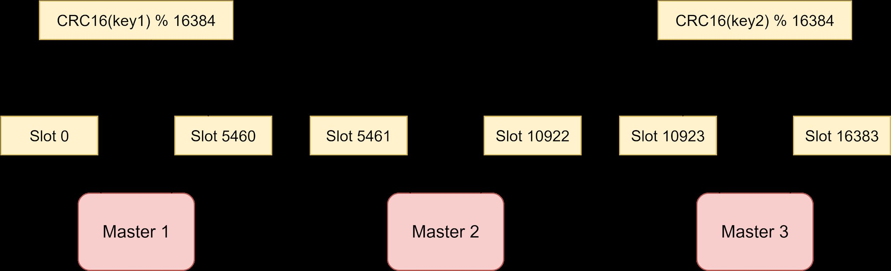

---

## Trang 40: 3.2.4. How to implement distributed locks?

### 3.2.4. How to implement distributed locks?
- Problem:
  - Context: 2 requests concurrently
  - Expectation: 1 request is processed at a time
Race condition
- Use SETNX
- Process:
  - SET lock_key value NX PX 10000
  - DEL (UNLINK) lock_key

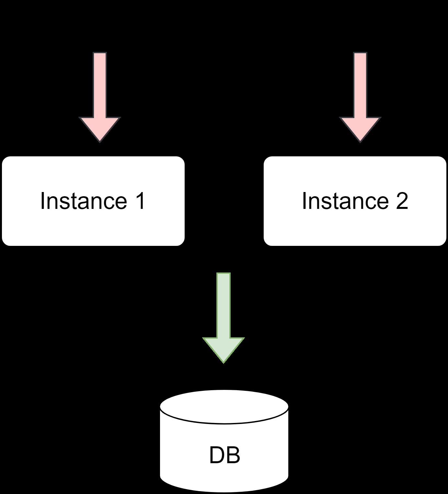

---

## Trang 41: 3.2.5. Best Practices

### 3.2.5. Best Practices
- Run Redis cluster
- Leverage multi get, pipelines
- Avoid long-run tasks
- Normally set short TTL
- Distribute TTL → avoid thundering herd
- Pick right data structures
- Leverage hashtag
- Understand the time complexity of each command
- Performance Tuning Best Practices
- …

---

## Trang 42: Recap

### Recap
- A cluster has a total of 16384 hash slots. Data is distributed into hash slots.
- CPU is not the bottleneck. Single thread model makes sense
- Leverage data structures and features. Specially care about distributed lock.

---

## Trang 43: Homework

### Homework
- Implement Distributed Lock
  - 2 requests booking the same seat
(A34_S012C) on a flight (FA634)
  - No need to implement DB and booking logic

---

## Trang 44: References

### References
- https://developer.redis.com/howtos/antipatterns/
- https://redis.com/blog/7-redis-worst-practices/
- https://architecturenotes.co/redis/
- https://medium.com/software-design/why-software-developers-should-care-about-cpu-caches-8da04
355bb8a

---

## Trang 45: Thank you

Thank you

---

## Trang 46: Thank you

Thank you

---
