# 7. Data Modeling

> **Tổng số trang:** 43 slide | **Thư mục ảnh/sơ đồ:** `assets/7_Data_Modeling/`

---

## Trang 1: Data Modeling

### Data Modeling
Engineering = building the thing right
Leadership = building the right thing

---

## Trang 2: Outline

### Outline
### 1. Database Design
  - Logical Design
i. Design Process
ii. Schema
iii. Table Format
  - Physical Design
i. Data Types
### 2. Case Studies

---

## Trang 3: 1. Database Design

### 1. Database Design

---

## Trang 4: 1.1. Design Process

### 1.1. Design Process

---

## Trang 5: 2.2. Design Process

### 2.2. Design Process
- Analysis
  - Clear requirements, data access patterns
  - Current DB
  - Preliminary Field List
- Data modeling
  - Define tables
  - Assign fields to each table
  - Refine the Table Structure
  - Keys, Relationships
- Data integrity
  - Review
  - Normalization / Denormalization

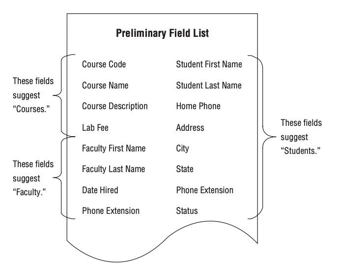

---

## Trang 6: 1.2. Schema

### 1.2. Schema

---

## Trang 7: 1.2.1. Entity-Relationship Diagram (ERD)

### 1.2.1. Entity-Relationship Diagram (ERD)
- Entity: object has identity and life cycle (status)
- Entity-Relationship Diagram (ERD) is a visual diagram to illustrate the relationships between
different entities or tables

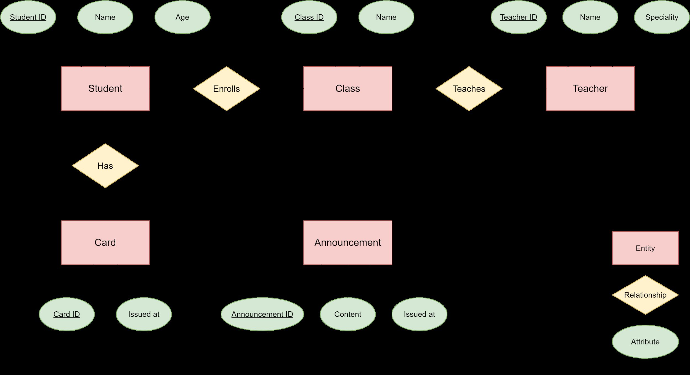

---

## Trang 8: 1.2.2. Types of Tables

### 1.2.2. Types of Tables
- Entity Table
- Relation Table (N - M)
- Support Table (for entity)
- Config Table (example: countries, provine, config, … )
Example

---

## Trang 9: 1.2.3. Normalization

### 1.2.3. Normalization
- Normalization is the process of organizing data to
reduce redundancy and improve data integrity.
- Normalization breaking down large tables into smaller,
related tables and establishing relationships between
them
Student
ID Name Age Class
ID Name
1 Ly 24 2 Math
2 Trang 25 3 Physic
3 Linh 18 1 English
4 Hoa 20 1 English
5 Trang 25 2 Math
Student
Student
ID Name Age
1 Ly 24
2 Trang 25
3 Linh 18
4 Hoa 20
5 Trang 25
Class
Class ID Name
1 English
2 Math
3 Physic
Enroll
Student
ID Class ID
1 2
2 3
3 1
4 1
5 2
- Pros:
  - Reduce redundancy
  - Data integrity
- Cons:
  - Increase complexity to schema
  - Join to get needed data
  - Some cases can not take effect of
indexes

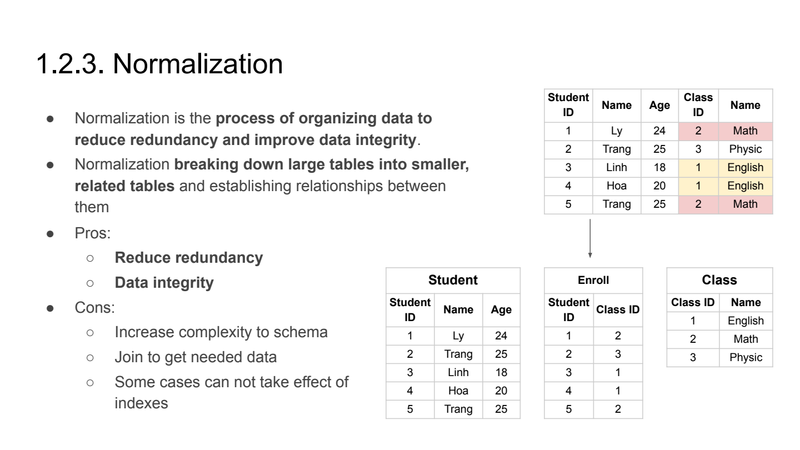

---

## Trang 10: 1.2.4. Denormalization

### 1.2.4. Denormalization
- Denormalization is the inverse process of normalization.
- Denormalization combine tables or adding redundant
data.
Student
Student
ID Name Age
1 Ly 24
2 Trang 25
3 Trinh 18
Enroll
Student
ID Class ID
1 2
2 3
3 1
1 1
3 2
Student
Student
ID Name Age Classes
1 Ly 24 2
2 Trang 25 1
3 Trinh 18 2
- Pros:
  - Improved query performance
  - Leverage Index
- Cons:
  - Increased Storage
  - Data Consistency

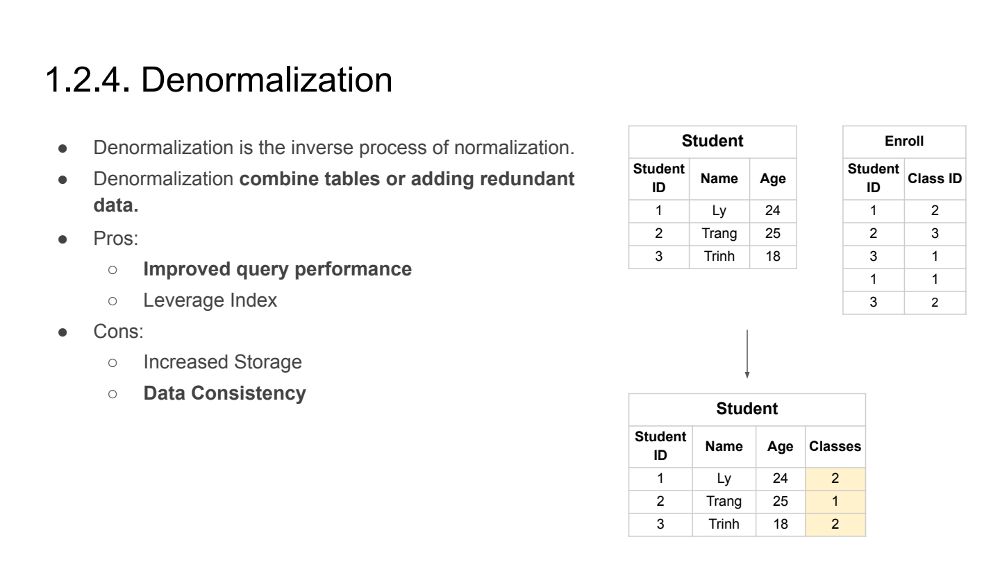

---

## Trang 11: 1.2.5. Problem 4: Foreign Key

### 1.2.5. Problem 4: Foreign Key
Problem: With foreign keys (constraints)
- During insert and update operations, DB needs to check the existence of the referenced key.
- Complexity of schema
- App must catch and inspect DB exception to know reason
- Backup process is complex
Solution: (my opinion)
- Remove constraint foreign key
- Implement the constraints in app layer
Note: Foreign Key != Reference Column

---

## Trang 12: 1.3.5. Where is reference column placed?

### 1.3.5. Where is reference column placed?
- Context:
  - Use case: Order
■ Create a order
■ Create a payment transaction
  - Use case: Donate
■ Create a donate transaction
  - Transaction and order has relation (1 - 1)
- Question: Where is the reference column placed?
- Answer:
  - Place reference column (order_id) in transaction table
  - Entity sinh ra sau sẽ lưu reference tới entity gốc (sinh ra trước).
→ improve scalability

---

## Trang 13: 1.3. Table Format

### 1.3. Table Format

---

## Trang 14: 1.3.1. Problem 1

### 1.3.1. Problem 1
Problem: In old version of MySQL, adding another fields/columns requires a full table lock
→ Downtime

---

## Trang 15: 1.3.1. JSON datatype

### 1.3.1. JSON datatype
- data: json → scalability

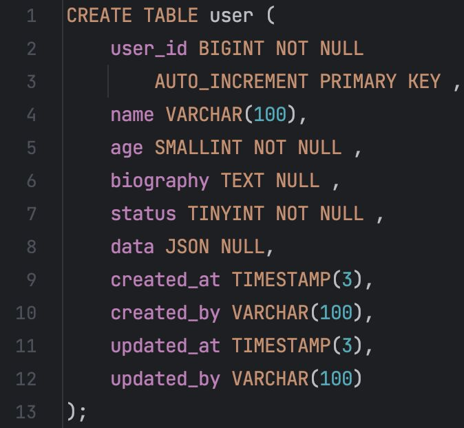

---

## Trang 16: 1.3.2. Problem 2

### 1.3.2. Problem 2
Problem: Need to index a field in JSON.
In older versions of MySQL, DB do not support index on JSON (function)
→ We need columns to index.

---

## Trang 17: 1.3.2. Redundant Columns

### 1.3.2. Redundant Columns
- Create redundant columns when creating tables
- Adding new data into the unused column
- Cons: Document the meaning of columns

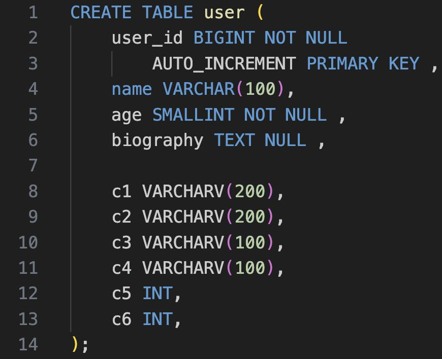

---

## Trang 18: 1.3.3. Problem 3

### 1.3.3. Problem 3
Problem: Before MySQL 5.6 (InnoDB), adding an index requires a full table lock
Solution:
- Before 5.6:
  - pt-Online-Schema-Change from Percona Toolkit
  - Gradually copy data from the original table to a new table.
  - Rename the new table to replace the old table
  - Minimize lock/downtime.
- After 5.6: Online DDL operations
  - ALTER TABLE my_table ADD INDEX my_table__idx (my_column),
ALGORITHM=INPLACE, LOCK=NONE;
  - Create an index on a huge MySQL production table without table locking - Stack Overflow
  - At the end of the index creation process, there might be a small lock

---

## Trang 19: 1.3.4. Table Template

### 1.3.4. Table Template
- What types of data?
- Business data
  - Id
  - Status
  - Name, …
- Technical data
  - Version
  - Created_at
  - …

---

## Trang 20: 1.3.4. Table Template: Common Columns

### 1.3.4. Table Template: Common Columns
- (Business)
  - Id
  - Other columns
■ Grouping columns
  - status
- data: json → scalability
- (Technical)
  - version
  - created_at
  - created_by
  - updated_at
  - updated_by

---

## Trang 21: 1.1. Data Types

### 1.1. Data Types

---

## Trang 22: 1.1.1. Data Type / String

### 1.1.1. Data Type / String
- VARCHAR:
  - Uses only as much space as it needs.
Uses 1 or 2 extra bytes to record the value’s length
  - Best: Short (< 255), frequently retrieved, infrequently
update
  - Use cases: user name, subject, …
- TEXT, BLOB
  - InnoDB may use a separate “external” storage area
for TEXT, BLOB
  - MySQL can not index the full length of these data
types and can’t use the indexes for sorting.
  - Best fits: Long, frequently update, …
  - Use case: logs, message, comments, …

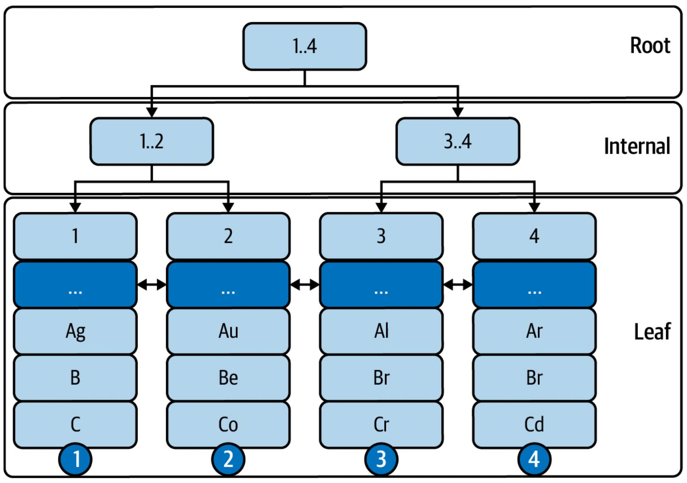

---

## Trang 23: 1.1.2. Data Type / Number

### 1.1.2. Data Type / Number
- Integer:
  - SMALLINT, INT, BIGINT
  - Use small if possible
  - Correct Misunderstanding: For storage and computational purposes,
INT(1) is identical to INT(9)
- Real number:
  - FLOAT, DOUBLE consume less bytes than DECIMAL
  - To store money:
■ Do not use FLOAT, DOUBLE.
■ The IEEE 754 standard uses the closest value in base-2 to store
■ Use DECIMAL and fractional number
→ accuracy

---

## Trang 24: 1.1.3. Data Type / Date

### 1.1.3. Data Type / Date
- Timestamp:
  - Pros: consume less space
  - Cons: limitation of value range
  - Use cases: to record a (more or less) fixed point in time. Example: created_at
- Datetime:
  - Pros: readable, no limitation of value range
  - Cons: consume more space, depend time zone
  - Use cases: time can be set and changed arbitrarily. Example: appointment time
- Practices:
  - Use a fractional seconds
  - Save time zone in addition
  - JVM time zone = OS time zone = DB time zone = time zone 0

---

## Trang 25: 1.1.4. Choosing Data Types

### 1.1.4. Choosing Data Types
- Smaller is usually better.
- Simple is good.
- Avoid NULL if possible. It’s harder for MySQL to optimize queries that refer to nullable columns,
because they make indexes, index statistics, and value comparisons more complicated.

---

## Trang 26: 2. Case Studies

### 2. Case Studies

---

## Trang 27: 2.1. Multiple Languages

### 2.1. Multiple Languages
- Context: View a post in multi languages
- Requirements:
  - Simple schema, don't break schema when
adding a new language
  - Easy to query
- Solution:
  - There are a several solutions
  - Towards an Evaluation Framework for
Multilingual Supported Data Modeling Patterns
  - Suggestion: add a “translation” json column in
the same table
id original_title title_translation
1 Engineer {
"vi": "Kỹ Sư",
"en": "Engineer",
"cn": "工程师"
}

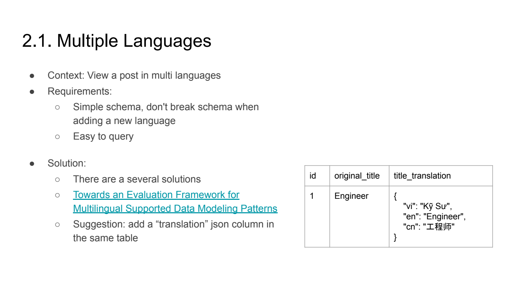

---

## Trang 28: 2.2. Ordering

### 2.2. Ordering
- Context: Reorder tasks in to-do list
- Requirements:
  - Easy to order
  - Less operations to update the order
ID Name Order
1 TV 1000
4 Working 1500
2 Commuting 2000
3 Gaming 3000
- Solution:
  - Order column with the gaps between values
  - New order value = (upper + lower) / 2
- Problem:
  - No value between upper and lower values
  - Upper: 1001 and lower 1000
- Solution: use float

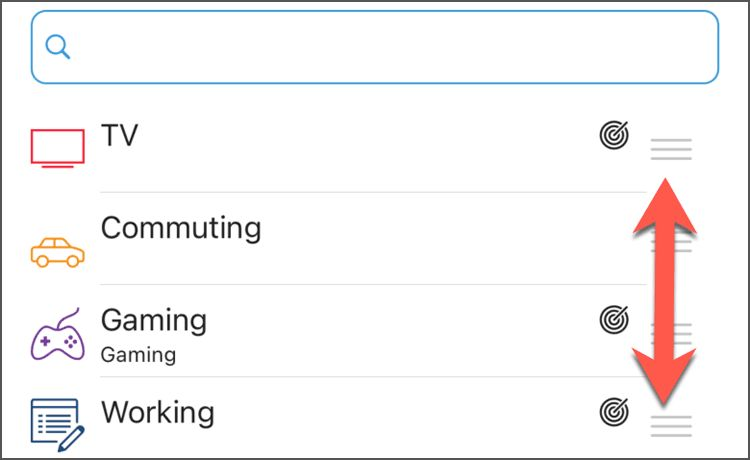

---

## Trang 29: 2.3. Homestay Booking

### 2.3. Homestay Booking
- Requirements:
  - Check status of a date.
  - Able to change price of a day.
- Solution:
  - Table homestay_availability
■ Homestay_id
■ Date
■ Price
■ Status
  - After creating a homestay,
generating 365 rows (1 year) in advance.

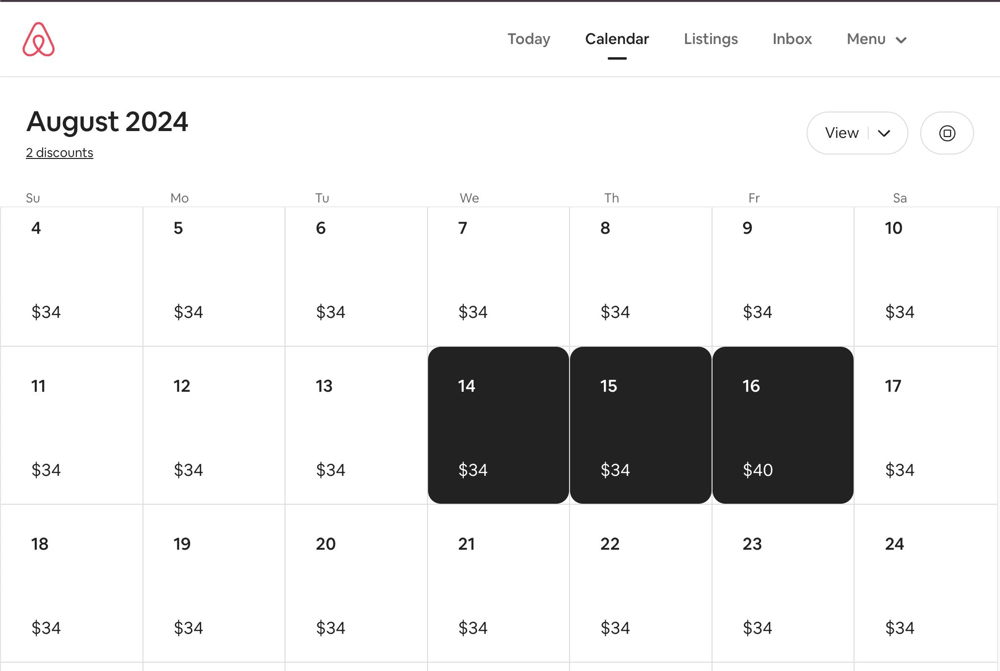

---

## Trang 30: 2.3. Homestay Booking

### 2.3. Homestay Booking
- Requirements:
  - Check status of a date.
  - Able to change price of a day.
- Solution:
  - Table homestay_availability
■ Homestay_id
■ Date
■ Price
■ Status
  - After creating a homestay,
generating 365 rows (1 year) in advance.

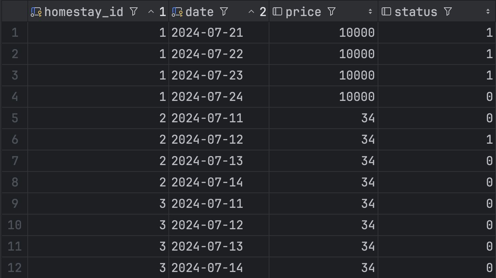

---

## Trang 31: 2.4. Calendar

### 2.4. Calendar
- Requirements:
  - Create time based events
■ Start time, and time
■ Can be repeated daily, weekly, …
  - Query events in a specific week.
- Solution:
  - Create time slots in advance
CREATE TABLE time_slots (
id INTEGER NOT NULL PRIMARY KEY AUTO_INCREMENT,
time_event_id INTEGER NOT NULL,
begin_local_time DATETIME NOT NULL,
end_local_time DATETIME NOT NULL,
timezone_id INTEGER NOT NULL
);

---

## Trang 32: 2.5. Tagging / Labeling

### 2.5. Tagging / Labeling
- Context: a post can have multiple tags
- Requirements:
  - (1) Get all tags of a post
  - (2) Get all posts by a tag
  - (1) > (2)
- Solution:
  - (1) Create a new table to present
many-to-many relationships
  - (2) Suggestion: (Postgres)
■ Column tags: array
■ Create inverted index
id title tags
34 Ronin Engineer [technical, software, it, …]

---

## Trang 33: 2.6. Report

### 2.6. Report
- Context: Count total clicks in last day
- Requirements:
  - Response time
  - Accuracy
- Solution:
  - Approximate:
■ Statistics
■ Hyperloglog
  - Cron job to sum clicks
  - Material view (sum clicks async)
  - Stream processing (real-time)

---

## Trang 34: Recap

### Recap
- Leverage JSON if possible.
- Not Normalization or Denormalization.
Normalization and Denormalization.
- Query a specific datetime easily, consider to generate time slot in advance.

---

## Trang 35: Homework

### Homework
- Design schema for
  - Booking flights
- Use the suggested table template

---

## Trang 36: References

### References
- https://stackoverflow.com/questions/42513839/mysql-view-performance-temptable-or-merge
- https://stackoverflow.com/questions/2023481/mysql-large-varchar-vs-text
- https://stackoverflow.com/questions/4244685/create-an-index-on-a-huge-mysql-production-table-wit
hout-table-locking
- https://dba.stackexchange.com/questions/261752/adding-indexes-to-very-large-tables-in-mysql

---

## Trang 37: Thank you

Thank you

---

## Trang 38

---

## Trang 39: 2. View

### 2. View

---

## Trang 40: 1.1. Introduction

### 1.1. Introduction
- A view is a virtual table that doesn’t store any data itself.
- Instead, the data in the base table.
- Syntax:
CREATE VIEW simple_bookings AS
SELECT book_ref, date(book_date), total_amount
FROM bookings;
- Normally, view is not updatable.
- There is a type of updatable views, but this is not recommended.

---

## Trang 41: 1.2. How View Works?

### 1.2. How View Works?
Processing Algorithm:
### 1. MERGE (by default):
### 1.1. Merge user’s SQL + view’s SQL = Final SQL
### 1.2. Execute the final SQL on base table (index).
### 2. TEMPTABLE:
### 2.1. Execute view’s SQL on base table
### 2.2. Create temporary table
### 2.3. Execute user’s SQL on the temporary table
(no index in some case).

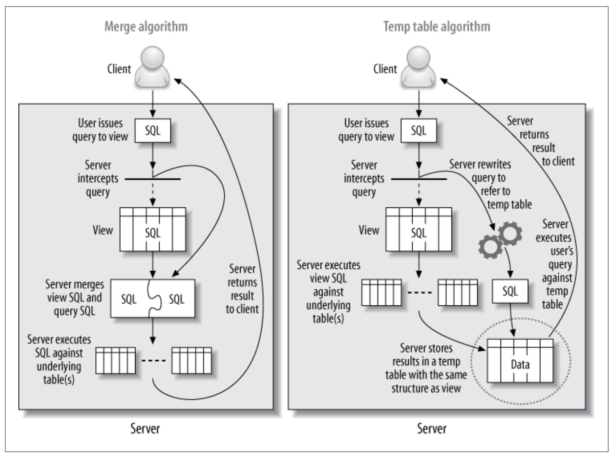

---

## Trang 42: 1.3. Limitation

### 1.3. Limitation
- Views might trick developers into thinking they’re simple, when in fact they’re very complicated
under the hood.
- In some case, no index in used
- MySQL does not support the materialized views. A materialized view generally stores its results
in an invisible table behind the scenes, with periodic updates to refresh the invisible table from the
source data

---

## Trang 43: 1.4. Practices

### 1.4. Practices
- Use Cases:
  - Simplify complex query (join, function,…)
  - Add extra security layers
■ HR can only view user profile
■ Accountant can view user balance
  - Enable backward compatibility
- Best Practices:
  - Use merge view for read
  - Check execution plan of SQL on views

---
