# 8. Security

> **Tổng số trang:** 44 slide | **Thư mục ảnh/sơ đồ:** `assets/8_Security/`

---

## Trang 1: Security

### Security
He said “One day, you’ll leave this world behind,
so live a life you will remember”
- The Nights (Avicii ft. Nicholas Furlong)

---

## Trang 2: Outline

### Outline
### 1. Concepts
### 2. Attacks
### 3. Authentication & Authorization
  - Basic Auth
  - Session Cookie Auth
  - Token-based Auth
  - Case Studies

---

## Trang 3: 1. Concepts

### 1. Concepts

---

## Trang 4: 1.1. Encoding

### 1.1. Encoding
- Encoding is a technique to transform data from one format to another so that it can be consumed by
different systems.
- Encoding is a reversible process without information loss
- Encoding has no security purpose
- Example:
  - Pineapple (UK) → Dứa (North of Vietnam) → Thơm (South of Vietnam)
  - Serialization: Object ←→ binary
  - URL encoding
  - JWT ← decoding/encoding → Base64

---

## Trang 5: 1.2. Hashing

### 1.2. Hashing
- Hashing is the process of mapping any arbitrary size data into a fixed-length value using a hash
function.
- Hashing is not a reversible process. It must not be possible to obtain the input from the output
data.
- Hashing ensures data integrity. Check if data is modified?
- Collision: two distinct input has the same hash value
- Avoid Collision → Good Hash Function

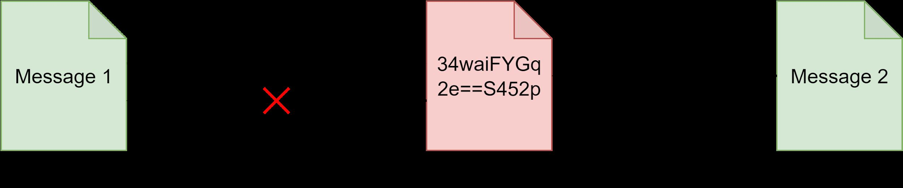

---

## Trang 6: 1.3. Encryption

### 1.3. Encryption
- Encryption secures data using mathematical techniques (aka cryptography)
- The input plaintext is converted into a unreadable ciphertext using algorithm and hard to decode.
- Encryption is a reversible process as well, although just for authorized people.
- Encryption algorithms need encryption keys as input. The encryption key and decryption key may be
different.

---

## Trang 7: 1.3. Encryption

### 1.3. Encryption
- Two families of key-based encryption:
  - Symmetric Encryption:
■ Use the same key to encrypt and
decrypt data
■ Ex: AES algorithm
■ Faster but less secure
  - Asymmetric Encryption:
■ The encryption key and decryption key
are different.
■ Ex: RSA algorithm
■ More secure but lower

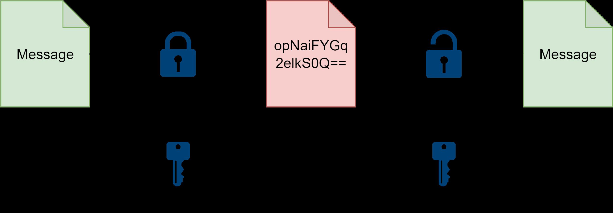

---

## Trang 8: 1.4.1. Encryption vs Hashing

### 1.4.1. Encryption vs Hashing
- Context: Ronin Engineer integrates with a payment gateway.
- Requirement:
  - Initialize a payment request without sensitive information
  - Integrity: Make sure that the request is not modified while being sent
  - Authenticity: Make sure that requestor is Ronin Engineer
- Hash with secret key. Example: HMACSHA512

---

## Trang 9: 1.4.2. Encryption vs Hashing

### 1.4.2. Encryption vs Hashing
Encryption Hashing
Purpose Protect data confidentiality Data integrity
Reversibility Yes No
Key Usage Yes No
Output Length Variable length A fixed length
Collision No Yes
Cost Medium, high Low
Use cases Securing data during transmission or
storage, protecting sensitive
information.
Ex: Credit card, personal message
Data verification, data deduplication, indexing.
Ex: Hash index, Password storage, Digital
Signature

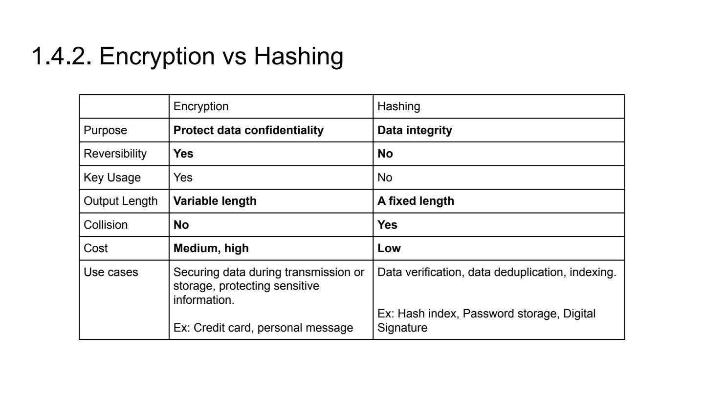

---

## Trang 10: 1.4.3. Applications of Encryption vs Hashing

### 1.4.3. Applications of Encryption vs Hashing
- Encryption
  - AES-256: encryption for files, databases, and end-to-end communication
  - RSA: Digital signatures
  - …
- Hashing
  - BLAKE2: integrity verification
  - SHA-256: digital signatures
  - Scrypt: password hashing
  - MD5, SHA-1: Strong checksum
  - …

---

## Trang 11: 1.5. Digital Signature

### 1.5. Digital Signature
- Purpose: Ensures that data has not been modified
- Message: Data + Digital Signature

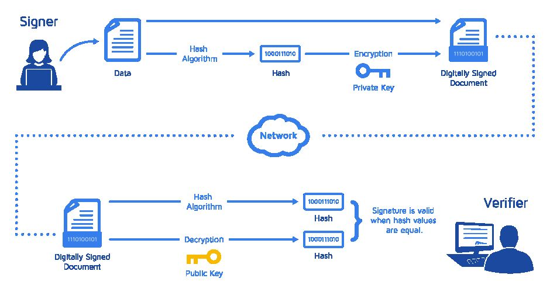

---

## Trang 12: 1.6. Case Study: Password Storage

### 1.6. Case Study: Password Storage
- Do not store password in plaintext
- Use hash because attacker can not obtain the
original value
- MD5, SHA-1 are fast but less secure
→ Not recommended
- Scrypt: slow but safe
→ Make brute force attacks impossible
- Bcrypt is legacy nowaday.
- Problem: Rainbow Table

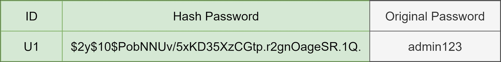

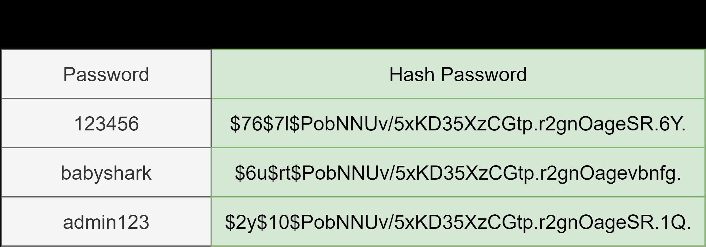

---

## Trang 13: 1.6. Case Study: Password Storage

### 1.6. Case Study: Password Storage
- Solution: Add random salt for each record

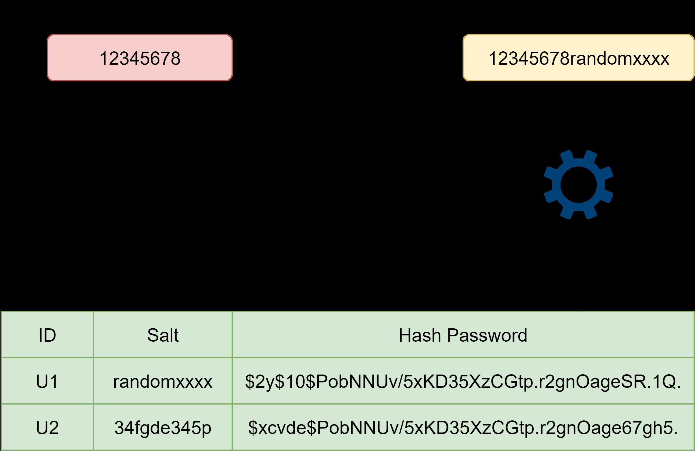

---

## Trang 14: 1.7. Case Study: Personal Data Encryption

### 1.7. Case Study: Personal Data Encryption
- Problem: Where should Encryption be performed?
  - Client Side
  - Server Side
  - DB
- Solution:
  - Encryption in Server Side
  - Flexible
  - Reduce workload for DB
  - Recommended Algorithm: AES-256

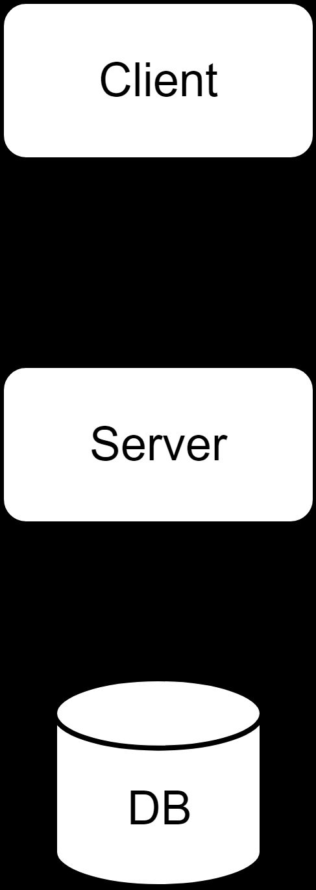

---

## Trang 15: 1.7. Case Study: Personal Data Encryption

### 1.7. Case Study: Personal Data Encryption
- Problem: Should Ciphertext is stored in Binary or String (Base64)
- Solution: Binary
  - String:
■ Portable: supported in JSON, XML, URL, …
■ Size: Base64 String increases its size ~33%
  - Binary:
■ Direct use: Ciphertext (output) is binary, network transmission
■ More space-efficient

---

## Trang 16: 1.7. Case Study: Personal Data Encryption

### 1.7. Case Study: Personal Data Encryption
- Problem: How to search encrypted data?
- Solution:
  - Blind Index
  - No support for fulltext search

---

## Trang 17: 2. Attacks

### 2. Attacks

---

## Trang 18: 2.1. Man-In-The-Middle-Attack

### 2.1. Man-In-The-Middle-Attack
- How it works?
  - An attacker intercepts and potentially alters a communication between two systems without their
knowledge or consent.
- How to defend?
  - Encrypted connection (SSL/TLS)
  - Verify Certificates
■ Client-Server using CA
■ BE-BE: using private key (HTTPS is not safe at all)
  - Request id prevent from replay attack

---

## Trang 19: 2.2. SQL Injection

### 2.2. SQL Injection
- How it works?
  - An attacker inserts malicious SQL into input fields by a web application so that attacker can
manipulate the application's SQL query to execute harmful actions (retrieve, modify data)
  - Demo: OWASP Juice Shop
- Original SQL: SELECT * FROM users WHERE username = ‘?’ AND password = ‘?’;
- Attacked SQL: SELECT * FROM users WHERE username = ‘' or 1 =1 ; –’ AND password = ‘?’;

---

## Trang 20: 2.2. SQL Injection

### 2.2. SQL Injection
- How to defend?
  - Prepared statement: These techniques separate SQL code from user input, making it harder for
attackers to inject malicious code.
  - Input validation
■ Whitelist params
  - Minimize necessary permissions to the account that web app use

---

## Trang 21: 2.3. XSS (Cross-Site Scripting)

### 2.3. XSS (Cross-Site Scripting)
- How it works?
  - An attacker injects malicious scripts into web pages.
  - User view the web page → these scripts are
executed within a user's web browser
  - Stealing sensitive data
  - Demo: Cross-site Scripting
- How to defend?
  - Input Validation
  - Output Encoding: Escape for specialization
characters
  - Content Security Policy (CSP) allows you to
specifically whitelist URLs from which dynamic
scripts can be loaded

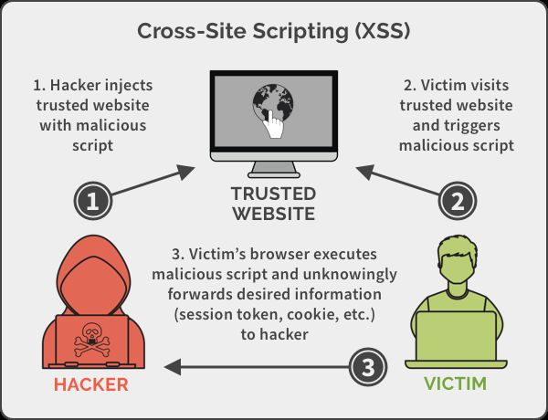

---

## Trang 22: 2.4. CSRF (Cross-Site Request Forgery)

### 2.4. CSRF (Cross-Site Request Forgery)
- How it works?
  - An attacker tricks a user into performing actions on
a website without their consent or knowledge.
  - Demo: Cross-site Request Forgery
- How to defend?
  - Stateless GET Requests
  - User Prompts: When performing sensitive actions,
ask the user for confirmation, such as re-entering
their password.
  - CSRF token

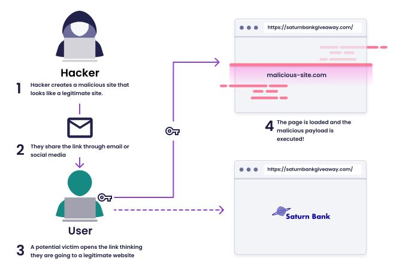

---

## Trang 23: 2.4. CSRF Token

### 2.4. CSRF Token

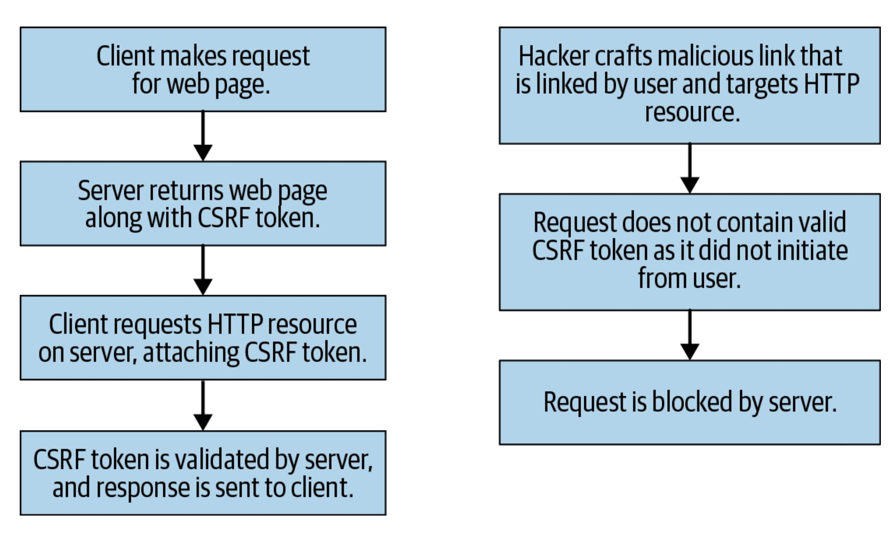

---

## Trang 24: 2.4. DDoS (Distributed Denial-of-Service)

### 2.4. DDoS (Distributed Denial-of-Service)
- How it works?
  - Botnet: pc, mobile, IoT devices, …
  - Robot + Network = Botnet
- How to defend?
  - DDoS attacks cannot be prevented, but can be
mitigated
  - Bandwidth Management Services: many vendors
on the market, but ultimately perform analysis on
each packet as it passes through their servers.
  - Rate limiting
  - CDN (caching)
  - Blackhole filtering: hard to get high accuracy

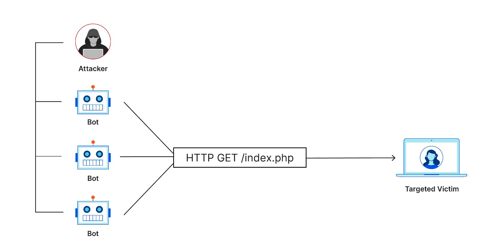

---

## Trang 25: 3. Authentication & Authorization

### 3. Authentication & Authorization

---

## Trang 26: 3.1. Definition

### 3.1. Definition
- Identity: Identity refers to the unique attributes that define an entity
- Authentication: the process of verifying who a user is
- Authorization: the process of verifying what they have permission to
- Example: a flight
  - Authentication: when you go through security gate, showing your ID card to tell who you are
  - Authorization: when you go through terminal gate, showing your flight ticket to tell you have
permission to board your flight

---

## Trang 27: 3.2. Basic Auth

### 3.2. Basic Auth
- Requires to provide a username and a password when
requesting a protected resource.
- Encoded Credential = Base64(username:password)
- Header: “Authorization: Basic dXNlcm5hWU3d2vcmQ=”
- Alternative for BE-BE: API Key
- Limitations:
  - Username and password can be easily decoded
  - Authorization header is attached to each request
→ Not track user login status → poor UX

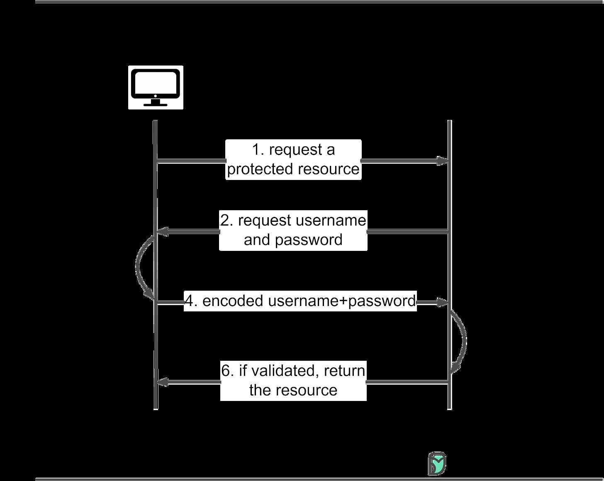

---

## Trang 28: 3.3. Session-Cookie Auth

### 3.3. Session-Cookie Auth
Cookies Session Storage Local Storage
Purpose Typically user session,
tracking user behavior
Data for a session caching, user preferences
Storage
Limit
4KB 5-10MB 5-10MB
Persistence Server configure Cleared when the user
closes the browser or
the tab
Nerver until clear manually

---

## Trang 29: 3.3. Session-Cookie Auth

### 3.3. Session-Cookie Auth
- A session ID is generated to track the user's
status during their visit.
- This session ID is recorded both server-side and in
the client’s cookie
- Session information can be stored in the server
memory or an independent session server
- Limitations:
  - Vulnerable over an unsecured network
  - Vulnerable to XSS, CSRF attacks
  - Stateful → Difficult to scale
  - Not friendly to mobile native applications

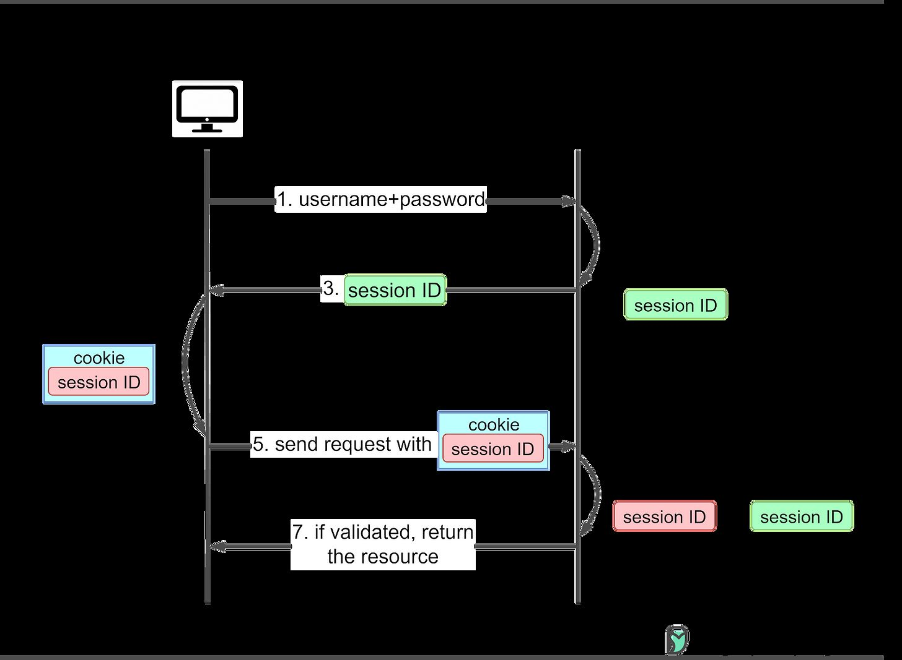

---

## Trang 30: 3.4. Token-Based Auth

### 3.4. Token-Based Auth
- The server issues a token and sends it to the client.
The client stores the token in the local storage.
- Doesn’t rely on cookies → friendly to mobile + web
- Typically include a user ID
→ Stateless authentication → Scalable

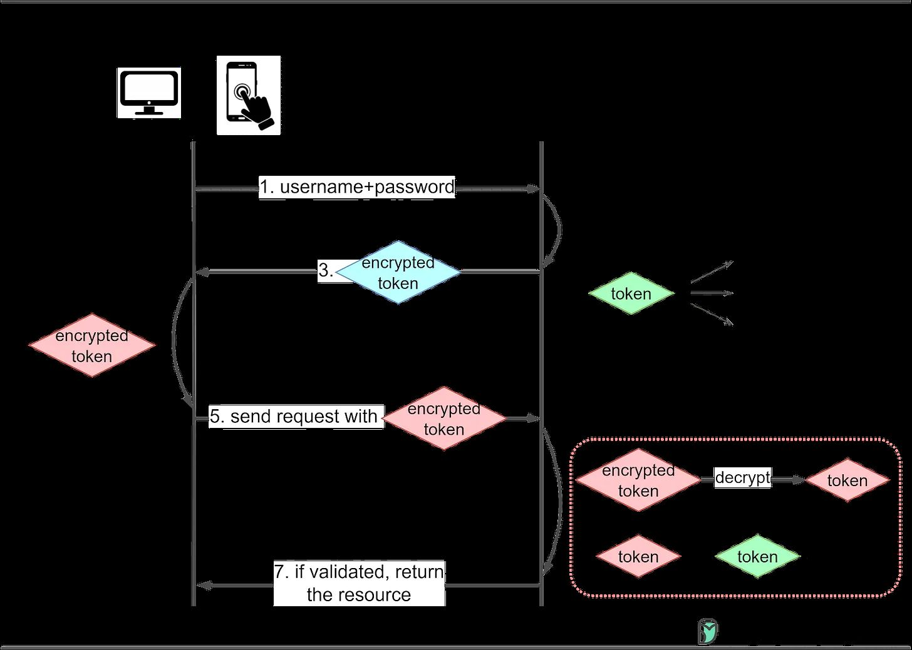

---

## Trang 31: 3.4. JWT (Json Web Token)

### 3.4. JWT (Json Web Token)
- A standardized format for token creation and
validation
→ improve overall security + performance
- JWT contains 3 parts:
  - Header: token type, hash algorithm
  - Payload:
■ Seven predefined claims
■ Public claims
■ Private claims
  - Signature: sign(encoded header + encoded
payload + a secret) Recommended: AES
- JWT uses Signature to ensure that exchange
information is not modified.
- Roles and permissions claims
→ useful to authorization processes

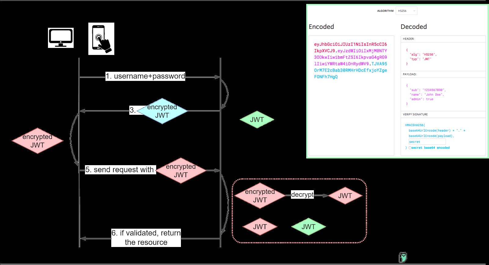

---

## Trang 32: 3.4. JWT (Json Web Token)

### 3.4. JWT (Json Web Token)
- A standardized format for token creation and
validation
→ improve overall security + performance
- JWT contains 3 parts:
  - Header: token type, hash algorithm
  - Payload:
■ Seven predefined claims
■ Public claims
■ Private claims
  - Signature: sign(encoded header + encoded
payload + a secret)
- JWT uses Signature to ensure that exchange
information is not modified.
- Roles and permissions claims
→ useful to authorization processes

---

## Trang 33: 3.4. JWT (Json Web Token)

### 3.4. JWT (Json Web Token)
Limitations:
- Vulnerable over insecure connections
- Refresh
- Revocation
- JWT have size-related issues:
  - Size limit
  - Performance
  - Vulnerable if weak signing mechanism
Enhancement
- Implement a mechanism to refresh
- Embedded session into token
- Define security levels of tokens

---

## Trang 34: 3.5. Case Study: Role Based Access Control

### 3.5. Case Study: Role Based Access Control
- Typically, each API is assigned to a set of roles in code
- Limitations:
  - A lot of overlaps between roles
  - Role redundancy when number of roles grows up
  - Assigning a new role to a API needs to redeploy app

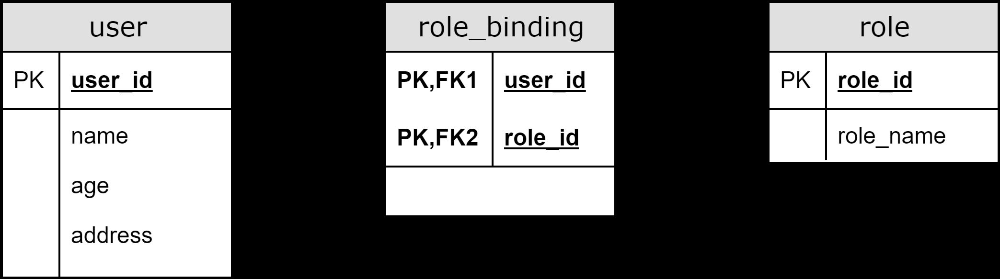

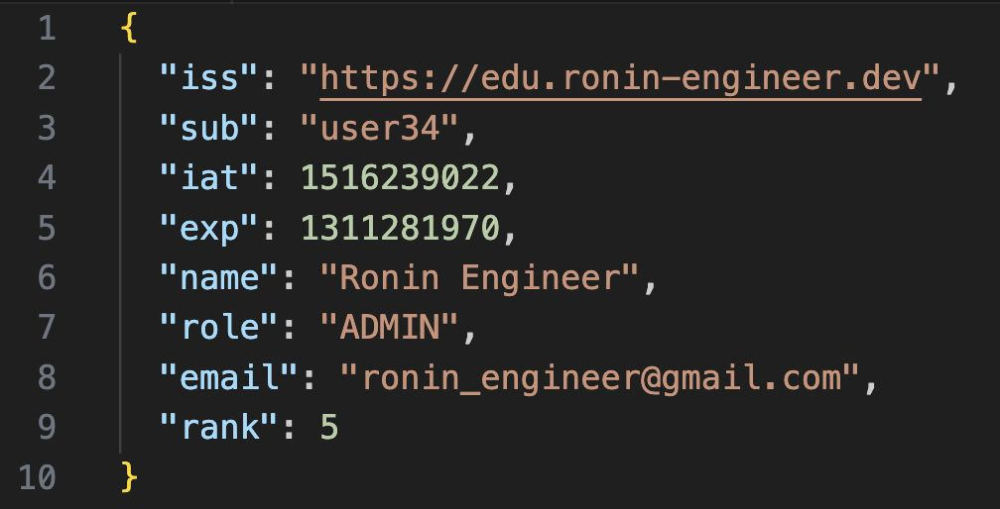

---

## Trang 35: 3.5. Case Study: Role + Permission-Based Access Control

### 3.5. Case Study: Role + Permission-Based Access Control
- Permission = Resource + Action
- Role = a set of Permissions
- Flexible
- Limitations:
  - Resource can be divided into many ones
→ Hard to manage Resource
  - Advanced case: access control to fields in a resource

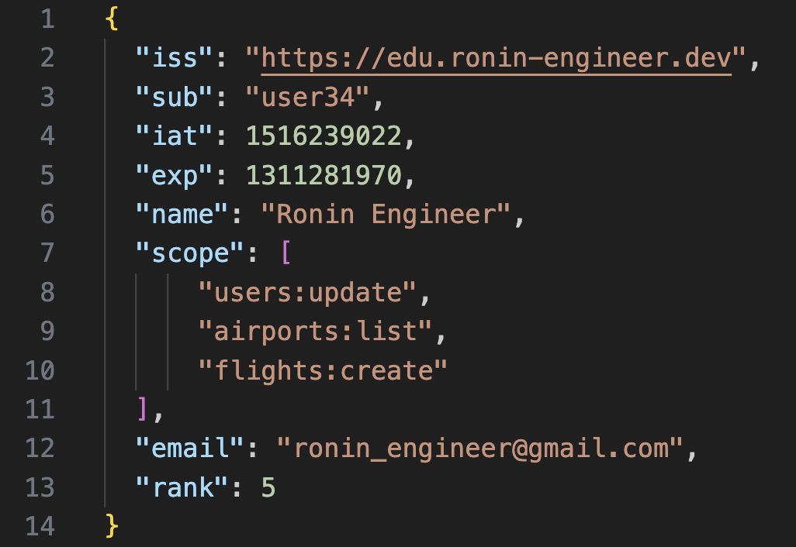

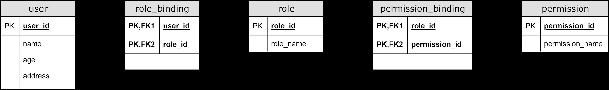

---

## Trang 36: 3.6. Case Study: Single Sign On

### 3.6. Case Study: Single Sign On
- Context:
  - 2 web apps on 2 different domains in the same
parent domain
  - 2 web apps use the same DB (identity)
- Requirements:
  - U1 logged in sub1 → logged in sub2
  - U1 logged in sub 1, U2 logged in sub2 at the
same time

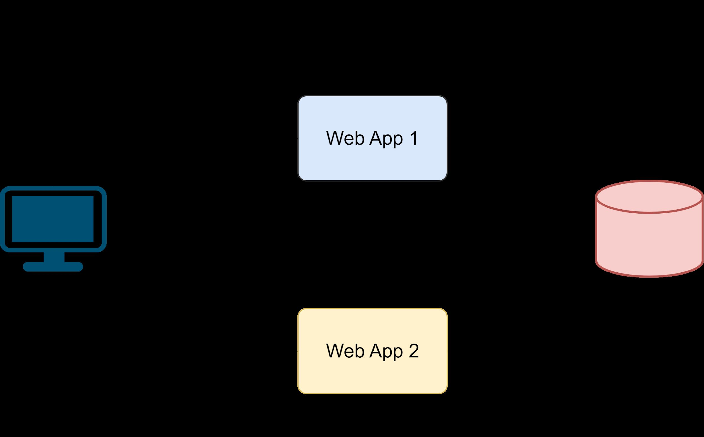

---

## Trang 37: 3.5. Case Study: Single Sign On

### 3.5. Case Study: Single Sign On

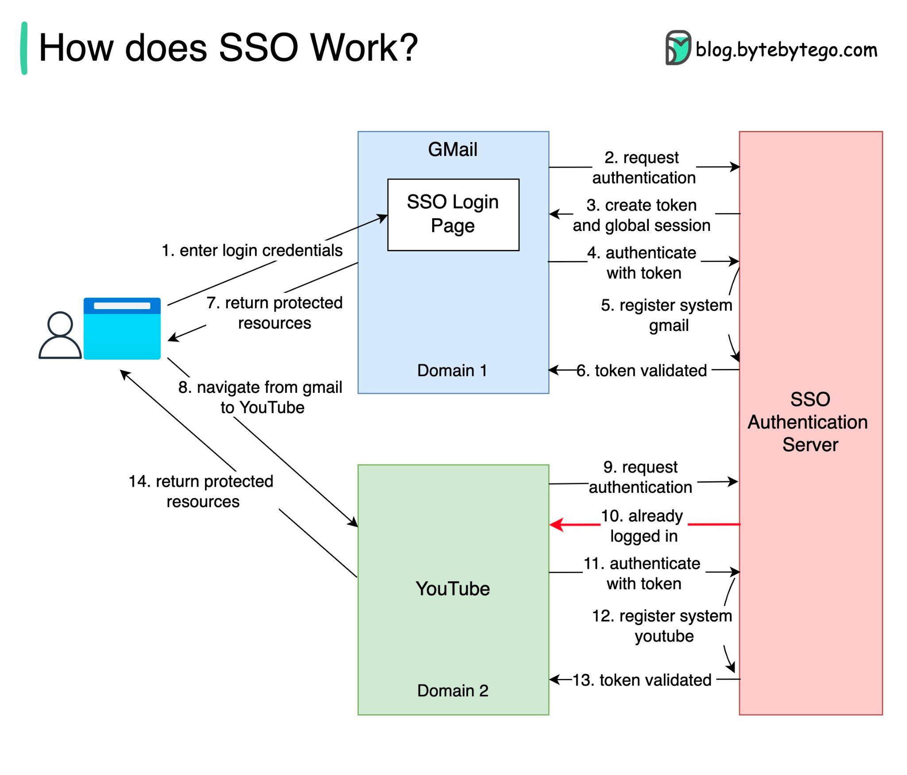

---

## Trang 38: 3.5. Case Study: Single Sign On

### 3.5. Case Study: Single Sign On

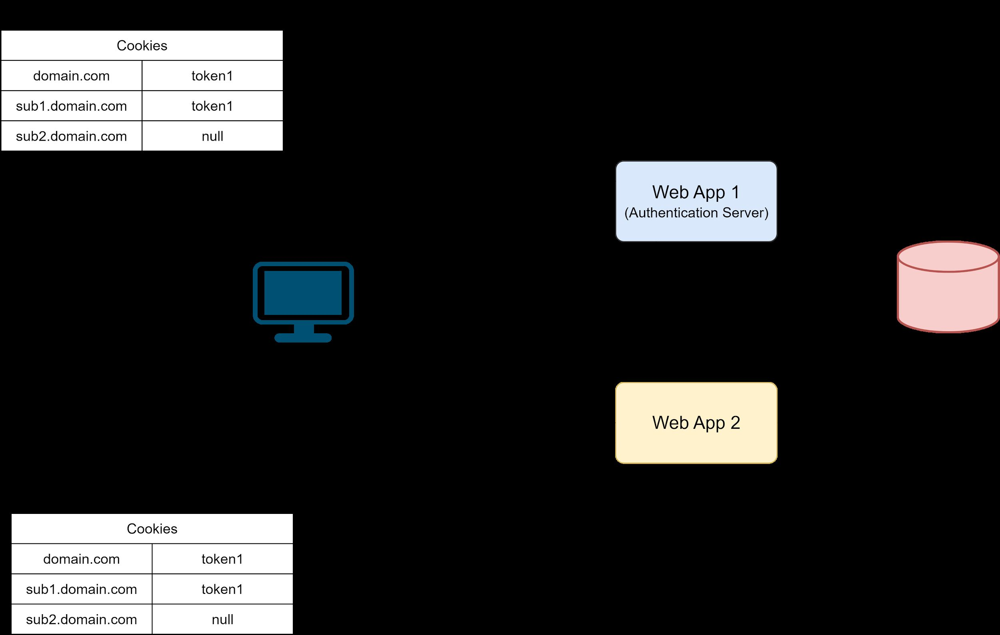

---

## Trang 39: 3.5. Case Study: Single Sign On

### 3.5. Case Study: Single Sign On

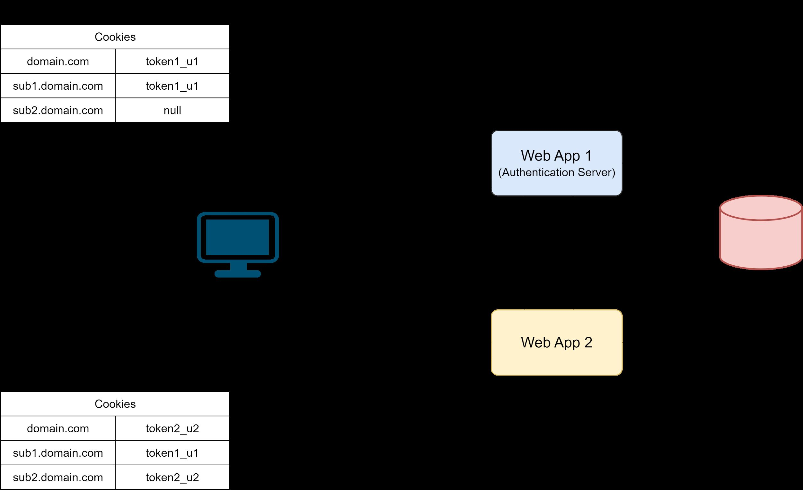

---

## Trang 40: Recap

### Recap
- Distinguish and understand concepts:
  - Encoding
  - Hashing
  - Encryption
  - Signing
- Validate input always
- Follow standards and guidelines

---

## Trang 41: Read More

### Read More
- Access Control
- OAuth 2.0
- OpenID Connect (OIDC)
- SAML

---

## Trang 42: References

### References
- https://owasp.org/
- https://auth0.com/blog/encoding-encryption-hashing/
- https://www.baeldung.com/cs/hashing-vs-encryption
- https://github.com/qazbnm456/awesome-web-security
- https://www.hacksplaining.com/prevention/xss-stored
- https://jwt.io/

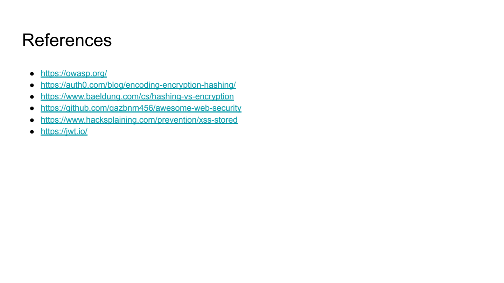

---

## Trang 43: Homework

### Homework
- Requirement:
  - Authentication using JWT
  - Authorization using role + permission based access control
- Implement:
  - Hardcode: map<username, list<permission>>
  - API Login: Create JWT
■ Username
■ user_id
■ scope: list<permission>
  - API Authorize:
■ Declare the permission for this API
■ Verify token, permission

---

## Trang 44: Thank you

Thank you

---
