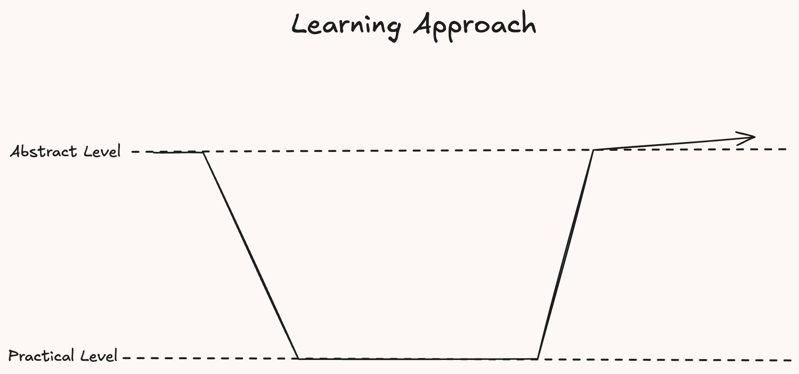
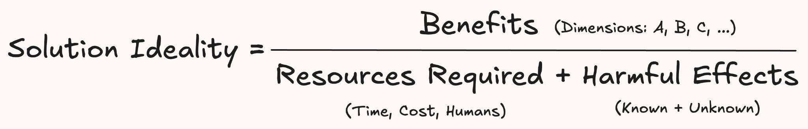
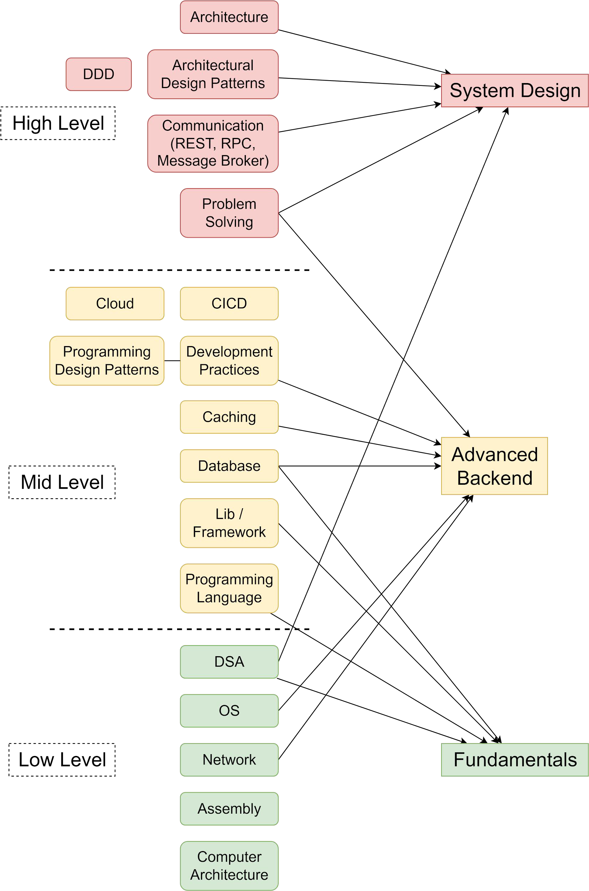
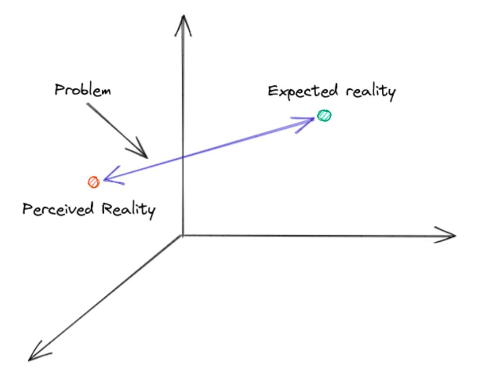
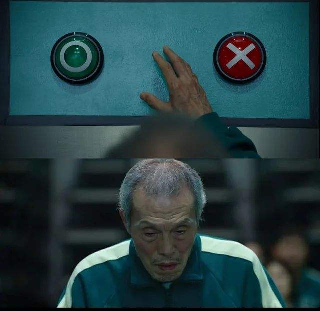

# 01. System Design- In-Depth Understanding

> **Tổng số trang:** 47 slide | **Thư mục ảnh/sơ đồ:** `assets/01_System_Design_In_Depth_Understanding/`

---

## Trang 1: Thank You for Joining With Us 🙏

### Thank You for Joining With Us 🙏

---

## Trang 2: The Goal of the Course

### The Goal of the Course
- Techniques to design a system (specially for highly concurrent systems)
- Process of system design.
- Revise, summary knowledge.
- Sharing knowledge between participants.

---

## Trang 3: Notes

### Notes
- Some content in this course maybe wrong. But I try my best.
- Please feel free to:
  - Feedback
  - Ask
  - Share your knowledge, opinions in the class.
  - Request a specific design.
- You can share your knowledge to others, but please don’t share this class
### resource.

---

## Trang 4: Learning Approach

### Learning Approach

---

## Trang 5: Syllabus

### Syllabus
1. System Design: In-depth Understanding

2. Design Principles & Estimation

3. Database

4. Caching

5. Communication

6. Microservices & Diagramming

7. Data Structure and Algorithm & Corresponding Case Studies

8. Design URL Shortener system (Bitly)

9. Design a News Feed System (Threads)

10. Design Messaging Platform (Discord)

11. Design a Food Delivery system (DoorDash)

12. Design Digital Wallet (ShopeePay)

13. Design Flash Sale system (Shopify)

14. Mock Interview

---

## Trang 6: System Design

### System Design
### In-depth Understanding
“Stop thinking, and end your problems.”

- Lao Tzu

---

## Trang 7: Outline

### Outline
### 1. Understand “System Design”
### 2. Understand the Problem
### 3. Design Mindset
### 4. Practices

---

## Trang 8: 1. What is “System Design”?

### 1. What is “System Design”?

---

## Trang 9: 1.1. What is “System Design”?

### 1.1. What is “System Design”?
- System Design (SD) is a process of defining the structure and operation of a system to meet specific requirement.
- System Design = Problem Solving + Computer Science
- System Design Interview != System Design in Reality
  - System Design in Reality focus more on constraint resources (time, cost, human) and unknown harmful effects

---

## Trang 10: Architecture vs Design

### Architecture vs Design

---

## Trang 11: 1.2. Architecture vs Design

### 1.2. Architecture vs Design
Architecture Design

Abstract Level

Highest Level Strategy

High Level Tactic

Goal ●Ensure the system meet functional & non-functional requirements
- Guide overall direction of development.
- Ensure the system meet functional & non-functional requirements
- Detail plan to implement

Scope ●Focus more on non-functional requirements
- Architectural styles
- Communication styles (sync, async)
- Global
- Focus on specific functions/problems
- DSA, logic and technology to solve the problems
- More localized

“Architecture is a overall design.”

---

## Trang 12: Which knowledge is used in

### Which knowledge is used in
### designing system?
### (Kiến thức gì phục vụ cho quá trình thiết kế hệ thống?)

---

## Trang 13: 1.3. Knowledge Mapping

### 1.3. Knowledge Mapping

---

## Trang 14: Which ones are fundamentals?

### Which ones are fundamentals?
### Which ones are important?
### (Kiến thức nào là nền tảng? Kiến thức nào là quan trọng?)

---

## Trang 15: 1.4. Knowledge Classification

### 1.4. Knowledge Classification
- Fundamentals:
  - Problem Solving
  - DSA
  - OS
  - Network
  - Concurrent programming
  - Computer Science
- Strategy:
  - Quan trọng học trước, nền tảng tích lũy dần.
  - Nếu mắc ở trong “quan trọng"

→ xuống tìm hiểu và chắc nền tảng liên quan
- Importance:
  - Scale out
  - Database
  - Caching
  - Communication

---

## Trang 16: What does the interviewer want from

### What does the interviewer want from
### interviewees in SD Interview?
### (Nhà tuyển dụng muốn gì trong System Design Interview?)

---

## Trang 17: 1.5. You need to show off in the SD interview?

### 1.5. You need to show off in the SD interview?
- Problem Solving
  - How do you clarify the problem?
  - How do you analyze the problem and solutions?
- Solid fundamental knowledge
  - Computer Science
- Communication skills
  - Proactive
  - Presentation
- Nice to have: Product mindset

---

## Trang 18: Steps in Designing System

### Steps in Designing System

---

## Trang 19: 1.6. Steps in Designing System

### 1.6. Steps in Designing System
1. Understand the Problem and Define Scope

2. Estimation

3. High-Level Design
  - API Design: this make sure you understand how the function works
  - Data Model: a summary of info from step 1, 2
  - High-level Design: a draft solution

4. Deep Dive (Low-Level Design)
  - For example: storage space, concurrency issue, …
  - Note:
    - There is no final design
    - Low-level decision may affect to the high-level design

---

## Trang 20: Principle 1: Understand the Problem First.

### Principle 1: Understand the Problem First.
### Do not jump to solutions first!

---

## Trang 21: 2. What is the definition of problem?

### 2. What is the definition of problem?

---

## Trang 22: 2.1. The Definition of “Problem”

### 2.1. The Definition of “Problem”
Problem is gaps between perceived reality and expectation for stakeholders.

---

## Trang 23: 2.2. How to Understand the Problem?

### 2.2. How to Understand the Problem?
- Expected:
  - Find ultimate goals (requirements)
    - Functional requirements
    - Non-functional requirements
  - Stakeholders
  - Timeline
- Reality:
  - Existing system
    - Ack constraints (team expertise, costs, …)
    - Note: SD interview usually requires to build a system from scratch

→ this is usually be skipped
  - Clear assumptions
    - Principle 2: Distinguish between opinion/assumptions and fact

→ Avoid to get lost or psychological manipulation

---

## Trang 24: 2.1. Functional Requirements

### 2.1. Functional Requirements

---

## Trang 25: 2.3. Functional Requirements

### 2.3. Functional Requirements
- Functional Requirements define what the system should do or interact with users.
- In other word, functional requirements are your purpose/features.
- A system may have many functional requirements, but in the interview, focus at most 3 requirement to solve

---

## Trang 26: How to find key requirements?

### How to find key requirements?

---

## Trang 27: 2.3.1. Tips to find key requirements

### 2.3.1. Tips to find key requirements
- (1) The function solves customer's problem directly.
- (2) The function helps biz make money directly.
- For example: Airbnb System
  - (1): Searching homestay by location
  - (2): Booking a homestay

---

## Trang 28: Exercise 1

### Exercise 1
- Find functional requirements of a Dating system (Tinder)
- Creating a profile
- Generating a feed based on the user location, filter conditions
- Chatting
- Subscription

---

## Trang 29: 2.3.2. Questioning Guideline to Functional Requirements

### 2.3.2. Questioning Guideline to Functional Requirements
- To describe a feature, the statement must include Actor, Activity, Work Object
  - Ex: A patient can schedule an appointment with a doctor
    - Actor: patient, doctor
    - Activity: schedule
    - Work Object: an appointment
- The data flow, domain story
- The most important information, features → most frequency query → data access pattern
- Flexibility: configure radius, price filter, …
- Type: In-house / SaaS
- UX:
  - Real-time?
  - Edge case?
  - Delivery Guarantee (notification)
  - …

---

## Trang 30: 2.2. Non-functional requirement

### 2.2. Non-functional requirement

---

## Trang 31: 2.4.1. Non-functional Requirement

### 2.4.1. Non-functional Requirement
- Non-functional requirements are the properties of a system that influence its operation and user experience
- Are not directly tied to specific functionality
- Which non-functional requirements do you know?

---

## Trang 32: 2.4.1. Non-functional requirement

### 2.4.1. Non-functional requirement
Term Type Definition

Performance Operational How efficiently the software executes its tasks

Availability Operational How long the system will need to be available

Reliability Operational Ensures consistent operation even in unexpected conditions. If the system fails, will it cost the company large sums of money?

Scalability Operational allows the system to adapt to increasing workloads.

Maintainability Structural Allows for easy modifications and updates.

Security Cross-Cutting Shielding the system and its sensitive data from attackers. Ex: Does the data need to be encrypted in the database?

---

## Trang 33: 2.4.2. Questioning for Non-functional Requirements

### 2.4.2. Questioning for Non-functional Requirements
- Load
  - The number of users, active users
  - DAU (Daily Active Users)
  - The number of Action / user / day on average
- Throughput
  - QPS, TPS
- Storage
  - Save history? How long is the retention?
  - Size of source data, message
  - Growth prediction: the number of customers grow 20% per year
  - Compression is allowed?

---

## Trang 34: 2.4.3. How to find key non-functional requirements

### 2.4.3. How to find key non-functional requirements
- (1) What hurts the user experience?
- (2) What prevents the business growth?
- Example:
  - (1)
    - Airbnb: users need to find homestay quickly → Performance
    - Bank: Reliability
  - (2)
    - E-commerce: the system stores and handles a lot of products, merchants, payment methods → Scalability
- SD interview mostly focus on: Scalability, Performance, Availability, Reliability

---

## Trang 35: 2.4.4. Discover the Existing system

### 2.4.4. Discover the Existing system
- Existing system:
  - What does existing infrastructure look like?
- Constraints
  - What are the budget limitations?
  - When is the deadline?

---

## Trang 36: Exercise 2

### Exercise 2
- Find non-functional requirements of a Food Delivery system (DoorDash)
  - Scalability
  - Availability
  - Performance

---

## Trang 37: Exercise 3

### Exercise 3
- Find non-functional requirements of a Trading Engine (Binance)
  - Availability
  - Reliability
  - Security
  - Latency

---

## Trang 38: 3. Design Mindset

### 3. Design Mindset

---

## Trang 39: 3.1. Design Mindset

### 3.1. Design Mindset
- Principle 3: Trade-off
  - Be fully aware of limitations of each solution
- Ability to answer “Why?”

---

## Trang 40: 3.2. Trade-off

### 3.2. Trade-off
- What is “Trade-off”?
  - When you have multiple solutions but it is hard to choose a solution.
- What factor affect to the final decision?
  - The order of non-functional requirements

(Know what you need)

---

## Trang 41: 3.1. Design Mindset

### 3.1. Design Mindset
- Principle 3: Trade-off
  - Be fully aware of limitations of each solution
- Ability to answer “Why?”
- The order of non-functional requirements
  - Scalability (for both tech and biz)
  - Reliability
  - (Security)
  - Performance
  - Availability
  - Note: this order may be changed slightly in the life cycle of a system.

---

## Trang 42: How to Evaluate a Design?

### How to Evaluate a Design?
### (Làm sao đánh giá được 1 design tốt khi chưa implement?)

---

## Trang 43: 3.2. Evaluate a Design

### 3.2. Evaluate a Design
- Necessary Conditions
  - Meet both functional and non-functional requirements
  - Satisfy constraints (timeline, cost, team expertise)
  - Document and explain clearly
- Sufficient Conditions
  - Strong evidences
    - Asking why → find fundamentals to prove the design
    - For example, requirement: find X from 34 to 88
- In B+Tree, leaf nodes are sorted. Time complexity to find one end of the range is O(Log(N)). → Time complexity of the finding process: ~ O(Log(N) + M)
- It’s hard to find other data structure with lower time complexity
  - Scalability

---

## Trang 44: Recap

### Recap
- System Design = Real Problem Solving + Computer Science Knowledge
- Problem is gaps between perceived reality and expectation for stakeholders.
- Asking why → find fundamentals to prove the design and clarify the assumptions.

---

## Trang 45: Homework

### Homework
- Read more, think more of CAP theorem
- Think of principles / techniques for Scalability, Performance, Availability

---

## Trang 46: References

### References

---

## Trang 47: Thank you 🙏

### Thank you 🙏

---
