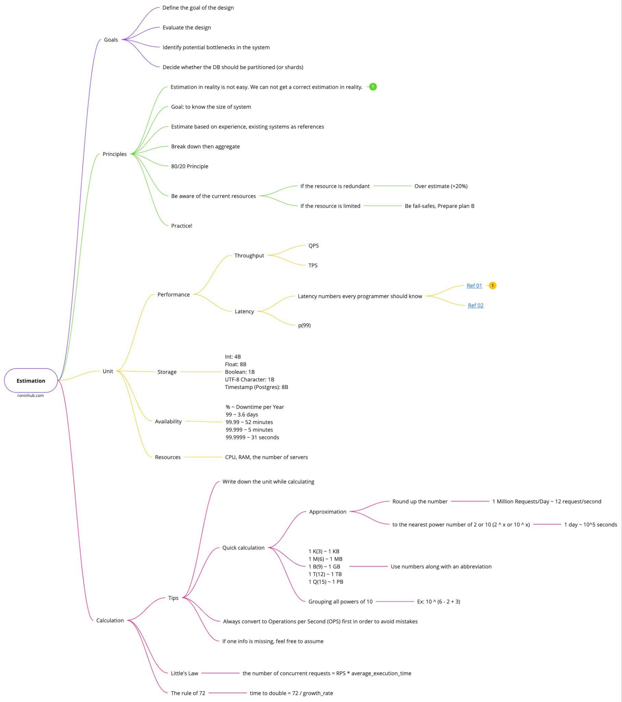
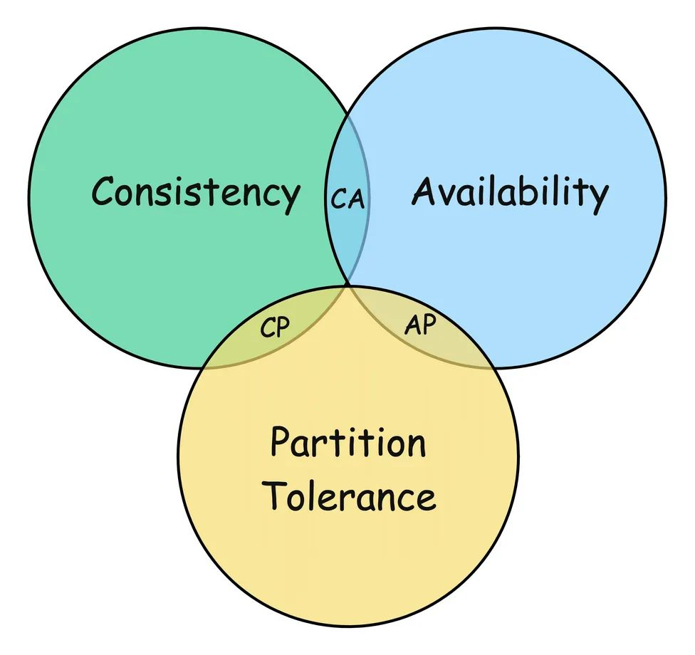
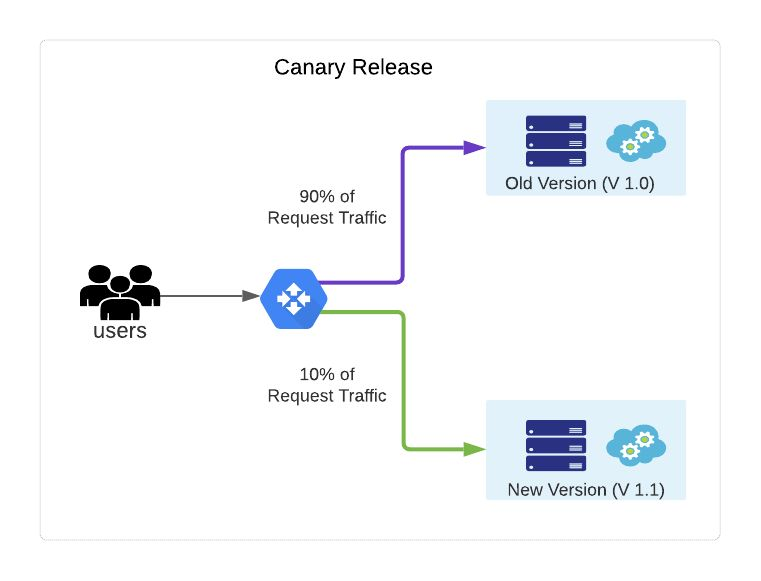
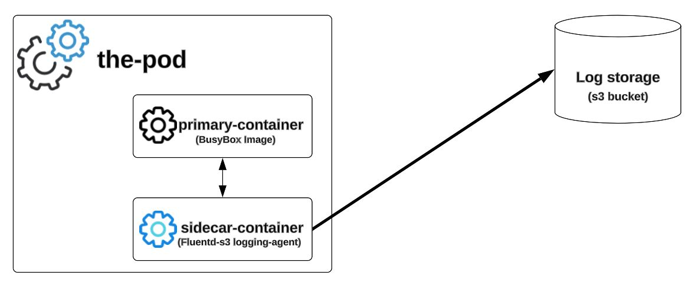
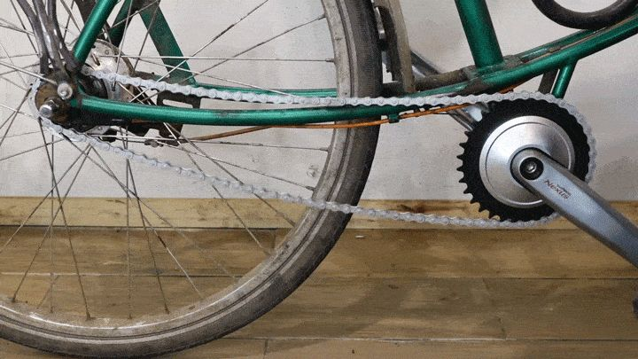
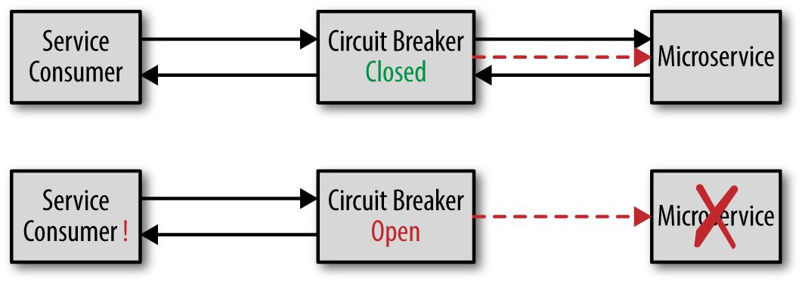
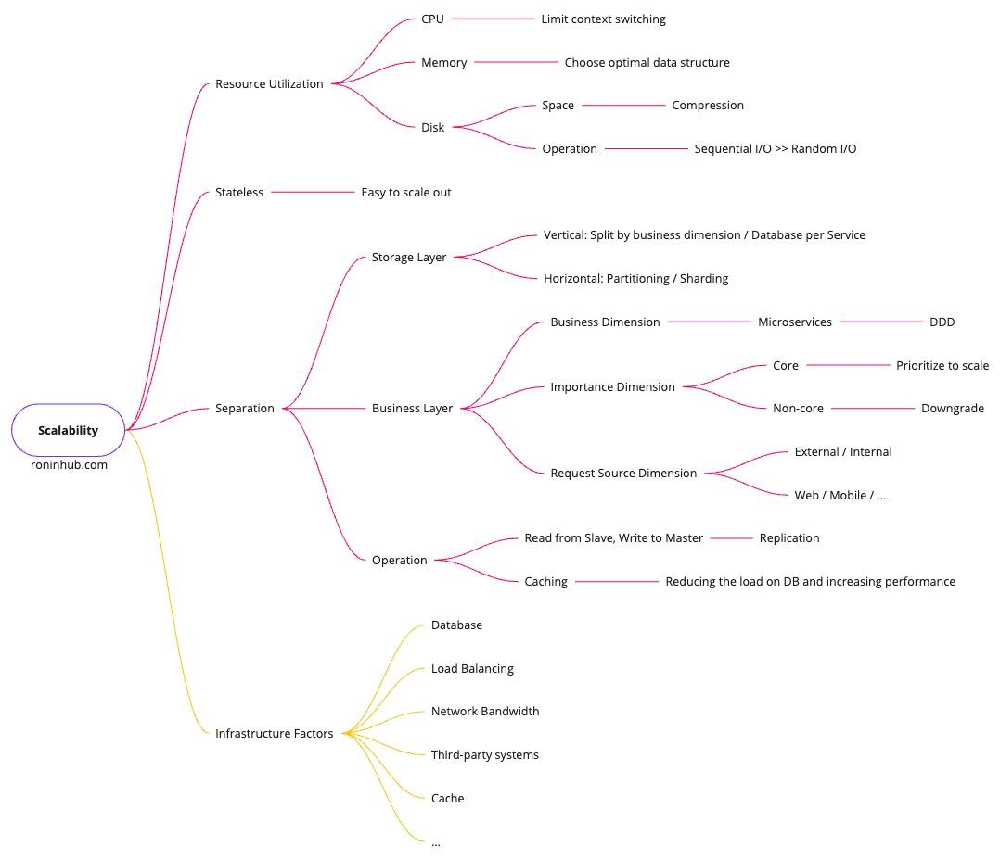
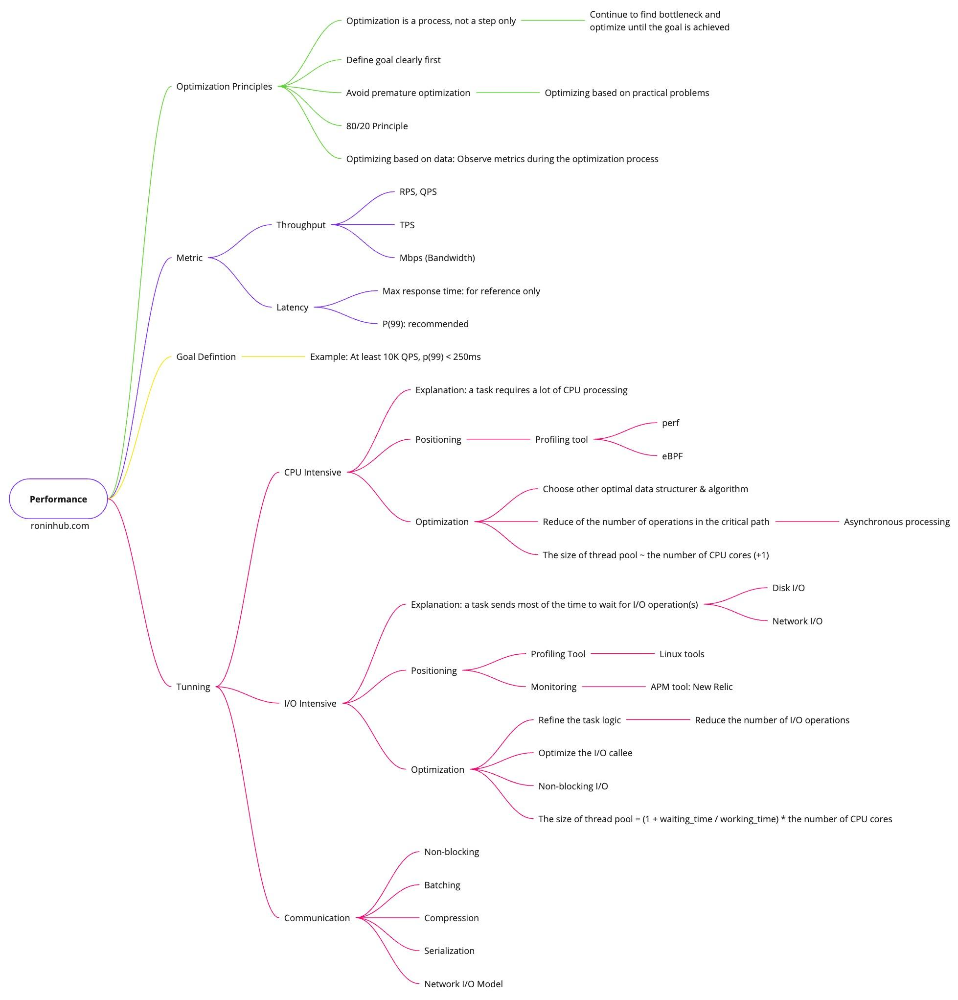
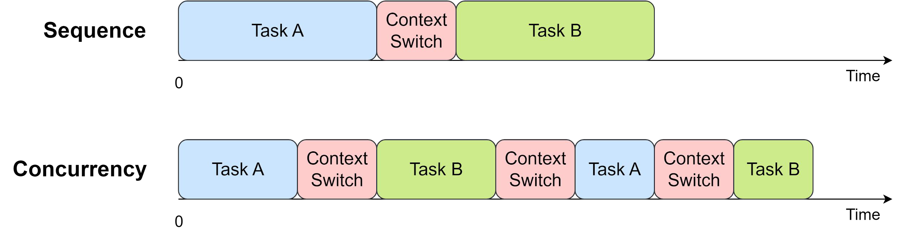
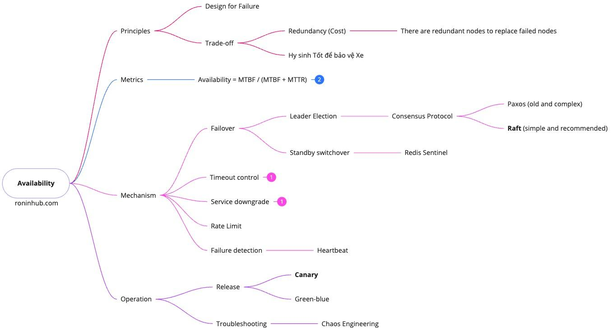

# 02. Design Principles & Estimation

> **Tổng số trang:** 36 slide | **Thư mục ảnh/sơ đồ:** `assets/02_Design_Principles_Estimation/`

---

## Trang 1: Estimation

### Estimation
### & Design Principles
“Tìm những người mày mang ơn trả.

Mọi thứ cứ để nhân quả” – Mở Mắt (Lil Wuyn, Đen)

---

## Trang 2: Outline

### Outline
### 1. Estimation
### 2. Trade-off
### 3. Design Principles
  - Fundamentals
  - Goals

i. Scalability

ii. Performance

iii. Availability

---

## Trang 3: 1. Estimation

### 1. Estimation

---

## Trang 4: (Trang ảnh)

---

## Trang 5: Exercise 1: URL Shortener

### Exercise 1: URL Shortener
Questions:

1. What is the average number of writes per day?

2. What is the read:write ratio?

3. What is the length of a short URL?

4. How many years should the short URL be persisted?

Answers:

1. 10M writes per day

2. 100:1

3. At most 8 characters

4. 4 years

---

## Trang 6: Exercise 1: URL Shortener / Traffic

### Exercise 1: URL Shortener / Traffic
- 10M writers per day
- Read:write = 100:1

→ 10^7 TPD / 10^5 seconds = 10^(7-5) = 100 TPS

→ QPS = TPS * 100 = 10K QPS

---

## Trang 7: Exercise 1: URL Shortener / Storage

### Exercise 1: URL Shortener / Storage
- A record
  - Long URL: 1 KB
  - Short URL: 10 B
  - User_id: 16 B
  - Created_at: 8 B
  - Expires_at: 8 B
  - Updated_at: 8 B
  - → a record ~ 1.1 KB
- Storage for 4 years: 1.1 KB/write * 10M writes/day * 400 days * 4 years

= (1.1 * 4 * 4) * 10 ^ (3 + 7 + 2) = 17.6 * 10^12 = 17.6 TB
- Replication Factor: 3 → total storage = 3 * 17.6 TB = 52.8 TB

---

## Trang 8: Exercise 1: URL Shortener / Memory

### Exercise 1: URL Shortener / Memory
- TTL: 1 days
- Apply 80/20 principles
- 10M writes/day * 1 day * 1.1 KB/record * 0.2

= (0.2 * 1.1) * 10^(7+3) = (2 * 1.1) * 10^9 = 2.2 GB
- Tip: M * K = G

---

## Trang 9: Exercise 1: URL Shortener / Bandwidth

### Exercise 1: URL Shortener / Bandwidth
- Read:write = 100:1 → ignore bandwidth for write operation
- 10K QPS
- Assume the average size of a GET request that not includes token/cookies: 1 KB
- Ingress:  10K QPS * 1 KB → 10 MB/s
- Egress: 10K QPS * (1+1.1) KB → 21 MB/s

---

## Trang 10: 2. Trade-Off

### 2. Trade-Off
“Everything in software architecture is trade-off” - Neal Ford

---

## Trang 11: CAP

### CAP
- Any distributed system can simultaneously provide at most two of three guarantees: Consistency, Availability, and Partition tolerance (CAP)
- What is the difference between C in CAP and C and ACID?

---

## Trang 12: Common Trade-offs

### Common Trade-offs
- Consistency vs Availability (CAP)
- Consistency vs Performance
  - Synchronous vs Asynchronous
  - Strong vs Eventual Consistency
- Space vs Time:
  - Memory vs CPU / IO
  - Caching
  - Compression
  - Normalization vs Aggregation
  - Resources vs Latency
    - Batch vs Stream processing
- Performance vs Security
- Complexity vs Flexibility
- Development Speed vs Quality

---

## Trang 13: Resolving Trade-off

### Resolving Trade-off
- Some trade-offs can be mitigated only or overcomed.
- The root cause of many trade-offs are couplings.
- Separation: Resolve the coupling, you can resolve the trade-off.
- How to find couplings?
  - Dependency / Relationship / Reuse / Constant
  - TRIZ: Separation Techniques

---

## Trang 14: Separation in Time

### Separation in Time
- Modern Umbrella
- Startup (Agility, Cost) → Enterprise (Reliability, Security)
- Auto scale out
- Canary deployment: A/B testing, monitoring perf

---

## Trang 15: Separation in Space

### Separation in Space
- Knife, Hammer
- Sidecar pattern
- Each microservice is optimized differently
  - Product Catalog service uses Elasticsearch
  - Order service uses Postgresql
- Multi-region deployments
- Each schema are used for each client (tenant)

---

## Trang 16: Separation between Parts and Whole

### Separation between Parts and Whole
- Concept: A system’s properties can be split between the whole object and its individual parts. The requirements for the entire system may differ from those for each component.
- Bicycle chain
- Each microservice have low fault tolerance but the whole microservices has high fault tolerance, high elasticity.

---

## Trang 17: Concern Points

### Concern Points
- List of elements
  - Duplication
  - Order
- Relationship: Direction
- Consistency

---

## Trang 18: 3. Design Principles

### 3. Design Principles

---

## Trang 19: Fundamental Principles

### Fundamental Principles

---

## Trang 20: Fundamental Principles

### Fundamental Principles
- SOLID
- 80/20 principle
- KISS (don’t make me think) - try to avoid over-engineering
- Understand principle of operation (of existing solutions) to design
- Define goals first
- Be aware of limitations
  - Every technology has limitation, even the pros have limitation
  - Evaluate the limitation and our needs
- Trade-off
- Avoid premature optimization

---

## Trang 21: Goal: Scalability

### Goal: Scalability

---

## Trang 22: What factors affect to scalability?

### What factors affect to scalability?

---

## Trang 23: Scalability

### Scalability

---

## Trang 24: Goal: Performance

### Goal: Performance

---

## Trang 25: (Trang ảnh)

---

## Trang 26: Finding Bottleneck

### Finding Bottleneck

---

## Trang 27: Finding Bottlenecks

### Finding Bottlenecks
- Bottleneck groups can be:
  - CPU
    - Context switches
    - IO waits
  - Memory
    - Size
  - Disk
    - I/O:
- IOPS depends on hardware
- Sequential I/O >> Random I/O
    - Fragmentation
  - Network
    - Bandwidth
    - I/O models

---

## Trang 28: Concurrency Principle

### Concurrency Principle
- For one core, executing A and B sequentially will always be faster than executing A and B concurrently through time-slicing.

---

## Trang 29: Goal: Availability

### Goal: Availability

---

## Trang 30: (Trang ảnh)

---

## Trang 31: How to Choose Technology?

### How to Choose Technology?

---

## Trang 32: How to Choose Technology?

### How to Choose Technology?
- Boring Technologies
  - Have been proven

→ increase known unknowns

→ decrease unknown unknowns
  - Familiar with the team
  - Don’t waste innovation tokens
- Community
- Active Development / Roadmap
  - How to check if it’s active
    - https://openhub.net/

Unknown unknowns Known unknowns

---

## Trang 33: Recap

### Recap
- Quick Estimation: Approximation + Grouping all powers of 10
- Some trade-offs can be mitigated by resolving couplings
- For one core, executing A and B sequentially will always be faster than executing A and B concurrently through time-slicing.

---

## Trang 34: Homework

### Homework
- Read about LSM Tree, Bitmap, B+Tree
- Design URL shortener

---

## Trang 35: References

### References

---

## Trang 36: Thank you 🙏

### Thank you 🙏

---
