# 03. Database

> **Tổng số trang:** 45 slide | **Thư mục ảnh/sơ đồ:** `assets/03_Database/`

---

## Trang 1: Database

### Database
“Life is a long lesson in humility.”

- James M. Barrie

---

## Trang 2: Outline

### Outline
### 1. Limitation
### 2. Partitioning/Sharding
### 3. How to choose the right DB?

---

## Trang 3: Limitation on a Single DB

### Limitation on a Single DB

---

## Trang 4: Limitation on a Single DB

### Limitation on a Single DB
- With mid-level hardware and a new version DB:
- ~ 20K QPS
- TPS (based on TPC-C):
  - Low contention: ~1000 (Postgres Reference)
  - High contention: ~200 (based on my exp)
- With low-level hardware and old version:
  - MySQL 5.7 & a cloud server (4 cores, 8G)
  - ~ 10K QPS
  - ~ 500 TPS
- Note: Based on estimation and limitations to design

---

## Trang 5: How to Handle With a Big Table?

### How to Handle With a Big Table?

---

## Trang 6: How to Handle With a Big Table?

### How to Handle With a Big Table?
- Evaluate the data size, access patterns first
- Do not jump into complex solution first
- Start from simple solutions:
  - Rewrite query
  - Index
  - Archive old data
  - Caching
  - Using multi-process features maximally
  - Master - Slave
  - Partitioning / Sharding
  - Other Database

---

## Trang 7: Partitioning

### Partitioning
### Sharding

---

## Trang 8: Pros

### Pros
- Improve Query Performance
- Fast to remove partitions
- Easy to migrate partitions to cheaper storage (native remote partitions)

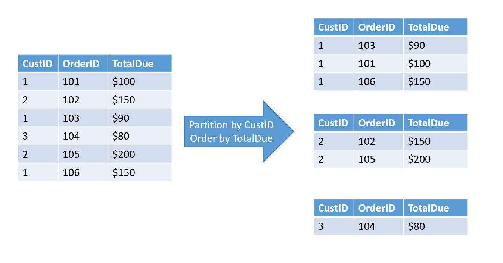

---

## Trang 9: Cons

### Cons
- Limation: Relational DB: all unique keys (or PK) on a partitioned table must include the partitioning key.
  - the partition keys must not include any expressions or function calls
- Secondary index
- Scatter Query
  - Note: queries must include the partition key to avoid Scatter Query
- (Shard) Transactions don't work across shards.
- Hard to join
- Routing
- Foreign Ref to the partitioned table
- Rebalancing

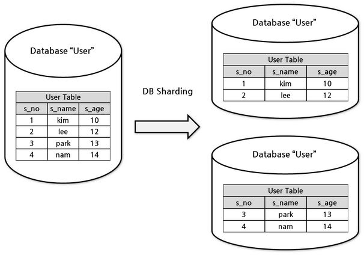

---

## Trang 10: When to partition / shard

### When to partition / shard
- It’s hard to define when. The following is suggestion.
- Large Table
  - \>= 50M records: partition
  - \>= 200M records: shard
- Write rate is very high: >= 3000 TPS
- Query Performance Degrade: Popular query P(99) > 120ms
- Maintenance Overhead: VACUUM, Indexing take longer

---

## Trang 11: Range Partitioning

### Range Partitioning
- There is no overlap between the ranges.
- Pros
  - Simple
  - Align with biz logic
- Cons
  - Fine tune to get even distribution
  - Hot spot
- Example: a news feed system
  - The `post` table is partitioned by `created_date`
  - The 98% traffic goes to the last partition

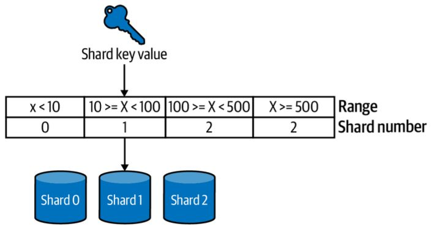

---

## Trang 12: Hash Partitioning

### Hash Partitioning
- Pros
  - Even Distribution on both storage & operations
- Cons
  - Inefficient for range queries
  - Unusual hot spot
- My opinion: Hash partitioning is preferred.

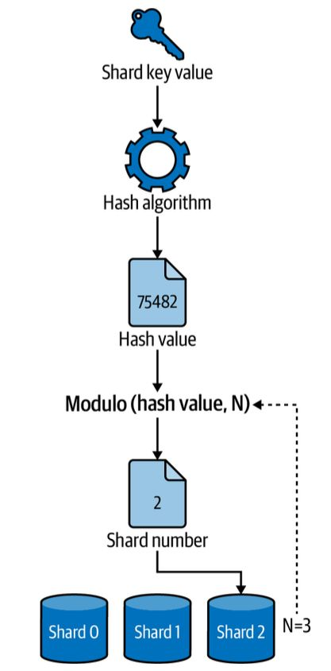

---

## Trang 13: Partition Key

### Partition Key
- Common Data Access Pattern + Strategy

→ Partition Key
- An ideal key has some of 3 properties:
  - Reference entity → to avoid accessing across shards
  - Small → because it’s heavily used
  - High cardinality → even distribution

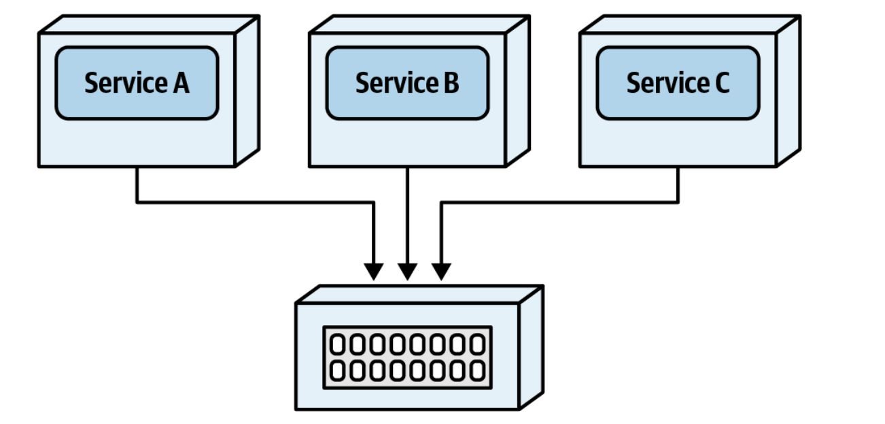

---

## Trang 14: Partition Key / Example 1

### Partition Key / Example 1
- Context:
  - System: E-Commerce
  - Table: Order
- What are common queries?
  - Insert orders
  - Order history of a user
  - Order detail
- What are the appropriate partition strategy and partition key?

What is the primary key?
  - HASH (user_id)
  - The primary key: order_id, user_id

---

## Trang 15: Partition Key / Example 2

### Partition Key / Example 2
- Context:
  - System: Payment System
  - Table: Transaction
- What are common queries?
  - Insert transactions
  - Transaction history for both debit account & credit account
  - View Transaction detail
- What are the appropriate partition strategy and partition key?

What is the primary key?
  - Should not be partitioned
  - The primary key: transaction_id

---

## Trang 16: Partition Key / Example 3

### Partition Key / Example 3
- Context:
  - System: Metric monitoring system
  - Table: Metric_log
- What are common queries?
  - Insert metrics from a device at specific time
  - Show history metric log of a device
  - Delete old metrics
- What are the appropriate partition strategy and partition key?

What is the primary key?
  - Nested partitions
    - Level 1: HASH(device_id)
    - Level 2: Range(timestamp)
  - Primary key: (device_id, timestamp)
- It’s hard to maintain and inefficient → Time-series DB

---

## Trang 17: Partition Key / Example 4

### Partition Key / Example 4
- Context:
  - System: Discord system
  - Table: message
- What are common queries?
  - Insert messages
  - View message history in a channel
- What are the appropriate partition strategy and partition key?

What is the primary key?
  - HASH (channel_id)
  - The primary key: (message_id, channel_id)
  - Sort by message_id (not created_at)

---

## Trang 18: Best Practices

### Best Practices
- If there is no performance bottleneck, try not to shard the database.
- If you want to do it, try to do it in one go. For example, 16 database and 64 partitions can basically meet your business needs for the next few years.
- Many NoSQL databases provide auto sharding features. You can also consider using these NoSQL databases to replace traditional relational databases.

---

## Trang 19: Alternatives

### Alternatives
- NoSQL
- NewSQL
  - Example: TiDB, Cockroachdb
  - Cons:
    - Not full ANSI SQL
    - OLAP need to be improved more
- Middleware
  - Example: Vitess (MySQL), Citus (Postgresql)
  - Cons:
    - Operation overhead

---

## Trang 20: Why Relational Database

### Why Relational Database
### is Bad At Scalability?

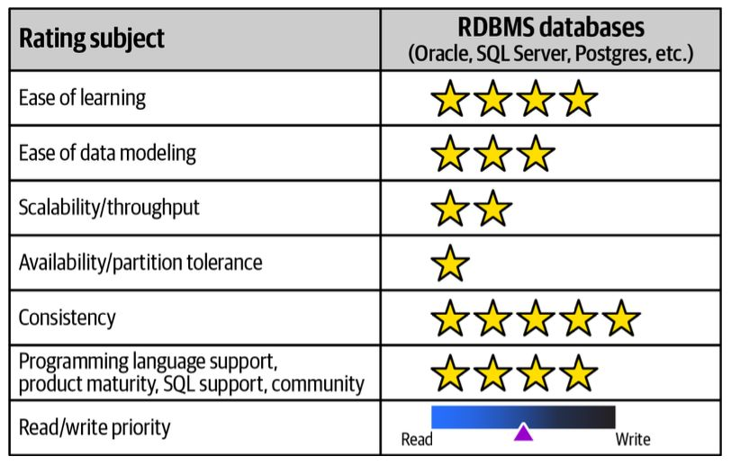

---

## Trang 21: Why Relational DB is not good at Scalability?

### Why Relational DB is not good at Scalability?
- Strong Consistency
- Monolithic design: easy to join, but hard to scale
- Random I/O:
  - Fact: Sequential I/O >> Random I/O
  - To insert a record, we scan B+Tree index to find the location

→ generate many random I/O
- Lack of auto-shard feature

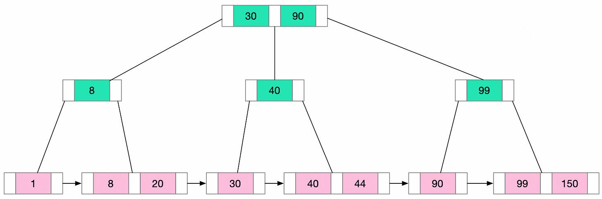

---

## Trang 22: Why NoSQL DB is good at Scalability?

### Why NoSQL DB is good at Scalability?
- Distributed design at the beginning
- LSM Tree: convert random I/O to sequential I/O
- Built-in Auto-shard feature (MongoDB)

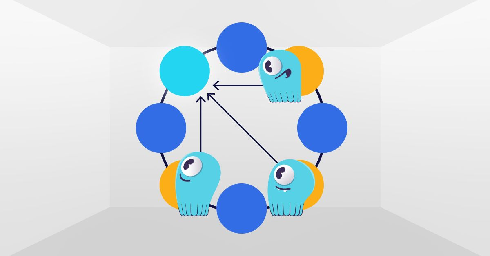

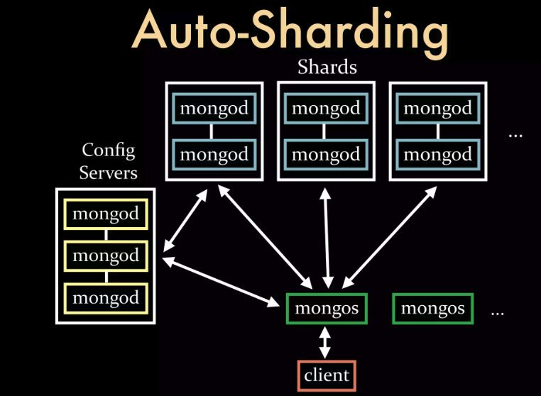

---

## Trang 23: LSM Tree

### LSM Tree
1. Write sequentially

2. Write

3. Flush (write sequentially)

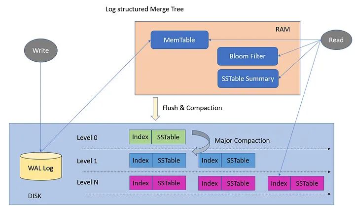

---

## Trang 24: How to choose the right DB?

### How to choose the right DB?

---

## Trang 25: How to choose the right DB?

### How to choose the right DB?

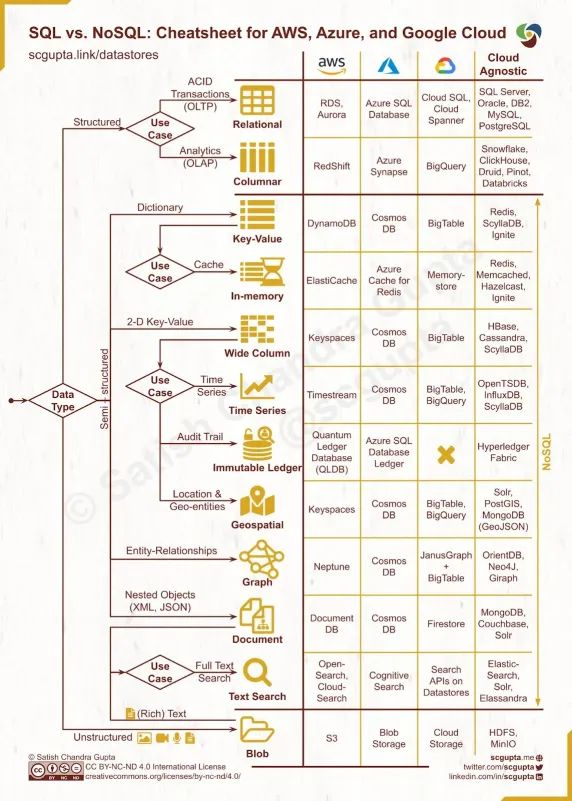

---

## Trang 26: How to choose the right DB?

### How to choose the right DB?

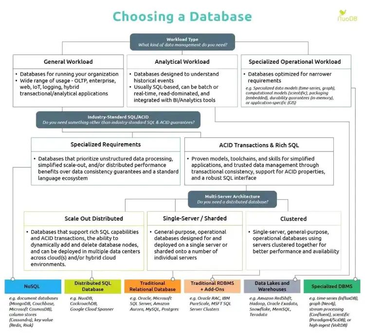

---

## Trang 27: How to choose the right DB?

### How to choose the right DB?
- High performance for write + read operation
- Scalability
- No need for strong consistency
- No special function on data
- If you need a flexible data model & complex queries
  - → MongoDB
  - UC: Device info, IoT metrics
- If you need performance and scalability
  - → ScyllaDB
  - UC: messages, posts

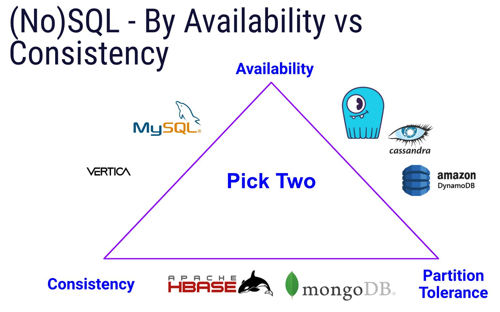

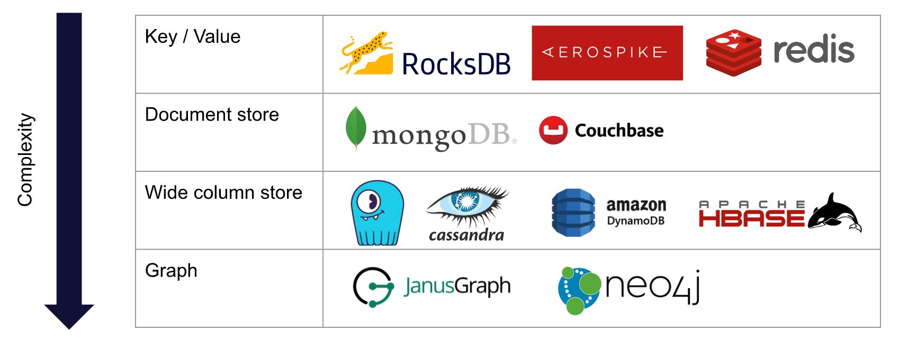

---

## Trang 28: Column-Oriented Storage

### Column-Oriented Storage
- Usually used for OLAP (online analytic processing)
- Each column file contains the row value in the same order

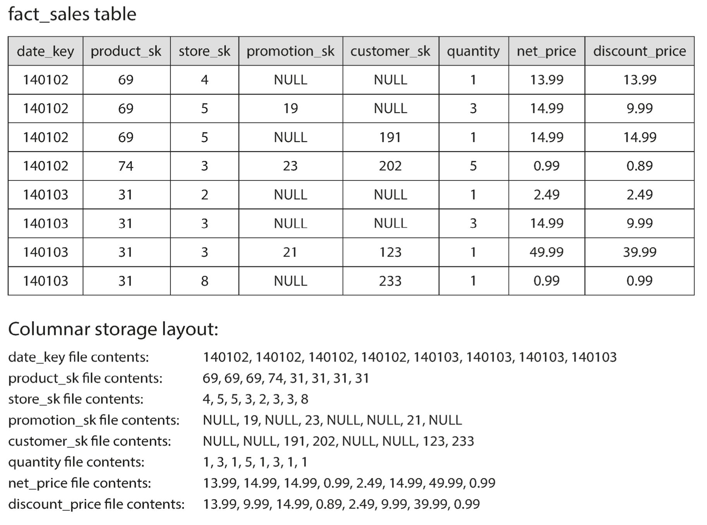

---

## Trang 29: Column-Oriented Storage

### Column-Oriented Storage
- `product_sk` column: low cardinality
- Query:

SELECT count(*)

FROM sales

WHERE product_sk IN (29, 30, 74)

OR 3 bitmap → count the number of “1” in the result bitmap is so quick (hardware support)

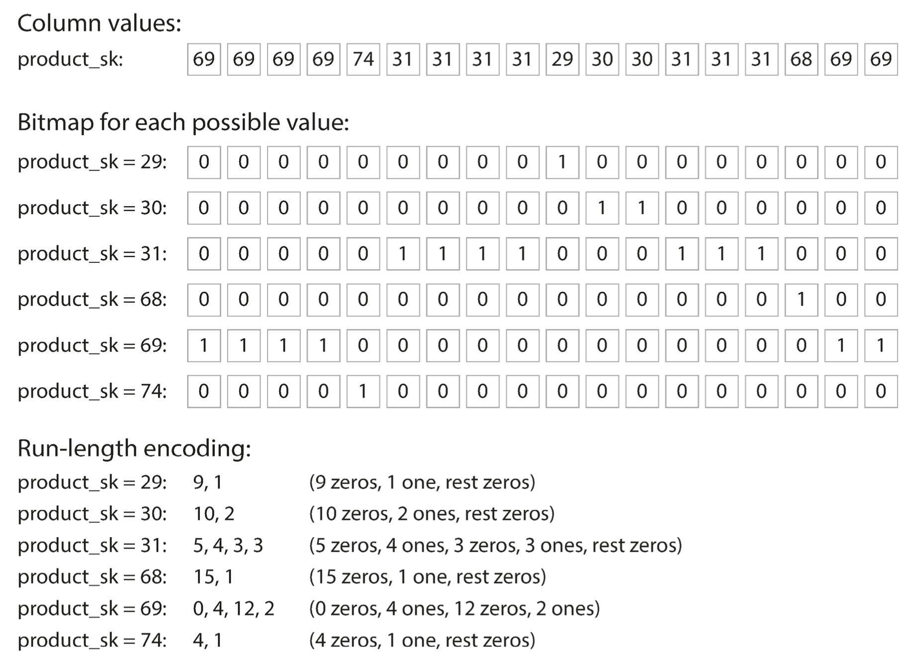

---

## Trang 30: Column-Oriented Storage

### Column-Oriented Storage
- Compression: run-length encoding

→ pro: save storage
- Problem: It’s hard to update-in-place with compression columns.
- Solution:
  - All writes go to an in-mem store first
  - Batch insert (Clickhouse)

---

## Trang 31: Search Engine

### Search Engine
- Elasticsearch (ES)
- Why ES Search So Fast?
  - Inverted Index
  - Parallel processing on shards/segments
  - Filesystem cache
  - Smart Relevance Scoring to avoid scanning unnecessary data

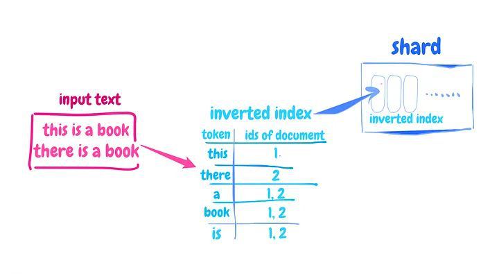

---

## Trang 32: Time series Databases

### Time series Databases

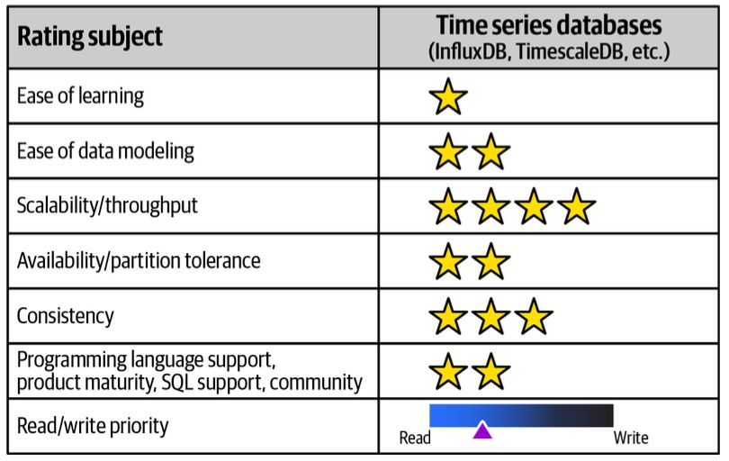

---

## Trang 33: Time Series Databases

### Time Series Databases
- Timescale (recommended)
- A hypertable automatically partitions data by time/space
- Each hypertable is made up of child tables called chunks.
- Improve performance for write heavy
  - Write to mem first
  - Batch Commit
  - Parallelize writes across many servers
  - synchronous_commit=off
- Read more:
  - TimescaleDB vs. InfluxDB: Purpose Built Differently for Time-Series Data

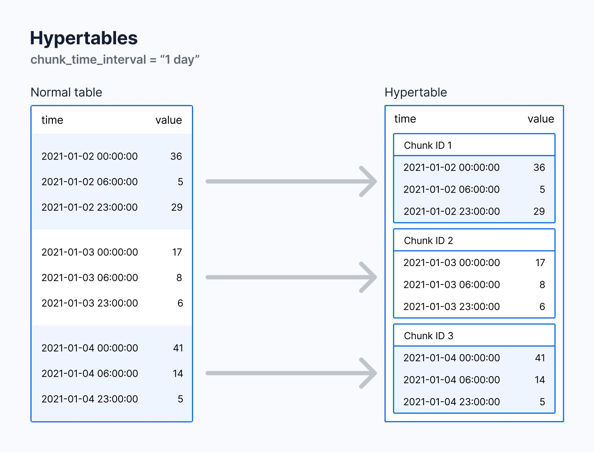

---

## Trang 34: Contention

### Contention

---

## Trang 35: Contention

### Contention
Strong Consistency + High Concurrency + Low Contention:

→ NewSQL (TiDB: recommended)

Strong Consistency + Normal Concurrency + High Contention:

→ Traditional Relational DB + Optimistic Lock + other optimization (has limitations)

+ High Concurrency

→ Other solution (discuss later)

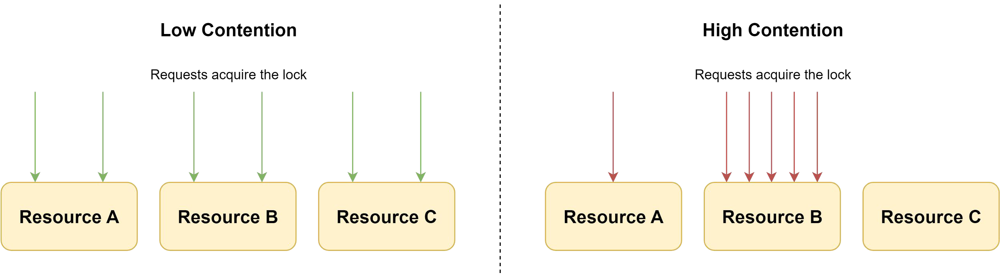

---

## Trang 36: Recap

### Recap
- Evaluate the data size, access patterns first
- Sharding has many cons
- Understanding Principle of Internal Operation help us:
  - Choose the right
  - Control it easily
  - Get insights to solve other problems

---

## Trang 37: Homework

### Homework
- Research Rate Limiting Algorithms
  - Which one is preferred?

---

## Trang 38: References

### References
- https://blog.lawrencejones.dev/state-machines/index.html
- https://vladmihalcea.com/optimistic-vs-pessimistic-locking/
- https://faculty.kutztown.edu/schwesin/spring2022/csc343/lectures/Locking.pdf

---

## Trang 39: How to choose the right DB?

### How to choose the right DB?

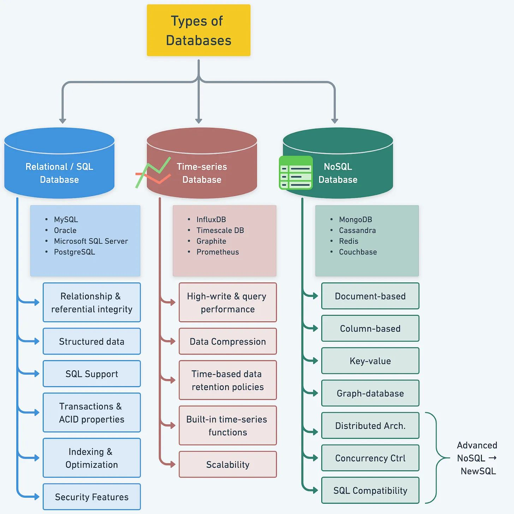

---

## Trang 40: Key Value Databases

### Key Value Databases

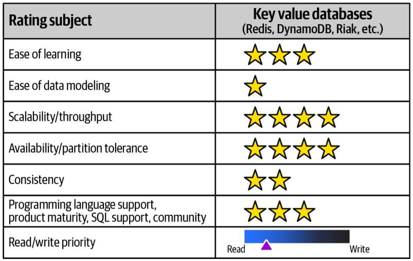

---

## Trang 41: Document Databases

### Document Databases

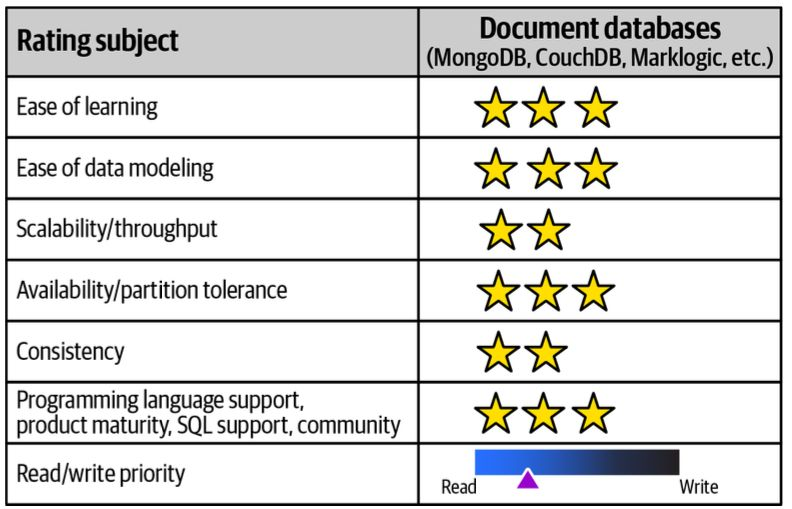

---

## Trang 42: Wide Column Databases

### Wide Column Databases

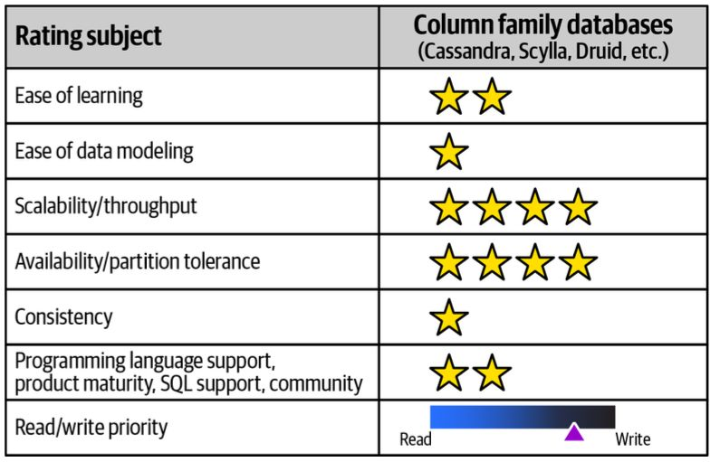

---

## Trang 43: Graph Databases

### Graph Databases

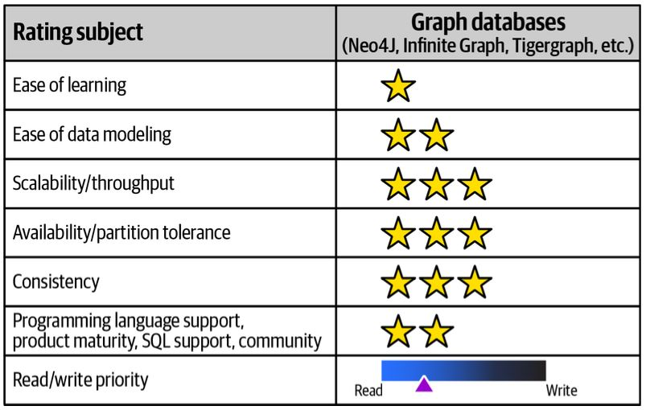

---

## Trang 44: NewSQL Databases

### NewSQL Databases

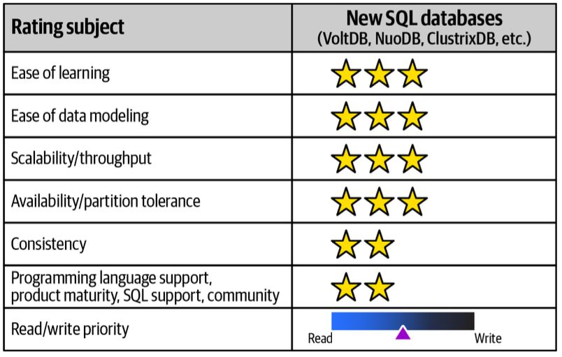

---

## Trang 45: Thank you 🙏

### Thank you 🙏

---
