# 04. Caching

> **Tổng số trang:** 39 slide | **Thư mục ảnh/sơ đồ:** `assets/04_Caching/`

---

## Trang 1: Cache

### Cache
Nhiều vấn đề nằm ở tâm lý. Những định kiến không còn đúng,

sẽ tạo rào cản tâm lý.


---

## Trang 2: Outline

### Outline
### 1. Fundamentals
### 2. Rate Limit
### 3. Practices

---

## Trang 3: Fundamentals

### Fundamentals

---

## Trang 4: Where Is Cache Used

### Where Is Cache Used

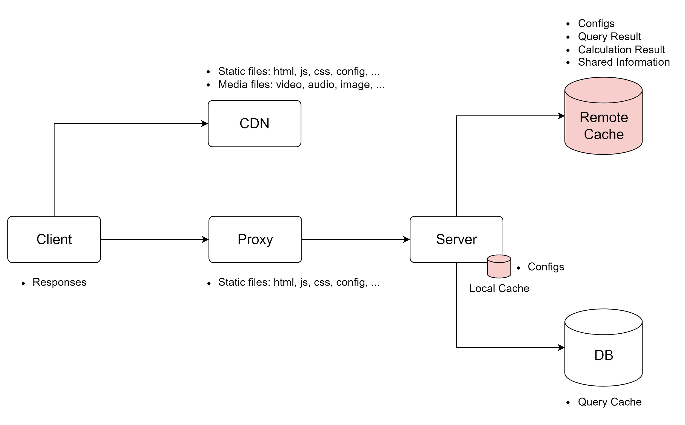

---

## Trang 5: Use Cases

### Use Cases
- Improving the access speed
- Buffer
  - A temporary storage of data, which will be transmitted to other component
  - Buffer != cache. Message queue is used as a buffer.
- Communication: Share data between components

---

## Trang 6: Cons

### Cons
- Redis Limitations:
  - Pub/Sub: CPU - UNSUBSCRIBE operation is costly
  - Single-threaded Model: CPU utilization
- Data Inconsistency
- Memory
- Bandwidth

---

## Trang 7: Redis in Production

### Redis in Production
- Single Redis instance can handle
  - ~50k TPS (SET)
  - ~80k QPS (GET)
  - ~ 250 million keys per instance (2^32 keys in theory)
  - 32 GB / instance (not limitation, recommended)
  - 60K connections
- Benchmark utility: redis-benchmark, K6

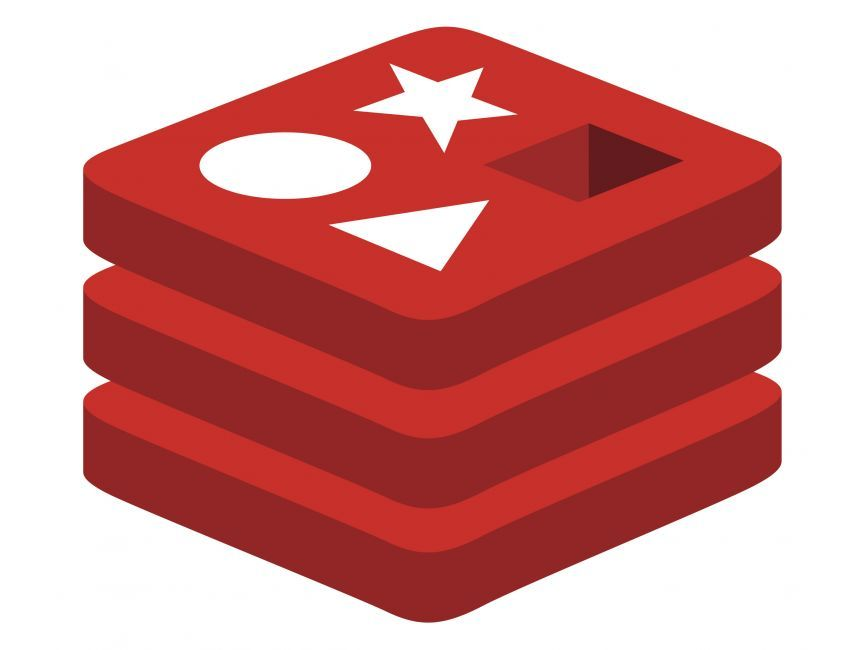

---

## Trang 8: Architecture / Cluster

### Architecture / Cluster
- Distributes the data on different servers
- Pros:
  - Solve Failover
  - Reduce the system's dependence on a single master node
  - Scalable for read and write
- Cons:
  - Data inconsistency
  - Operational Overhead

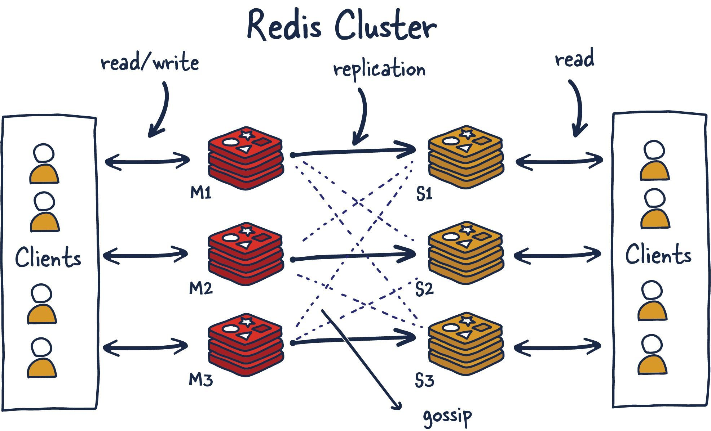

---

## Trang 9: Architecture / Cluster

### Architecture / Cluster
- Hash Slots handle the mapping relationship between data and nodes
- A cluster has a total of 16384 hash slots
- Even distribution on nodes in a cluster
- One hash slots can have multiple keys

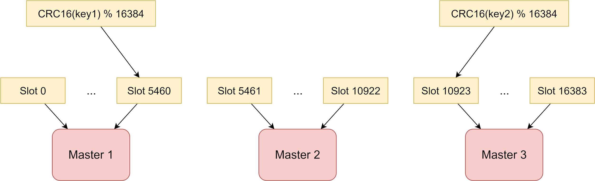

---

## Trang 10: Redis Data Structure

### Redis Data Structure

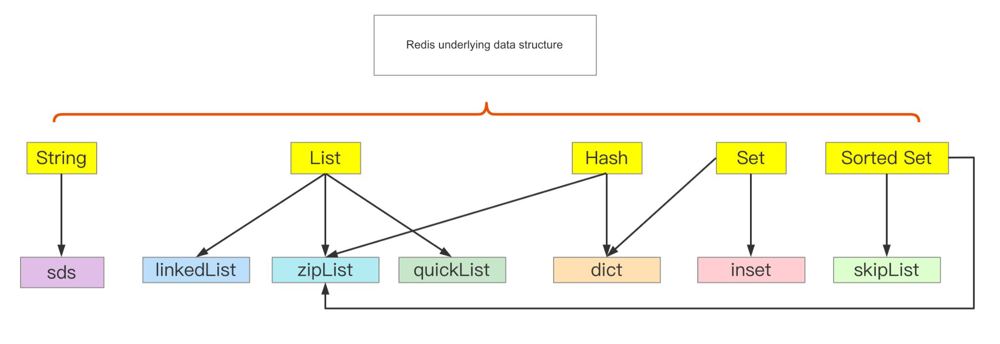

---

## Trang 11: Remind

### Remind
- Leverage local cache
- Choose read strategy + write strategy
- Challenges: Penetration, Avalanche
- Architecture: Sential, Cluster
- Reference: Advanced Backend

---

## Trang 12: Rate Limiting

### Rate Limiting

---

## Trang 13: Window-fixed Algorithms

### Window-fixed Algorithms
- Pros
  - Simple
- Cons
  - Unable to limit bursts of requests at the boundary of windows.

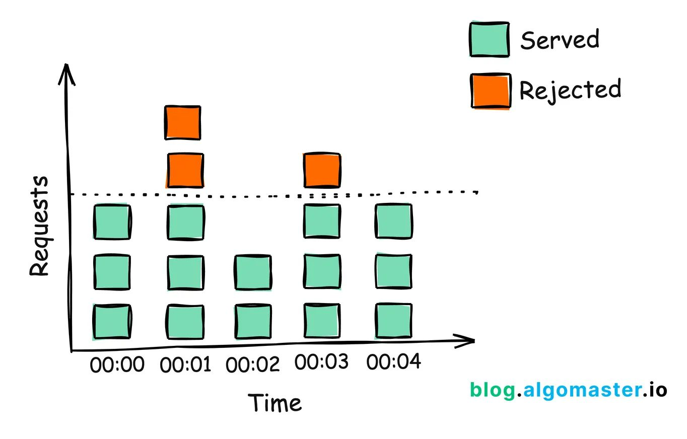

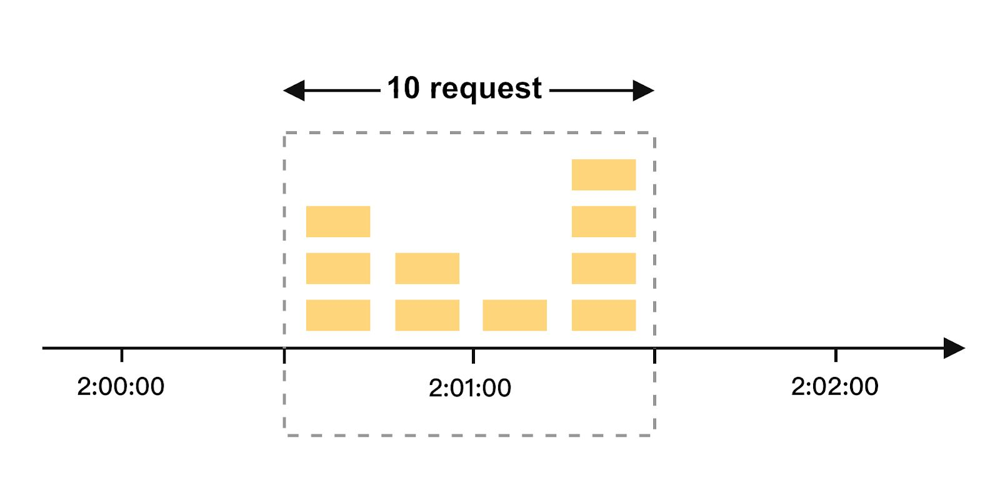

---

## Trang 14: Sliding Window Counter

### Sliding Window Counter
- Pros
  - More accurate
  - Smooths out edges between windows
- Cons
  - Slightly more complex to implement.
  - Still unable to limit bursts of requests within a short period of time.

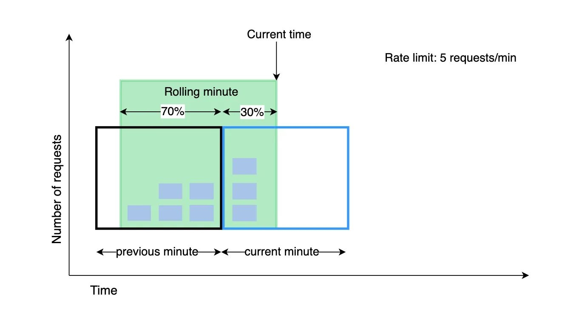

---

## Trang 15: Leaky Bucket Algorithm

### Leaky Bucket Algorithm
- Implementation: use message queues as leaky buckets
- Pros:
  - Steady Rate
  - Easy to implement
- Cons
  - Latency: caching the traffic in a leaky bucket (queue) → increases the response time

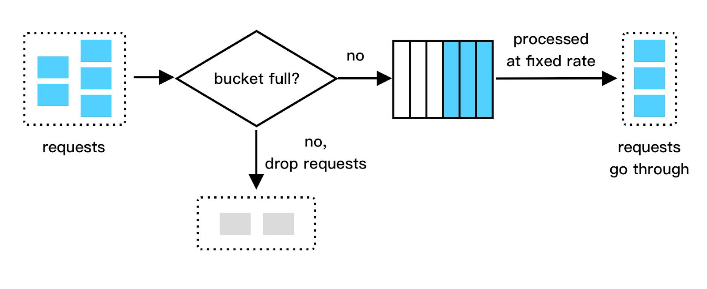

---

## Trang 16: Token Bucket Algorithm

### Token Bucket Algorithm
- Pros: just store the number of token
  - Efficient memory
  - Low latency
- Token bucket algorithm is preferred
- Implementation
  - Guava
  - Redis
- Problem: when using Redis to store the number of tokens. In this case, each request needs to request Redis once to obtain a token.

→ increase the delay by several milliseconds (RTT) and have some performance loss.
  - Solution: Obtain a batch of tokens instead

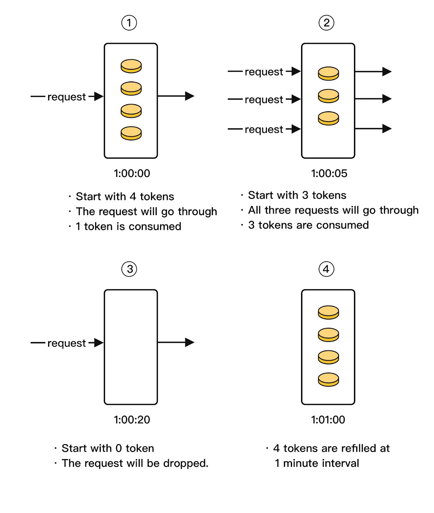

---

## Trang 17: Practices

### Practices

---

## Trang 18: Counter in News Feed System

### Counter in News Feed System

---

## Trang 19: Counter in Threads

### Counter in Threads
- Functional requirements:
  - The number of likes, comments, shares, views of a post.
  - The number of posts, followers, following of a person.
- Non-functional requirements:
  - Accurate
  - Performance
  - Availability
  - Persistence
- 1B users
- 200M DAU
- 1M QPS

→ Count System


---

## Trang 20: Simple Design: Relational DB

### Simple Design: Relational DB
- Get count

```

select like_count, comment_count, share_count, view_count

from post_count

where post_id = ?

```
- Update count

```
```
UPDATE post_count SET like_count = like_count + 1 WHERE post_id = 1;
UPDATE post_count SET like_count = like_count + 1 WHERE post_id = 1;
UPDATE post_count SET like_count = like_count + 1 WHERE post_id = 1;
```
```

→ Problem: Relational DB is not optimized for burst of writes


---

## Trang 21: Simple Design: Relational DB

### Simple Design: Relational DB
- Solution 1: Batch insert
  - Problem: it still has limitations
- Solution 2: adding a queue in front of DB
  - Problem: latency

---

## Trang 22: Optimal Solution: Redis

### Optimal Solution: Redis
- Accurate: Single threaded model

→ solve race condition problem
- Performance:
  - Latency: mem → improve latency for read & write
  - Throughput: clustering
- Memory
  - Use hash DS to save memory
  - Problem: large data of posts
  - Solution: cold data vs hot
    - Auto-tiering
    - Pika DB


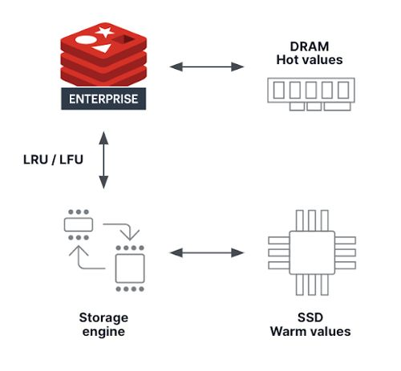

---

## Trang 23: Design Unread Broadcast Counter

### Design Unread Broadcast Counter

---

## Trang 24: Unread Broadcast Notification

### Unread Broadcast Notification
- Requirement:
  - The number of broadcast notifications
  - Don’t count in  FE
- Non-functional requirements:
  - Accurate
  - Low latency
- 10M users


---

## Trang 25: Unread Broadcast Notification

### Unread Broadcast Notification
- Solution 1: count on all users
  - Problem: take time to travel all users
- Solution 2: pointer per user
  - Poll to check unread

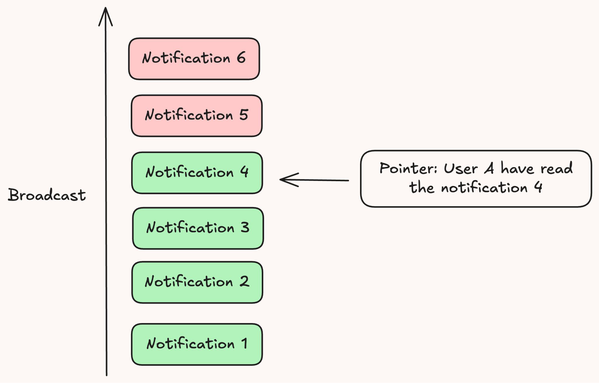

---

## Trang 26: Share Data

### Share Data

---

## Trang 27: Problem: Two-Way Communication

### Problem: Two-Way Communication
- Messages go through one message queue in one way.
- Problem:
  - Services need two-way communication.
    - Example: REST API
  - How to get a response from the replier?


---

## Trang 28: Reply Topic

### Reply Topic
- Problems:
  - Instance A sends a request, but instance B receives the response.
  - How to share responses between instances?
  - How to get responses fast?

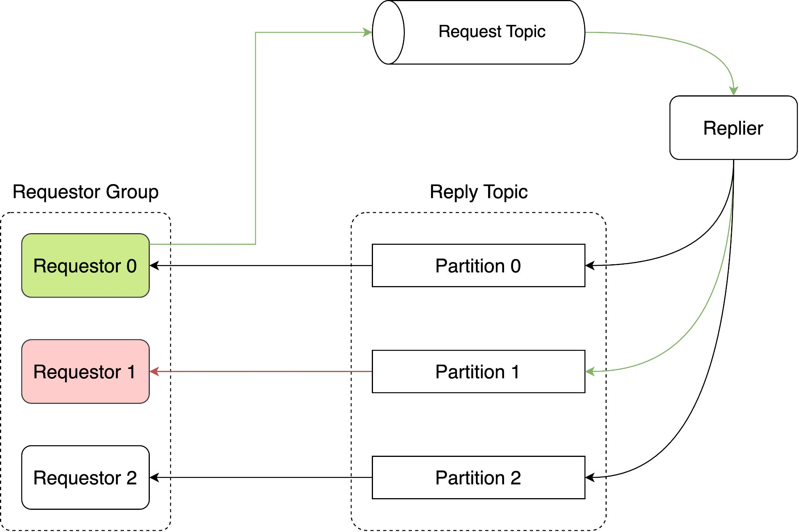

---

## Trang 29: Remote Message Pool

### Remote Message Pool
- A remote message pool (Redis) for storing and sharing responses between instances
  - Key: message_id
  - Value: response
- The request thread will poll the remote pool to get the appropriate response.

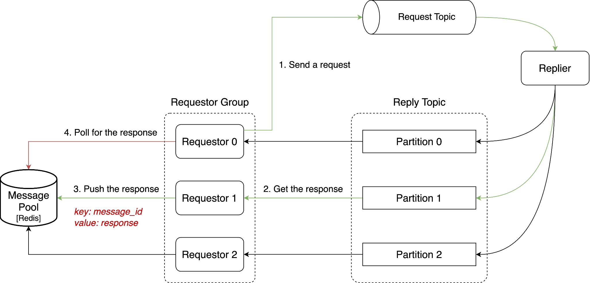

---

## Trang 30: Replicated Caching Pattern

### Replicated Caching Pattern
- Example: Hazelcast (Java)

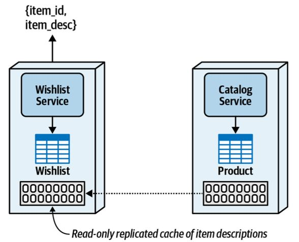

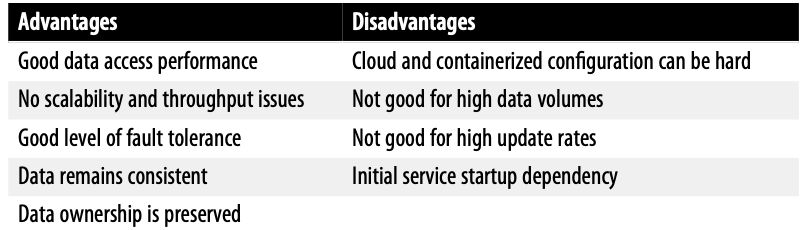

---

## Trang 31: Recap

### Recap
- Cache is used to improve the access speed, buffer and share data.
- Among Rate Limit Algorithms, Token Bucket is preferred.
- Redis is popular because it’s easy to change data/solve problems.

---

## Trang 32: Homework

### Homework
- Practice with Lua script in Redis
- Research about network I/O models

---

## Trang 33: Race Condition (in Client Side)

### Race Condition (in Client Side)
- Problem: TODO
- Solution:
  - Transaction
    - Optimistic Lock: WATCH
  - Lua Script (recommended): simpler, faster

---

## Trang 34: Delay Task

### Delay Task
### Requirement:
  - Cronjob
  - Set a task that will be executed at specific time
### Solution:
  - ZSET

---

## Trang 35: Count Unique

### Count Unique
### Requirement:
  - Count unique visits to a page on this day based on IP address
  - Low latency
  - Low storage
  - Accurate > 95%
### Solution:
  - Hyperloglog
  - https://chengweihu.com/hyperloglog/

---

## Trang 36: Segmentation

### Segmentation
### Requirement:
  - Classify books
  - Check which genre is a book?
  - Find intersection between “Fiction” genre and “Adventure” genre?
  - Low latency, low storage
- Solution
  - Bitmap
  - Read more: Grab's Segmentation Platform

---

## Trang 37: Check if a username is taken

### Check if a username is taken
### Requirement:
  - Public API: Check if a username is taken
  - Low latency
  - High throughput → prevent attack (to DB)
- Solution
  - Bloom filter

---

## Trang 38: References

### References
- https://github.com/OpenAtomFoundation/pika

---

## Trang 39: Thank you 🙏

### Thank you 🙏


---
