# 05. Communication

> **Tổng số trang:** 31 slide | **Thư mục ảnh/sơ đồ:** `assets/05_Communication/`

---

## Trang 1: Communication

### Communication
“Speak the Truth”

---

## Trang 2: Outline

### Outline
### 1. Fundamentals
### 2. Choosing the Right One
### 3. Practices

---

## Trang 3: 1. Fundamentals

### 1. Fundamentals

---

## Trang 4: What do we need to consider

### What do we need to consider
### in communication?

---

## Trang 5: Considerations

### Considerations
- Delivery Guarantee
- Compatible: Changing interface
- Performance, Efficiency
- Error Handling
- Security
- Note: in reality, don’t take performance first.

---

## Trang 6: Message Processing Flow

### Message Processing Flow
Efficiency Performance Delivery Guarantee,

Efficiency,

Security

Compatible Error Handling

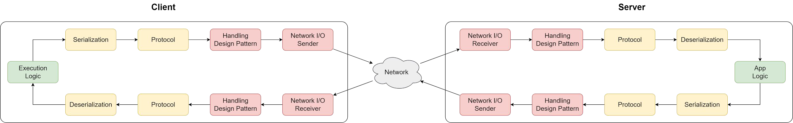

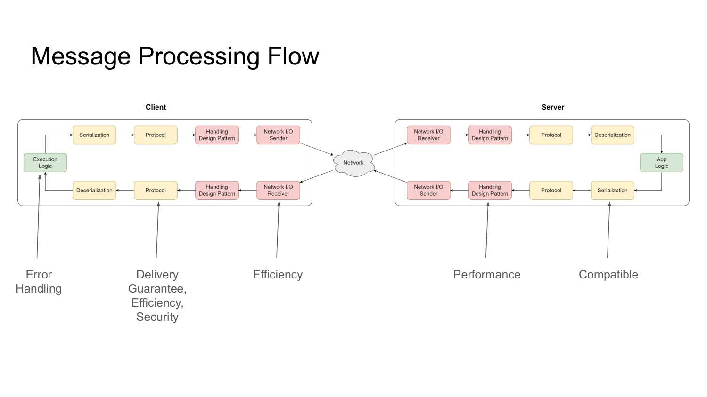

---

## Trang 7: 1.1. Network I/O Model

### 1.1. Network I/O Model

---

## Trang 8: Network I/O Models

### Network I/O Models
- Blocking I/O (BIO): Synchronous, popular
- Non-blocking I/O (NIO): Synchronous
- Multiplexing I/O: Synchronous, popular, recommended for high-concurrency systems
- Signal-driven I/O
- Asynchronous I/O (AIO): Asynchronous

---

## Trang 9: Blocking I/O (BIO)

### Blocking I/O (BIO)
- A network call blocks the application thread until the operation completes
- You stand by the stove and wait for the water to boil (wait for resources), and then pour the water (use resources)
- Problem: creating too many threads will increase the overhead of thread switching

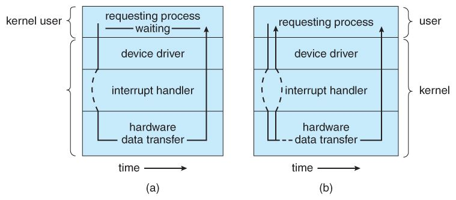

---

## Trang 10: Non-blocking I/O (NIO)

### Non-blocking I/O (NIO)
- The system call returns immediately. App polls the readiness of I/O operations.
- You watch TV (do other things - nonblocking) while boiling water, but still have to check if the water is boiling (polling). Once the water is boiled, you immediately go to pour water (using resources).
- Problem: the concurrency increases, a large number of system calls during the polling process lead to a large amount of context-switching overhead.

---

## Trang 11: Multiplexing I/O

### Multiplexing I/O
- A system call monitors multiple I/O operations.
- You boil multiple pots of water at the same time (multiple I/O operations). You can watch TV (nonblocking) and check which pot of water is boiling (polling). Then pour water (using resources -synchronous).
- Speed up the boiling water.

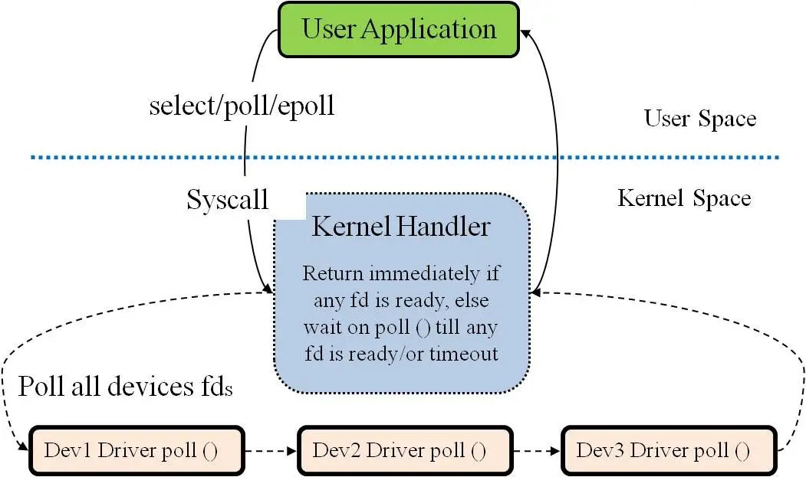

---

## Trang 12: 1.2. Handling Design Pattern

### 1.2. Handling Design Pattern

---

## Trang 13: Threading Pattern: Traditional

### Threading Pattern: Traditional
- A new request → a new thread.
- Each thread handles
  - Handles the connection (BIO)
  - Processing the request.
- Note: The number of threads is limited by thread pool

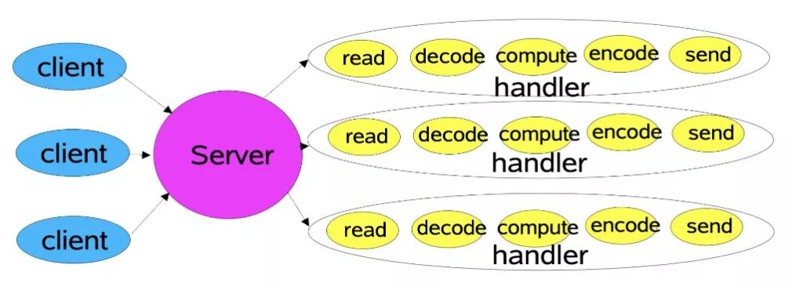

---

## Trang 14: Threading Pattern: Reactor pattern (Actor model)

### Threading Pattern: Reactor pattern (Actor model)
- Idea: separating I/O bound tasks from CPU-bound tasks.
- The main reactor in the main thread uses its selector to monitor connection events.
- The sub reactor adds the connections to the connection queue, and creates a handler to handle subsequent events.
- Read more:
  - Essential Technologies for Java Developers: I/O and Netty - Alibaba Cloud Community
  - How Is Netty Used to Write a High-Performance Distributed Service Framework? - Alibaba Cloud Community

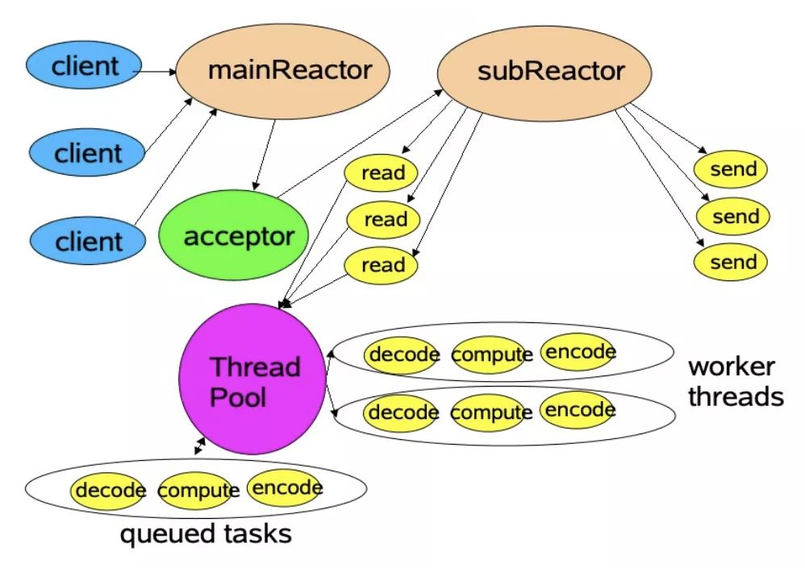

---

## Trang 15: 1.3. Protocol

### 1.3. Protocol

---

## Trang 16: HTTP/1.1 vs HTTP/2

### HTTP/1.1 vs HTTP/2
- Multiplexing: Keep one TCP connection to stream multiple requests, responses.
- Bi-Directional: server push
- Header compression
- Binary Framing Layer

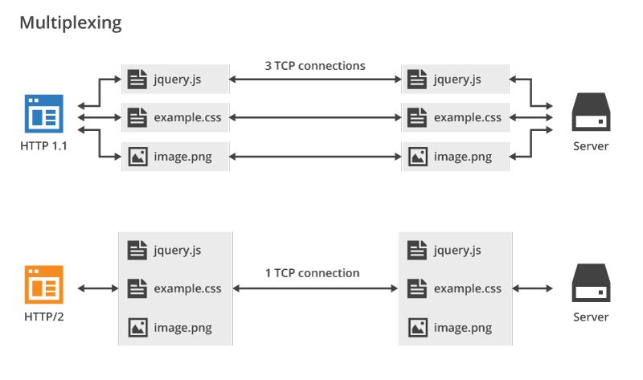

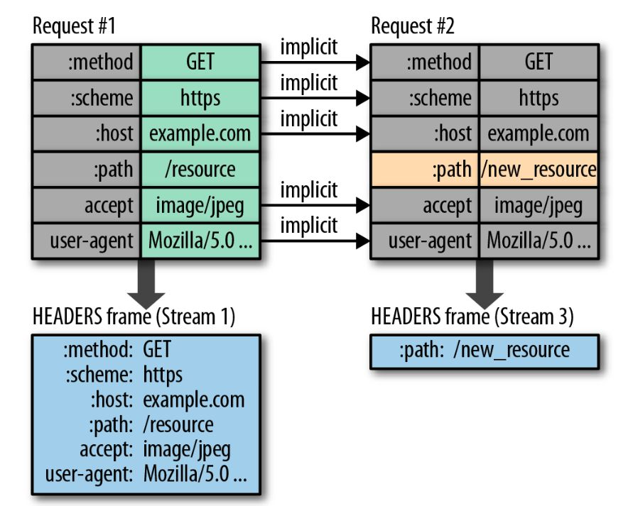

---

## Trang 17: 1.4. Serialization

### 1.4. Serialization

---

## Trang 18: Serialization Formats

### Serialization Formats
JSON (Textual) Protobuf (Binary)

Compatible (x) High Low Changing field numbers, types breaks

compatibility

Complexity (x) Low Schema is Optional

Readable

High Requires a predefined schema

Hard to debug

Performance (x)

Use cases If performance requirement is not high Otherwise

---

## Trang 19: 2. Choosing The Right One

### 2. Choosing The Right One

---

## Trang 20: 2.1. BE - BE

### 2.1. BE - BE

---

## Trang 21: Synchronous: REST vs gRPC

### Synchronous: REST vs gRPC
REST gRPC

Compatibility (x) Supported by browser, LB, all languages

Performance HTTP/1.1 (x) Built on HTTP/2 Protobuf serialization

Async RPC

Complexity (x) Require code generation

Load Balancing

(x) K8S native service. Built-in client load balance.

Use cases If performance requirement is not high Otherwise

*New idea: REST over HTTP/2

---

## Trang 22: Asynchronous: Kafka vs Rabbitmq

### Asynchronous: Kafka vs Rabbitmq
Kafka Rabbitmq

Delivery Guarantee

At-most once, at least once At-most once, at least once

Throughput (x) Scale the number of partition.

~10M MPS

~ 500K MPS

Latency Write sequentially to disk;

Pull-based delivery

(x) RabbitMQ initially stores messages in

memory; push-based delivery

Routing Lacks built-in filtering capabilities (x) Routing key, filtering messages

Retention (x) persists all messages evicts messages after being consumed

Other features

Ecosystem (x) Built-in error handling, TTL, Delayed

Messages, RPC

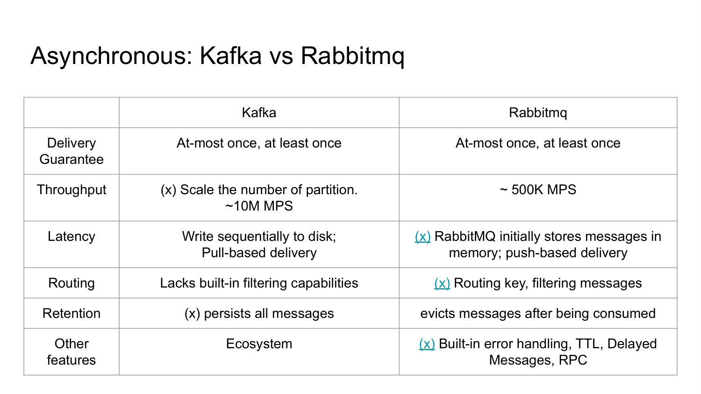

---

## Trang 23: 2.2. FE - BE

### 2.2. FE - BE

---

## Trang 24: Broadcast to a Lot of Devices

### Broadcast to a Lot of Devices
- Scenarios
  - Turn on all IoT devices
  - Update trading order book
- Solution:
  - Websocket
  - MQTT clients + MQTT broker
    - Asynchronous, supports broadcast
    - Browser: MQTT over Websocket

---

## Trang 25: MQTT over QUIC

### MQTT over QUIC
QUIC
- Performance
  - UDP
  - Fewer packet round trips to establish connection.
  - solve the head-of-line blocking that exists in TCP and TLS
- Reliability
  - Resending lost TCP packets
- Cons:
  - UDP protocol wasn't optimized by routers and OS
  - packet-by-packet cryptography

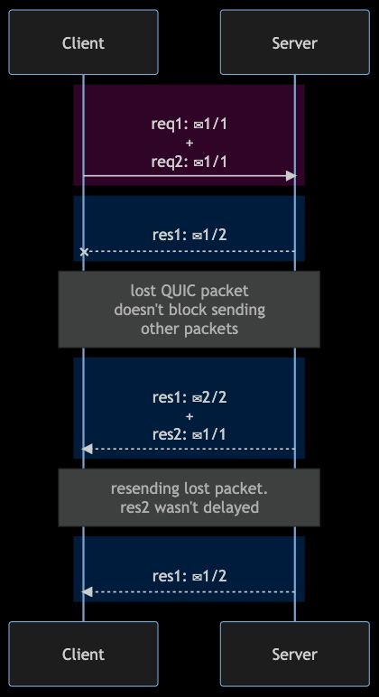

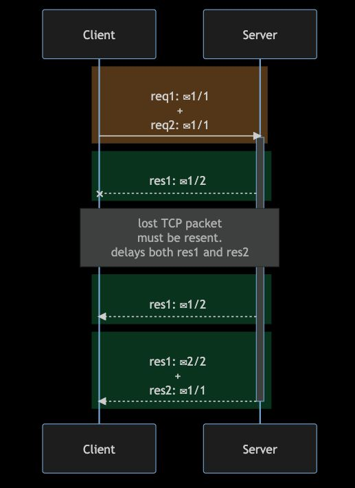

---

## Trang 26: Practices

### Practices

---

## Trang 27: Fraud Detection System

### Fraud Detection System

---

## Trang 28: Recap

### Recap
- Don’t focus on Performance first.
- Network I/O model → Handling Design Pattern → Protocol → Serialization
- Kafka and Rabbitmq are both message broker, but Kafka focus more on event streaming platform

(high throughput + retention + acceptable latency)

---

## Trang 29: Homework

### Homework
- Read about distributed transaction

---

## Trang 30: References

### References
- https://www.alibabacloud.com/blog/how-is-netty-used-to-write-a-high-performance-distributed-servic

e-framework_598081
- https://www.cloudflare.com/learning/performance/http2-vs-http1.1/

---

## Trang 31: Thank you 🙏

### Thank you 🙏

---
