# 06. Microservices

> **Tổng số trang:** 40 slide | **Thư mục ảnh/sơ đồ:** `assets/06_Microservices/`

---

## Trang 1: Microservices

### Microservices
“Muốn đi nhanh và xa, cần thầy + đồng đội”

---

## Trang 2: Outline

### Outline
### 1. Microservice Boundary
### 2. Distributed Transaction

---

## Trang 3: 1. Fundamentals

### 1. Fundamentals

---

## Trang 4: Microservices

### Microservices
- Pros
  - Independent deployments
  - Organizational Alignment: Reduce communication costs
  - Scalability
  - Flexibility on technologies
  - Resilience
- Cons
  - Operation overhead: monitoring, troubleshooting, cost
  - Testing
  - Latency
  - Data Inconsistency

---

## Trang 5: Components in Microservices

### Components in Microservices
- Main Components
  - Microservices
  - Service Discovery
  - API Gateway
  - Load Balancer
- Extended Component
  - Message Broker
  - Monitoring System (logs, metrics)
  - Tracing System (APM)
  - Config/Secret Management System
  - Service Mesh
  - …
- Kubernetes support main components

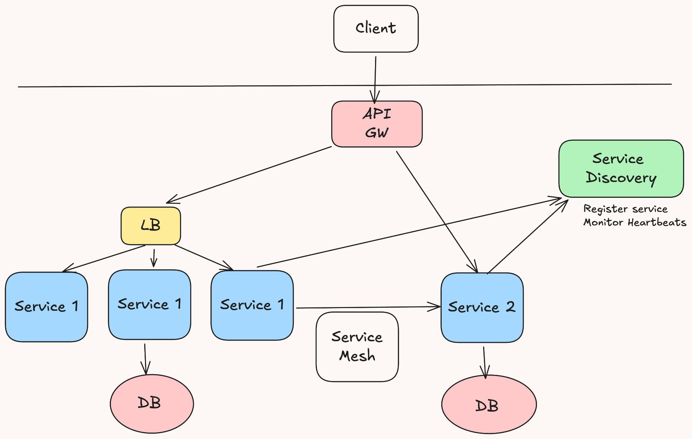

---

## Trang 6: How to define microservice boundaries?

### How to define microservice boundaries?

---

## Trang 7: Process

### Process
- Using Event Storming + Domain Storytelling → discovery subdomains
- Using Bounded Context Canvas to define bounded contexts
- Use context map to define relationships and communication patterns between BCs
- A good starting point: a Bounded Context → a microservice
- A Bounded Context might be large still → continue to decompose into microservices

---

## Trang 8: Principles/Techniques of Microservice Decomposition

### Principles/Techniques of Microservice Decomposition
- High cohesion and low coupling

---

## Trang 9: Principles/Techniques of Microservice Decomposition

### Principles/Techniques of Microservice Decomposition
- High cohesion and low coupling
- First splitting into coarse-grained services, then splitting into fine-grained services.

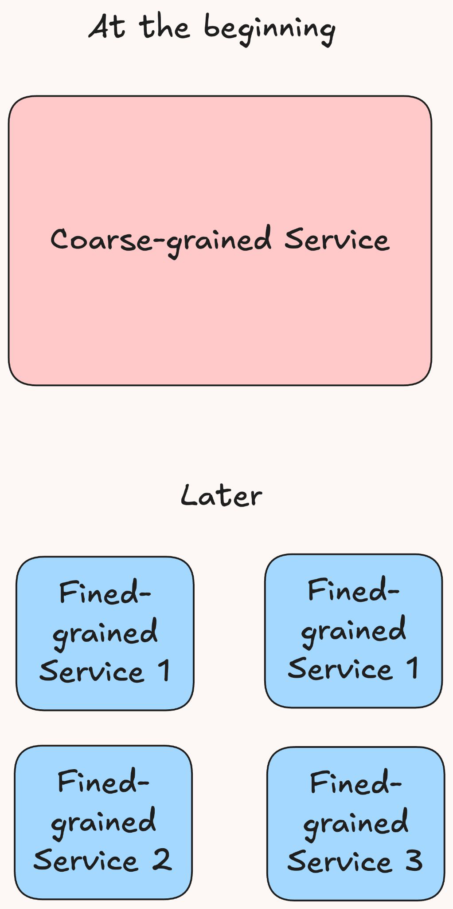

---

## Trang 10: Principles/Techniques of Microservice Decomposition

### Principles/Techniques of Microservice Decomposition
- High cohesion and low coupling
- First splitting into coarse-grained services, then splitting into fine-grained services.
- Avoid or limit the number of distributed transactions

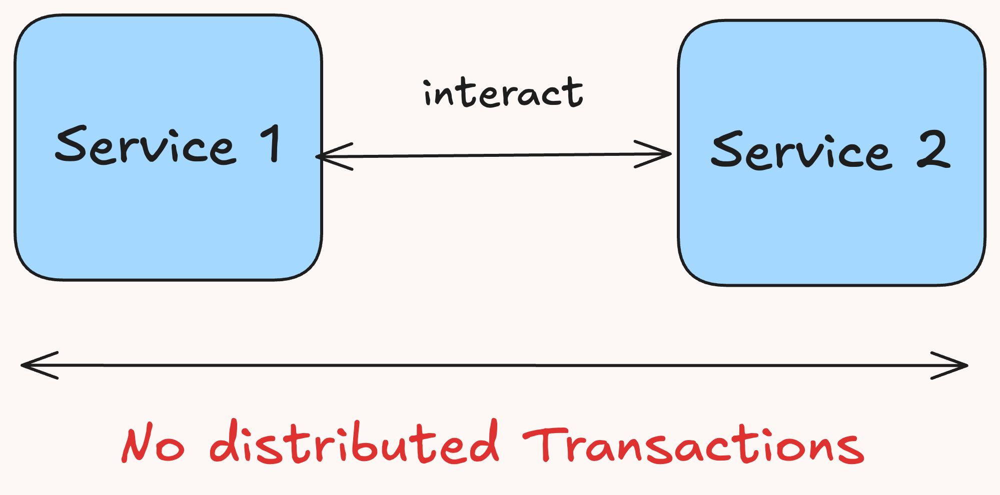

---

## Trang 11: Principles/Techniques of Microservice Decomposition

### Principles/Techniques of Microservice Decomposition
- High cohesion and low coupling
- First splitting into coarse-grained services, then splitting into fine-grained services.
- Avoid or limit the number of distributed transactions
- Avoid affecting the daily deployment
  - Start by splitting non-core services first

→ reduce impact.

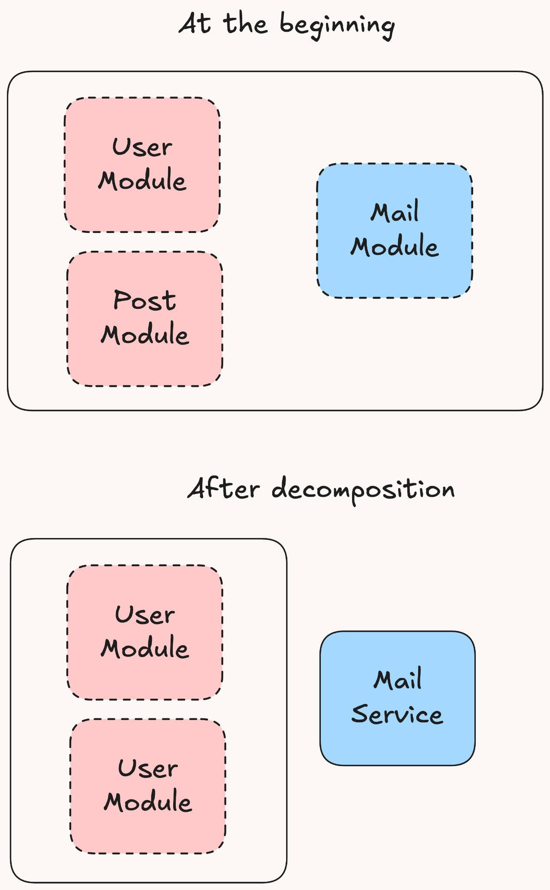

---

## Trang 12: Principles/Techniques of Microservice Decomposition

### Principles/Techniques of Microservice Decomposition
- High cohesion and low coupling
- First splitting into coarse-grained services, then splitting into fine-grained services.
- Avoid or limit the number of distributed transactions
- Avoid affecting the daily deployment
  - Start by splitting non-core services first

→ reduce impact.
  - Start by splitting the root service first

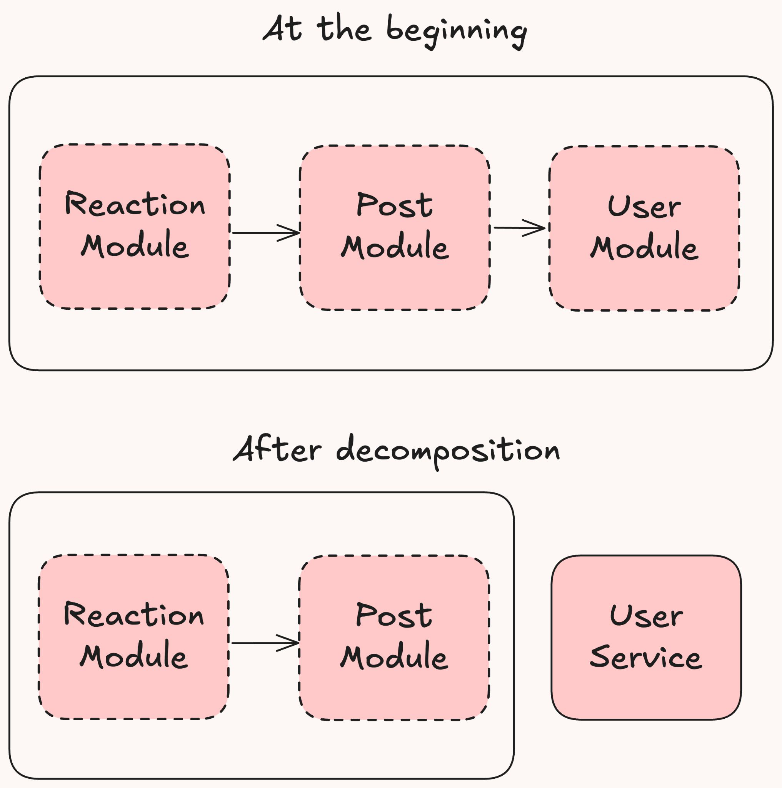

---

## Trang 13: Principles/Techniques of Microservice Decomposition

### Principles/Techniques of Microservice Decomposition
- High cohesion and low coupling
- First splitting into coarse-grained services, then splitting into fine-grained services.
- Avoid or limit the number of distributed transactions
- Avoid affecting the daily deployment
  - Start by splitting non-core services first → reduce impact.
  - Start by splitting the root service first
- At the beginning of decomposition, keep both the module in the original service and a new microservice. Dual run the 2 components with different API versions.

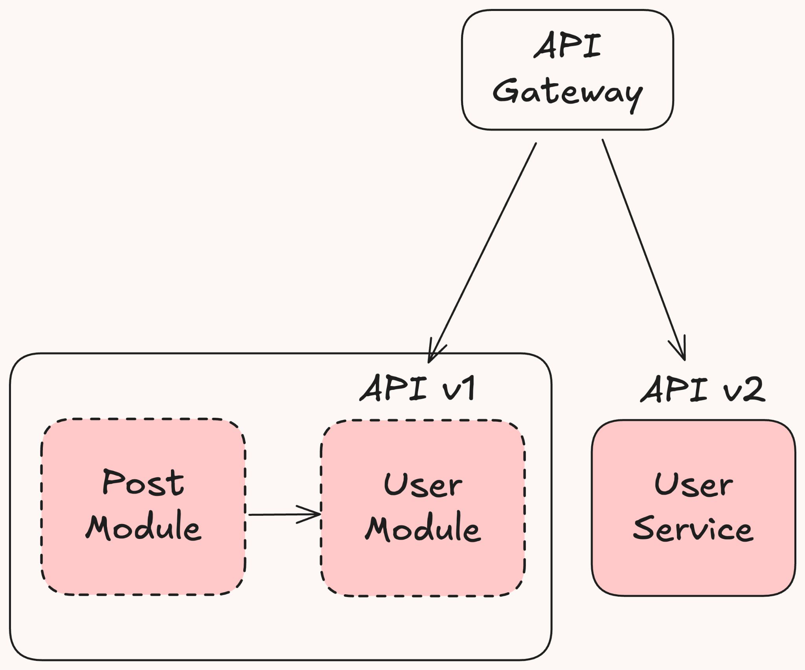

---

## Trang 14: 2. Distributed Transaction

### 2. Distributed Transaction

---

## Trang 15: ACID in Transaction

### ACID in Transaction
- ACID
  - Atomicity: a group of SQL queries is like a query. all or nothing.
  - Consistency: Before and after the transaction, data should be valid according to all predefined rules.
  - Isolation: Multiple concurrent transactions do not affect each others.
  - Durability: Committed data would be not lost, even after power failure.
- The main goal of transaction is atomicity.
- Multiple concurrent distributed transactions will violate the Isolation property.
- Local transactions take care Consistency, Durability
  - Remind: Consistency in ACID != Consistency in CAP

---

## Trang 16: Category

### Category
1. Internal Distributed Transaction
  - NewSQL

2. Cross-Database, Cross-Service
  - Discuss in this lecture

---

## Trang 17: Two Phase Commit (2PC - XA)

### Two Phase Commit (2PC - XA)
- Pros
  - Simple
  - Strong Consistency* for the happy case
- Cons
  - Performance impact. Long period of locking
  - Recovery failure when TM fails
  - Limited data source support

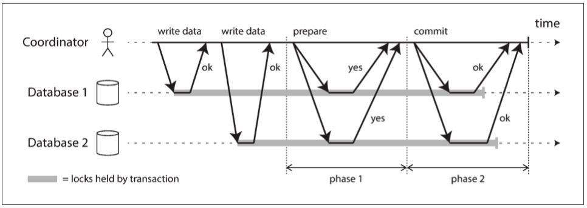

---

## Trang 18: Strong Consistency in Theory

### Strong Consistency in Theory
- Every read operation retrieves the most recent write
- All clients always have a consistent and up-to-date view of the data

---

## Trang 19: Unable to Get Strong Consistency in Practice

### Unable to Get Strong Consistency in Practice
*NewSQL DB is a distributed system that achieve strong consistency. Discuss later.

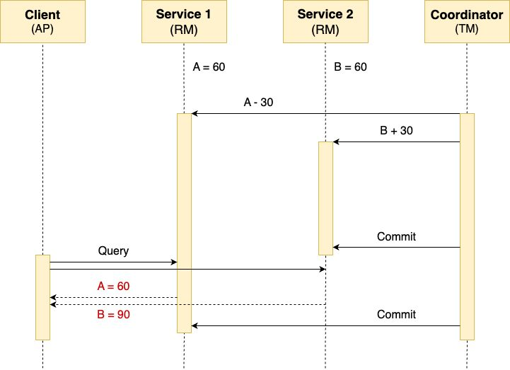

---

## Trang 20: Consistency Level

### Consistency Level
- 2PC (XA) > AT > Try Confirm/Cancel (TCC) > 2 Phase Message > Saga

---

## Trang 21: Why Saga is popular in Microservices?

### Why Saga is popular in Microservices?

---

## Trang 22: Why Saga is popular in Microservices?

### Why Saga is popular in Microservices?
- Reason 1: Eventual Consistency is Acceptable
  - After creating an order successfully, users don’t care the inventory.
  - A little delay in a payment step (update txn, order) is acceptable.
- Reason 2: More Scalable, Highly Concurrent
  - Discuss later

---

## Trang 23: Saga

### Saga
- Pros
  - No global lock + Non-blocking

→ improve concurrency
  - Partial failure recovery
- Cons
  - Eventual consistency
  - Complexity
  - Require idempotency and compensating operations

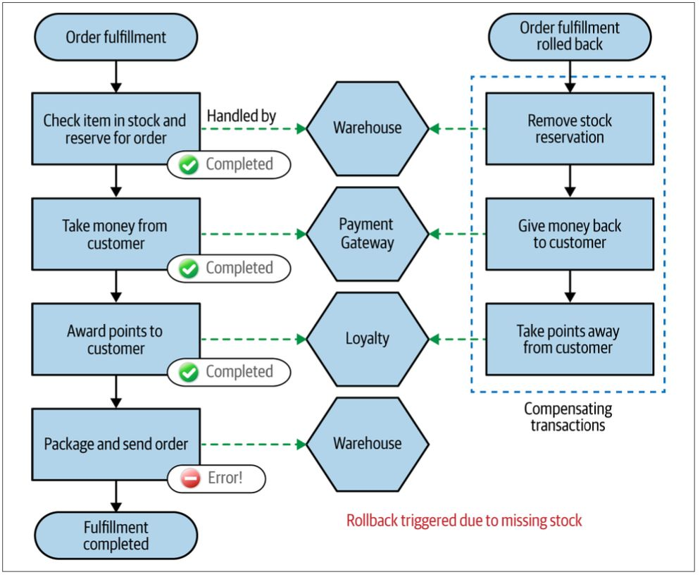

---

## Trang 24: Saga

### Saga
- Pros
  - No global lock + Non-blocking

→ improve concurrency
  - Partial failure recovery
- Cons
  - Eventual consistency
  - Complexity
  - Require idempotency and compensating operations

---

## Trang 25: Saga / Orchestration

### Saga / Orchestration
- Pros
  - Easy to debug
- Cons
  - Complexity
    - It’s hard to maintain a state machine
    - Centralizing too much business logic in the orchestrator

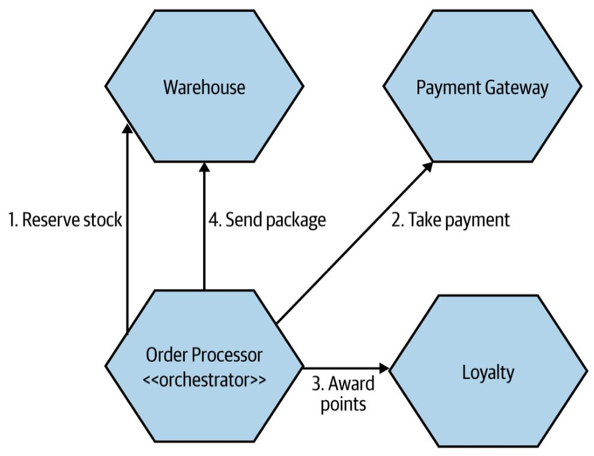

---

## Trang 26: Sagas / Choreography

### Sagas / Choreography
- Pros
  - No central TM
- Cons
  - Hard to debug.

No global state for transactions

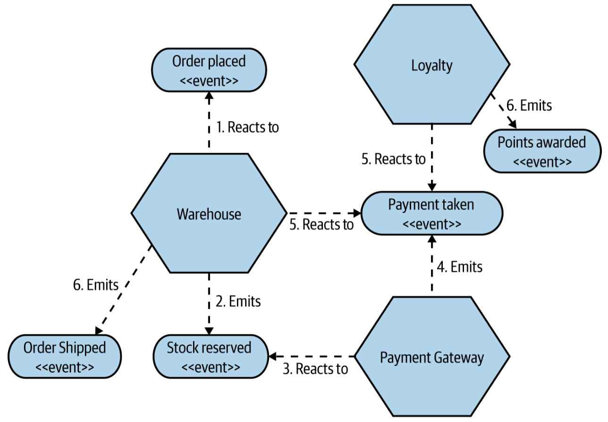

---

## Trang 27: Choose which Saga?

### Choose which Saga?
- My opinion: Choreography Saga
- More scalable: Orchestration scalability depends TM's scalability
- Decoupling: Each team develop a service → only handling input event stream.
- More performant: More calls through TM in Orchestration
- More resilient: events can be stored in retention message broker.
- Orchestration is suitable to complex flows, but complex flow for a distributed transaction is a sign of anti-pattern.

---

## Trang 28: Pivot Transaction

### Pivot Transaction

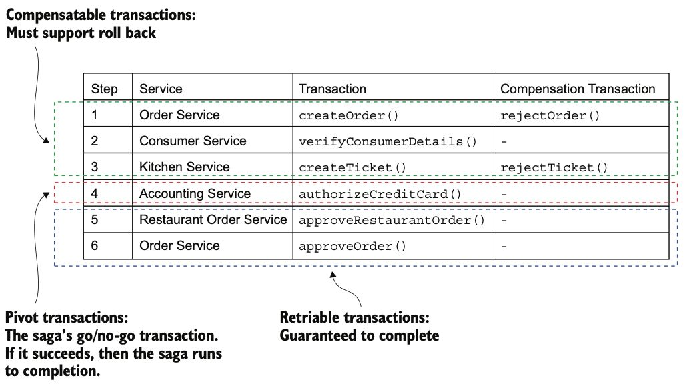

---

## Trang 29: Saga Issues: The lack of Isolation

### Saga Issues: The lack of Isolation
1. Lost Updates:
- While `Creating Order` Saga is executing but `Canceling Order` Saga start
- Solutions:
  - Sematic Lock.
    - Sematic Lock: Step 1 in `Creating Order` Saga changes state the order to APPROVAL_PENDING
    - Error Handling: `Canceling Order` Saga
- Is blocked
- Be failed → client retries (recommended)
  - Version file

---

## Trang 30: Saga Issues: The lack of Isolation

### Saga Issues: The lack of Isolation
2. Dirty Read:
- Read committed data in a local transaction, but the global transaction is not committed yet.
- Solution:
  - Reorder
  - Re-read

---

## Trang 31: Misunderstanding 1: Improving TPS

### Misunderstanding 1: Improving TPS
- Not right. It depends on
  - Architecture
  - Lock contention
- The case that distributed transaction won’t improve TPS:
  - High lock contention
- The case that distributed transaction will improve TPS:
  - The dataset is sharded or separated, and
  - Low lock contention.

---

## Trang 32: Misunderstanding 2: Purpose of Each Pattern

### Misunderstanding 2: Purpose of Each Pattern
- Misunderstanding: Event Sourcing, Transactional Outbox solve distributed transaction
  - Event Sourcing:
    - Providing other persistence method than the traditional method.
    - Providing time machine :)
  - Transactional Outbox: Dual-write

Transactional Outbox

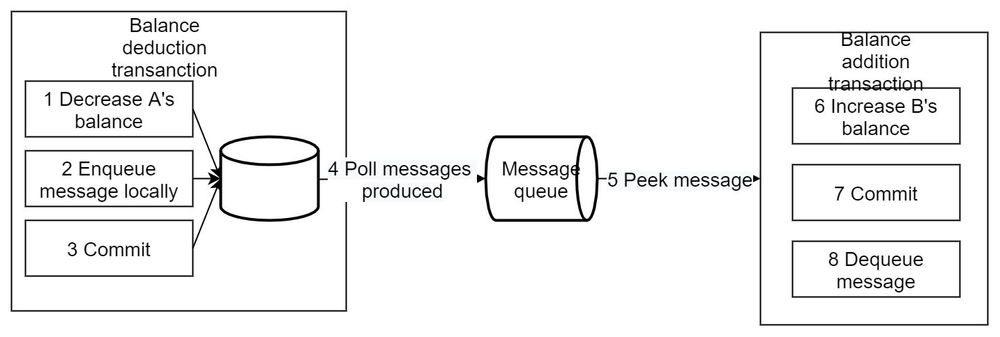

---

## Trang 33: Misunderstanding 2: Purpose of Each Pattern

### Misunderstanding 2: Purpose of Each Pattern
- Misunderstanding: Event Sourcing, Transactional Outbox solve distributed transaction
  - Event Sourcing:
    - Providing other persistence method than the traditional method.
    - Providing time machine :)
  - Transactional Outbox: Dual-write

Transactional Outbox

Local Messaging

---

## Trang 34: Practices

### Practices

---

## Trang 35: Liveness

### Liveness

---

## Trang 36: Liveness System

### Liveness System
- Context:
  - 1M IoT devices send heartbeats to server periodically (every 3 seconds).
- Functional Requirement:
  - If a device does not send any heartbeat after a timeout threshold

→ System raise alert that the device is connected.
  - Ability to configure the timeout threshold for each device type.
- Non-functional Requirement:
  - Scalability
  - A little delay between the timeout moment and the alert moment is acceptable

---

## Trang 37: Recap

### Recap
- Microservice Boundary: Starting with Bounded Context → a Microservice → Decomposition later
- In microservices, eventual consistency is acceptable. So implement a distributed transaction by

Choreography Saga to achieve high concurrency
- The main goal of Distributed Transaction is not improving TPS. In some case with separated

datasets + low lock contention, distributed transaction will improve TPS.

---

## Trang 38: Homework

### Homework
- What are 4 conditions that causes deadlock.
- A simple way to avoid deadlock.
- Design Liveness System

---

## Trang 39: References

### References
- https://en.dtm.pub/
- https://seata.apache.org/docs/overview/what-is-seata

---

## Trang 40: Thank you 🙏

### Thank you 🙏

---
