# 07. DSA

> **Tổng số trang:** 32 slide | **Thư mục ảnh/sơ đồ:** `assets/07_DSA/`

---

## Trang 1: DSA & Presentation

### DSA & Presentation
“Good things take time”

---

## Trang 2: Outline

### Outline
### 1. DSA
  - Liveness System
### 2. Concurrent Programming
### 3. Presentation
  - Diagramming
  - Presenting

---

## Trang 3: 1. DSA

### 1. DSA

---

## Trang 4: What factors do you analyze a DSA on?

### What factors do you analyze a DSA on?

---

## Trang 5: Factors to Analyze a Data Structure

### Factors to Analyze a Data Structure
- Use cases
- Time Complexity
  - Read Operation
    - Random (one)
    - Range (many)
  - Write Operation: Insert, Update, Remove
- Space Complexity
  - Size
  - Location:
    - Contiguous
    - unpredictable distributed (random).
- Limitations

---

## Trang 6: DSA

### DSA
- Don’t need to learn or remember all. Put the cheat sheets into your pocket.
- Learn one when you need it
- Based on the implementation, try to find the limitations
- Note: Don’t judge a design by the time complexity only. Consider Space Complexity, I/O operations, …

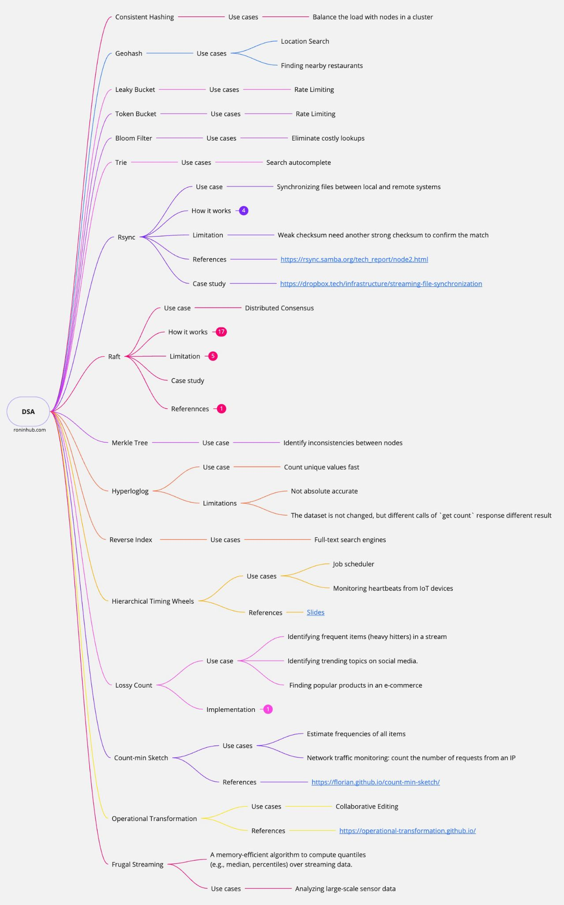

---

## Trang 7: Liveness System

### Liveness System

---

## Trang 8: Liveness System

### Liveness System
- Context:
  - 1M IoT devices send heartbeats to server periodically (every 3 seconds).
- Functional Requirement:
  - If a device does not send any heartbeat after a timeout threshold

→ System raise alert that the device is disconnected.
  - Ability to configure the timeout threshold for each device type.
- Non-functional Requirement:
  - Scalability
  - A little delay between the timeout moment and the alert moment is acceptable

---

## Trang 9: Requirement Analysis

### Requirement Analysis
- Every time, a device sends a heartbeat to the system, the system reset timeout timer.
  - How to reset timeout timer effectively?
- Basically, detecting timeouts is scanning the timeout moments periodically to get expired ones.
  - How to get expired ones effectively?
  - How long for a period actually?
- If a lot of timeouts at the same time (the same scanning), how to handle it effectively?

→ We need an appropriate data structure

---

## Trang 10: Solution 1: Sorted Set (Redis)

### Solution 1: Sorted Set (Redis)
- Sorted Set (Redis)
  - Key: device type (for scalability)
  - Score: expiration_time
  - Member: device_id
- On heartbeat:
  - Add a new timer
  - Remove the old timer
- Advance Clock:
  - Get timers with expiration_time (score) less than current time
  - Remove this range

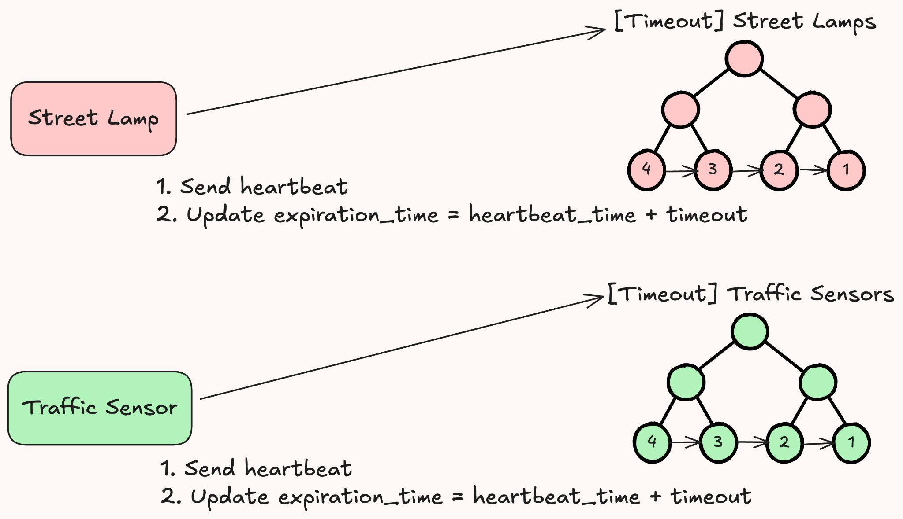

---

## Trang 11: Solution 1: Sorted Set (Redis)

### Solution 1: Sorted Set (Redis)
- Adding or removing one timer: O(log(n))
- ZRANGE…BYSCORE: O(log(N)+M)
- ZREMRANGEBYSCORE: O(log(N)+M)
  - Return the number M only, not the range
- Let’s try another way: not removing the old timer

---

## Trang 12: Solution 1.2: Sorted Set (Redis)

### Solution 1.2: Sorted Set (Redis)
- On heartbeat:
  - Add a new timer
  - Set key:value (device_id:expiration_time)
- Advance Clock:
  - Get timers with expiration_time (score) less than current time
  - Check expiration_time
  - Remove this range
- Limitations
  - Don’t leverage Lua script.

Because different keys
  - More I/O calls

---

## Trang 13: Solution 2: Timing Wheel

### Solution 2: Timing Wheel
- Wheel: an circular array with fixed size
- The size ~ timeout threshold
- Each slot in the wheel is called a bucket.

Each bucket contains a set of timers.
- Timer:
  - Device_id
  - Remaining Rounds (Expiration_time)
  - Slot Index
- Map&lt;device_id, Timer>

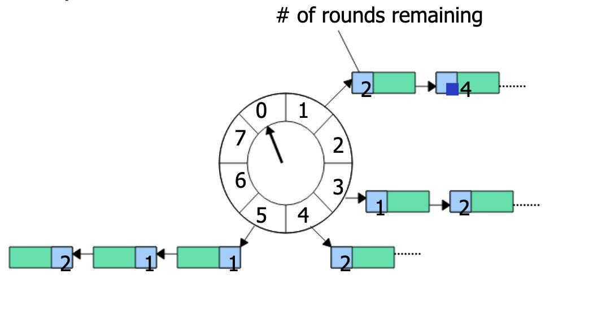

---

## Trang 14: Solution 2: Timing Wheel

### Solution 2: Timing Wheel
- On heartbeat:
  - Get the old timer from the map&lt;device_id, timer>
  - Find the target bucket by slot index in timer

→ remove old timer
  - Calculate the new slot index → find bucket
  - Add timer into the bucket
  - Add timer into the map
  - All the above operations: O(1)

---

## Trang 15: Solution 2: Timing Wheel

### Solution 2: Timing Wheel
- Advance Clock: scan through a bucket
- Read more: Hashed Wheel Timer
- Limitation: not suitable for long-duration timers
- Kafka Hierarchical timing wheels

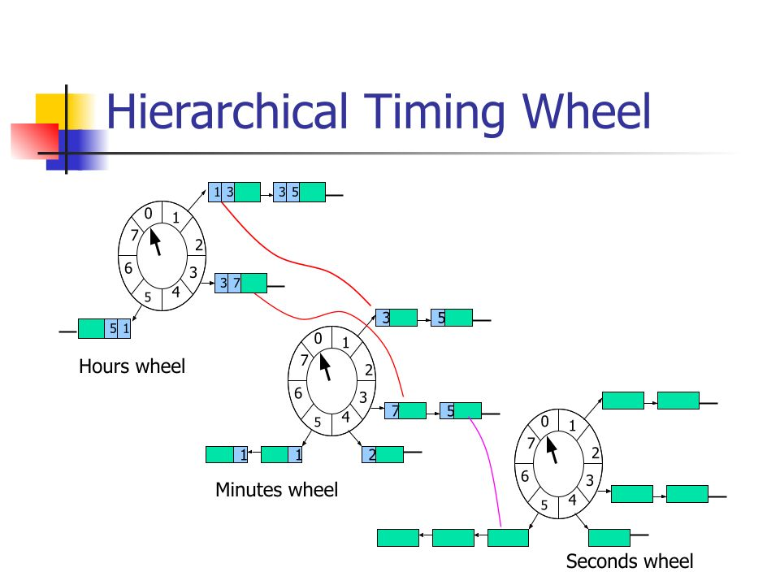

---

## Trang 16: Problem 2: Large Bucket

### Problem 2: Large Bucket
- Advance Clock: scan through a large bucket
  - Scan
  - Check the timer
  - Alert
- How to speed up the process of scanning the bucket?
- Solution: Multi-threads

---

## Trang 17: 2. Concurrent Programming

### 2. Concurrent Programming

---

## Trang 18: Problem 3: Messaging

### Problem 3: Messaging
- How does the main thread:
  - communicate to worker threads?
  - divide workload to worker threads?
- The sender may outpace worker threads
- Solution: Queue

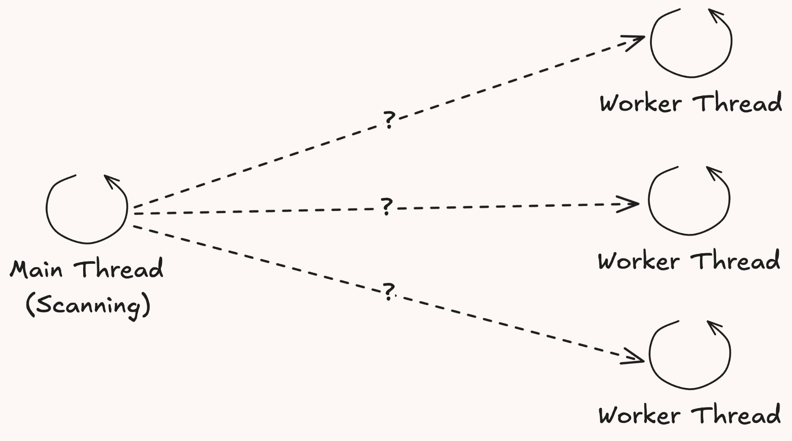

---

## Trang 19: Problem 4: Queue in Concurrent Env

### Problem 4: Queue in Concurrent Env
- Implementations
  - Array
    - Fixed size
  - Linked List
    - Unbounded → exhausting memory
    - Not cache friendly
- Write contention on the head, tail, and size variables
- Unused objects need to be reclaimed (GC)

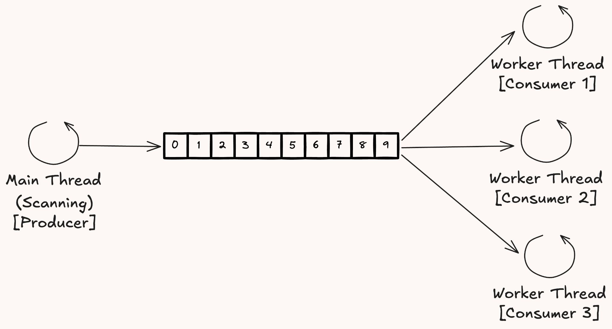

---

## Trang 20: Solution 4: LMAX Disruptor

### Solution 4: LMAX Disruptor
- LMAX Disruptor: High Performance Inter-Thread Messaging
- CAS instead of Lock
- Separating producer and consumer completely
- All memory for the ring buffer is pre-allocated on start up. Producers update entry, not initialize entries

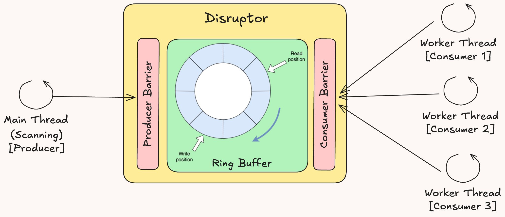

---

## Trang 21: Solution 4: LMAX Disruptor

### Solution 4: LMAX Disruptor
- Memory Barrier to ensure visibility of changes across threads
- Batch Processing
- Highly Tunable

---

## Trang 22: Solution 4: LMAX Disruptor

### Solution 4: LMAX Disruptor
- Read more:
  - Learn a fundamental course of concurrent programming first.
  - LMAX Disruptor: Technical Paper
  - Dissecting the Disruptor: What's so special about a ring buffer? - Trisha Gee
  - The power of Mechanical Sympathy in Software Engineering

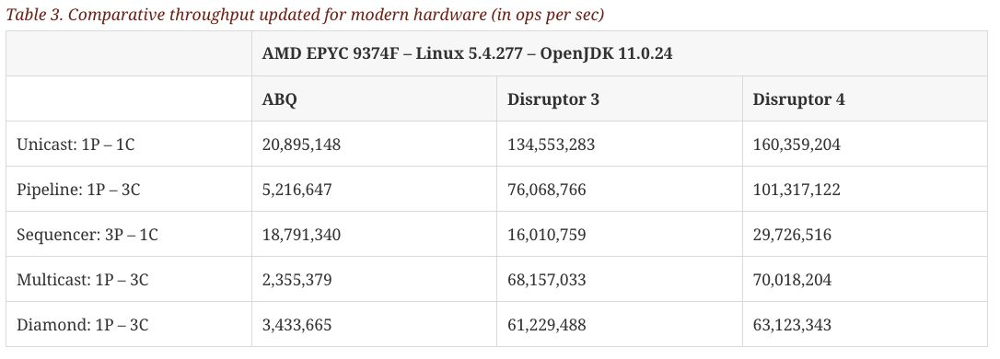

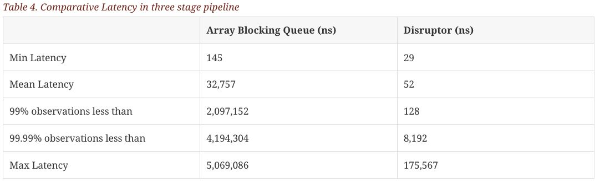

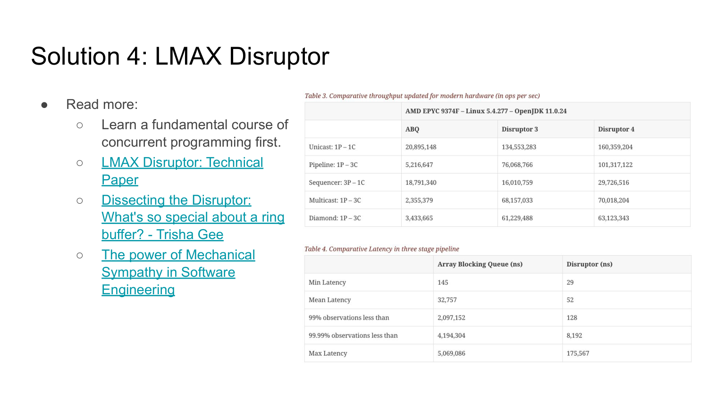

---

## Trang 23: (Trang trống)

---

## Trang 24: 3. Presentation

### 3. Presentation

---

## Trang 25: 3.1. Diagramming

### 3.1. Diagramming

---

## Trang 26: Diagramming

### Diagramming
- Colors have meanings
- Learn shortcuts
- Layering

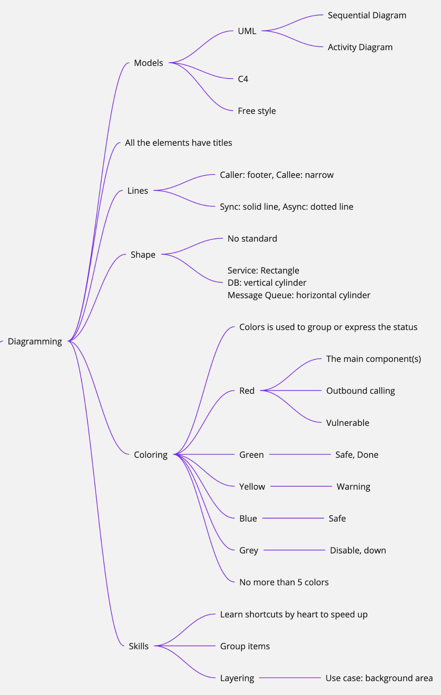

---

## Trang 27: 3.2. Presenting

### 3.2. Presenting

---

## Trang 28: Presenting

### Presenting
- Top Down
- The speaker has 2 information channels: verbal and visual
- Power of Three
- Don't forget to recap

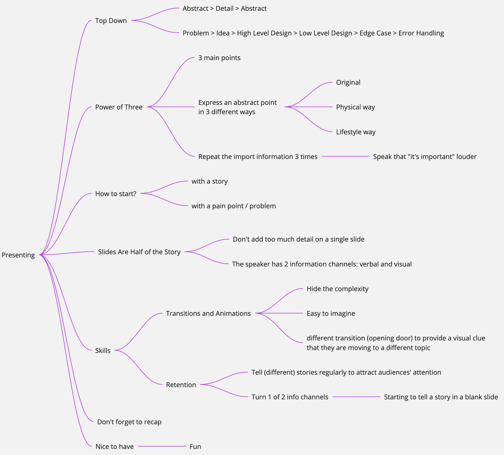

---

## Trang 29: Recap

### Recap
- Dont judge a design based on time complexity only.
- Disruptor is inter-thread messaging lib
- Power of Three
- 3 topics all need “Practice”!

---

## Trang 30: Homework

### Homework

---

## Trang 31: References

### References
- https://en.dtm.pub/
- https://seata.apache.org/docs/overview/what-is-seata

---

## Trang 32: Thank you 🙏

### Thank you 🙏

---
