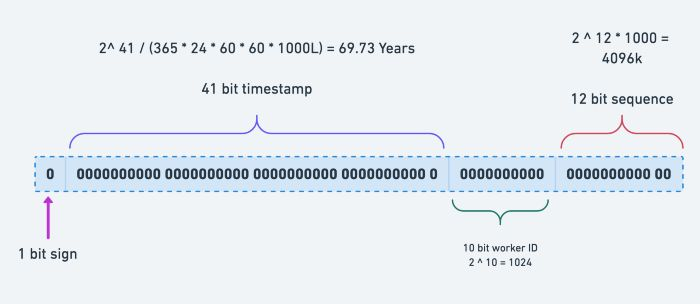
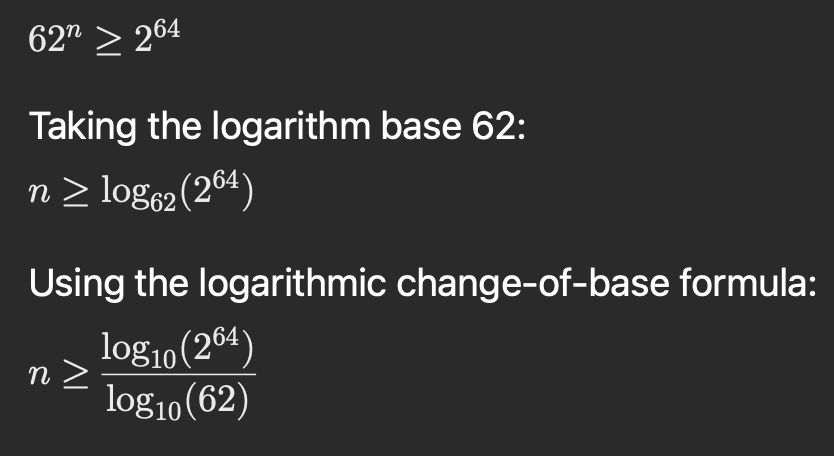
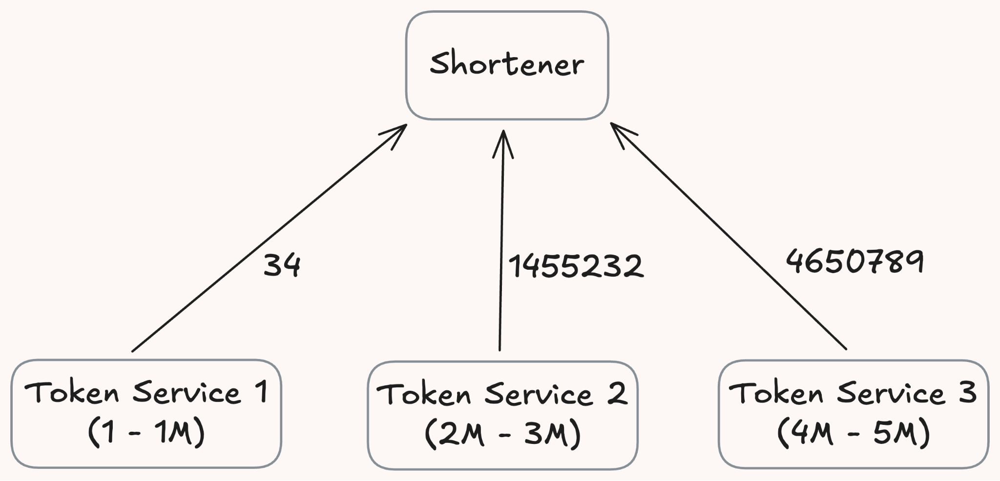
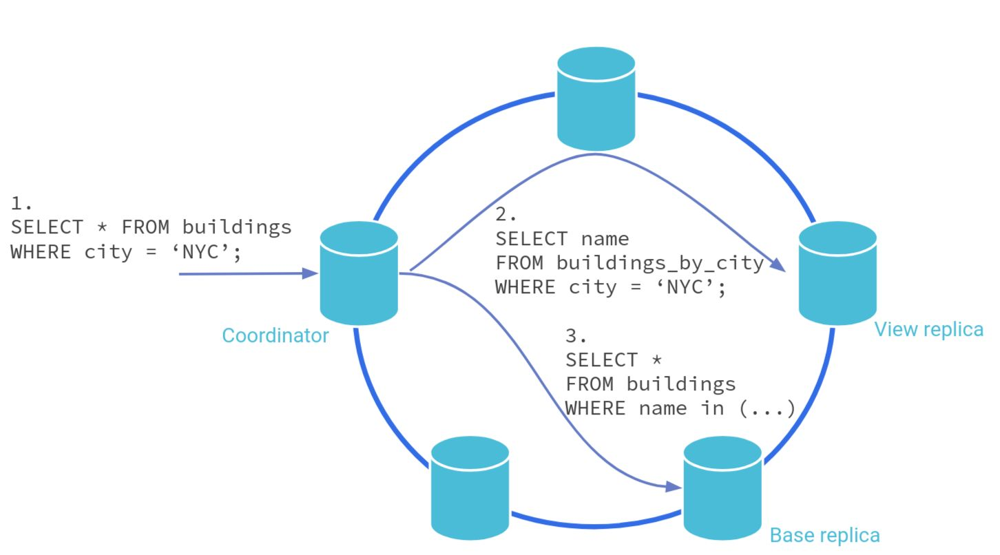
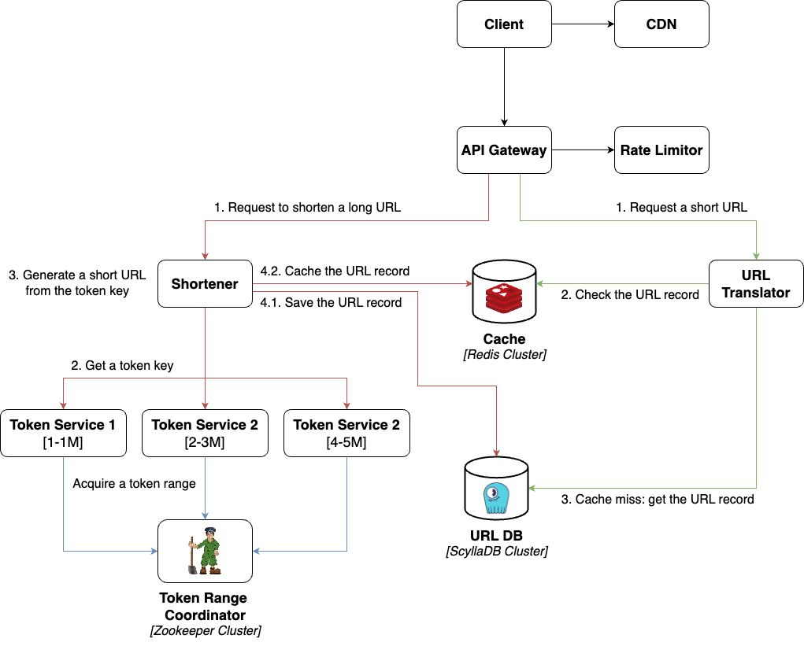

# 08. URL Shortener

> **Tổng số trang:** 24 slide | **Thư mục ảnh/sơ đồ:** `assets/08_URL_Shortener/`

---

## Trang 1: URL Shortener

### URL Shortener
“Trí Tri - Tri Trí”

---

## Trang 2: Outline

### Outline
### 1. Understand The Problem
### 2. High Level Design
### 3. Low Level Design

---

## Trang 3: 1. Understand The Problem

### 1. Understand The Problem

---

## Trang 4: 1.1. Functional Requirements

### 1.1. Functional Requirements
- URL shortening Service similar to TinyURL, or Bitly
- The same long URL can receive multiple different short URLs.
- Collision-free.
- Non-predictable.
- Client can customize the short URL.
- The short URL should be web crawler friendly (SEO).
- The short URL should support analytics.

---

## Trang 5: 1.2. Capacity

### 1.2. Capacity
Questions:

1. What is the average number of writes per day?

2. What is the read:write ratio?

3. What is the length of a short URL?

4. How many years should the short URL be persisted?

Answers:

1. 10M writes per day

2. 100:1

3. At most 8 characters

4. 4 years

---

## Trang 6: 1.3. Non-functional Requirements

### 1.3. Non-functional Requirements
- Availability
- Low latency
- Scalability
- Durability

---

## Trang 7: 2. Estimate

### 2. Estimate

---

## Trang 8: 2. Estimate

### 2. Estimate
- 10M writes per day → 10^7 TPD / 10^5 seconds = 10^(7-5) = 100 TPS
- Read:write = 100:1 → QPS = TPS * 100 = 10K QPS
- Storage for 4 years: ~ 17.6 TB
- Replication Factor: 3 → total storage = 3 * 17.6 TB = 52.8 TB
- Cache
  - TTL: 1 day
  - Size: 2.2 GB

---

## Trang 9: 3. High Level Design

### 3. High Level Design

---

## Trang 10: Let's Design by Yourself

### Let's Design by Yourself
### (mini interview)

---

## Trang 11: Abstract Process

### Abstract Process
- Process: A long URL → short URL in binary (small) → encoded for readability
- Problems:
  - Encoding
  - Generating short URL in binary

---

## Trang 12: Encoding

### Encoding
- Base36: a-z 0-9
- Base62: a-z A-Z 0-9
- Base64: base62 + /
- Choose Base62
- Reasons:
  - The higher number of chars in dictionary, the lower length of encoding output.
  - Friendly with web URL

---

## Trang 13: Generate Short URL / Random ID

### Generate Short URL / Random ID
- Algorithms: UUID, CSPRNG
- Pros:
  - Simple
  - Scalability
  - Avoiding sequential guessing
- Cons:
  - The probability of collisions is high
  - Coordination between servers is required to prevent a collision

→ Don’t use Random ID here

---

## Trang 14: Generate Short URL / Hash

### Generate Short URL / Hash
- Pros:
  - Scalability
- Cons:
  - Predictable output
  - Higher probability of a collision

→ Don’t use Hash here

---

## Trang 15: Generate Short URL / Snowflake ID

### Generate Short URL / Snowflake ID
- Pros:
  - Scalability
- Cons:
  - Long output: 64bits is encoded in Base62

→ at least 11 characters
  - the probability of collisions is high due to the overlapping bits

→ Don’t use Snowflake ID here

---

## Trang 16: Generate Short URL / Token Range

### Generate Short URL / Token Range
- Pros:
  - Scalability
- Cons:
  - Predictability
  - How to assign a range to a token service automatically and without overlapping
    - Zookeeper Coordinator

→ Use Token Range here

---

## Trang 17: Storage

### Storage
- NoSQL for table: URL
  - Non-relational data, No need for complex joins
  - Scalable
  - High performance
  - Recommend: ScyllaDB
- Relational DB for tables: User, Subscription
  - Relational data
  - ACID compliance
  - Strict schema
  - Recommend: Postgres

---

## Trang 18: Partition Key

### Partition Key
- Table URL
  - Primary key: shorten_url
  - Partition key: shorten_url
  - Strategy: hash

---

## Trang 19: New Requirement: Long URL - Short URL: 1-1

### New Requirement: Long URL - Short URL: 1-1
- Need a operation to check the existing one
- Solution 1: Bloom Filter
  - False positives: BF tells yes → DB says no
  - Operation overhead
  - Not recommended
- Solution 2: Global Secondary Index
  - Easy: Transparent to app
  - Scalability
- Indexing on long URL → ineffficient
  - Indexing on hash(long_url)

---

## Trang 20: Final Design

### Final Design

---

## Trang 21: Recap

### Recap
- Process: Long URL

→ Short URL in binary (Token Range)

→ Encode (Base62)
- Generating: Avoid collision, the small size of

output.
- Use Zookeeper in order that Token Ranges

don’t overlap each other.

---

## Trang 22: Homework

### Homework

---

## Trang 23: References

### References

---

## Trang 24: Thank you 🙏

### Thank you 🙏

---
