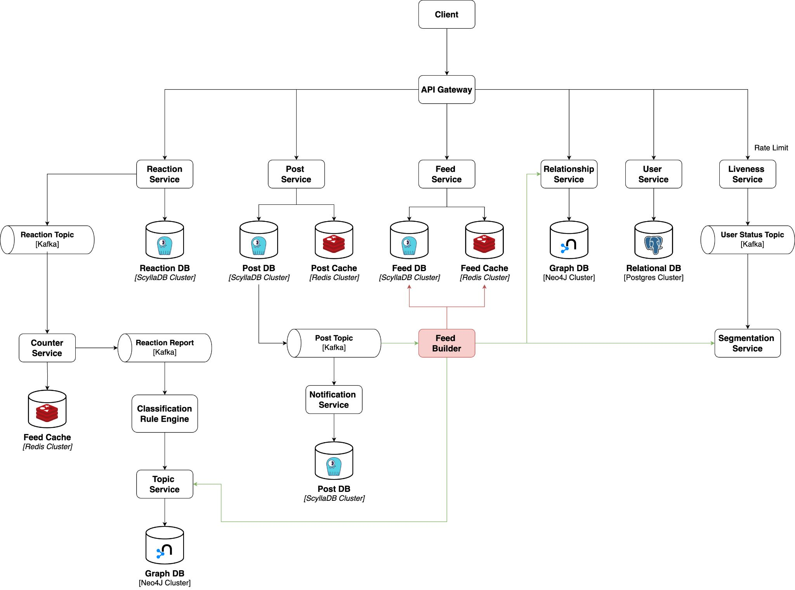
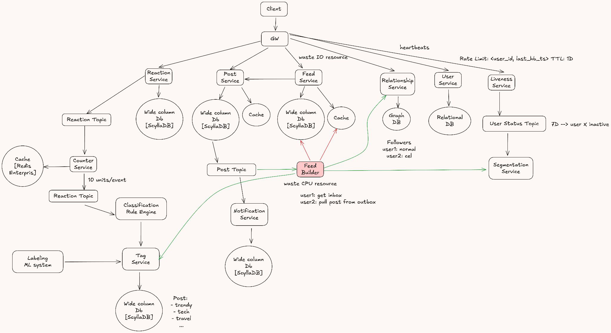

# 09. Design a Microblogging System (Threads)

> **Tổng số trang:** 27 slide | **Thư mục ảnh/sơ đồ:** `assets/09_Design_a_Microblogging_System_Threads/`

---

## Trang 1: Design a Microblogging System

### Design a Microblogging System
### (Threads)
“Care about what other people think and

you will always be their prisoner.”

― Lao Tzu


---

## Trang 2: Outline

### Outline
### 1. Understand The Problem
### 2. Estimation
### 3. High Level Design
### 4. Low Level Design

---

## Trang 3: 1. Understand The Problem

### 1. Understand The Problem

---

## Trang 4: Ask Me!

### Ask Me!


---

## Trang 5: 1.1. Functional Requirements

### 1.1. Functional Requirements
- User B can follow user A
- User A can publish a post
  - The feed contains text only
- User B receive a notification about the post
- Build a feed for every user
  - Keep it simple, the feed is sorted by reverse chronological
- User B can react to the post
  - Like, comment, share, …
  - Show the number of reacts


---

## Trang 6: 1.2. Capacity

### 1.2. Capacity
Questions:

1. How many users? How many DAU?

2. How many post does a user publish per day?

3. What is the average number of comments per post?

4. Which posts the most users care about?

Answers:

1. 500M users, 50M DAU

2. 1 post/DAU/day

3. 10 comments/post

4. Posts in the last 7 days OR trendy posts

---

## Trang 7: 1.3. Non-functional Requirements

### 1.3. Non-functional Requirements
- Scalability
- Performance
  - Latency:
    - Return a feed quickly (&lt; 100ms). Building feed is aggregating so much data (posts, users, counters, …)
    - The post needs to be appear in followers’ feed in short period of time.
  - Throughput
    - Normal: 1 QPS, Peak: 5M QPS
- Availability
- Security
- Eventually Consistency

---

## Trang 8: 2. Estimate

### 2. Estimate

---

## Trang 9: 2. Estimate

### 2. Estimate
- Assume that:
  - 3 KB/post
  - 500 B/post
- Storage for posts and comments in 5 years:

(3+0.5*10)*5 * 10^(3+7) * 400 * 5

= 8*5*4*5 * 10(3+7+2)

= 4*2 * 10^(3+7+2+2)

= 800 TB
- Cache
  - TTL: 7 day
  - Size: 3*5*7 * 10^(3+7) = 105 * 10^10 = 1.05 TB
- 500M users, 50M DAU
- 1 post/DAU/day
- 10 comments/post
- Posts in the last 7 days & trendy posts

---

## Trang 10: 3. High Level Design

### 3. High Level Design

---

## Trang 11: Data Modeling

### Data Modeling
- Table: Post
  - Post_id (pk)
  - creator_id
  - content
  - status
  - created_at
  - updated_at
- Partition key: post_id
- Table: Feed
  - User_id (pk)
  - Post_id (pk)
  - status
  - order
  - created_at
- Partition key: user_id

---

## Trang 12: Let's Design by Yourself

### Let's Design by Yourself
### (mini interview)

---

## Trang 13: Push Model

### Push Model
- Publisher push actively the post to her followers.
- Each user has an inbox and outbox. The system is like a postman.
- When a user creates a post - placing a letter into outbox, then a postman (the system) delivers to the inbox of receiver (follower).
- The most of a feed is built based on the inbox.

Outbox Publisher

Inbox Follower

```

insert into outbox(userId, postId, create_time) values("A", $feedId, $current_time);  // write to A outbox

insert into inbox(userId, postId, create_time) values("B", $feedId, $current_time);  // write to B inbox

insert into inbox(userId, postId, create_time) values("C", $feedId, $current_time);  // write to C inbox

insert into inbox(userId, postId, create_time) values("D", $feedId, $current_time);  // write to D inbox

```


---

## Trang 14: Push Model / Pros and Cons

### Push Model / Pros and Cons
- Pros:
  - Simple
  - Building a feed is fast
- Cons:
  - If a celebrity (a famous singer) has a lot of fans, then the process of sending to all inboxes is very long.
  - Redundant push (computing, resource) because of inactive users.
  - Weak scalability:
    - Unfollowing → deleting posts in inboxes
    - Users can follow categories: travel, tech, …

Inbox Follower


---

## Trang 15: Pull Model

### Pull Model
- When building a feed, followers active pull posts from the outbox of publisher

Outbox Publisher
- Pros:
  - Do not take time to broadcast.
  - No redundant storage because only actives users build feeds
  - Scalability
- Cons:
  - Take time to build a feed due to another calls.
  - Complex due to aggregate.


---

## Trang 16: So which one do you choose?

### So which one do you choose?
### Push or Pull?

---

## Trang 17: I prefer Pull model. But how about latency?

### I prefer Pull model. But how about latency?
### I will try to handle it.
### But how?

---

## Trang 18: 4. Low Level Design

### 4. Low Level Design

---

## Trang 19: Mixing Model: Push + Pull

### Mixing Model: Push + Pull
- How to handle with latency?
- How to limit redundant storage, computing resource?
  - If publisher is a normal user → Push
  - If publisher is a celebrity → Pull
  - Cache for latest posts
  - Tracking Active Users

---

## Trang 20: How to Track Active Users?

### How to Track Active Users?
- Definition of “active users”? Depends on biz logic
- Sending heartbeats → Liveness Component
- What is heartbeat?
  - Opening app
- Problem: too many hits on system
  - Solution: Rate limit. Cache &lt;user_id, last_active_ts>

TTL: 1 day

---

## Trang 21: Trendy Post

### Trendy Post
- Definition of “Trendy”? Depends on biz logic
- Based on metrics: likes, comments, shares, …
- We also have other classification:
  - Tech
  - Business
  - Health
  - …

---

## Trang 22: Final Design

### Final Design



---

## Trang 23: Final Design

### Final Design



---

## Trang 24: Recap

### Recap
- User experience, user behavior affect to the design.
- Trade off: Push vs Pull.

In this case, pull model is preferred due to scalability.
- Tracking active users is used to save storage space,

but it make system more complicated.


---

## Trang 25: Homework

### Homework
- Design a Messaging System (Discord)

---

## Trang 26: References

### References

---

## Trang 27: Thank you 🙏

### Thank you 🙏


---
