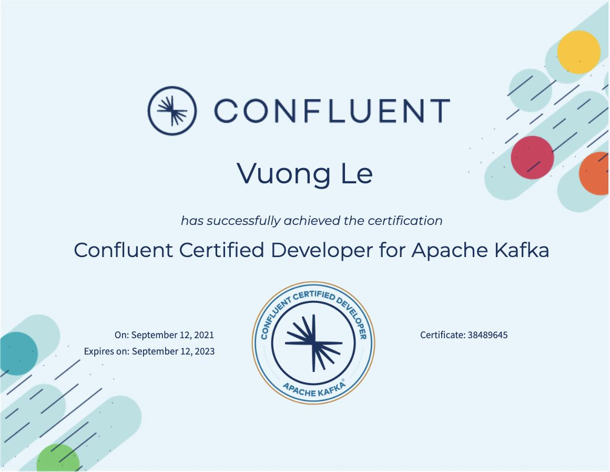
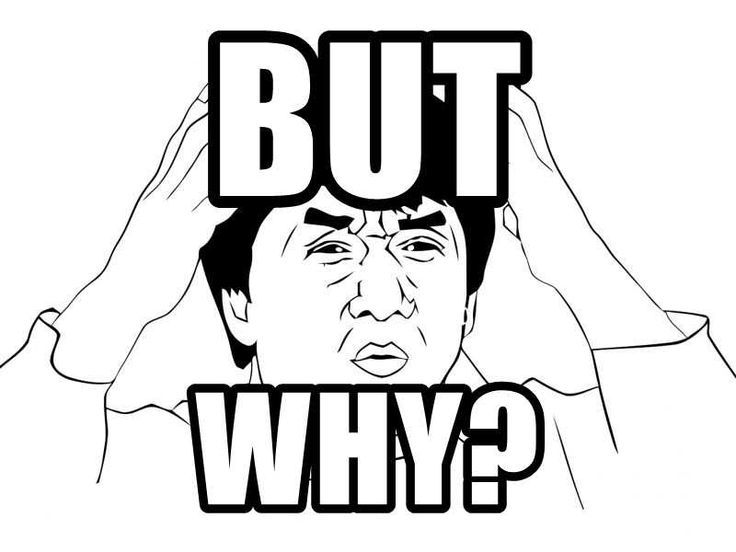

# CCDAK Exam

> **Tổng số trang:** 8 slide | **Thư mục ảnh/sơ đồ:** `assets/CCDAK_Exam/`

---

## Trang 1: CCDAK Exam

### CCDAK Exam
“One original thought is worth a thousand mindless quotings”

- Diogenes

---

## Trang 2: 1. CCDAK Introduction

### 1. CCDAK Introduction
- CCDAK (Confluent Certified Developer for Apache Kafka)
- Purpose: develop applications that work with Kafka
- Target: developers and solutions architects
- Difficulty: 7.75/10
- Price: $150
- Format:
  - 60 questions
  - 90 minutes (in the past, 120 minutes)
  - Multiple choices
  - Online
  - Certification is valid for two years

---

## Trang 3: 2. Why CCDAK?

### 2. Why CCDAK?
- For CV → re-consider
  - Because there are few people know the exam and its difficulty
- For verifying your knowledge → OK
- It’s ok to skip this exam.

---

## Trang 4: 3. Knowledge Domains

### 3. Knowledge Domains
- Application Design
  - Kafka's command line tools
  - Overall Kafka's architecture and design, …
- Development
  - Performance, throughput, latency, scaling
  - Consumer groups, partition assignment, …
- Deployment/Testing
  - Monitoring and troubleshooting clients
  - Kafka APIs (Connect, Streams)
  - Schema registry,  …

Read more: CCDAK Knowledge Domains

---

## Trang 5: 4. Preparation

### 4. Preparation
- 3-6 months
- Java, Garbage Collection
- Read more: https://www.confluent.io/certification/
- Built-in camera and mic
- Identity Card (driver’s license, passport)
- Empty room for taking the exam

---

## Trang 6: 5. Tips

### 5. Tips
- Before exam:
  - Read books
  - Practice and practice more.
  - No need to dive deep into Kafka Connect, Streams, Schema Registry.
  - Take dumps first, some questions can be learnt by heart.
  - Finding coupon
  - Time: Early morning / early afternoon
- During exam:
  - Skip hard questions, come back later.
  - No negative scoring → answer all questions
- After exam:

Submit and pray 🙏

---

## Trang 7: 6. Resources

### 6. Resources
- Books: https://github.com/vking34/books/tree/master/kafka
- Dumps:
  - Dump 1: +150
  - Dump 2: confluent

---

## Trang 8: Goodluck 🙏

### Goodluck 🙏

---
