# Core Concepts

> **Tổng số trang:** 29 slide | **Thư mục ảnh/sơ đồ:** `assets/Core_Concepts/`

---

## Trang 1: Kafka Core Concepts

### Kafka Core Concepts
He said “One day, you’ll leave this world behind, so live a life you will remember”

-  The Nights (Avicii ft. Nicholas Furlong)


---

## Trang 2: 1. Architecture

### 1. Architecture
- Broker:
  - A Kafka cluster can have multiple brokers
  - Responsible for persisting and serving messages
  - …
- Zookeeper:
  - Zookeeper manages brokers and manages the overall status within the cluster.
  - Zookeeper will be removed in Kafka 4.0
  - …

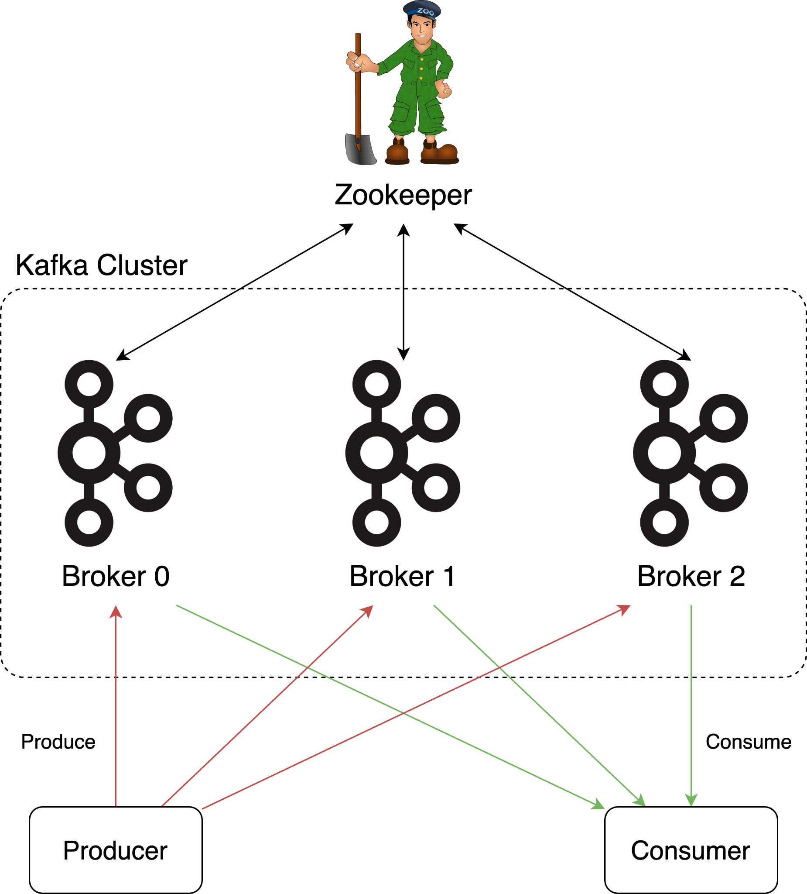

---

## Trang 3: 2. Topic

### 2. Topic
- Topic is a stream of messages/events
- Producers write to a topic, and consumers read from the topic
- A cluster can have multiple topics

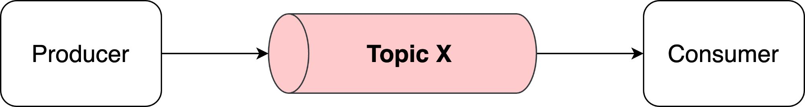

---

## Trang 4: 3. Partition

### 3. Partition
- A topic contains one or more partitions
- In other words, a topic is a group of partitions
- Kafka uses partitions to increase throughput and spread the load of messages to all brokers in a cluster

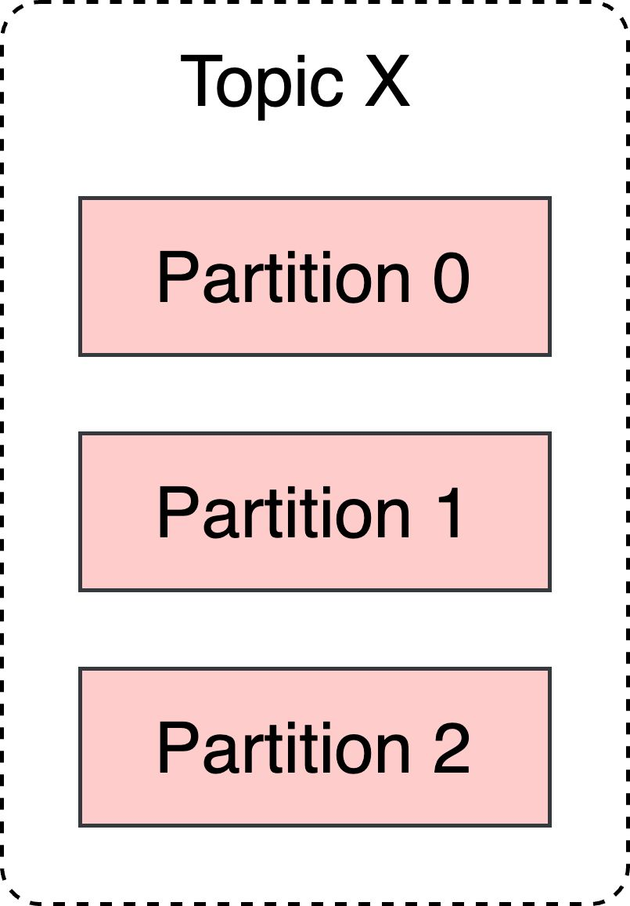

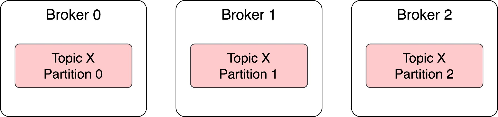

---

## Trang 5: 3. Partition

### 3. Partition
- A partition is a totally ordered, unbounded set of messages/records.
- Consumers will read messages in the order they are written in the partition.
- A partition is like a queue.

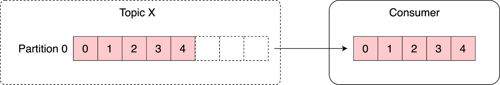

---

## Trang 6: 3. Partition

### 3. Partition
- Message order can only be achieved when a single producer produces messages to the same partition
- Case 1: a producer writes to a topic with a single partition

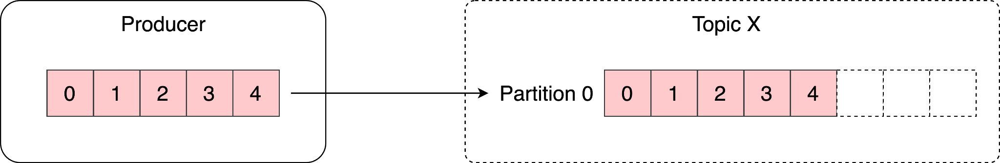

---

## Trang 7: 3. Partition

### 3. Partition
- Case 2: multiple producers write to a topic with a single partition

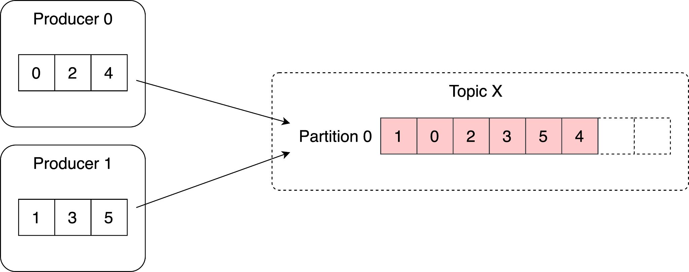

---

## Trang 8: 3. Partition

### 3. Partition
- Case 3: a produce write to a topic with multiple partitions
- Note: for illustration purposes only

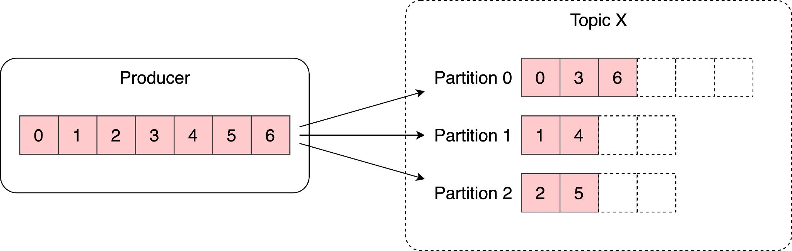

---

## Trang 9: 4. Offset

### 4. Offset
- Offset is the unique ID for each message/record in a partition
- Offset acts as the primary key
- Offset is defined after a record is written to a partition
- Offset is an increasing integer starting from 0
- Fast lookup: O(1)
- There may be a gap between neighboring offsets in advanced situations

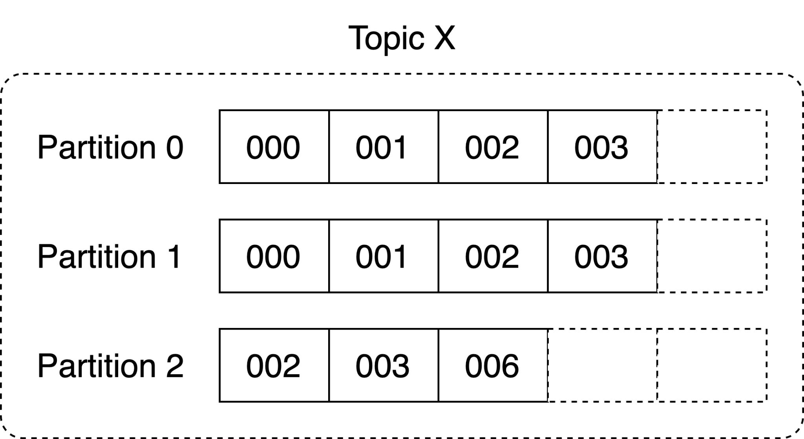

---

## Trang 10: 5. Record

### 5. Record
- A record is aka a message, an events
- Records are immutable
- A record contains 6 attributes:
  - Key:
    - Is optional, non-unique.
    - Grouping related records.
    - Is free form, can be an array of bytes.
  - Value:
    - The most important part: value describes an event
    - Nullable
    - Is free form, can be an array of bytes

Key: 34 (user_id)

Value:
```
{
    "user_id": 34,
    "action": "PAID",
    "items": ["p1", "p2"]
}
```

---

## Trang 11: 5. Record

### 5. Record
- A record contains 6 attributes:
  - Header: A set of free-form key-value pairs that is metadata for a record. Akin to HTTP headers
  - Partition: the partition that the record appears in
  - Offset: A 64-bit signed integer for locating a record within a partition
  - Timestamp:
    - A millisecond-precise timestamp
    - Timestamp is set by the producer by default. Or timestamp may be set by the broker when a record is appended to the partition

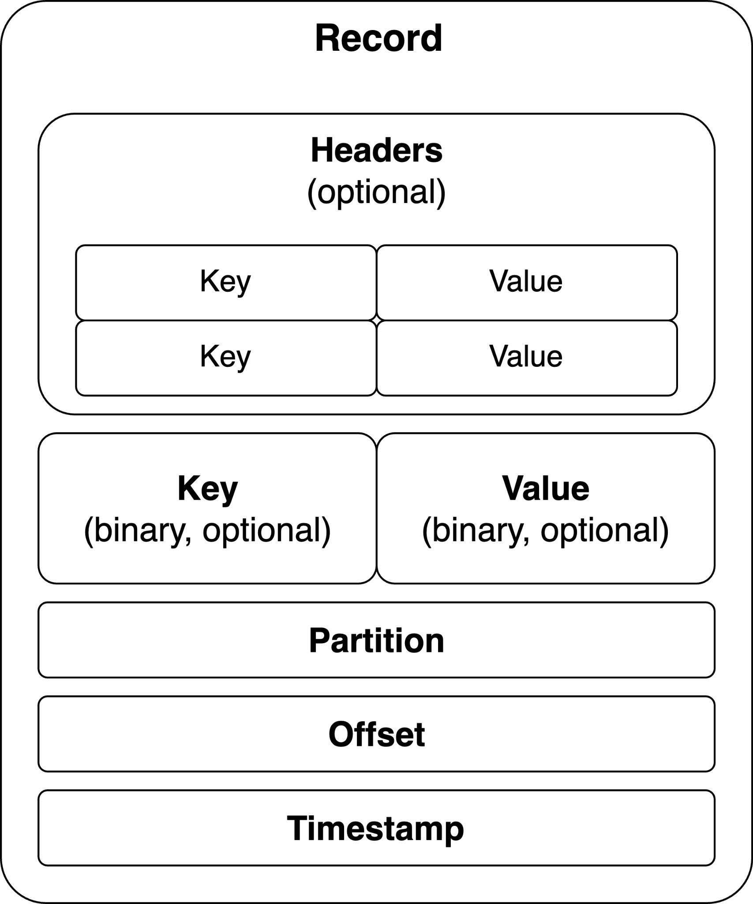

---

## Trang 12: 6. Producer

### 6. Producer

---

## Trang 13: 6. Producer

### 6. Producer
- Producers create messages/records and write them to topics.
- We need a Kafka Client lib (Producer API) to implement producers.
  - Partitioning
  - Serialization
  - Compression
  - Retry
  - …

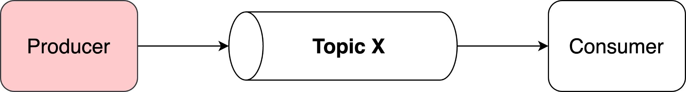

---

## Trang 14: 6.1. Partitioner

### 6.1. Partitioner
1. If a partition is specified in the ProducerRecord, that partition will always be used.

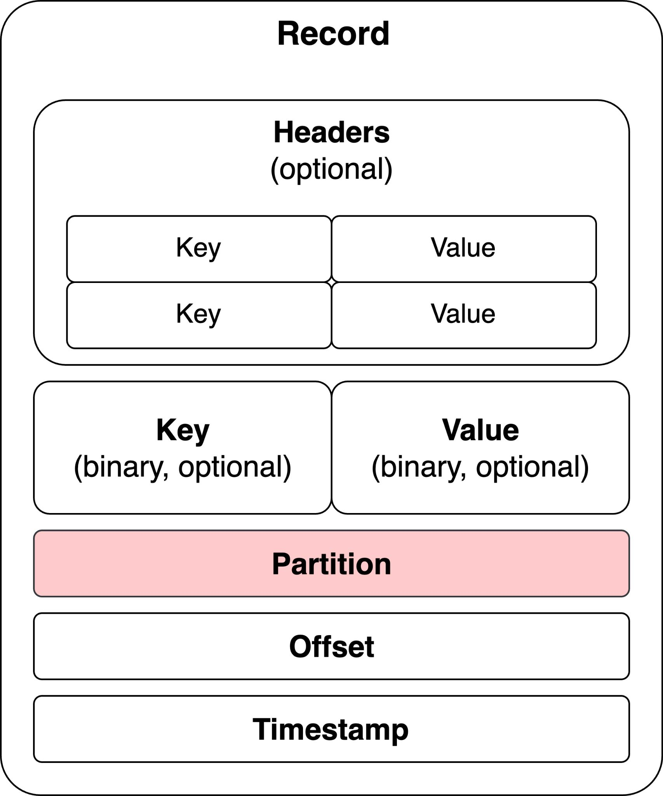

---

## Trang 15: 6.1. Partitioner

### 6.1. Partitioner
2. If key != null, the key is hashed to determine the partition number.
  - Partition = murmur2(key_bytes) % number_of_partition.
  - Messages having the same key are sent to the same partition.

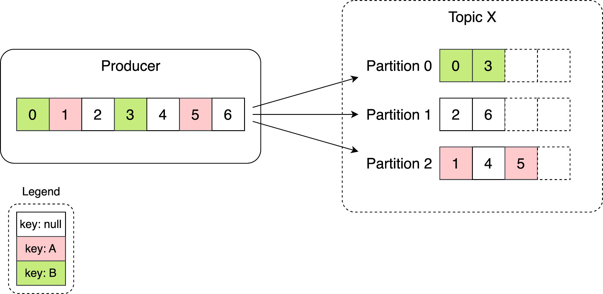

---

## Trang 16: 6.1. Partitioner

### 6.1. Partitioner
3. If key == null:
  - In &lt; Kafka 2.4.0, messages are sent using a round-robin strategy
  - In >= Kafka 2.4.0, Kafka uses a new improved mechanism - Sticky Partitioner (discuss later)

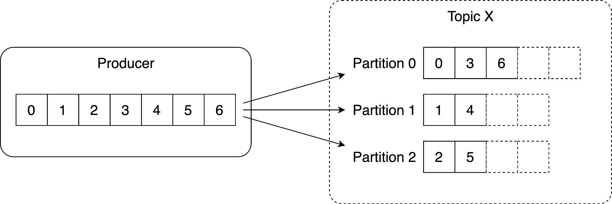

---

## Trang 17: 6.2. When The Number of Partitions Changes

### 6.2. When The Number of Partitions Changes
- If the number of partitions changes, messages have the same key and can be placed in different partitions

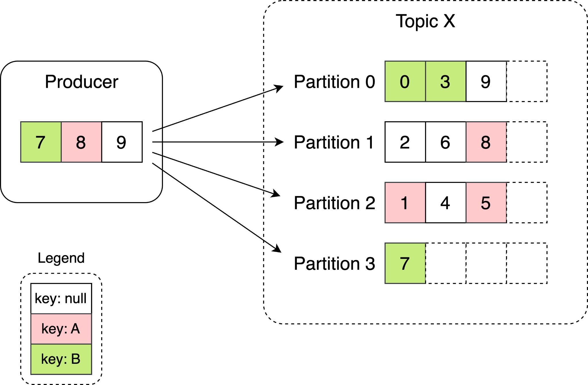

---

## Trang 18: 7. Consumer

### 7. Consumer

---

## Trang 19: 7. Consumer

### 7. Consumer
- Consumers read messages/records from topics using a pull/poll mechanism
- Consuming a record does not remove it from the topic
- We need Consumer API (a Kafka Client lib) to implement consumers
  - Consumer Group
  - Committing Offset
  - Rebalance
  - Liveness
  - …

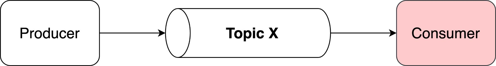

---

## Trang 20: 7.1. Consumer Group

### 7.1. Consumer Group
- Consumer Group is a load-balancing mechanism.
- Distributing partitions approximately evenly to consumers within a consumer group.
- Every consumer needs to be in a consumer group.

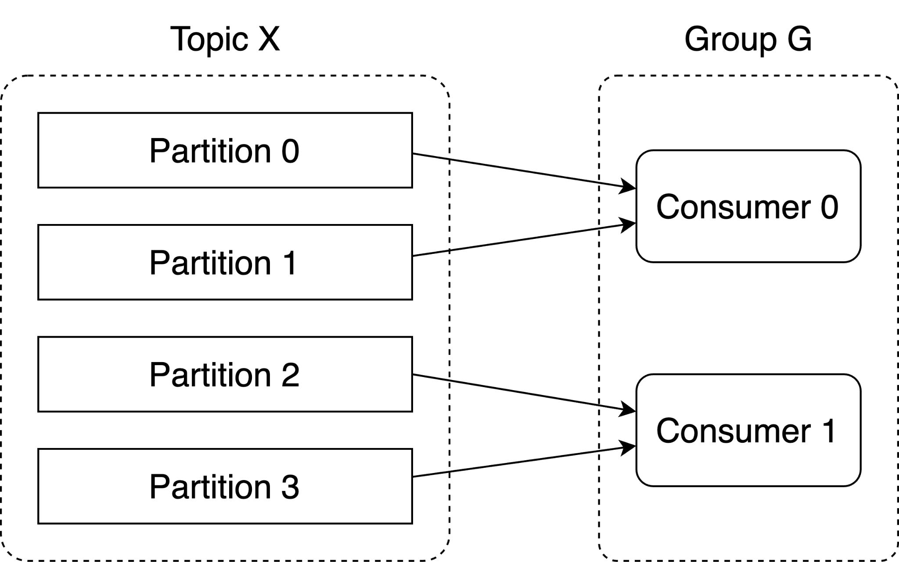

---

## Trang 21: 7.1. Consumer Group

### 7.1. Consumer Group
- When starting a consumer without a consumer group name, the consumer will automatically create a random consumer group.

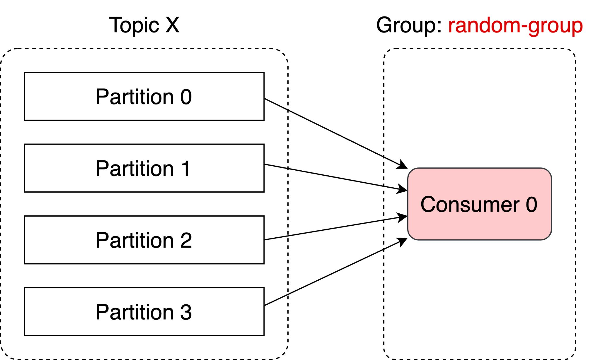

---

## Trang 22: 7.1. Consumer Group

### 7.1. Consumer Group
- Starting a consumer with the consumer group name, the consumer will join that group.
- The first consumer in a group subscribes to a topic, it will receive all partitions.
- When the second consumer joins the group, a rebalance is triggered. Then the second consumer will get approximately half of the partitions from the first consumer.

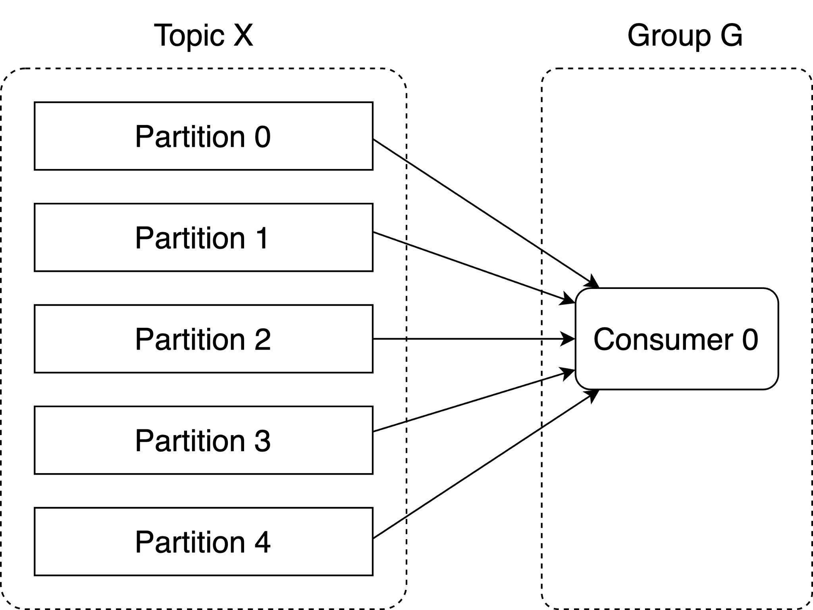

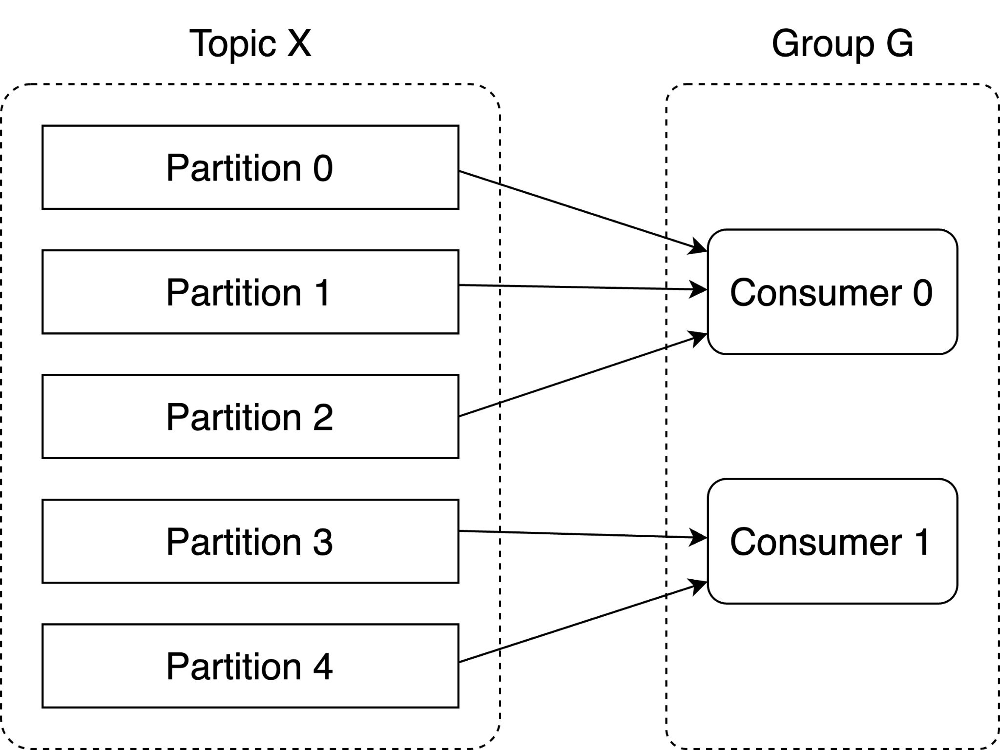

---

## Trang 23: 7.1. Consumer Group

### 7.1. Consumer Group
- A partition is assigned to at most one consumer within a consumer group.
- Different consumer groups do not interfere with others.

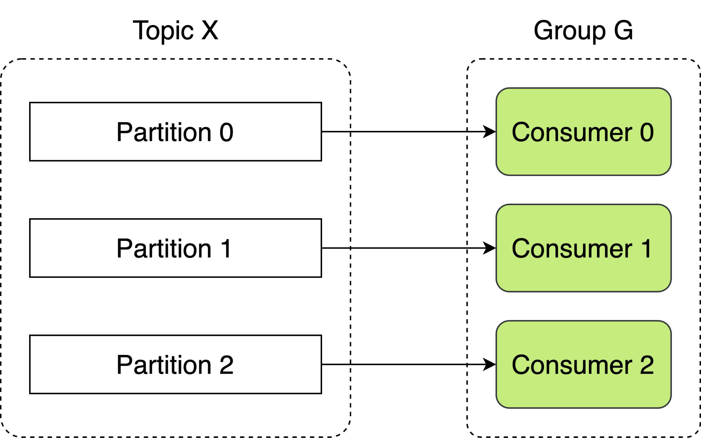

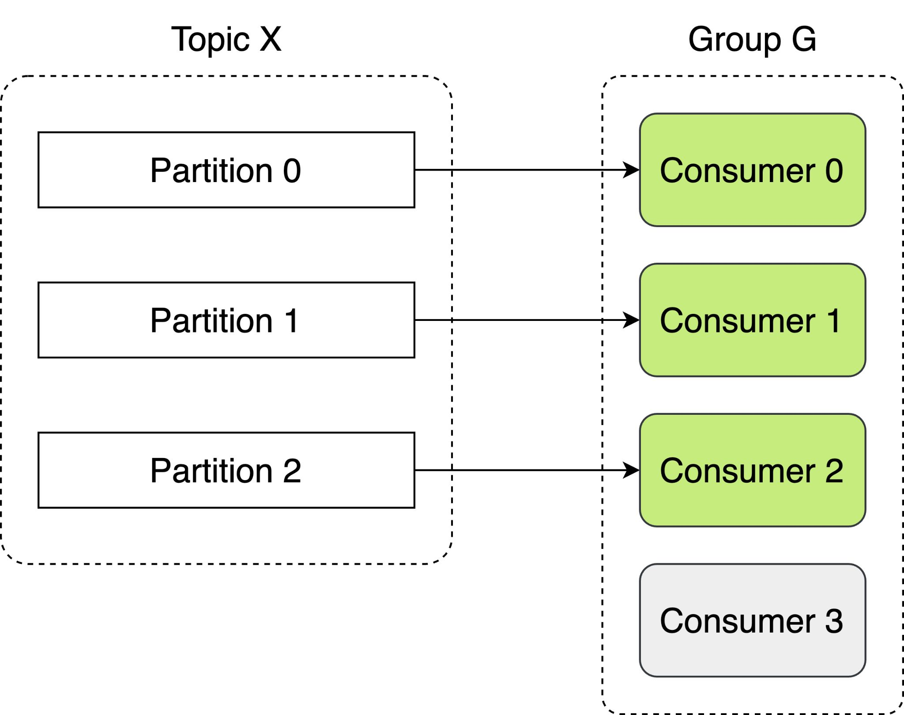

---

## Trang 24: 8.1. Problem

### 8.1. Problem
- Context: partitions (data) are distributed across brokers.
- Problems: a broker goes down
  - Durability: losing data.
  - Availability: can not write to and read from partitions in the broker.

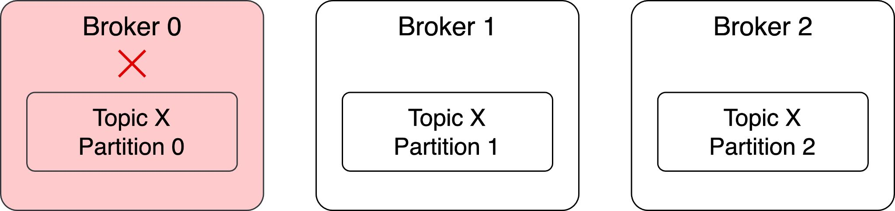

---

## Trang 25: 8. Replication

### 8. Replication

---

## Trang 26: 8.2. Solution: Replication

### 8.2. Solution: Replication
- Replication achieves durability, availability.
- A replica is a copy of a partition.
- Replicas are distributed across brokers.

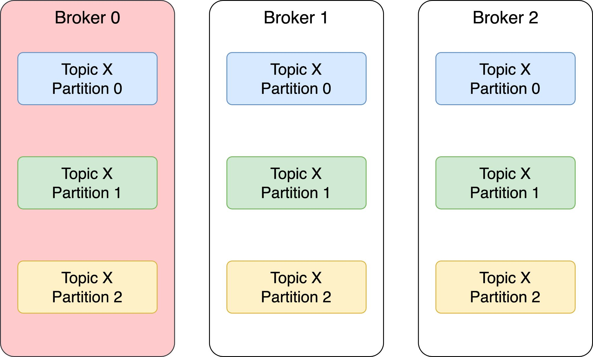

---

## Trang 27: 8.3. Replication Factor

### 8.3. Replication Factor
- The number of replicas is called the replication factor, is configured at the topic level.
- Replication factor = 1 (by default) but replication factor should be greater than 1 and less than the size of the cluster.
- The recommended value: 3


---

## Trang 28: 8.4. Leader & Follower

### 8.4. Leader & Follower
- In replicas of a partition, there are 1 leader replica and >= 0 follower replicas.
- Records from the leader partition are replicated to the follower replicas asynchronously.
- The follower replica that catches up with the leader replica, is called In-Sync Replica (ISR). The leader is included in ISR.

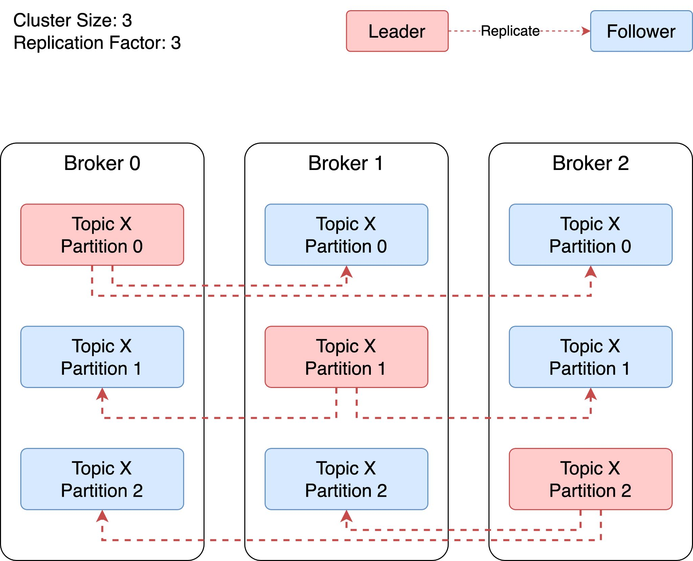

---

## Trang 29: 8.5. Leadership

### 8.5. Leadership
- Producers only write to the leader replica.
- Consumers read from the leader replica by default. Consumers can read from the closest replica by configuring it.

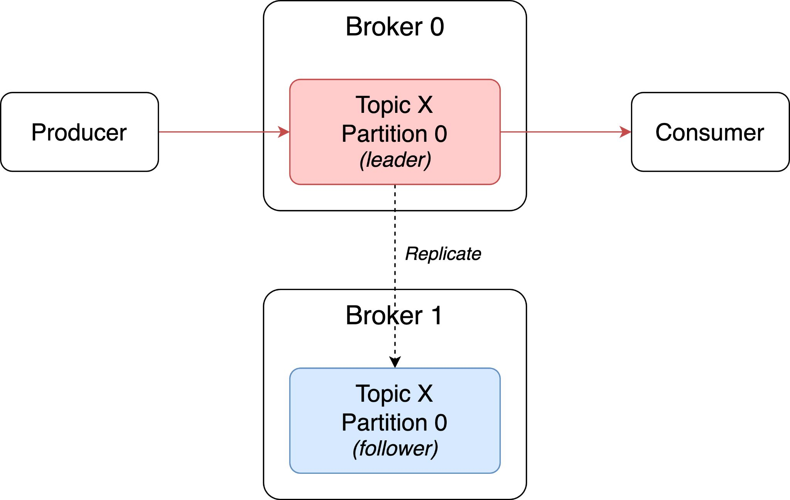

---
