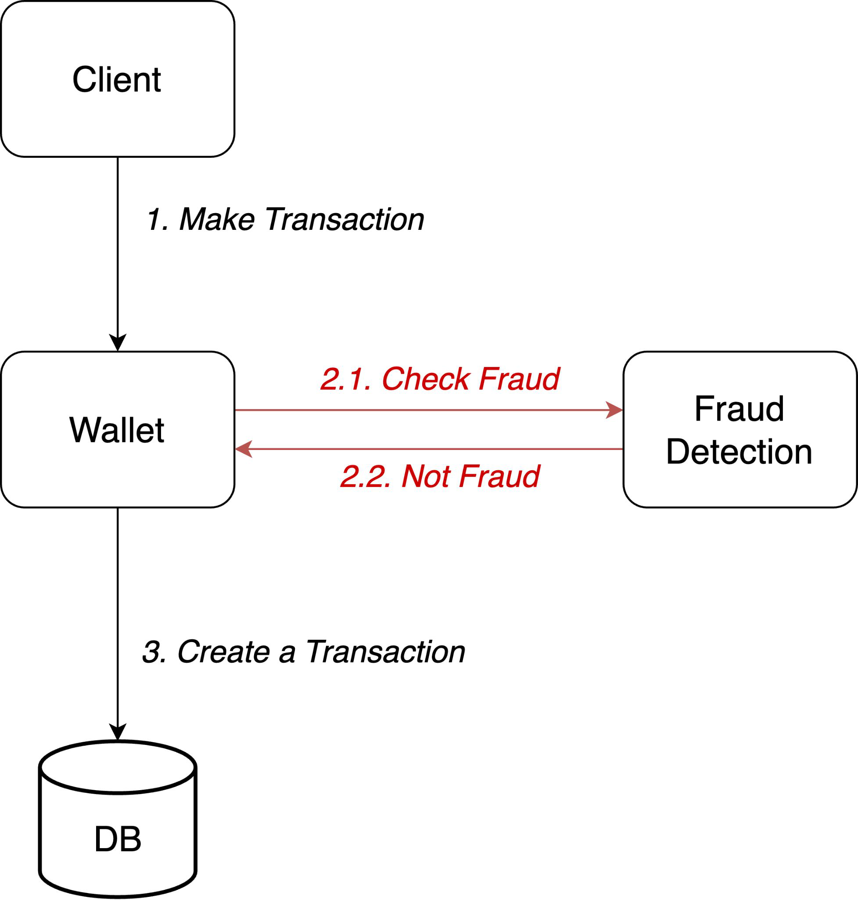
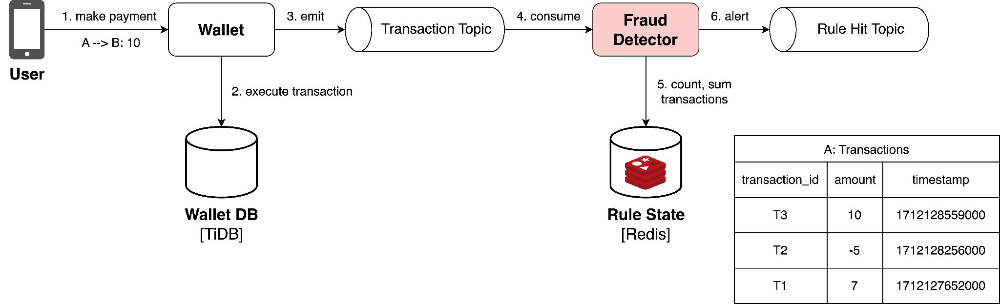

# Fraud Detection System

> **Tổng số trang:** 3 slide | **Thư mục ảnh/sơ đồ:** `assets/Fraud_Detection_System/`

---

## Trang 1: Fraud Detection System

### Fraud Detection System
“Việc trong không ổn hỏi Trương Chiêu,

việc ngoài không ổn hỏi Chu Du”

- Tôn Sách

---

## Trang 2: 1. Fraud Detection

### 1. Fraud Detection
Context:
- Image Binance wallet, there are a lot of transactions per minute.
- There are also a lot of frauds

Requirements:
- Rule: an account makes 100 transactions in 5 minutes

→ alert a rule hit
- Quick detection → minimize the impact

---

## Trang 3: 2. Fraud Detection System Design

### 2. Fraud Detection System Design

---
