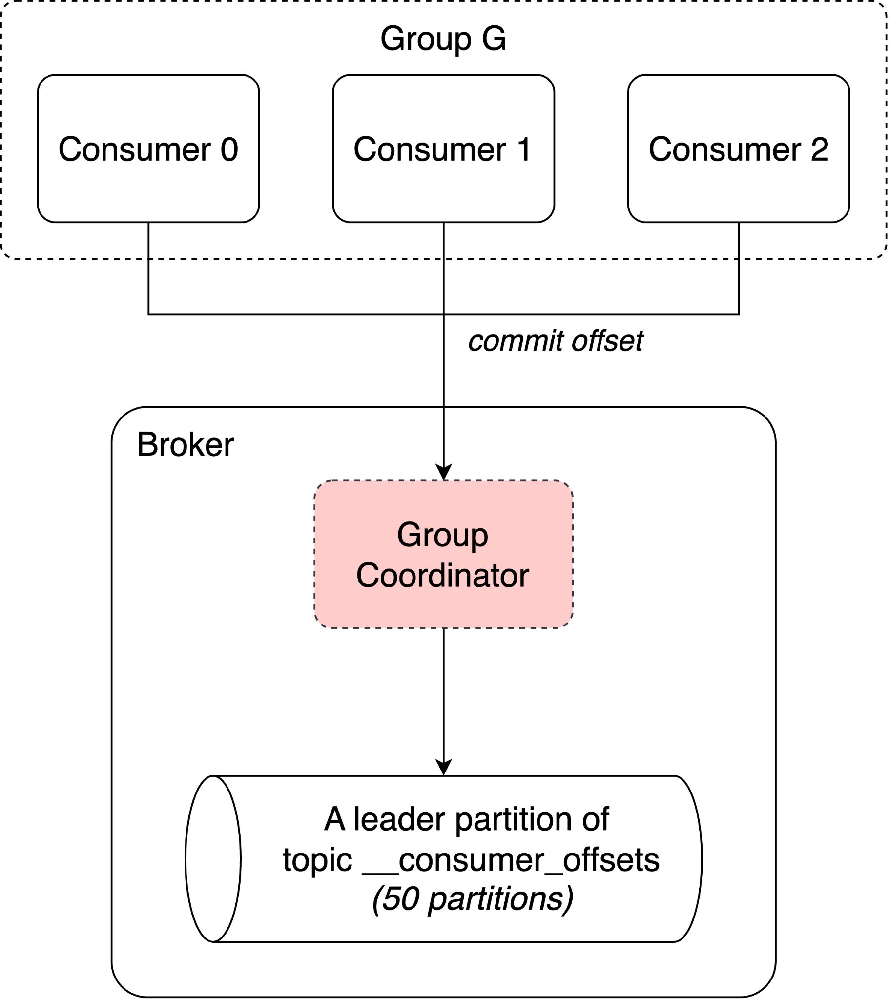
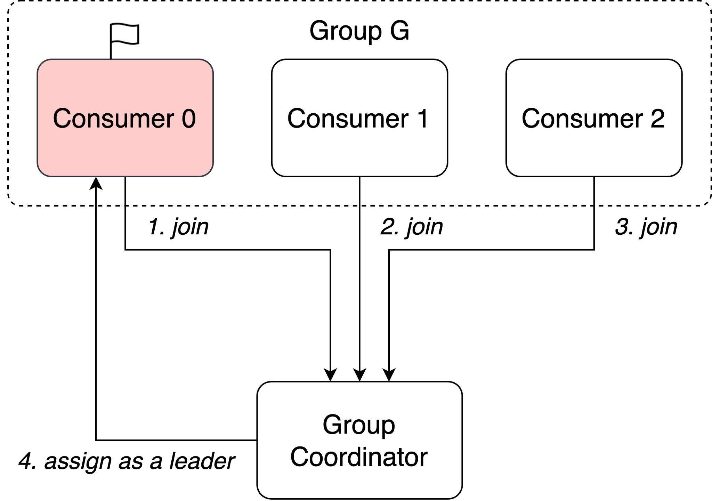
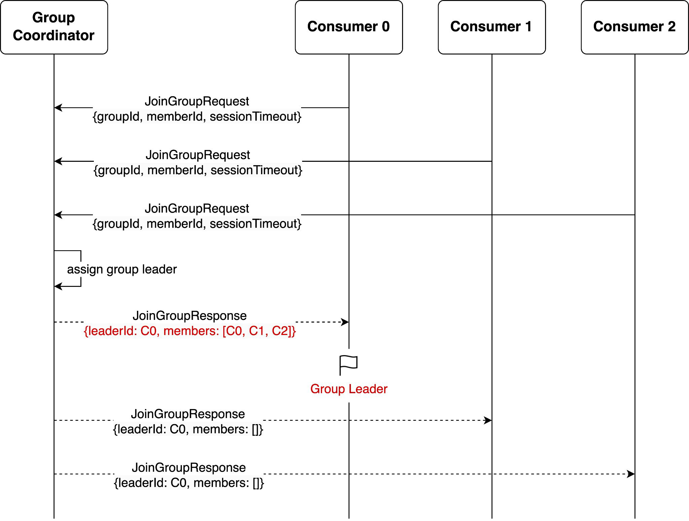
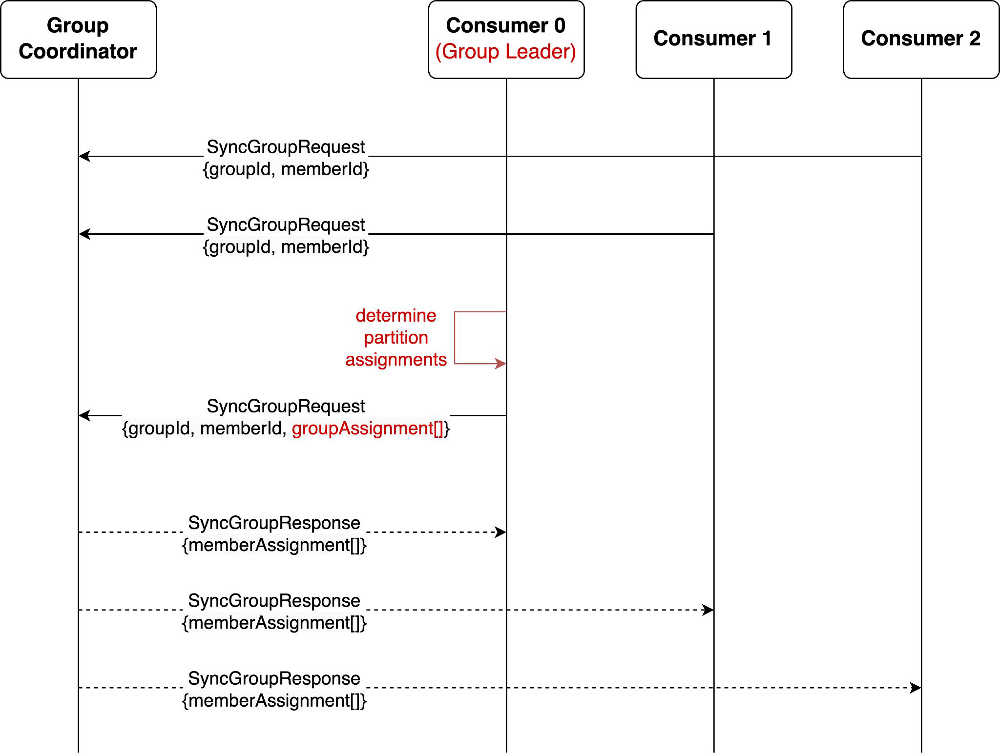
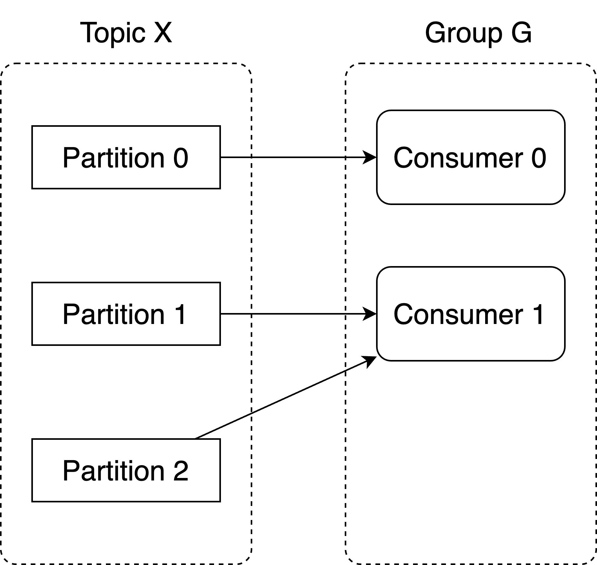
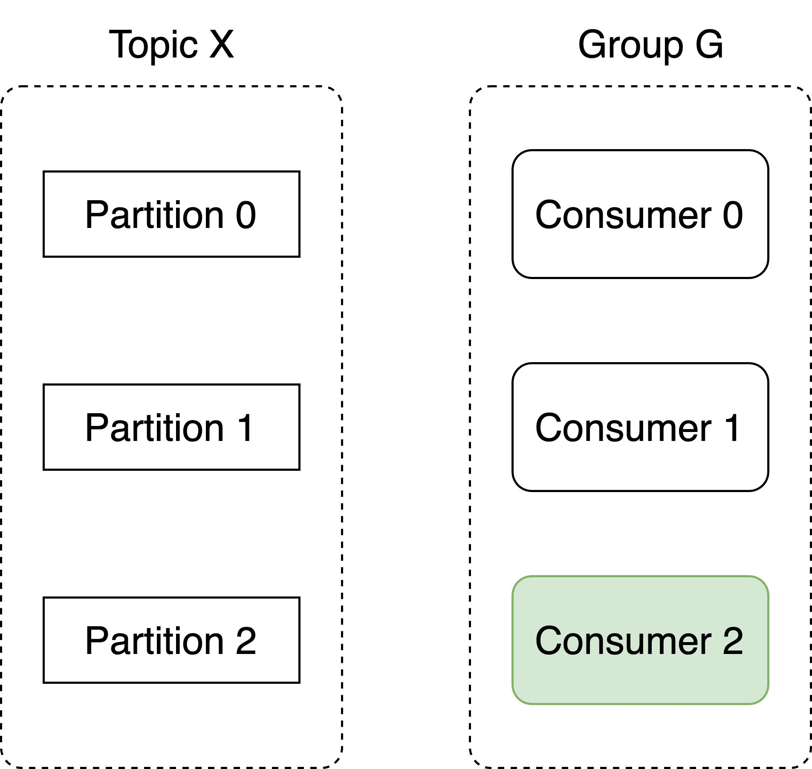
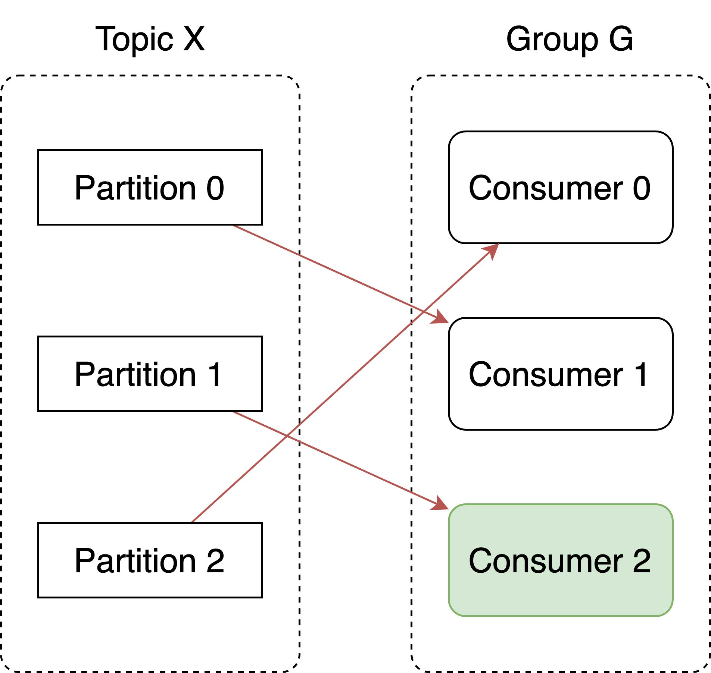
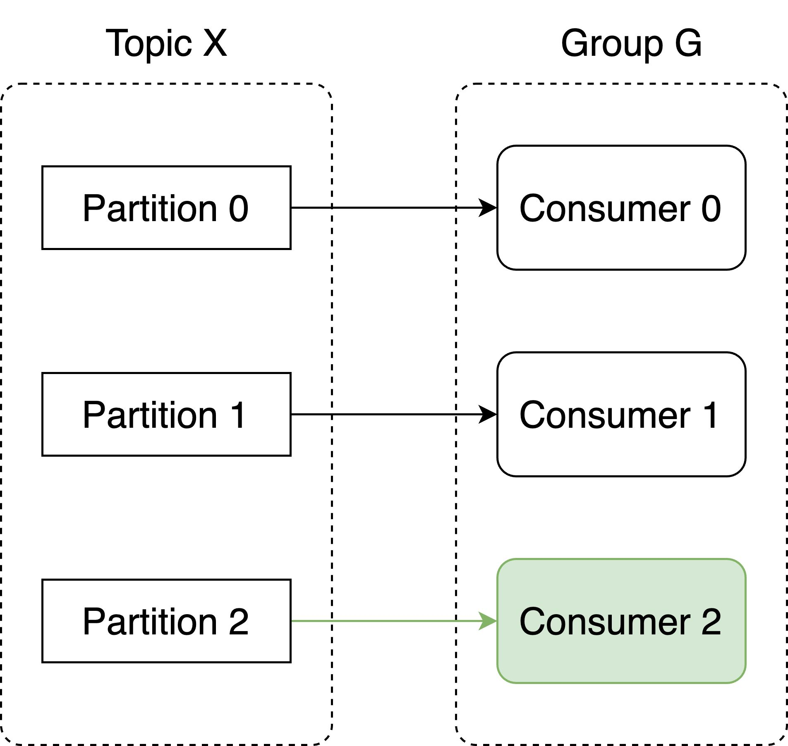

# Group Membership & Partition Assignment

> **Tổng số trang:** 17 slide | **Thư mục ảnh/sơ đồ:** `assets/Group_Membership_Partition_Assignment/`

---

## Trang 1: Group Membership &

### Group Membership &
### Partition Assignment
“Care about what other people think and you will always be their prisoner.”

– Lao Tzu

---

## Trang 2: 1. Group Membership

### 1. Group Membership

---

## Trang 3: 1.1. Group Coordinator

### 1.1. Group Coordinator
- A consumer group has a group coordinator.
- The Group Coordinator is typically a process within a Kafka broker.
- Functions:
  - Managing group membership
  - Partition assignment / Rebalancing
  - Tracking Offsets
  - Liveness, …
- A cluster has multiple group coordinators.
- A group coordinator serves multiple consumer consumer groups.

---

## Trang 4: 1.2. Group Leader

### 1.2. Group Leader
- Group Leader is a consumer and is assigned by the Group Coordinator.
- Functions:
  - Determining partition assignment
  - As a Consumer

---

## Trang 5: 2. Group Protocol

### 2. Group Protocol

---

## Trang 6: 2.1. Membership Phrase

### 2.1. Membership Phrase
- Assume that 3 consumers join the same group simultaneously.
- The Group Coordinator assigns the group leader.
- The Group Leader is usually the first consumer who joins the group.

---

## Trang 7: 2.2. Synchronization Phrase

### 2.2. Synchronization Phrase
- The Group Leader is responsible for determining partition assignments.
- The Group Leader sends partition assignments to the Group Coordinator
- The Group Coordinator forwards partition assignments to the group members.

---

## Trang 8: 2.2. Synchronization Phrase

### 2.2. Synchronization Phrase
- Why Partition Assignment is determined on the consumer side?
- Flexible to choose the partition assignment strategy.

---

## Trang 9: 3. Eager Rebalance

### 3. Eager Rebalance

---

## Trang 10: 3. Membership Phrase

### 3. Membership Phrase
- All consumers in a group stop for a short period.
- All partition assignments are revoked.
- The Group Lead determines a new partition assignment.
- All consumers join back to the group with the new assignment.
- After rebalance, a consumer might be assigned to new partitions.

---

## Trang 11: 4. Partition Assignment

### 4. Partition Assignment

---

## Trang 12: 4.1. Partition Assignment

### 4.1. Partition Assignment
- What factors are considered in partition assignment?
- Partition distribution: the distribution of partitions across consumers, useful for balancing workloads.
- Partition movement: the number of reassigned partitions.
- Eager
- Simplicity

---

## Trang 13: 4.2. partition.assignment.strategy

### 4.2. partition.assignment.strategy
Pros Cons

Range Assignor
- Simple and Predictable ● Eager
- High partition movement
- Uneven distribution for multiple topics

Round-Robin Assignor
- Even distribution for multiple topics ● Eager
- High partition movement in some cases

Sticky Assignor
- The low number of reassigned partitions ● Eager

Cooperative Sticky Assignor
- Not Eager
- The low number of reassigned partitions
- Complexity: maintaining the state when rebalancing

---

## Trang 14: 4.3. Cooperative Sticky Assignor

### 4.3. Cooperative Sticky Assignor
- Since Kafka 2.4.0

---

## Trang 15: 4.3. Cooperative Sticky Assignor

### 4.3. Cooperative Sticky Assignor
- Since Kafka 2.4.0

---

## Trang 16: 4.3. Cooperative Sticky Assignor

### 4.3. Cooperative Sticky Assignor
- Since Kafka 2.4.0
- Pros:
  - Reduce partition movement
  - Reduce the stop-the-world pause
- Cons:
  - Complex

---

## Trang 17: 4.3. Cooperative Sticky Assignor

### 4.3. Cooperative Sticky Assignor
- Since Kafka 2.4.0
- Pros:
  - Reduce partition movement
  - Reduce the stop-the-world pause
- Cons:
  - Complex
- The default assignor: [RangeAssignor, CooperativeStickyAssignor]

---
