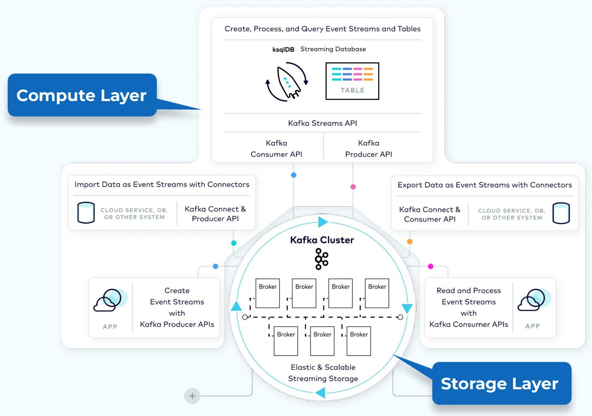

# Kafka Introduction

> **Tổng số trang:** 7 slide | **Thư mục ảnh/sơ đồ:** `assets/Kafka_Introduction/`

---

## Trang 1: Kafka

### Kafka
“A man who doesn't spend time with his family can never be a real man.”

- Mario Puzo, The Godfather

---

## Trang 2: Outline

### Outline
### 1. Definitions
### 2. Use Cases
### 3. Worst Cases

---

## Trang 3: 1.1. Introduction

### 1.1. Introduction
- Apache Kafka is a distributed event streaming platform.
- Kafka can act as a message broker, its capabilities extend beyond traditional message broker such as high-throughput data streaming and long-term data retention
- Kafka was originally developed at LinkedIn, and was open sourced in 2011.

---

## Trang 4: A Distributed Event Streaming Platform

### A Distributed Event Streaming Platform

---

## Trang 5: 1.1. Differences between Response vs Event?

### 1.1. Differences between Response vs Event?
- Response:
  - Be sent to a specific client (that made a request)
  - Variable (over time)
  - Synchronous communication
- Event:
  - Just a thing that has happened → immutable
  - Business fact that have value to more than one service.
  - Asynchronous communication

---

## Trang 6: 1.2. Event Streaming

### 1.2. Event Streaming
- Streaming: a continuous flow of data (event) in real-time
- Event streaming:
  - How to get events in/out
  - How to store events
  - Ordering of events
  - …
- Note: Streaming != Stream Processing

---

## Trang 7: 1.3. Platform

### 1.3. Platform
- Kafka platform provides additional functionalities:
  - Data Integration
  - Stream Processing
  - Ecosystem and Tools, …

Source: Confluent
- Kafka APIs:
  - Producer API
  - Consumer API
  - Streams API
  - Connect API
  - AdminClient API

---
