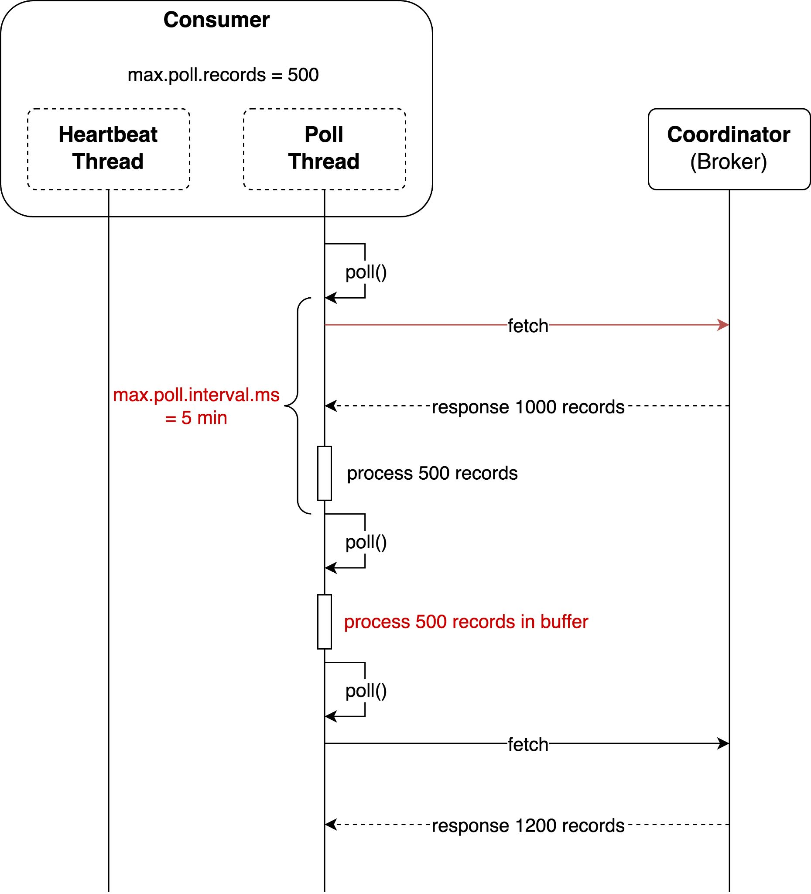
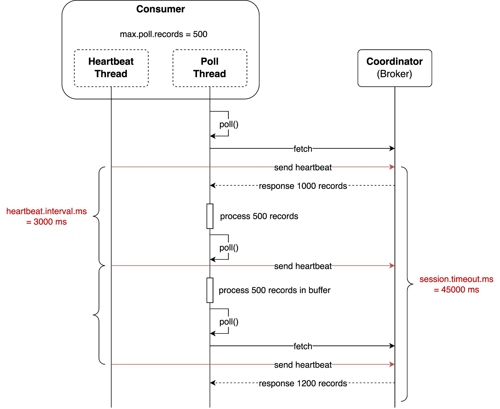

# Liveness

> **Tổng số trang:** 5 slide | **Thư mục ảnh/sơ đồ:** `assets/Liveness/`

---

## Trang 1: Liveness

### Liveness
“You know you're in love when you can't fall asleep

because reality is finally better than your dreams.”

– Dr. Seuss

---

## Trang 2: 1. Fundamental Property

### 1. Fundamental Property
- There are 2 fundamental properties in distributed systems:
  - Liveness: will guarantee that something good will eventually happen
  - Safety: something bad will never happen
- Safety:
  - At least one consumer for a partition
  - Guarantee the order of message in a partition
  - A lot of missing configurations with default values but Kafka still runs correctly

---

## Trang 3: 2. Liveness

### 2. Liveness
- Kafka satisfies the liveness in 2 ways:
  - Checking availability:
    - Is it alive still?
    - Requiring consumers to periodically exchange heartbeats with the group coordinator.
  - Checking progress:
    - Is it still working?
    - Being alive does not mean it is still working.
    - Requiring consumers to invoke poll() periodically.
- There are 2 internal threads in a consumer
  - Heartbeat Thread
  - Poll Thread

---

## Trang 4: 3. Poll Thread

### 3. Poll Thread
- Poll thread and heartbeat thread work independently
- By default, if a consumer does not invoke poll() in 5 minutes (max.poll.interval.ms)

→ the consumer leaves the group.

---

## Trang 5: 4. Heartbeat Thread

### 4. Heartbeat Thread
- By default, consumers send a heartbeat every 3 seconds (heartbeat.interval.ms)
- If the coordinator does not receive a heartbeat within 45 seconds (session.timeout.ms), it will assume that the consumer died.
- Recommended: session.timeout.ms > 3 x heartbeat.internal.ms
- If heartbeat.internal.ms and session.timeout.ms are configured shorter, it might overwhelm brokers and cause false-positive failure

---
