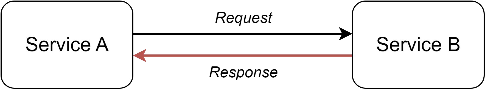
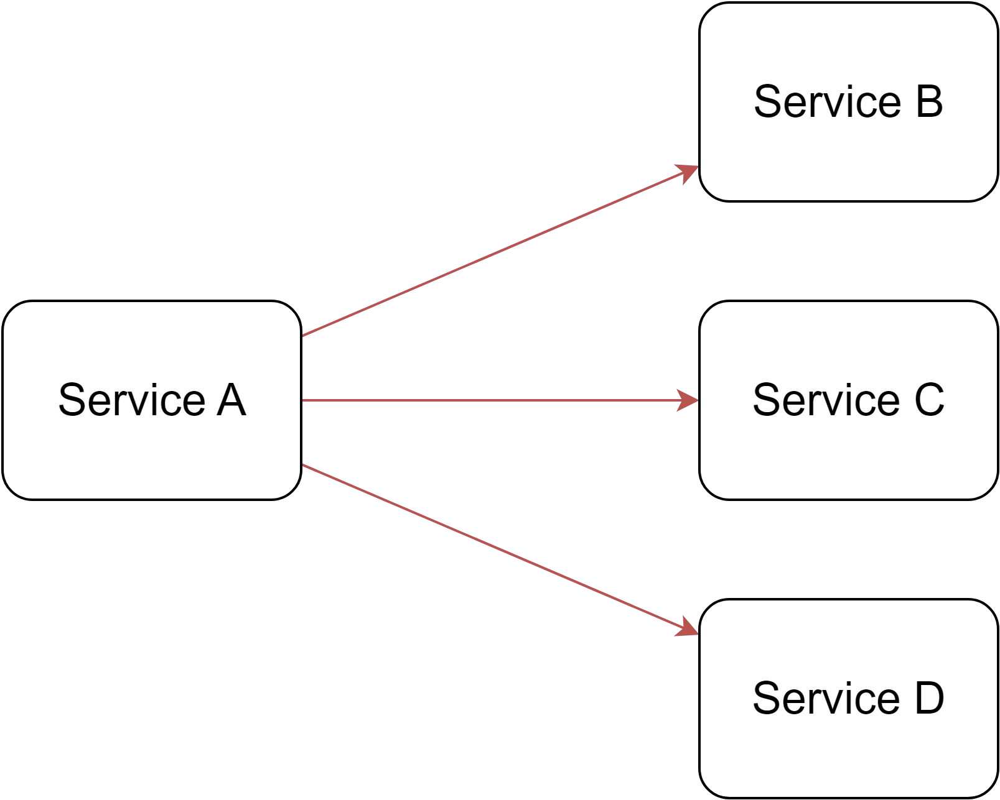
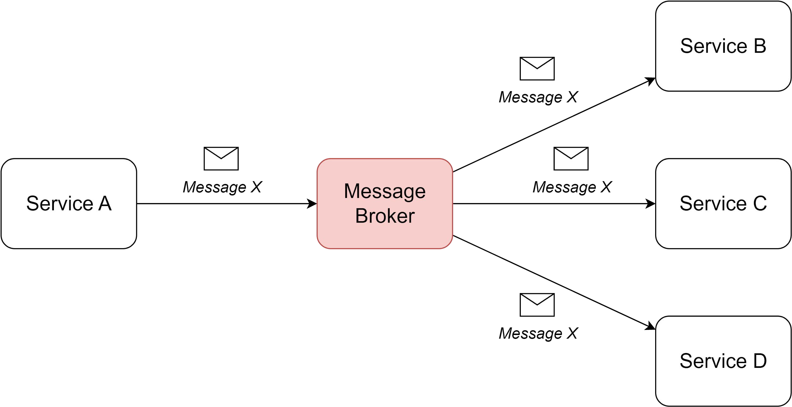
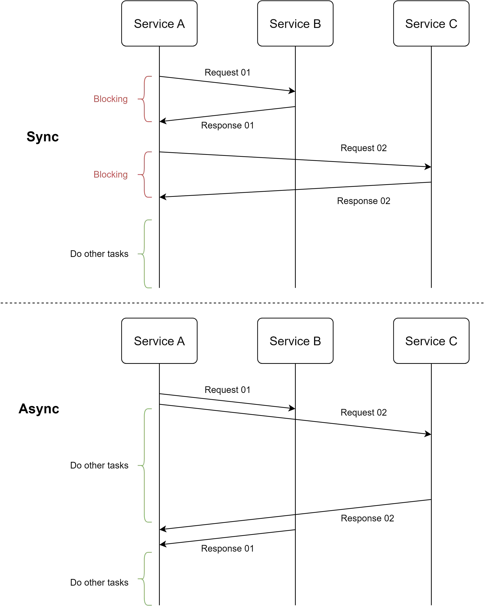
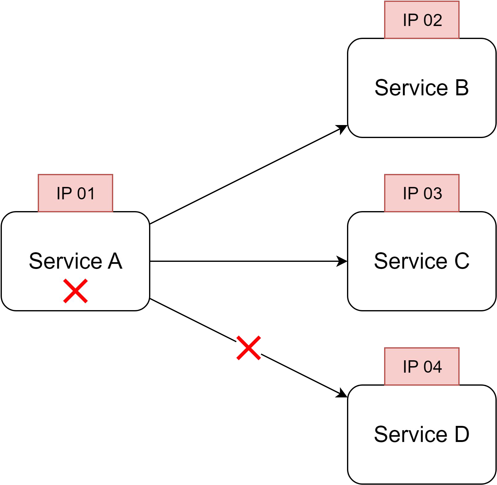
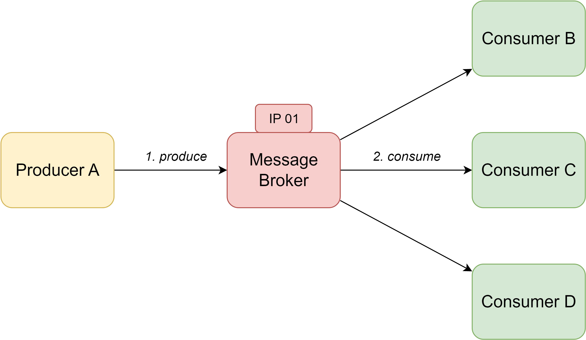
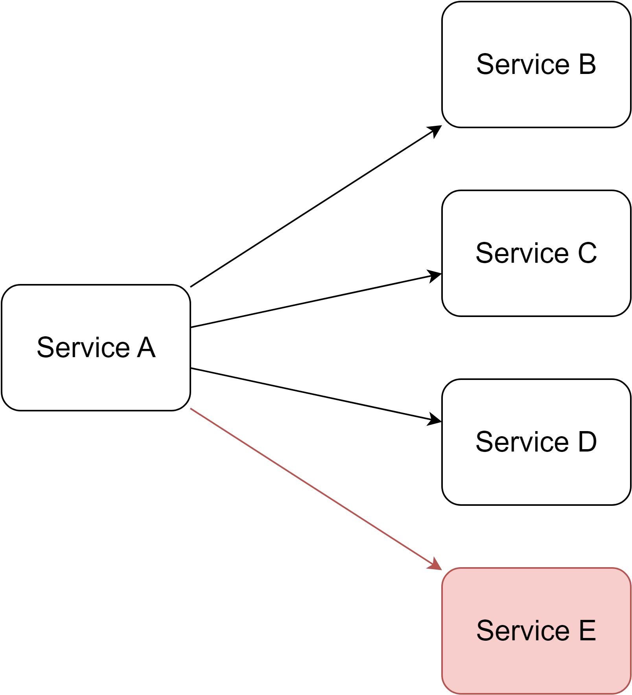
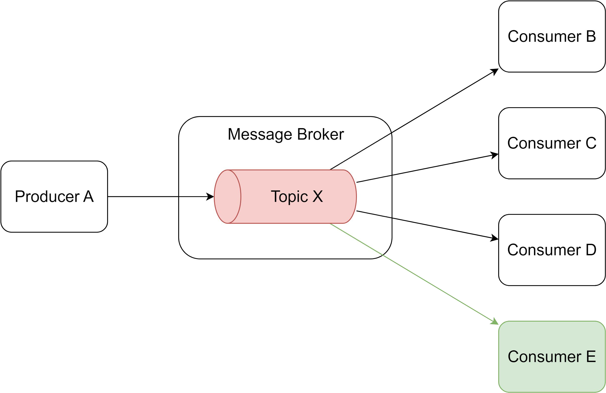
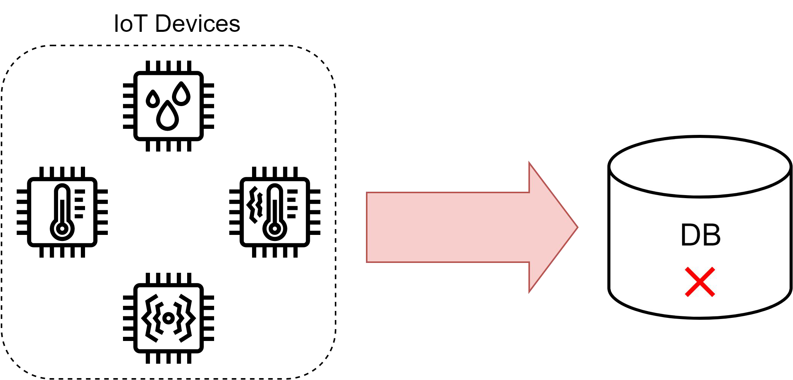
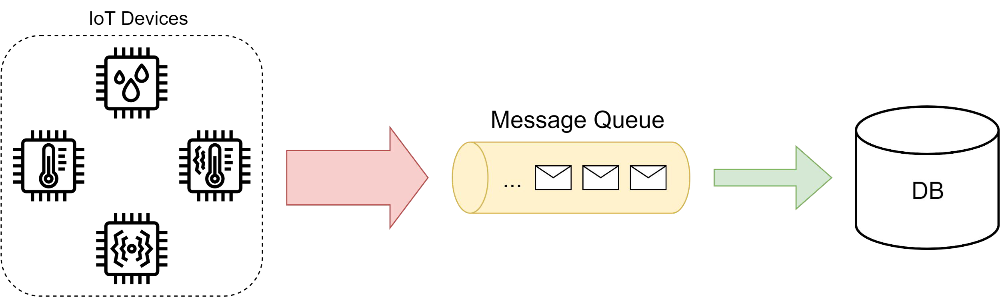

# Message Broker

> **Tổng số trang:** 15 slide | **Thư mục ảnh/sơ đồ:** `assets/Message_Broker/`

---

## Trang 1: Message Broker

### Message Broker
“Being deeply loved by someone gives you strength,

while loving someone deeply gives you courage.”

-  Lao Tzu

---

## Trang 2: 1. Request-Response Model

### 1. Request-Response Model
- Characteristics:
  - Synchronous
  - Blocking
  - Coupling

---

## Trang 3: 2. Problem 01

### 2. Problem 01
- Problem Context: Service A sends a message to 3 services

→ With request-response pattern, Service A have to send the message 3 times

---

## Trang 4: 2. Problem 01

### 2. Problem 01
- Solution:
  - Service A only needs to send the message once to a message broker.
  - The message will be transferred to Service B, C, D using push/pull mechanism.
  - Asynchronous Communication

---

## Trang 5: 2.1. Pro 1: Asynchronous Communication

### 2.1. Pro 1: Asynchronous Communication
- Service A only send message once, and don't wait for the response

→ Asynchronous Communication

→ Non-blocking

→ Improve performance of service A

---

## Trang 6: 2.1. Pro 1: Asynchronous Communication

### 2.1. Pro 1: Asynchronous Communication

---

## Trang 7: 3. Problem 02

### 3. Problem 02
- Problem context: with request-response pattern
  - Service A have to know the addresses of 3 target services to send message
  - Service A calls service B, if B fails

→ A fails too

---

## Trang 8: 3. Problem 02

### 3. Problem 02
- Solution:
  - A producer is a component responsible for publishing messages to topics
  - A consumer is a component responsible for subscribing to topics and processing the messages
  - Producers and consumers only need to know the messages broker’s address

---

## Trang 9: 3.1. Pro 2: Decoupling

### 3.1. Pro 2: Decoupling
- Decrease the interdependence between producer and consumer. Producer and consumer do not need to know each other’s existence and implementation
- Fault Tolerance: If an error occurs in a consumer, that will not affect to producer. And vice versa.

---

## Trang 10: 4. Problem 03

### 4. Problem 03
- Problem Context:
  - With request-response pattern, when we need a new Service E (for a new feature, a new flow)

→ Service A make a new call to Service E
  - Load balancing in Service A is impractical

---

## Trang 11: 4.1. Pro 3: Scalability

### 4.1. Pro 3: Scalability
- Solution:
  - Pub/Sub pattern, Fan-out mechanism
  - Service A produce event to Topic X

→ Service E consume topic X
  - Message Broker implements load balancing
- This pattern does not affect to existing flows
- Easy to scale

---

## Trang 12: 5. Problem 04

### 5. Problem 04
- Problem Context:
  - Events from IoT devices or user behavior are stored directly to Database.
  - If there is a heavy traffic → DB goes down

---

## Trang 13: 5.1. Pro 04: Reliability

### 5.1. Pro 04: Reliability
- Solution:
  - Rate Limiting
  - Message queue
- A message queue acts like a buffer that throttle the heavy traffic → Reliable

---

## Trang 14: 6. Message Broker

### 6. Message Broker
- A message broker is a software component that works as an intermediary layer, exchanging messages between services, systems.
- Pros:
  - Asynchronous Communication
  - Decoupling
  - Scalability
  - Reliability
  - …
- Cons:
  - Complexity
  - Latency
  - Operational Overhead
  - Cost
  - …

---

## Trang 15: Please like and subscribe

### Please like and subscribe
### Thank you 🙏

---
