# Problems & Patterns

> **Tổng số trang:** 83 slide | **Thư mục ảnh/sơ đồ:** `assets/Problems_Patterns/`

---

## Trang 1: Problems & Patterns

### Problems & Patterns
“Let your plans be dark and impenetrable as night,

and when you move, fall like a thunderbolt.”

– Sun Tzu

---

## Trang 2: 1. Topic Width

### 1. Topic Width

---

## Trang 3: 1.1. Context

### 1.1. Context
- Kafka only supports increasing the partition count.
  - Kafka does not allow decreasing the number of partitions.
  - Adding partitions to a topic does not interrupt client operations.
- The producer hash is not consistent.
  - Increasing the partition count results in 2 records with the same key potentially sent to different partitions.
- Throughput = Consumer throughput | Producer throughput
- Future Scaling
- …

→ It is hard to determine the right number of partition.

---

## Trang 4: 1.2. Pattern

### 1.2. Pattern
- Number of Partitions = Expected Throughput / Throughput per Partition
  - Throughput = Write Throughput | Read throughput
- Recommended: a divisible number of partitions.
- Common approach: start with a sufficiently over-provisioned topic
  - Pros:
    - Improve throughput
    - Limit inconsistent hashing
  - Cons: increase the load on brokers and consumers
- Confluent recommends that each broker to have up to 4,000 partitions and each cluster to have up to 200,000 partitions.

---

## Trang 5: 1.3.1. Suggestion / Write Throughput

### 1.3.1. Suggestion / Write Throughput
- Assume: Expected Throughput = Write Throughput
  - Use cases: events from IoT devices, user behaviors
- Number of Partitions = Write Throughput / Write Throughput per Partition
- Expected Throughput = Expected QPS * Message Size
  - Message Size ~ 700B
  - Message size after compressing ~ 500B
- Write Throughput per Partition = 10 MB/s
- Suggestion:
  - Low throughput:  messages/s ⇒ &lt; 4 partitions
  - Medium throughput: 10k - 100K messages/s ⇒ 8 - 16 partitions
  - High throughput: 100K - 1M messages/s ⇒ 20 - 32 partitions

---

## Trang 6: 1.3.1. Suggestion / Read Throughput

### 1.3.1. Suggestion / Read Throughput
- Assume: Expected Throughput = Read Throughput
  - Use cases: payment, order, …
- Number of Partitions = Expected Throughput / Read Throughput per Partition
- Expected Throughput = Expected TPS
- Read Throughput per Partition depends on app logic, DB ⇒ load test to get TPS
- Suggestion:
  - Low throughput: &lt; 1K messages/s ⇒ &lt;= 8 partitions
  - Medium throughput: 1k - 10K messages/s ⇒ 8 - 16 partitions
  - Note: Increasing more partitions might not improve throughput

---

## Trang 7: 1.4. Decreasing the Number of Partitions in a Topic

### 1.4. Decreasing the Number of Partitions in a Topic
1. Create a new topic with the desired size.

2. Replicate from the old topic to the new topic by using MirrorMaker.

3. When the replication catches up, cut off. We need some producer downtime to allow for parity.

4. Switch the producers to double publish to both the old and the new topic.

5. Consumes resets offset.
  - auto.offset.reset = latest
  - Consumers should be idempotent.
  - auto.offset.reset = earliest
  - Reset the offsets to the cutoff timestamp

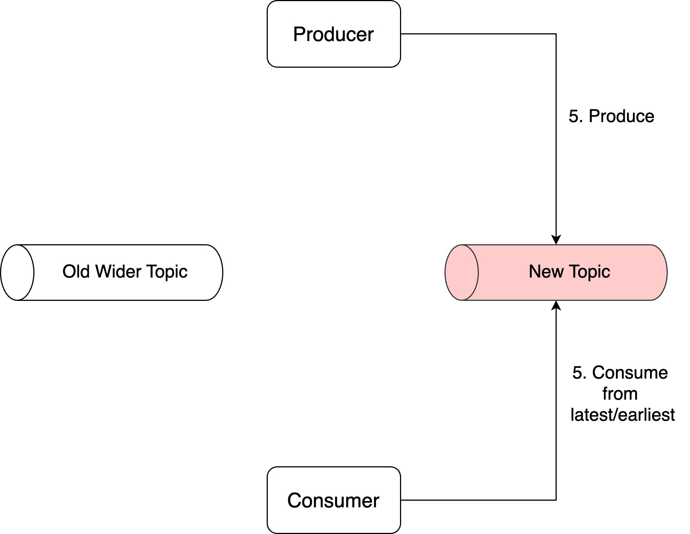

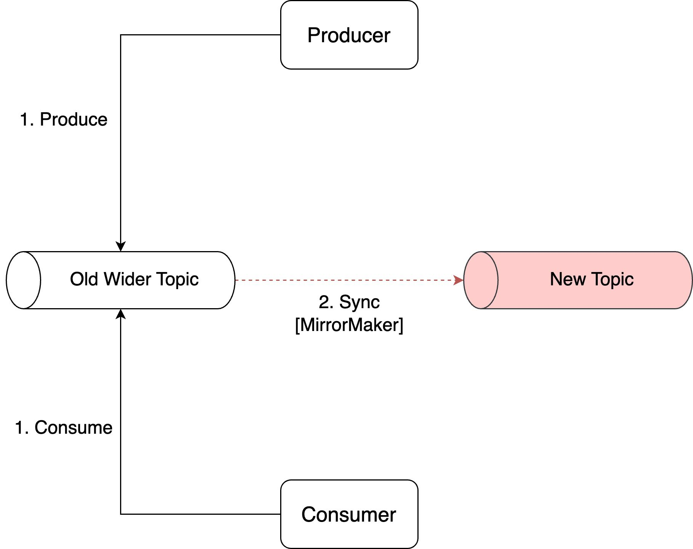

---

## Trang 8: 2. Large Message

### 2. Large Message

---

## Trang 9: 2.1. Problem Context

### 2.1. Problem Context
- Producers want to send a large message to consumers.
  - For example, a report file needs to be processed.
- The default max size of a Kafka record is 1 MB.
- Files can be greater than 1 MB.

---

## Trang 10: 2.2. Solution 1: Increase The Max Message Size

### 2.2. Solution 1: Increase The Max Message Size
- Configure Topic: max.message.bytes
- Configure Broker: message.max.bytes in files server.properties
- The maximum of this value can be 10 MB because of the impact on the replication mechanism.
- This solution is anti-pattern.
  - Limitation: &lt;= 10 MB
  - Reduce throughput
  - Slow down consuming
  - Wasted resources

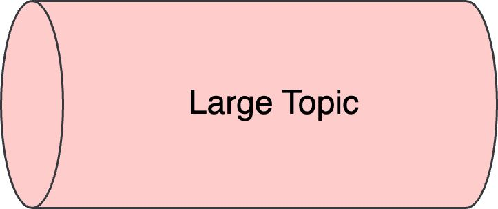

---

## Trang 11: 2.3. Solution 2: External Storage

### 2.3. Solution 2: External Storage
- Save the report file to a cloud storage.
- Producers send a message including the object URL (reference).
- Consumers will download the file via the URL and then process.
- Pros
  - Simple
  - Improve performance
- Cons
  - External storage

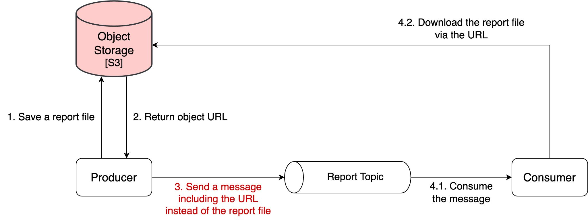

---

## Trang 12: 3. Message Lag

### 3. Message Lag

---

## Trang 13: 3.1. Message Lag

### 3.1. Message Lag
- Message lag is the delta between the last produced message and the current committed offset.
- Time Lag = (Last_Produced - Last_Consumed) / Producer Rate.
- Lag is a key performance indicator (KPI) for Kafka.
- Consequences:
  - Unacceptable latency
  - Consumers do not send heartbeats on time
  - Risk of losing messages due to retention
  - Potential risk of critical issues
- Message Lag is a major blindspot.

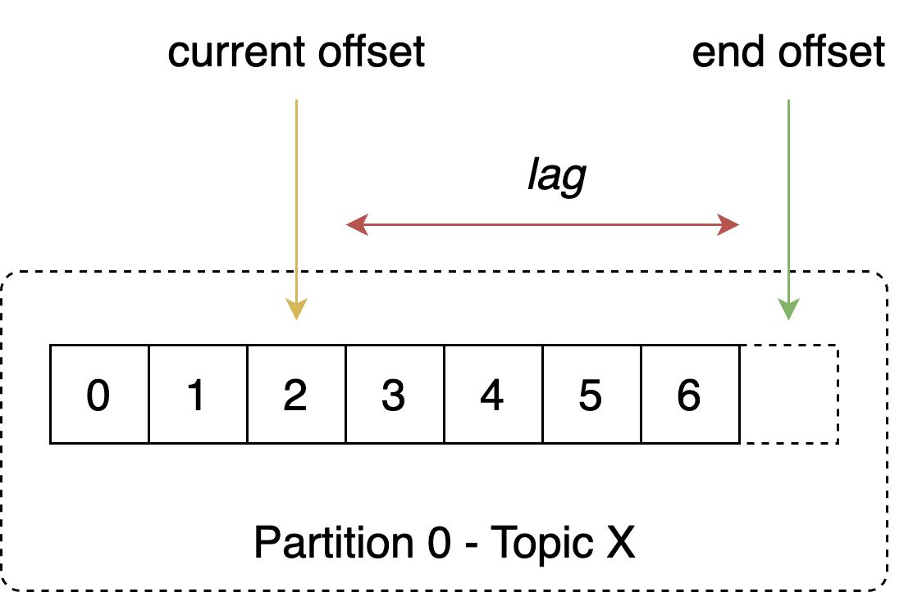

---

## Trang 14: 3.2. Monitoring First

### 3.2. Monitoring First
- Check the root cause first. Do not jump to scale the consumer group first.
- To find the root cause: monitoring
  - Burrow (Recommended)
  - Confluent Platform, Kafka Lag Exporter, …
- Message lag has many causes:
  - Producer Rate spikes
  - Consumer Rate slows down
  - Long-running task
  - Network issues
  - Long GC pause
  - …

---

## Trang 15: 3.3. Low Consumer Rate

### 3.3. Low Consumer Rate
- Assume that the consumer processing is optimized.
- If the root cause is low consumer rate, then
- Scale-out consumer group
- The scale of consumer group depends on the number of partitions, so consider to increase partitions

---

## Trang 16: Long-running Tasks may cause message lag.

### Long-running Tasks may cause message lag.

---

## Trang 17: 4. Long-running Task

### 4. Long-running Task

---

## Trang 18: 4.1. Problem Context

### 4.1. Problem Context
- Example:
  - Generating reports
  - Machine learning jobs
  - Loan application files, …
- Problem: What if each message has a long processing time?
  - Message Lag
  - Consumers don’t send heartbeats on time
    - Consumers might enter rebalance even though they are still running

---

## Trang 19: 4.2. How to Handle with Long-running Tasks?

### 4.2. How to Handle with Long-running Tasks?
- Best Practice: Consumers process data as fast as possible.
- Approaches
  - Asynchronous
  - Liveness Tuning
  - Pipeline

---

## Trang 20: 4.3. Asynchronous

### 4.3. Asynchronous
- Consume messages and commit, then process the messages asynchronously.
- Pros
  - Very low latency
  - Simple for consuming
- Cons
  - At most once
  - Hard to handle error
  - Complex for managing asynchronous tasks
  - Out of order

---

## Trang 21: 4.4. Liveness Tuning

### 4.4. Liveness Tuning
- A consumer is failed if:
  - poll() is not called in 5 mins (max.poll.interval.ms)
  - A consumer does not send heartbeats in 45s (session.timeout.ms)
- Rebalance is triggered unexpectedly

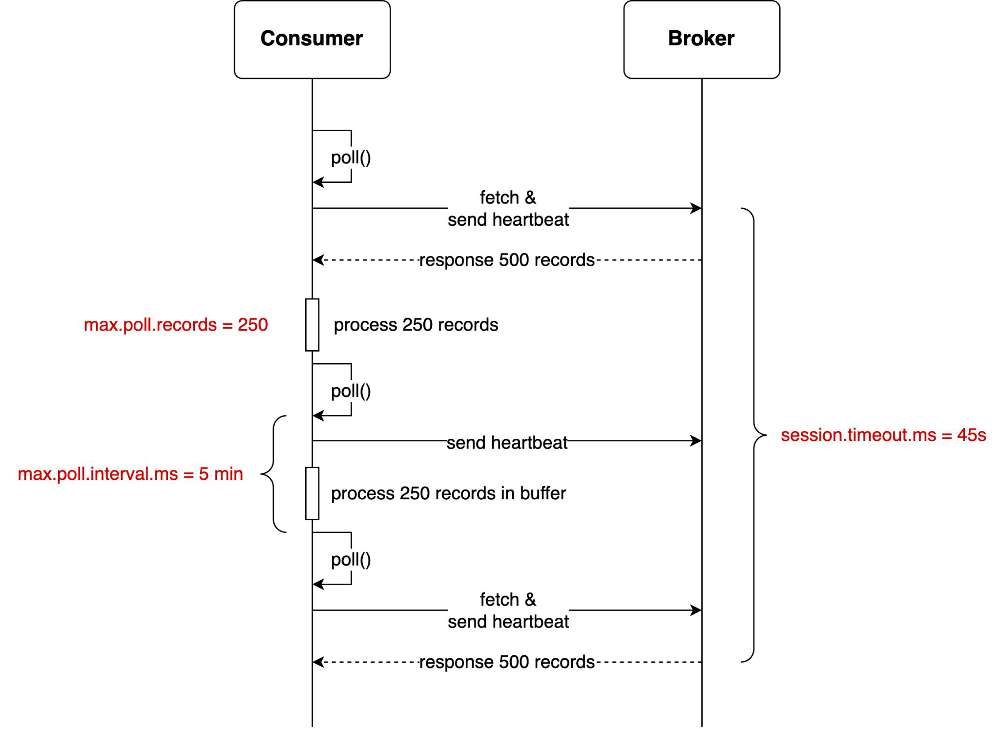

---

## Trang 22: 4.4. Liveness Tuning

### 4.4. Liveness Tuning
- Solution:
  - Decrease max.poll.records (500)
  - Increase session.timeout.ms (45s)
  - Increase max.poll.interval.ms (5 mins)
- Pros:
  - Do not modify consumers
- Consumer:
  - Tuning → Not reliable

---

## Trang 23: 4.5. Pipeline

### 4.5. Pipeline
- Break down the process into smaller stages
- Pros
  - Low latency
  - At least once
  - Traceable
  - Decoupling between stages
  - Stages in a process are in order
- Cons
  - More complex topology
  - Different processes are out of order

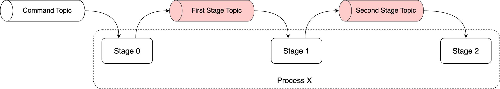

---

## Trang 24: 4.5. Pipeline

### 4.5. Pipeline

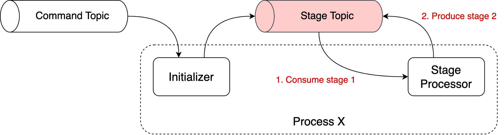

---

## Trang 25: 5. Request & Reply

### 5. Request & Reply

---

## Trang 26: 5.1. Problem 1: Two-Way Communication

### 5.1. Problem 1: Two-Way Communication
- Messages go through one message queue in one way.

---

## Trang 27: 5.1. Problem 1: Two-Way Communication

### 5.1. Problem 1: Two-Way Communication
- Messages go through one message queue in one way.
- Problem:
  - Services need two-way communication.
    - Example: REST API
  - How to get a response from the replier?

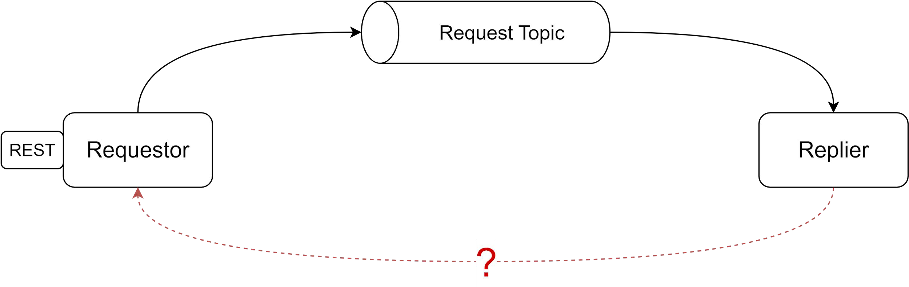

---

## Trang 28: 5.2. Solution 1: Request-Reply Pattern

### 5.2. Solution 1: Request-Reply Pattern
- One topic for requests
- One topic for reply/responses
- Read more: Request-Reply - Enterprise Integration Patterns

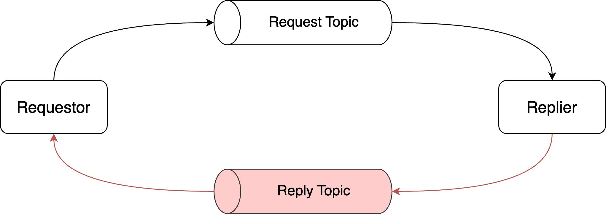

---

## Trang 29: 5.3. Problem 2: Request-Response Mapping

### 5.3. Problem 2: Request-Response Mapping
- All responses in a reply topic.
- Which request does a response correspond to?

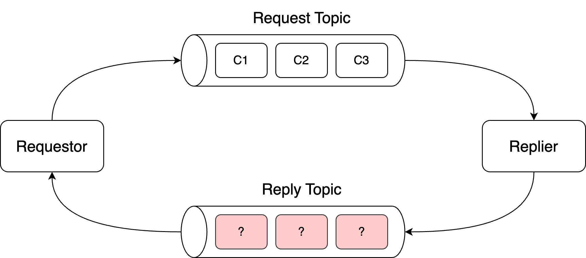

---

## Trang 30: 5.3. Problem 2: Request-Response Mapping

### 5.3. Problem 2: Request-Response Mapping
- All responses in a reply topic.
- Which request does a response correspond to?

---

## Trang 31: 5.4. Solution 2: Message ID

### 5.4. Solution 2: Message ID
- Each message has
  - message_id: a unique message ID (UUIDv4)
  - original_message_id: message ID of the request
    - Mapping the request and response
    - Tracing

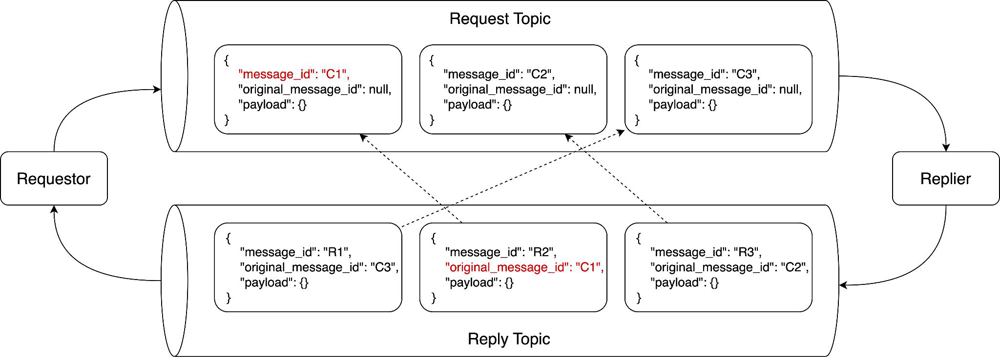

---

## Trang 32: 5.5. Problem 3: Processing Reply

### 5.5. Problem 3: Processing Reply
- A requestor consumes all responses from the reply topic.
- How does the requestor process responses?

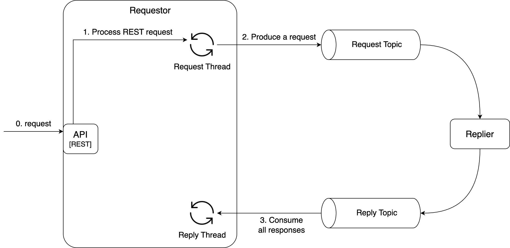

---

## Trang 33: 5.6. Solution 3: Message Pool

### 5.6. Solution 3: Message Pool
- The message pool is used to store responses or request callback.
- Implementation: Local cache (Guava).
  - Key: message_id
  - Value:
    - Response
    - Request callback (local cache)
- Set TTL (timeout) to responses in the cache to avoid running out of memory.

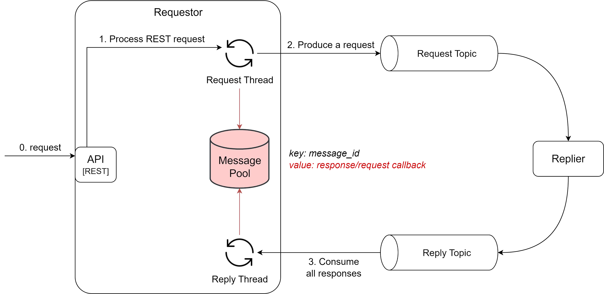

---

## Trang 34: 5.6. Solution 3: Message Pool

### 5.6. Solution 3: Message Pool
- How to interact with the message pool?
- How to response?
  - Synchronous Polling
  - Asynchronous Callback

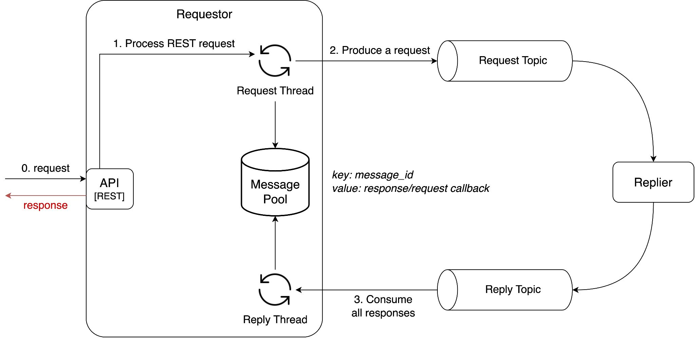

---

## Trang 35: 5.6.1. Synchronous Polling

### 5.6.1. Synchronous Polling
- Reply thread pushes all response to the message pool.
- The requestor will poll the message pool to get the right response.
- Pros:
  - Simple
- Cons:
  - Wasting resources

→ Limit requestor’s performance

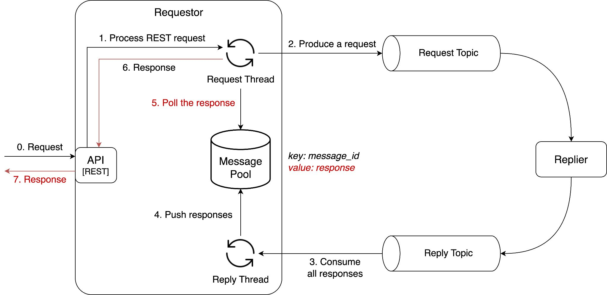

---

## Trang 36: 5.6.2. Asynchronous Callback

### 5.6.2. Asynchronous Callback
- The requestor saves a callback for the reply in a message pool.
- The reply thread invokes the appropriate callback.
- Implementation:
  - Callback: CompletableFuture
- Pros:
  - Improve performance
- Cons:
  - Complex
- Read more the sample code

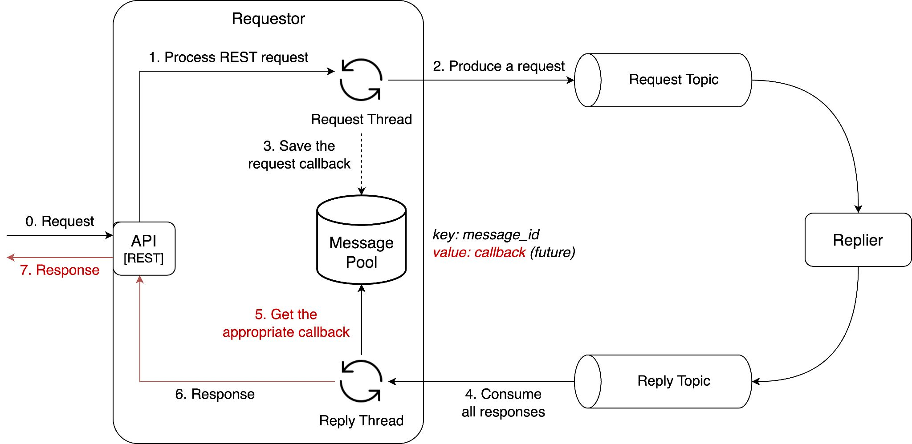

---

## Trang 37: 5.7. Problem 4: Multiple Requestor

### 5.7. Problem 4: Multiple Requestor
- A requestor consumes all responses from the reply topic.
- The requestor can run many instances.
  - One consumer group per instance
  - One consumer group for all instances

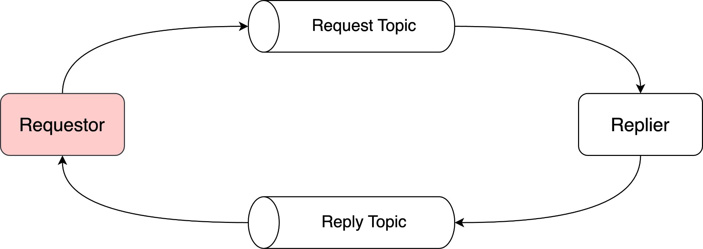

---

## Trang 38: 5.7.1. One Consumer Group per Instance

### 5.7.1. One Consumer Group per Instance
- Each instance is in one different consumer group.
- Ex: Starting a consumer with a random consumer group.
- Each instance consumes all responses.
- Problems:
  - Wasting resources to filter out inappropriate responses
  - The higher load, the more latency

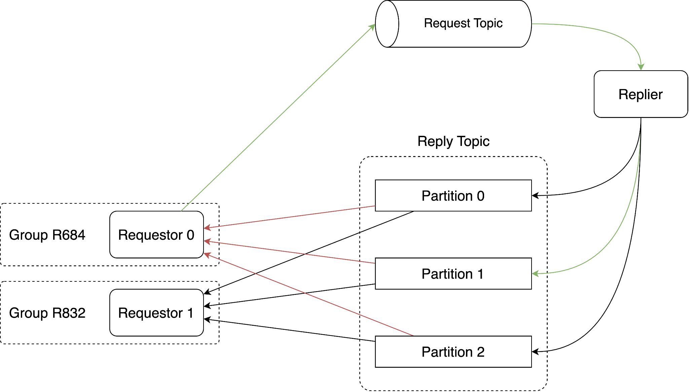

---

## Trang 39: 5.7.2. One Consumer Group for All Instances

### 5.7.2. One Consumer Group for All Instances
- All instances in one consumer group.
- Each instance consumes a part of the reply topic only.
- Problems:
  - Instance A sends a request, but instance B receives the response.
  - How to share responses between instances?
  - How to get responses fast?

---

## Trang 40: 5.8. Remote Message Pool

### 5.8. Remote Message Pool
- A remote message pool (Redis) for storing and sharing responses between instances
  - Key: message_id
  - Value: response
- The request thread will poll the remote pool to get the appropriate response.

---

## Trang 41: 5.8. Remote Message Pool

### 5.8. Remote Message Pool
- Polling for the response can be synchronous or asynchronous. This example uses a synchronous mechanism.

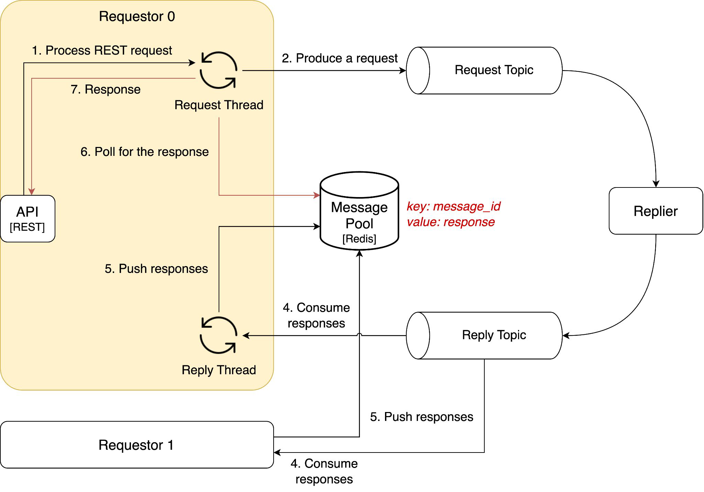

---

## Trang 42: 5.9. Problem 5: Remote Message Pool

### 5.9. Problem 5: Remote Message Pool
- Add latency due to network overhead.
- More operational overhead for Redis.
- Redis is not reliable.

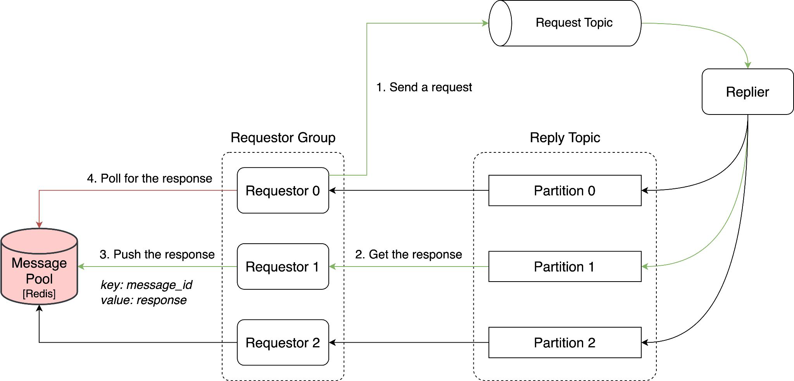

---

## Trang 43: 5.9.1. Attempt: Fixed Partition

### 5.9.1. Attempt: Fixed Partition
- Try to send the response to a specific partition that the requestor instance is consuming
- Cons:
  - Hard to implement
  - Hard to scale
- Any better solution?

---

## Trang 44: 5.10. Solution 5: Return Address

### 5.10. Solution 5: Return Address
- The IP address of the requestor is attached to the request.
- No reply topic.
- The requestor exposes an API to receive the response.
- A local message pool:
  - Key: message_id
  - Value: callback
- When getting a response, the reply thread invokes the appropriate callback.

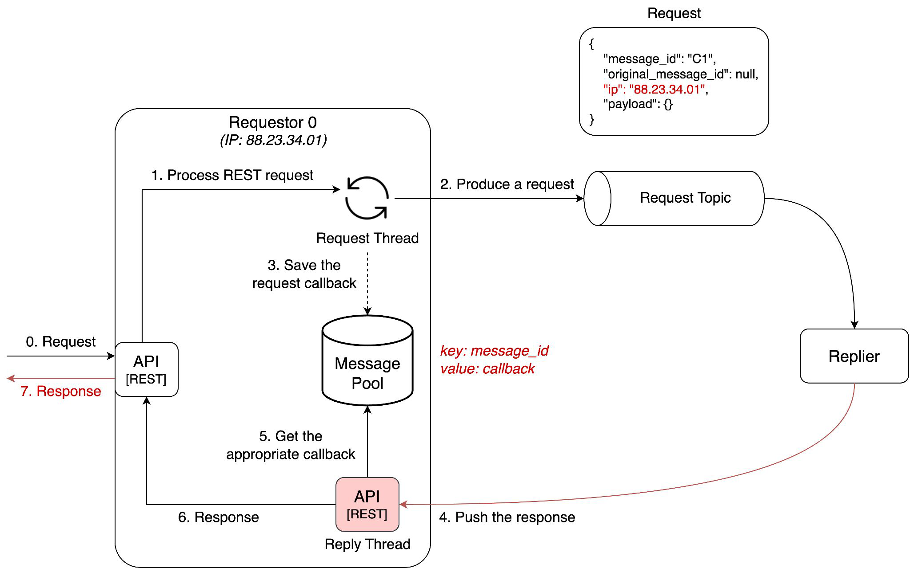

---

## Trang 45: 5.10. Solution 5: Return Address

### 5.10. Solution 5: Return Address
- Pros:
  - Improve performance
  - Scalability for request-reply only
- Cons:
  - Coupling between the Requestor and Replier
  - True response, not event

→ not scalable for other cases

---

## Trang 46: Recap

### Recap
- Request Reply Pattern
- Be aware of pros and cons
- Best Practice: package client code as a lib.

2. Return Address 1. Remote Message Pool

---

## Trang 47: 6. Dual Write Problem

### 6. Dual Write Problem
“Everything in software architecture is a trade-off,

and the why is more important than how."

– Neal Ford

---

## Trang 48: 6.1. Problem

### 6.1. Problem

---

## Trang 49: 6.1.1. Problem Type

### 6.1.1. Problem Type
- Context: A process has dual-write
  - United Dual-Write: 2 writes to Kafka
  - Separate Dual-Write: 1 write to database, 1 write to Kafka
- Requirement:
  - Transactional behavior
  - 2 writes must be executed atomically

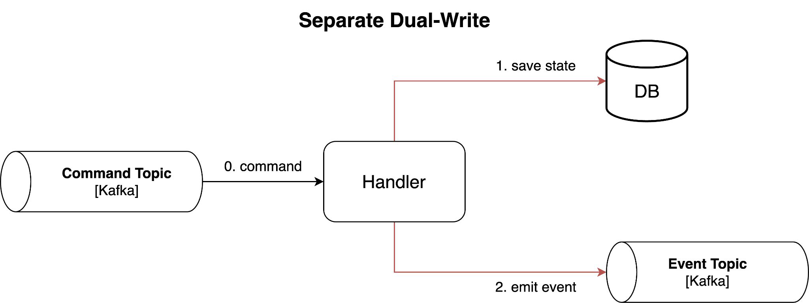

---

## Trang 50: 6.1.2. United Dual-Write

### 6.1.2. United Dual-Write
- Problem:
  - At the beginning of Kafka, no built-in way to roll back the successful writes, leading to partial updates
- Solution: Kafka transaction (introduced in release 0.11.0)
- Be aware of the limitations of Kafka transaction.

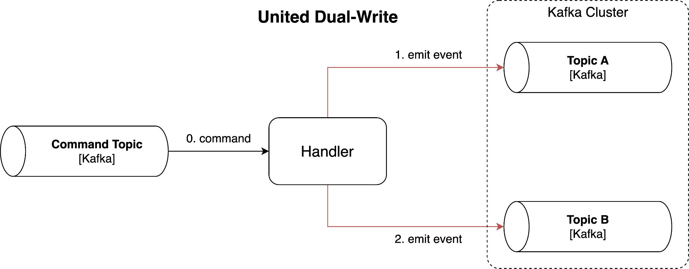

---

## Trang 51: 6.1.3. Separate Dual-Write

### 6.1.3. Separate Dual-Write
- The process:
  - Save state to a database
  - Emit event to a separate system (Kafka, Email Service, …)
- 2 systems are not linked

→ 2 systems can not be updated in transactional behavior.
- This case is common.

---

## Trang 52: 6.1.3. Separate Dual-Write

### 6.1.3. Separate Dual-Write
- For example: billing
  - Save state: update balance
  - Emit event: pay bill
- The frequency of failures is rare but the impact is severe and it is hard to resolve.
- Problem:
  - What if a failure occurs between the save and emit?
  - The state is updated but event is never emitted.

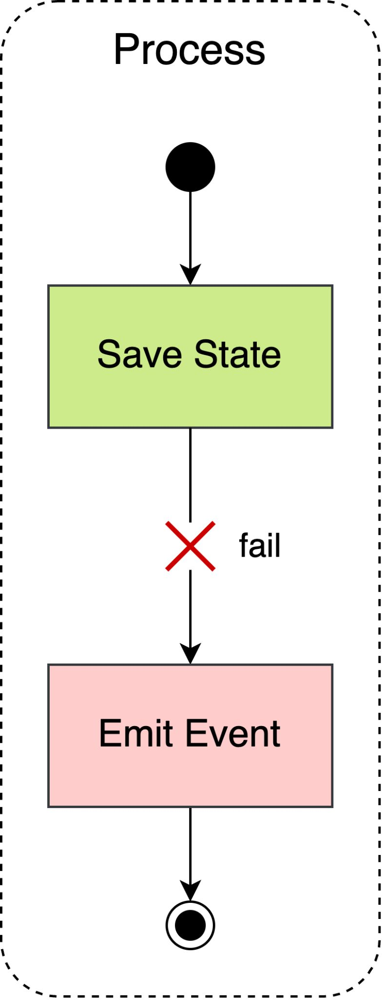

---

## Trang 53: 6.2. Solution

### 6.2. Solution

---

## Trang 54: 6.2.1. Attempt 1: Emit Event First

### 6.2.1. Attempt 1: Emit Event First
- What if a failure occurs between the save and emit?
- Event is emitted but the state is not updated

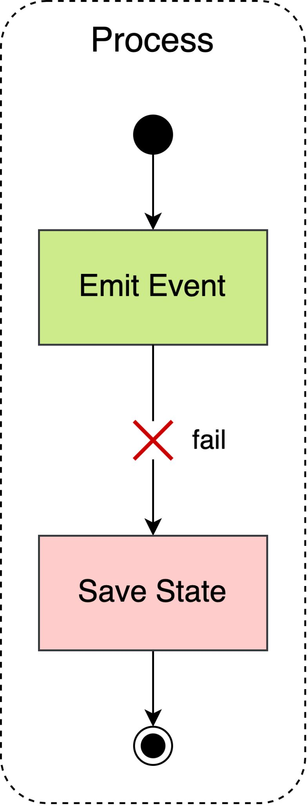

---

## Trang 55: 6.2.2. Attempt 2: Wrap in a Transaction

### 6.2.2. Attempt 2: Wrap in a Transaction
- What if a failure occurs after emit event?
- The state gets rolled back but the event is emitted
- Because of no transactions spanning both a database and a message broker.

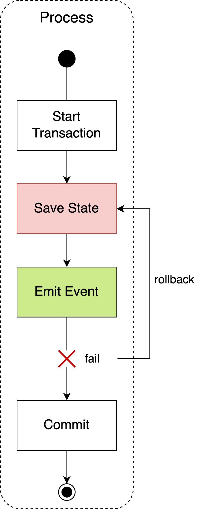

---

## Trang 56: 6.2.3. Potential Solutions

### 6.2.3. Potential Solutions
- Listen to Yourself pattern
  - Leading another problems
  - This is impractical

“Everything in software architecture is a trade-off"

– Neal Ford
- Event Sourcing pattern
  - Complex to implement, handle error
  - Not straightforward, depend on specific cases
- Change Data Capture (CDC) pattern
  - Simple
  - Not full control on the write logic
- Transactional Outbox pattern
  - Straightforward
  - Effective

---

## Trang 57: 6.3. Transactional Outbox Pattern

### 6.3. Transactional Outbox Pattern

---

## Trang 58: 6.3.1. Transactional Outbox Pattern

### 6.3.1. Transactional Outbox Pattern
- Update the state balance and the outbox table in a transaction.
- CDC Connector listens to the changes of the outbox table
- CDC Connector emits corresponding events.

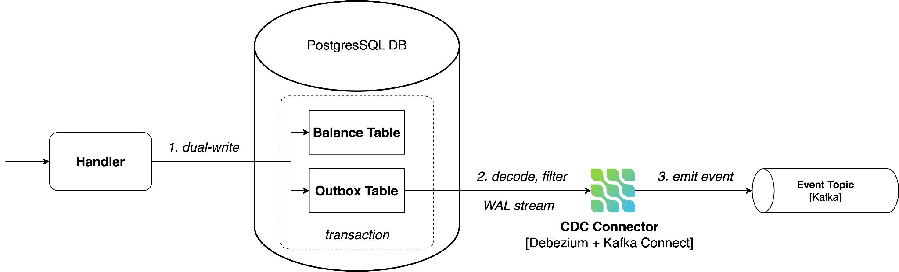

---

## Trang 59: 6.3.2. Implementation Note

### 6.3.2. Implementation Note
- The outbox has a simple structure
- Save encoded messages to the outbox table

→ CDC connector can emit messages directly.

Outbox Table

id TEXT

topic VARCHAR

header BYTEA

key BYTEA

value BYTEA

created_at TIMESTAMP
- Leverage tools for the connector (Debezium), deployment (Kafka Connect), and management (Strimzi)
- Keep an eye on the ordering of messages.
- Reliability

---

## Trang 60: 6.3.3. Cons

### 6.3.3. Cons
- Latency
- The outbox table gets bigger over time → slow down the database
- At least once

---

## Trang 61: 6.3.4. Recap

### 6.3.4. Recap
- No transactions spanning both a database and a message broker.
- United Dual-Write to Kafka → Kafka transaction
- Separate Dual-Write → Transactional Outbox Pattern, …

---

## Trang 62: 7. Exactly-Once

### 7. Exactly-Once
“One good thing about music, when it hits you, you feel no pain.”

– Bob Marley

---

## Trang 63: 7.1.1. Event-Driven Architecture (EDA)

### 7.1.1. Event-Driven Architecture (EDA)
- Causes:
  - Network Unreliability
  - Consumer Failures
  - Retry
  - …
- To achieve exactly-once semantic, we need to combine many mechanisms across the whole pipeline

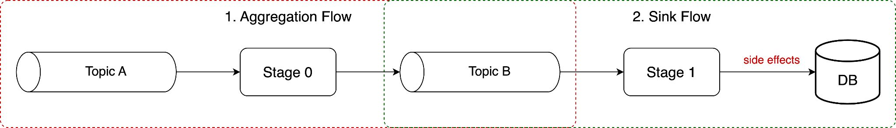

---

## Trang 64: 7.1.2. Aggregation Flow

### 7.1.2. Aggregation Flow
- Solution: Kafka Transaction

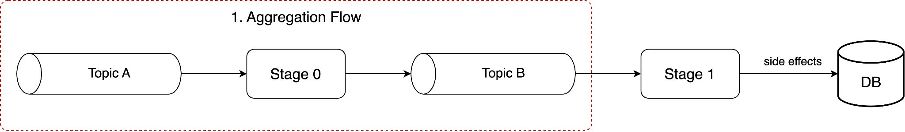

---

## Trang 65: 7.1.3. Sink Flow

### 7.1.3. Sink Flow
- Has side effect (writing to DB)
- The common case
- Let’s find solutions for this case.

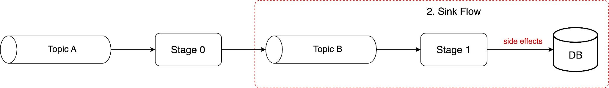

---

## Trang 66: 7.2. Solution

### 7.2. Solution

---

## Trang 67: 7.2.1. Theory

### 7.2.1. Theory
- Mathematically, Exactly-Once = At-Least-Once + At-Most-Once
- At-Least-Once: Kafka can guarantee at-least-once delivery
- At-Most-Once:
  - Message brokers and Kafka don’t provide an idempotence mechanism or deduplication mechanism at the application level.
  - Consumers having side effects must be idempotence.

---

## Trang 68: 7.2.2. At Least Once

### 7.2.2. At Least Once
- In other words, avoiding to lose messages on 2 sides
  - Producer Side
  - Consumer Side

---

## Trang 69: 7.2.3. Producer Side

### 7.2.3. Producer Side
- Risks of losing messages:
  - Failed to send messages due to network issues
  - The broker goes down before replicating messages
- Solution:
  - retries (recommended: 30)
  - acks = all
  - Consider enabling idempotence
    - Deduplicate on the broker side
    - Keep the order of messages on producer side

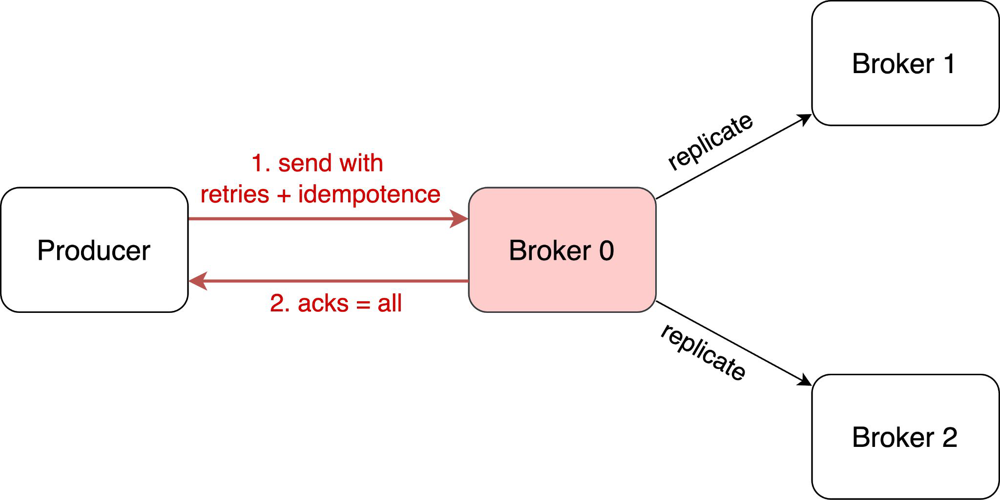

---

## Trang 70: 7.2.4. Consumer Side

### 7.2.4. Consumer Side
- Risks of losing messages:
  - A consumer commits a message before processing
  - Each restart uses a new consume group
- Solution:
  - Committing message after processing. Recommend: enable auto-commit
  - Using a specific consumer group.

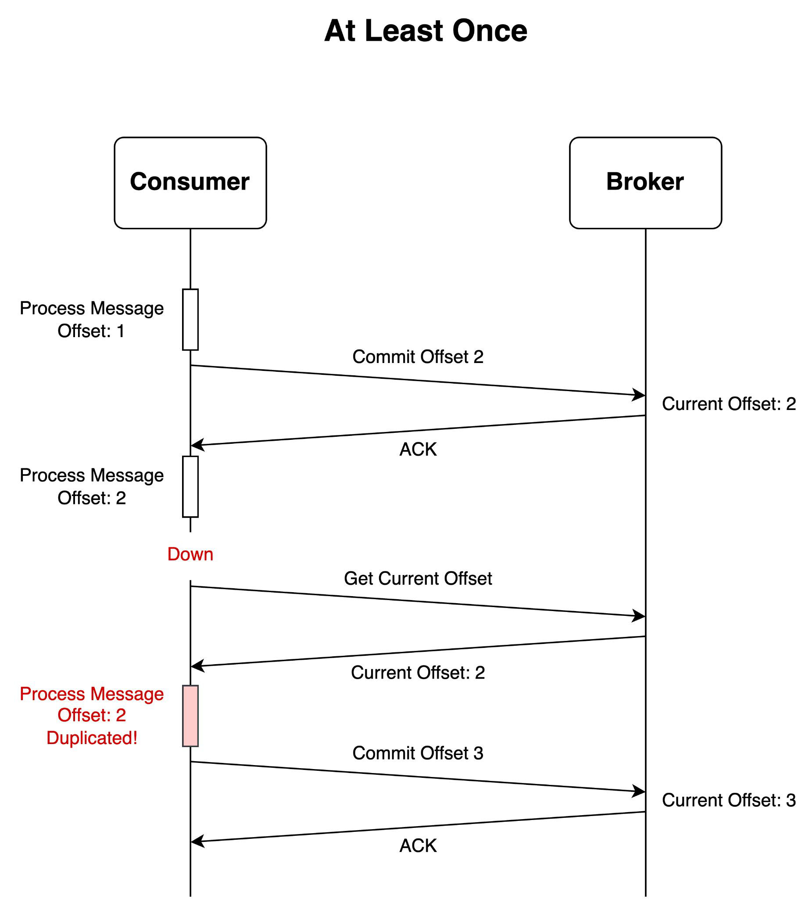

---

## Trang 71: 7.2.5. Idempotent Consumer

### 7.2.5. Idempotent Consumer
- Two types:
  - Overwrite without impact
  - Deduplicate
    - Each message has an ID. Recommended: UUID
    - Deduplicate messages by using a unique constraint on the request_id column

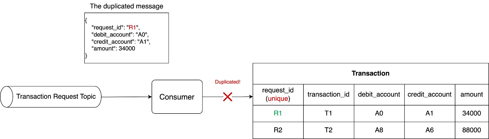

---

## Trang 72: 6.3.4. Recap

### 6.3.4. Recap
To achieve exactly-once semantics in the Sink Flow
- Avoid to lose messages
  - Producer:
    - retries (recommend: 30)
    - acks=all
  - Consumer:
    - enable.auto.commit=true
- Idempotent Consumer:
  - Each message has ID.
  - Deduplicate messages by using a unique constraint on the request_id column.

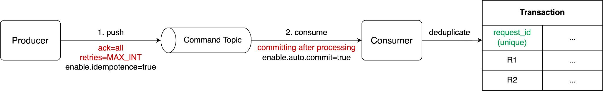

---

## Trang 73: Order of Messages

### Order of Messages
“There are only two hard problems in distributed systems:

2. Exactly-once delivery

1. Guaranteed order of messages

2. Exactly-once delivery” – Mathias Verraes

---

## Trang 74: 1. Problem

### 1. Problem
- The importance of message ordering:
  - Gaming: the sequence of actions move up, jump, turn left, … affects the game state
  - Order Processing: the sequence of actions order placed, payment, shipped, delivered is the order lifecycle
- Order by field(s) or a comparable logic
  - For example: created_at (timestamp), sequence number, version, id, …
- Problems with physical clock: Ordering Distributed Events. by Vaidehi Joshi
- Don't use the physical clock to order in a distributed system.
- The following solutions only leverage the Kafka features or are related to Kafka.

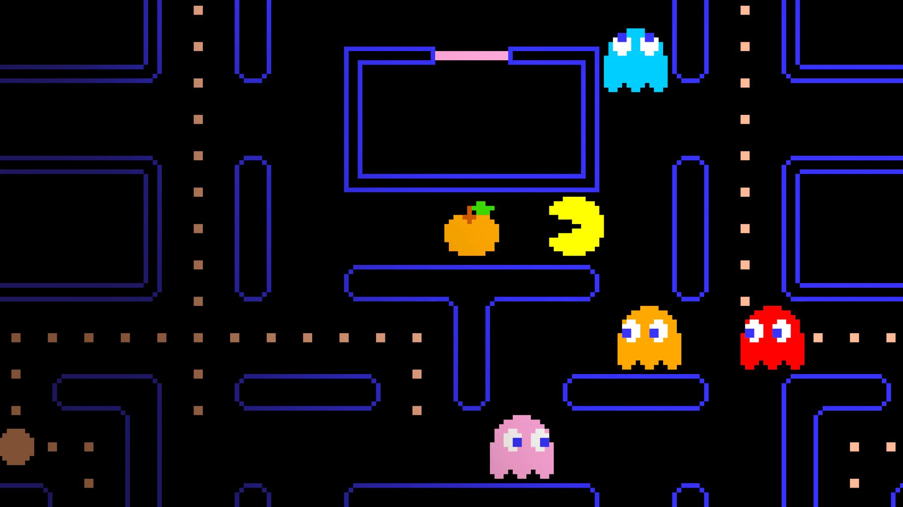

---

## Trang 75: 2.1. Total Order

### 2.1. Total Order
- In a set of events that are totally ordered, we know the exact total order of every event.
- Kafka guarantees message ordering only within a single partition.
- A consumer will read messages in the same order to the partition.

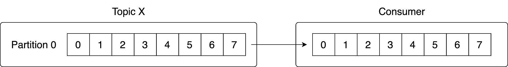

---

## Trang 76: 2.2. Partial Order

### 2.2. Partial Order
- In partial order, we can not be sure of the exact order of all the events.
- In a distributed system without a global clock, events can only be partially ordered.
- Usually, we just need a partial order.
- For example, Pac-Man is a single-player video game.
  - Actions of a player are not related to other players

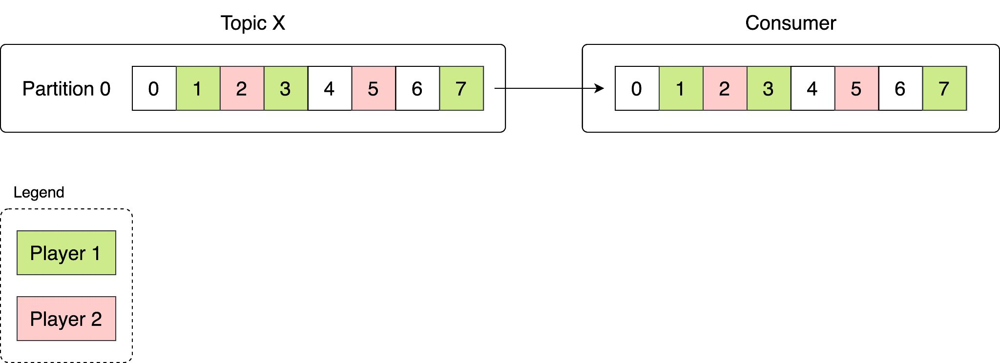

---

## Trang 77: 2.2. Partial Order

### 2.2. Partial Order
- A topic X has multiple partitions
- Each partition is partial order for a the topic.

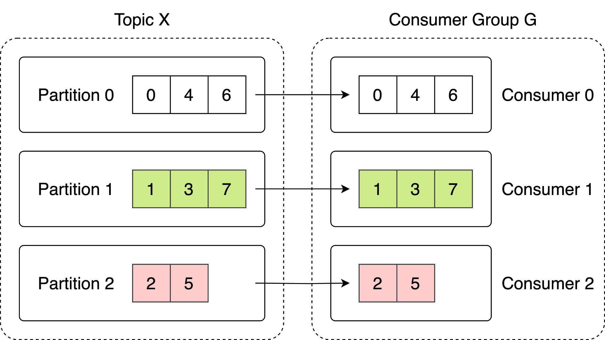

---

## Trang 78: 1. How to group related messages in a partition?

### 1. How to group related messages in a partition?
### 2. How to guarantee end-to-end message ordering?

---

## Trang 79: 3. Message Ordering in Producer

### 3. Message Ordering in Producer
- Messages with the same key will be written to the same partition. Note: the number of partitions might be changed.
- If it requires to maintain the message ordering in producer, then enable idempotence.

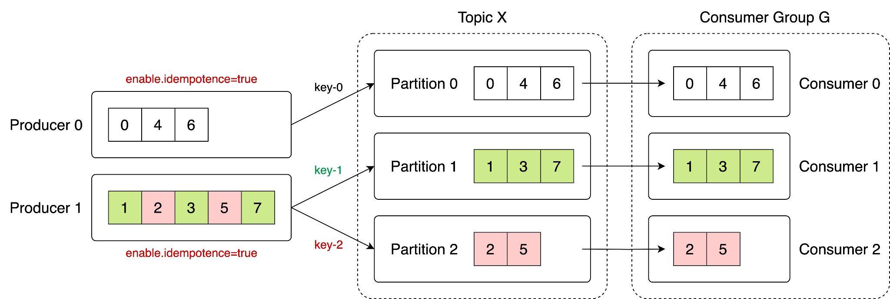

---

## Trang 80: 4. End-to-End Message Ordering

### 4. End-to-End Message Ordering
- To ensure end-to-end message ordering:
  - enable.idempotence=true
  - A partition guarantees message ordering. Use key to group related messages in a partition.

---

## Trang 81: 5. Message Ordering across Processes?

### 5. Message Ordering across Processes?
- Misunderstanding of solution Message Ordering across Processes
- Requirement: only one is processed at a time (across processes) to ensure data integrity.
- Solution:
  - Message ordering (Lamport Clock, Vector Clock, …)
  - Distributed Locking

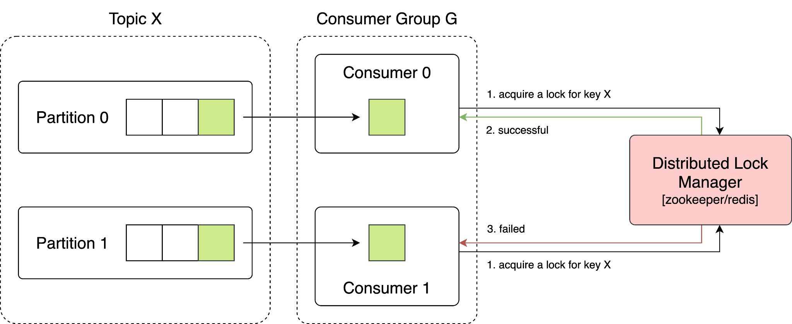

---

## Trang 82: 6. Notes for Distributed Locking

### 6. Notes for Distributed Locking
- Choosing the lock key
- Lock failure
- Deadlock
- Performance

---

## Trang 83: Recap

### Recap
- To ensure end-to-end message ordering, use key, enable.idempotence=true.
- Usually, we just need partial order.
- Leverage distributed locking.

---
