# Producer

> **Tổng số trang:** 34 slide | **Thư mục ảnh/sơ đồ:** `assets/Producer/`

---

## Trang 1: Producer

### Producer
“Stop thinking, and end your problems.”

- Lao Tzu

---

## Trang 2: Outline

### Outline
### 1. ACK
### 2. Retry
### 3. Batching
### 4. Compression
### 5. Sticky Partitioner
### 6. Max Requests In Flight
### 7. Idempotent

---

## Trang 3: 1. ACK

### 1. ACK

---

## Trang 4: 1. ACK

### 1. ACK
- Acknowledgment (ACK) is a signal sent from receiver indicating that a message has been received, and optionally, processed successfully.
- ACKS is the number of acknowledgments the producer requires the leader to have received before completing a request.

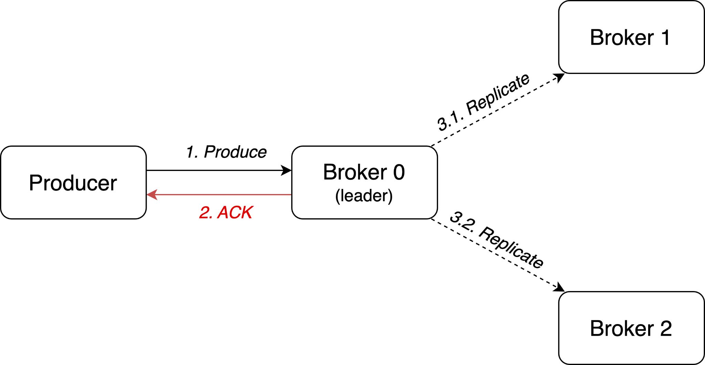

---

## Trang 5: 1.1. ACKS = none (0)

### 1.1. ACKS = none (0)
- Producers require no ACK from the leader
- Fire and forget
- Pros:
  - Most performant
- Cons:
  - Durability: weakest
  - Messages might be lost
  - No offset in the record metadata
- Use cases:
  - Some metrics from IoT devices: temperature sensor
  - Non-essential logs, …
- Records will still be replicated asynchronously

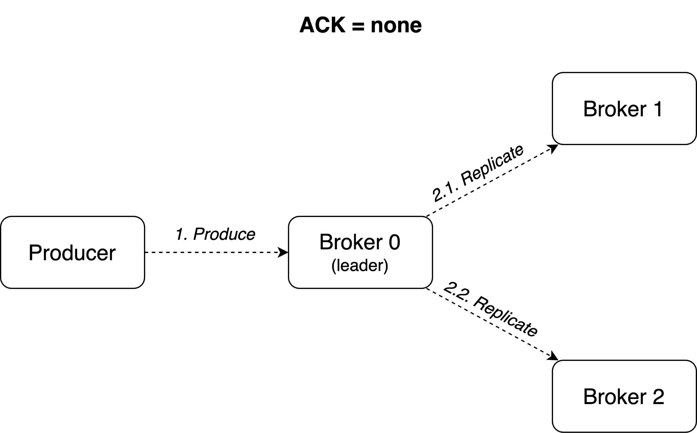

---

## Trang 6: 1.2. ACKS = one (1)

### 1.2. ACKS = one (1)
- Producers require ACK from the leader only
- Pros:
  - High performance
  - Offset in the record metadata
- Cons:
  - Durability: weak
  - Messages might be lost still
- Use cases:
  - User activity tracking
  - Tracking clicks, views, …
- Records will still be replicated asynchronously

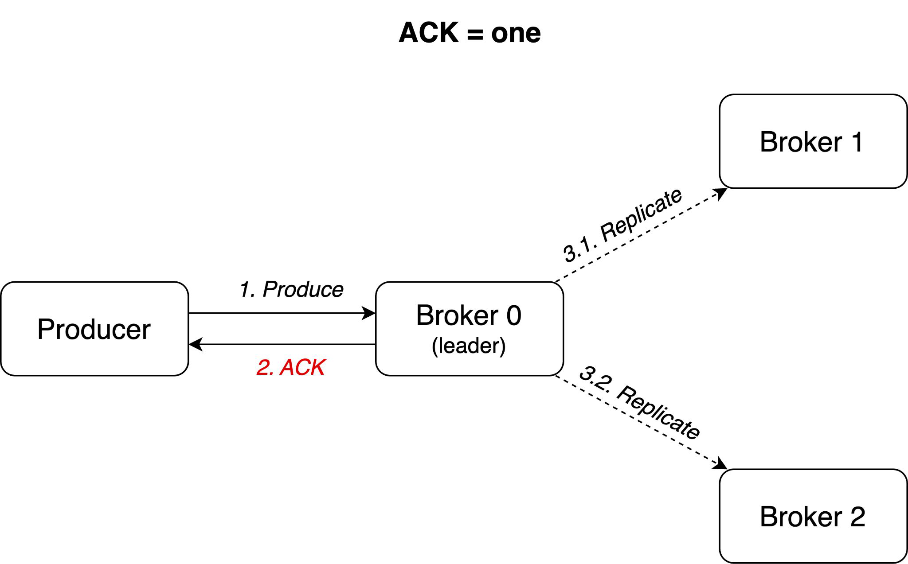

---

## Trang 7: 1.3. ACKS = all (-1)

### 1.3. ACKS = all (-1)
- Producers will wait until the leader has gathered ACKs from all In-Sync Replicas (ISRs).
- Replication here is synchronous.
- Pros:
  - Durability: Strong
- Cons:
  - High latency
- Use cases:
  - Financial activity
  - Order, payment, …

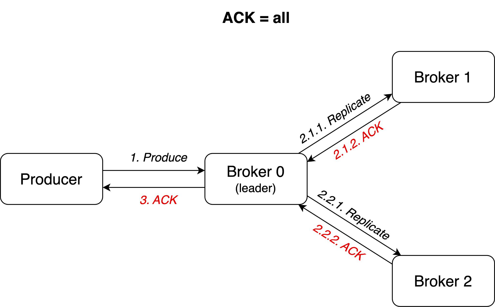

---

## Trang 8: When getting an unknown error,

### When getting an unknown error,
### What should we do first?

---

## Trang 9: 2. Retry

### 2. Retry

---

## Trang 10: 2. Retry

### 2. Retry
- Producers get an unknown error while sending messages, producers should retry first.
- Types of errors:
  - Retriable error: LEADER_NOT_AVAILABLE, network connectivity issues, …
  - Non-Retriable error: INVALID_CONFIG, too large message, …
- 2 types of handling errors:
  - Auto: automatically retry N times then give up
  - Manual

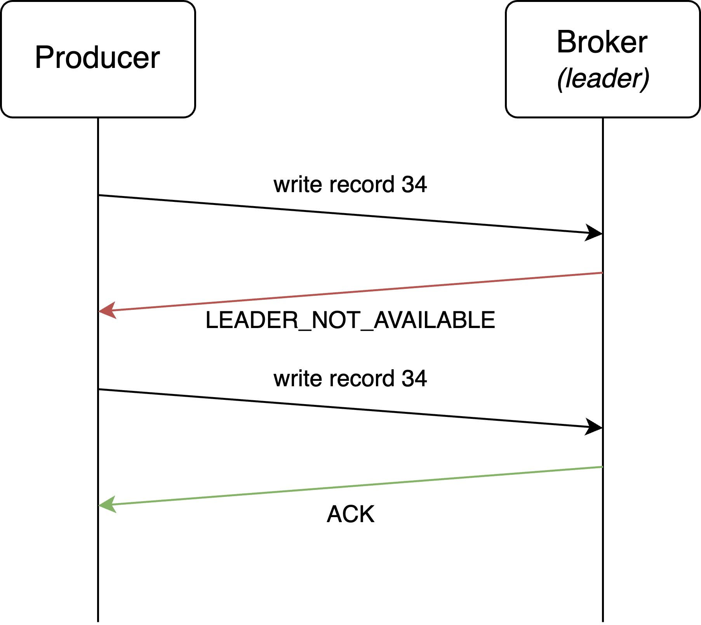

---

## Trang 11: 2. Retry

### 2. Retry
- The default value of tries:
  - Kafka &lt;= 2.0: 0
  - Kafka >= 2.1: 2147483647
- Retry.backoff.ms: 100ms
- Producers retry in 2 mins (delivery.timeout.ms=120000)
- Recommended: retries = 30
- Issues:
  - Duplicate messages
  - Ordering in producer side

---

## Trang 12: What is the bottleneck of Kafka?

### What is the bottleneck of Kafka?
### Disk?
### Answer: Network

---

## Trang 13: 3. Batching

### 3. Batching

---

## Trang 14: 3.1. Batching

### 3.1. Batching
- Batching multiple records together before sending.
- The batching mechanism improves network bandwidth efficiency and throughput.
- How batching mechanism works?
- Batching is implemented by the producer
- A write request contains a batch
- A batch is written to a partition.
- Batching is controlled by 2 configurations:
  - linger.ms: A producer will wait for up to the given delay to batch.
  - batch.size: The maximum size of a batch.

---

## Trang 15: 3.2. linger.ms

### 3.2. linger.ms
- A producer will wait for up to the given delay to batch before sending.
- This adds more latency.
- The default value = 0. This means producers send records as soon as possible.
- If linger.ms = 0, batching still works.
- If linger.ms > 0, it increases the chance of batching.

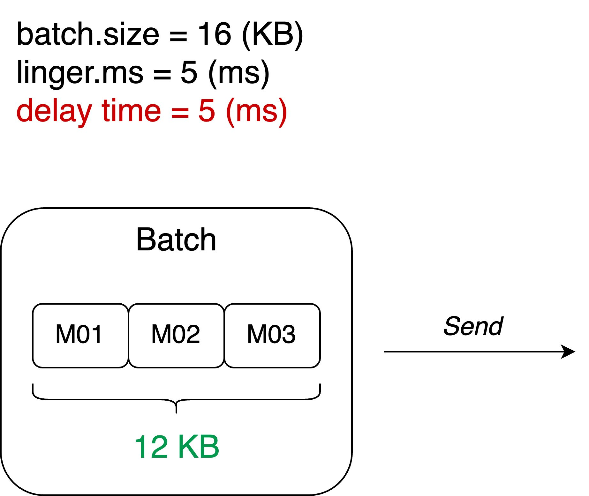

---

## Trang 16: 3.3. batch.size

### 3.3. batch.size
- The maximum size of a batch.
- The default value = 16 KB.
- A very large batch size may use more memory wastefully.
- If a message is bigger than the batch size, then the message will not be batched.

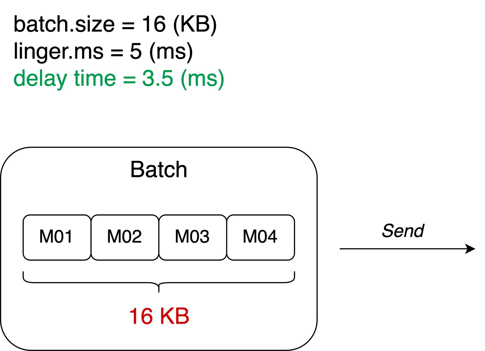

---

## Trang 17: 3.4. Batching

### 3.4. Batching
- Trade-off: throughput vs latency.
- Brokers persist a batch without unpacking the batch.

→ improve disk I/O efficiency
- Some specific cases, brokers might modify the batch.

---

## Trang 18: Batches can be big. How to handle with something big?

### Batches can be big. How to handle with something big?
- Compress
- Split

---

## Trang 19: 4. Compression

### 4. Compression

---

## Trang 20: 4.1. Compression

### 4.1. Compression
- Compression has a positive impact on performance
  - Improve network bandwidth
  - Save storage space
  - Better latency
- Batching makes the compression ratio higher
  - For JSON, the compression ratio is from 5x to 7x.
- Cons: CPU utilisation of the producer and consumer
- Note: Compression != Encryption

---

## Trang 21: 4.2. Compression Type

### 4.2. Compression Type
- Types:
  - None: (default) Compression is disabled.
  - gzip: Use the GNU Gzip algorithm — released in 1992, used by early UNIX systems.
  - snappy: Use Google’s Snappy compression format — optimised for throughput at the expense of compression ratios.
  - lz4: Use the LZ4 algorithm — also optimised for throughput, most notably for the speed of decompression.
  - zstd: Use Facebook’s ZStandard — a newer algorithm introduced in Kafka 2.1.0, intended to achieve an effective balance between throughput and compression ratios
- Recommend value:
  - lz4: normal cases
  - zstd: very high throughput

---

## Trang 22: 4.2. Compression Type

### 4.2. Compression Type
Compression

Type

Compression

Ratio

CPU Usage Compression

Speed

Network Bandwidth

gzip Highest Highest Slowest Slowest

snappy Medium Medium Medium Medium

lz4 Slowest Slowest Fastest Highest

zstd Medium Medium Medium Medium

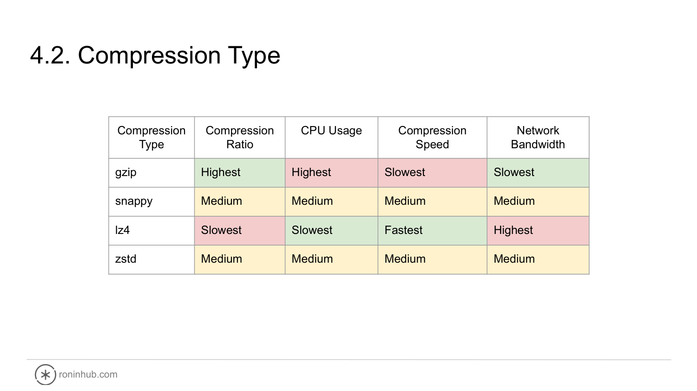

---

## Trang 23: 4.3. End-to-End Concern

### 4.3. End-to-End Concern
- Compression is implemented by producers and decompression is implemented by consumers.
- By default, brokers do not interfere with the batch when storing the batch. No need to change the compression configuration in brokers, or consumers.
- A compression format on the producer side must be compatible with the consumer version.

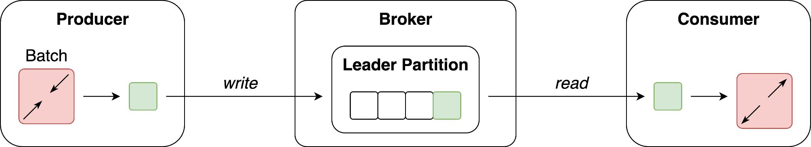

---

## Trang 24: 5. Sticky Partitioner

### 5. Sticky Partitioner

---

## Trang 25: 5.1. Old Default Partitioner (version &lt; 2.4.0)

### 5.1. Old Default Partitioner (version &lt; 2.4.0)

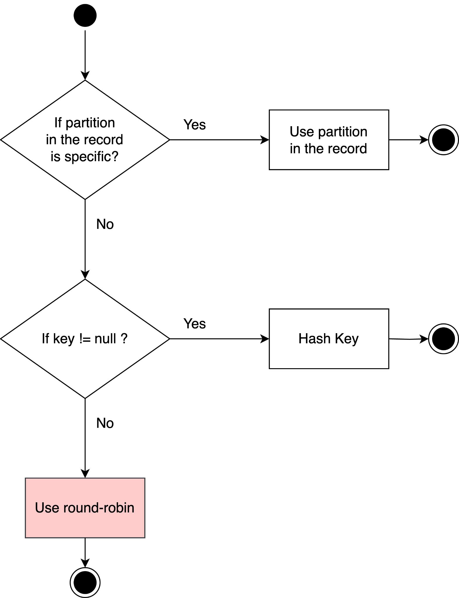

---

## Trang 26: 5.1. Old Default Partitioner

### 5.1. Old Default Partitioner
- In &lt; Kafka 2.4.0, if the partition and key in records are not specific, then the records will be sent using a round-robin strategy.
- Producers don’t immediately send records, instead placing them into partition-specific batches to be sent later.
- Drawbacks:
  - More small batches will be sent

→ more requests, more load on brokers
  - May add latency

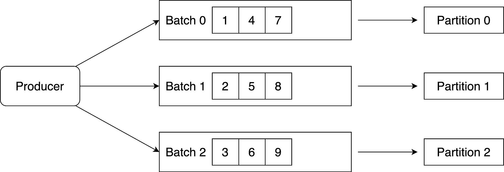

---

## Trang 27: 5.2. Sticky Partitioner

### 5.2. Sticky Partitioner
- Kafka 2.4.0 added the sticky partitioner.
- Picking a single partition to send all non-keyed records.
- Once the batch is filled, randomly chooses and “sticks” to a new partition.
- The sticky partitioner still results in an even distribution of records.
- It is like a “per-batch” round robin or “eventually even” approach.

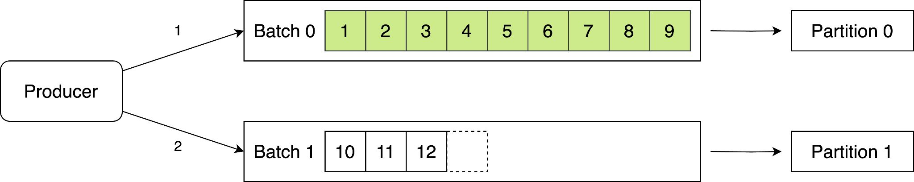

---

## Trang 28: 5.3. New Default Partitioner

### 5.3. New Default Partitioner

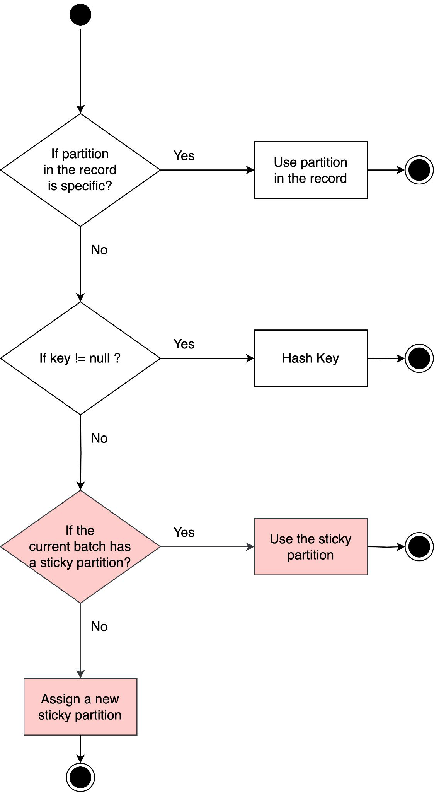

---

## Trang 29: 6. Max In-Flight Requests

### 6. Max In-Flight Requests

---

## Trang 30: 6. Max In-Flight Requests

### 6. Max In-Flight Requests
- max.in.flight.requests.per.connection: an upper bound on the number of unacknowledged requests on a single connection before the producer waits for the acks.
- The default value = 5 (Kafka >= 1.0)
- Purpose: improve the throughput of producer,

not improve network bandwidth.

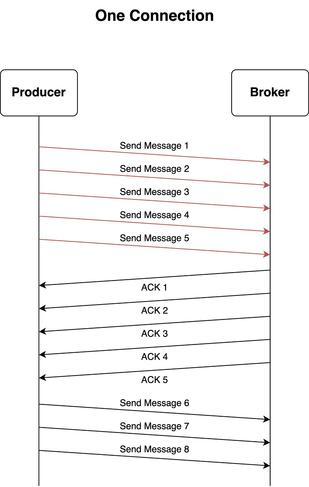

---

## Trang 31: 7.0. Problems

### 7.0. Problems
- When working with collections,

What should problems be considered first?
  - Record duplication
  - Out of order

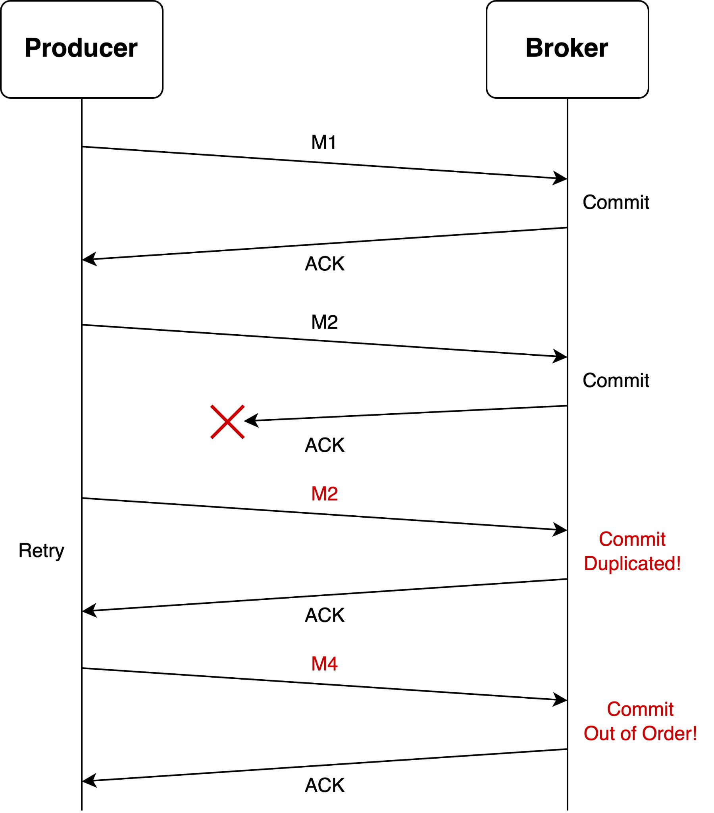

---

## Trang 32: 7. Idempotent

### 7. Idempotent

---

## Trang 33: 7.1. Idempotent

### 7.1. Idempotent
- Idempotence: the operation can be applied multiple times without changing the result.
- How a idempotent producer works?
  - A unique producer ID (PID) is assigned by a broker.
  - A monotonically increasing sequence number to each record.

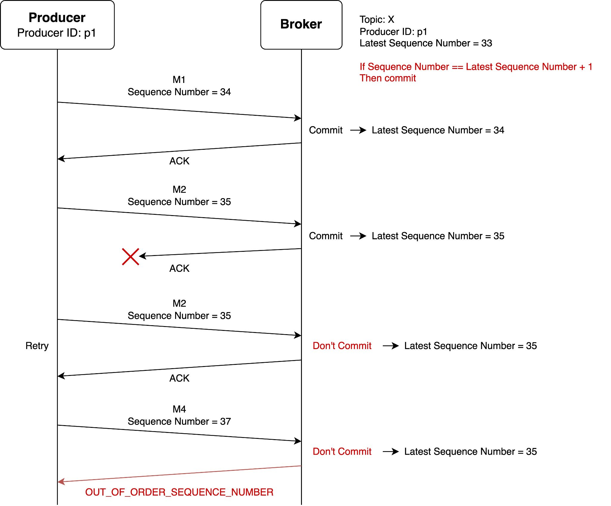

---

## Trang 34: 7.2. Implementation

### 7.2. Implementation
- enable.idempotent = true (recommended)
  - False: default before Kafka 3.0
  - True: default since Kafka 3.0
- Come with:
  - acks=all
  - retries=INT_MAX
  - max.in.flight.requests=5
- Note: Idempotent producers only resolve ordering issues on producer side.

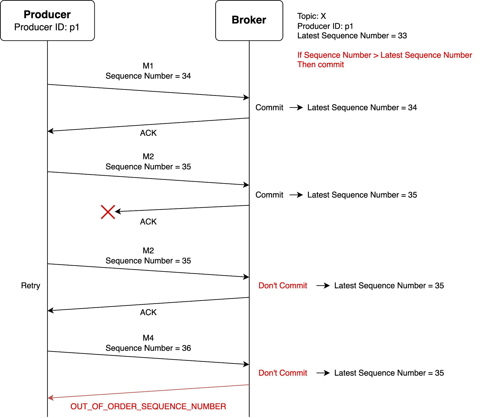

---
