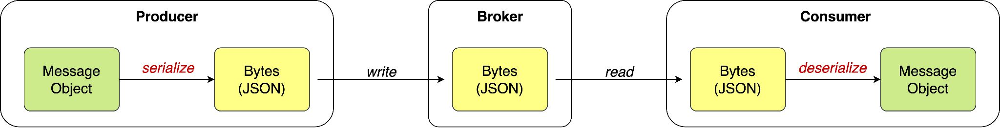
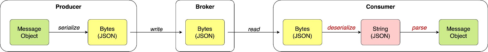
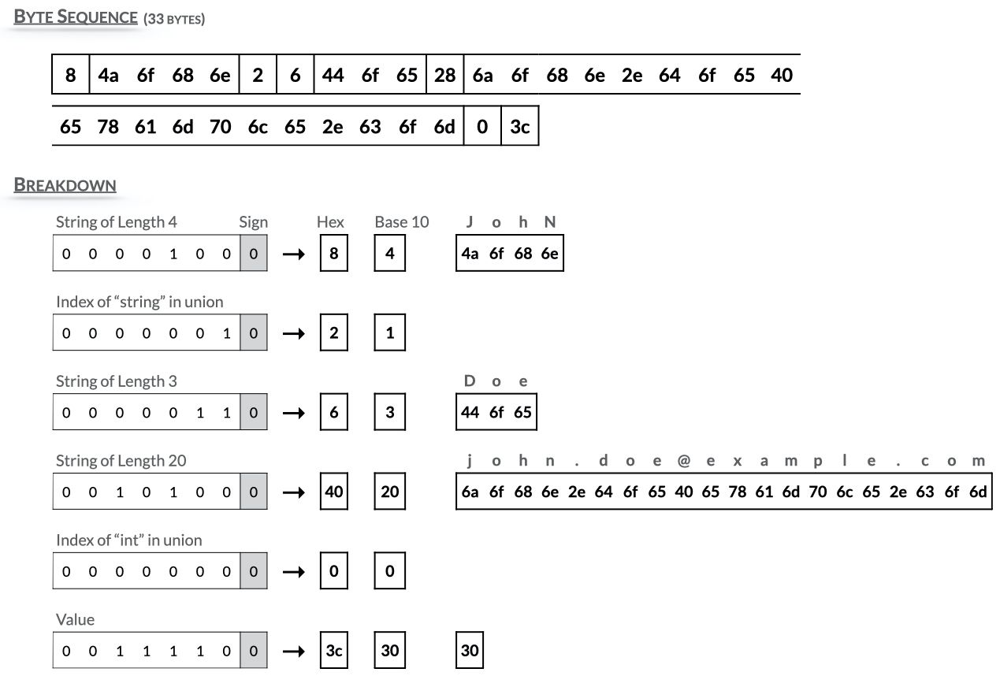
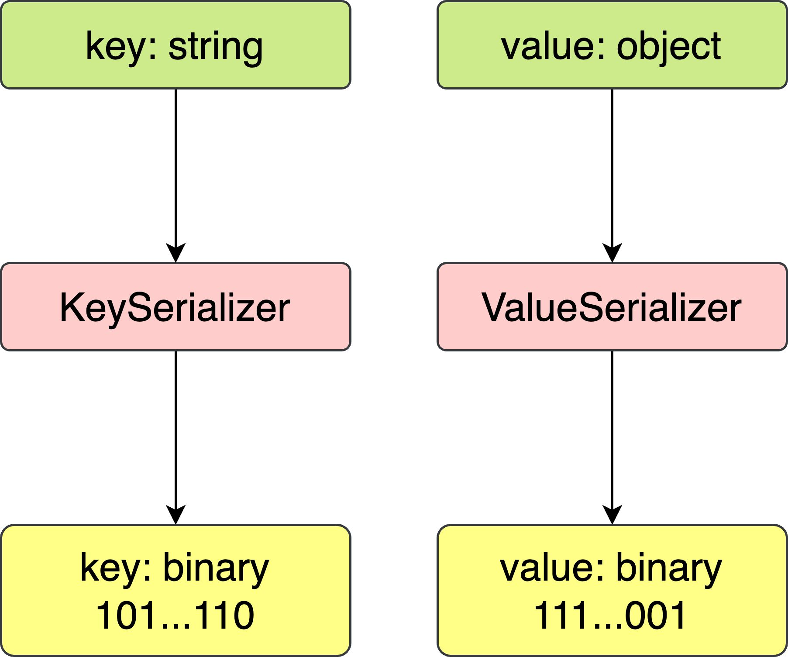

# Serialization

> **Tổng số trang:** 7 slide | **Thư mục ảnh/sơ đồ:** `assets/Serialization/`

---

## Trang 1: Serialization

### Serialization
“Appear weak when you are strong,

and strong when you are weak.”

– Sun Tzu

---

## Trang 2: 1. Introduction

### 1. Introduction
- Serialization is the process of converting objects or data structures into bytes.
- Why Serialization?
  - Preserve the state of an object so that it can be recreated (deserialized) later.
  - Efficiency for storage and transmission.
- Deserialization is the reverse process, converting bytes into objects.

---

## Trang 3: 2.1. Serialization, Parsing, and Marshaling

### 2.1. Serialization, Parsing, and Marshaling
Serialization Parsing Marshaling

Context Converting objects into a storable or transmittable format. A broader concept.

Analyzing and converting textual data into a structured format.

A form of serialization often used in RPC

Direction Bidirectional Unidirectional (in theory) Bidirectional

Purpose Preserving the state of an object for storage or transmission.

Used for understanding and processing textual data formats

Prepare objects for RPC.

Use cases ● Caching objects in memory
- Sending data over HTTP or other communication protocols
- Parsing JSON string to an object
- Parsing HTML to a DOM
- Reading configuration files
- Make the remote method call (RPC)

---

## Trang 4: 2.2. Serialization vs Parsing

### 2.2. Serialization vs Parsing
- Mistake: deserializing from bytes to string then parsing from string to an object.
- Best practice: deserializing from bytes to an object directly.

---

## Trang 5: 3.1. Formats

### 3.1. Formats
- Text-based formats:
  - String
  - XML
  - JSON
- Binary-based formats:
  - Avro
  - Thrift
  - Protobuf
- Others:
  - Int, Float
  - …

Avro Binary Format

---

## Trang 6: 3.2. Format Selection

### 3.2. Format Selection
- Factors for selection:
  - Complexity
  - Compatibility
  - Size
  - Speed
  - …
- Why JSON?
  - Simple
  - Compatibility
  - Suite to beginner

---

## Trang 7: 4. Configuration

### 4. Configuration
- Serialization is applied to the key and value in records.
- No default values for the serializer, deserializer.
- Deserializer must be compatible for serializer.
- 2 ways to configure serializer/deserializer:
  - Property-based
    - Pros: Simple
    - Cons: Not type-safety; Complex to customize
  - Instantiating serializers
    - Pros:
- Customizable for serializers/deserializers
- Generic type-safety
    - Cons: Manual

---
