# Why Kafka.

> **Tổng số trang:** 26 slide | **Thư mục ảnh/sơ đồ:** `assets/Why_Kafka/`

---

## Trang 1: Why Kafka?

### Why Kafka?
“Care about what other people think and you will always be their prisoner”

- Lao Tzu

---

## Trang 2: Outline

### Outline
### 1. How to Choose a Message Broker?
### 2. Why is Kafka performant?
### 3. Why is Kafka reliable?

---

## Trang 3: 1. How to Choose a Message Broker?

### 1. How to Choose a Message Broker?

---

## Trang 4: When choosing a message broker, What characteristics should be evaluated?

### When choosing a message broker, What characteristics should be evaluated?
### And in which order?

---

## Trang 5: 1.0. How to Choose a Message Broker?

### 1.0. How to Choose a Message Broker?
- Common Pitfall: Performance First
- Advision: Consider the delivery guarantee and functionality first
- Evaluating message broker on characteristics:
  - Delivery Guarantee
  - Functionality
  - Performance
  - Scalability
  - Ecosystem

---

## Trang 6: 1.1. Database-Backed Queue

### 1.1. Database-Backed Queue
- Pros:
  - Leveraging existing infrastructure
  - Consistency (exactly-once)
- Cons
  - Low performance (bottleneck: database)
  - Complex to handle errors
  - Poor features
- Case Study: Starbucks uses a database table as a queue

order_no status updated_at

34 DONE 12:11:00

35 IN_PROCESSING 12:11:02

36 IN_PROCESSING 12:11:03

37 NEW 12:11:08

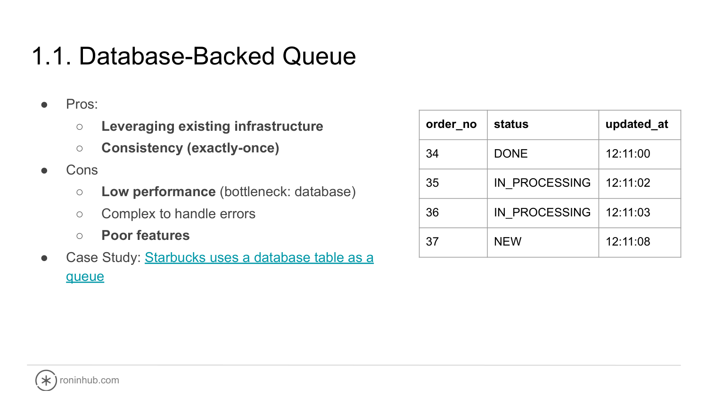

---

## Trang 7: 1.2. Redis

### 1.2. Redis
- Pros
  - Leveraging existing infrastructure
  - Low Latency
  - Simplicity
- Cons
  - Durability concerns
  - Resource intensiveness
  - Operational overhead
  - Poor features for a message broker
- Redis works as message brokers with 3 features:
  - List (at-most-once)
  - Pub/Sub (at-most-once)
  - Stream (at-least-once)

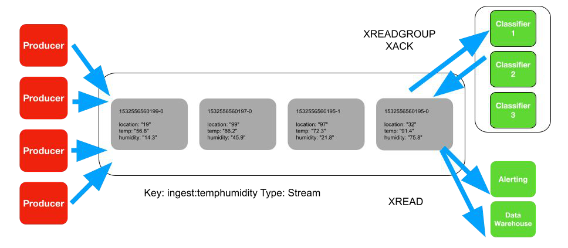

---

## Trang 8: 1.3. RabbitMQ

### 1.3. RabbitMQ
- Pros:
  - Flexible Routing
  - RabbitMQ supports at-least-once
  - Cool features (Delay, Priority Queue, RPC, …)
  - Low Latency
  - Wide Support
- Cons
  - Deleting messages on ACK
  - Medium performance
  - Resource intensiveness
  - Ecosystem

Credit: bytebytego

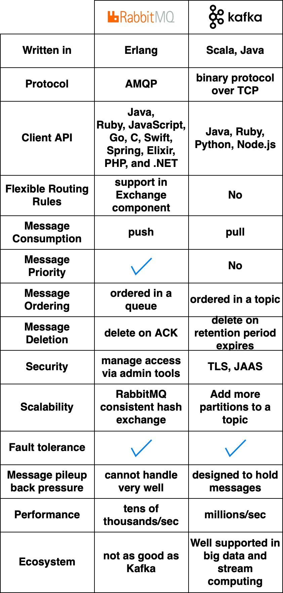

---

## Trang 9: 1.4. NATs

### 1.4. NATs
- Pros:
  - Higher performance than Kafka
  - Flexible Routing
  - Less operational overhead
- Cons:
  - Random load balancing → ordering issue
  - At-most-once delivery
- Read more

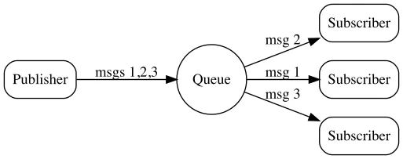

---

## Trang 10: 1.5. Pulsar

### 1.5. Pulsar
- Pulsar is quite similar to Kafka
- Pros:
  - High Performance (&lt; Kafka)
  - Scalability (&lt; Kafka)
  - Cool features
    - Queuing
    - Multi-tenancy
- Cons:
  - Operational Overhead
  - Ecosystem
- Read more

---

## Trang 11: 1.6. How to Choose a Message Broker?

### 1.6. How to Choose a Message Broker?
- Evaluating a message broker on characteristics:
  - Delivery Guarantee
  - Functionality
  - Performance
  - Scalability
  - Ecosystem
- Kafka is popular but not a silver bullet.
- Don’t trust opinionated benchmarks from others!

---

## Trang 12: Performance Reliability Performance

Performance

Reliability

Performance

Scalability

Throughput

Latency

Durability

Availability

…

…

Apache Kafka

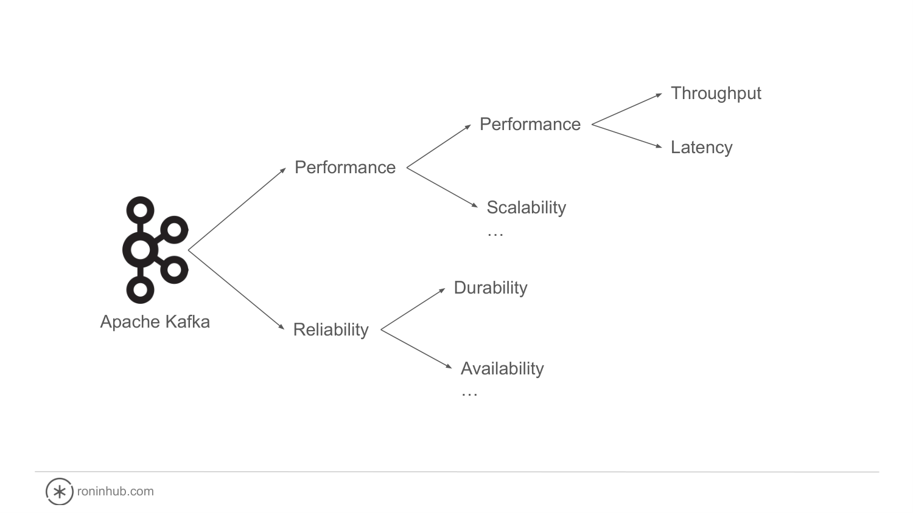

---

## Trang 13: 2. Why is Kafka performant?

### 2. Why is Kafka performant?

---

## Trang 14: 2.0. Why is Kafka performant?

### 2.0. Why is Kafka performant?
- A lot of design decisions:
  - Broker Side
  - Client Side
  - Stream Parallelism
- Correct misunderstanding: Actually Apache Kafka is not fast, is optimized for throughput at the expense of latency, while preserving other desirable qualities, such as durability, strict record order, and at-least-once delivery semantics.

---

## Trang 15: 2.1. Broker Side

### 2.1. Broker Side

---

## Trang 16: Are disk accesses slow or fast?

### Are disk accesses slow or fast?

---

## Trang 17: 2.1.1. Sequential I/O

### 2.1.1. Sequential I/O
- A wide misconception: disks are slow
- Sequential access is much faster than random access (x3 - 4), which jumps to many different locations on disk.
- Understanding I/O: Random vs Sequential | flashdba
- Kafka utilizes a segmented, append-only log
- Sequential I/O for both reads and writes

---

## Trang 18: 2.1.2. Zero-Copy

### 2.1.2. Zero-Copy
- Context switching and CPU copy are costly
- Zero-Copy mechanism reduces context switches and CPU copy significantly
- Zero-Copy is disable when
  - SSL connections to clients
  - Brokers execute compression

Credit: bytebytego

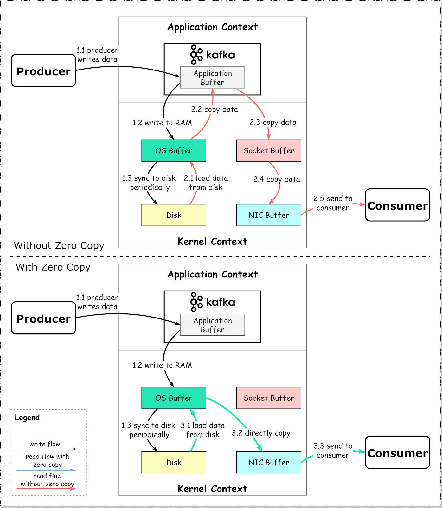

---

## Trang 19: 2.1.3. Unflushed Buffered Writes

### 2.1.3. Unflushed Buffered Writes
- Kafka doesn’t actually call fsync when writing to the disk before acknowledging the write
- Broker return ACK after record is written to the I/O buffer, not after fsync to the disk.
- This is unsafe → in-sync replicas to make Kafka durable

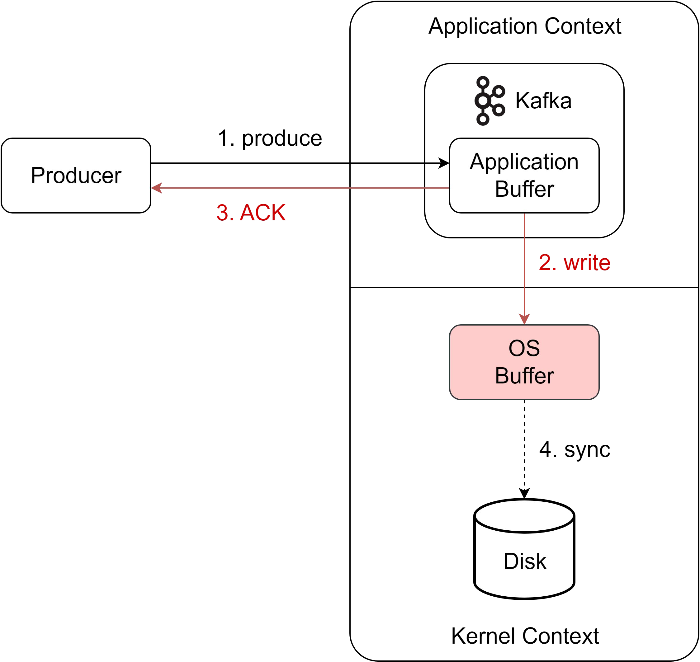

---

## Trang 20: 2.1.4. Cheap Consumer

### 2.1.4. Cheap Consumer
- Traditional MQ-style brokers which remove messages when consuming

→ the penalty of random I/O
- Kafka doesn’t remove messages after they are consumed
- It independently tracks offsets at each consumer group level (using a topic __consumer_offsets). This is fast

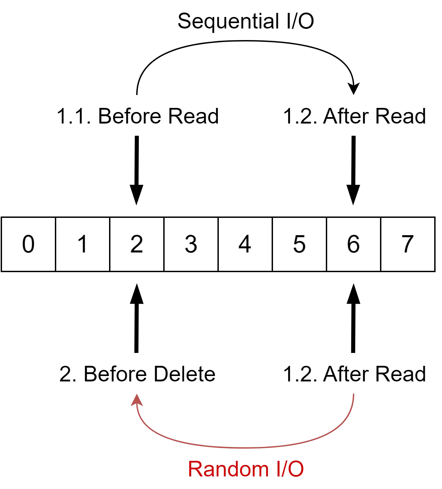

---

## Trang 21: 2.2. Client Side

### 2.2. Client Side

---

## Trang 22: 2.2.1. Batching

### 2.2.1. Batching
- Problem:
  - A wide misconception: the bottleneck with Kafka is the disk
  - Usually the bottleneck is network.
- Solution:
  - Batching of records improves network bandwidth and throughput

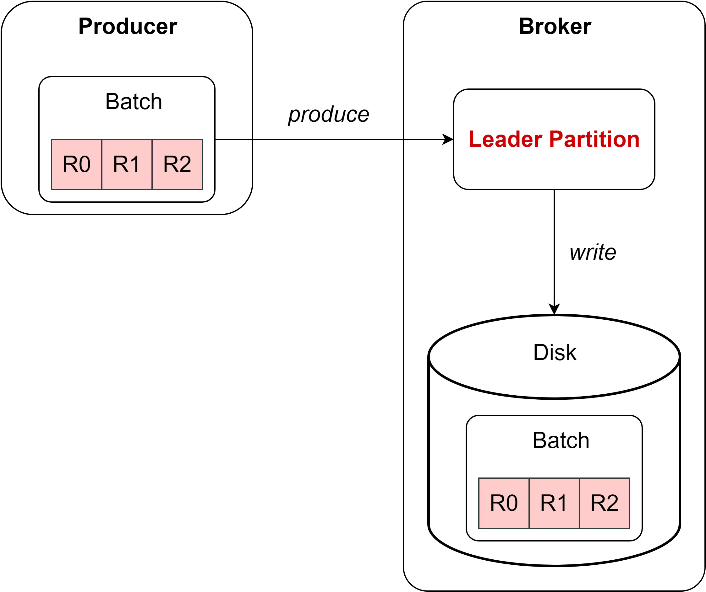

---

## Trang 23: 2.2.2. Compression

### 2.2.2. Compression
- Problem: Size of a batch can be big
- Solution: Batch Compression
  - Improve network bandwidth
  - Improve storage space, disk I/O utilization

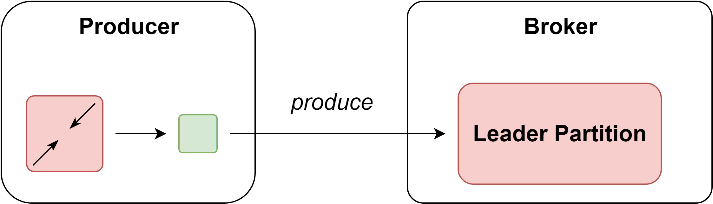

---

## Trang 24: 2.2.3. Client-Side Optimizations

### 2.2.3. Client-Side Optimizations
- Problem:
  - Generally, client is simpler than the server significantly
  - Server/Broker handles a bulk of the load
- Solution:
  - Client performs a significant amount of work
  - Example: batching records, compressing, hashing keys, checksumming, refreshing the metadata of cluster, …

---

## Trang 25: 2.3. Stream Parallelism

### 2.3. Stream Parallelism

---

## Trang 26: 2.3. Stream Parallelism

### 2.3. Stream Parallelism
- Partitioning mechanism allows for:
  - Parallelism (throughput)
  - The horizontal scalability
  - Availability, Durability
- Producers can publish to multiple partitions concurrently and partitions handle in parallel
- Consumers (in a group) subscribe the topic and process messages in parallel
- Load-balancing mechanism: distributing partition assignments approximately evenly among the individual consumer instances within the group.

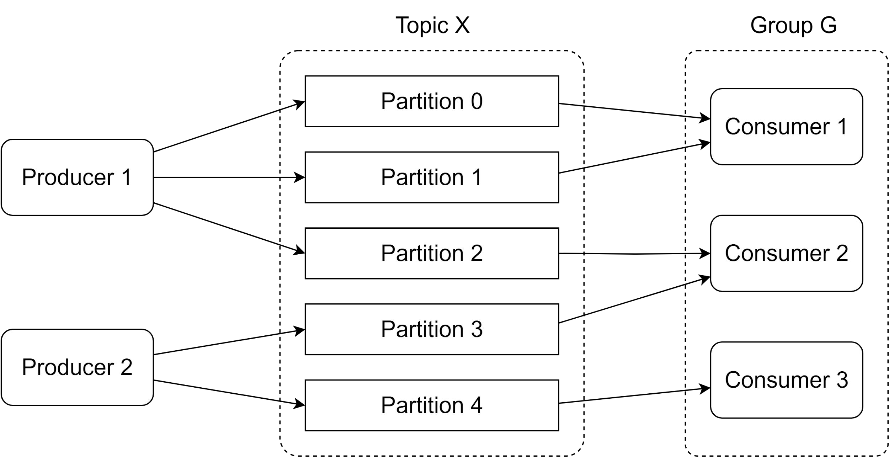

---
