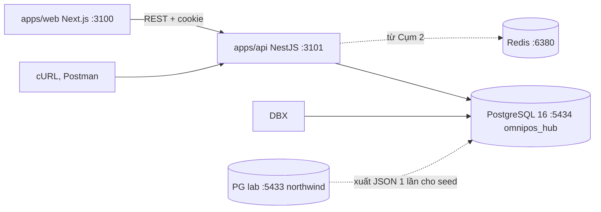
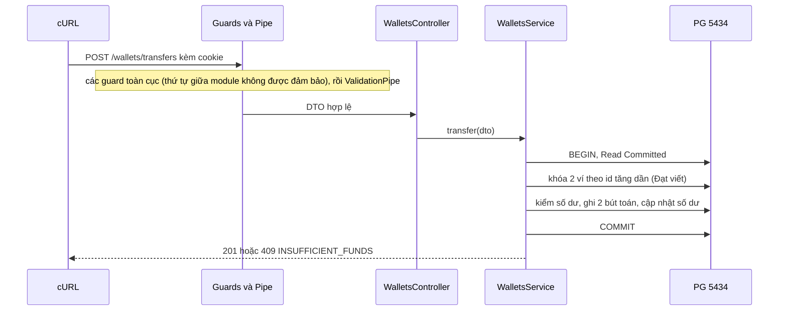
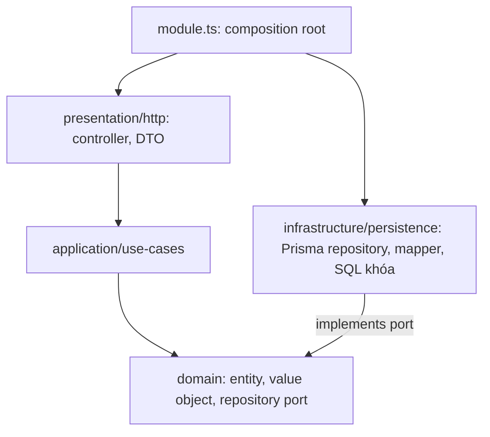
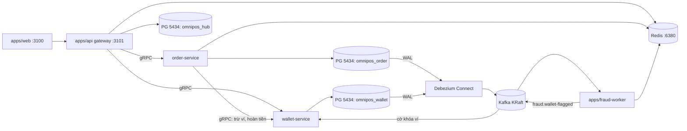
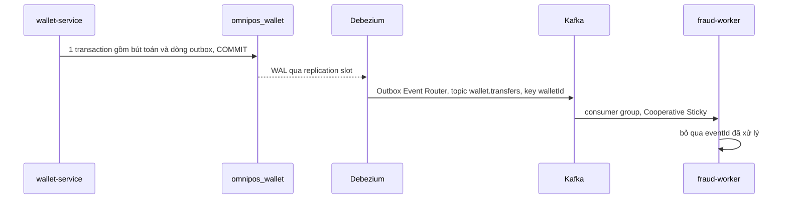
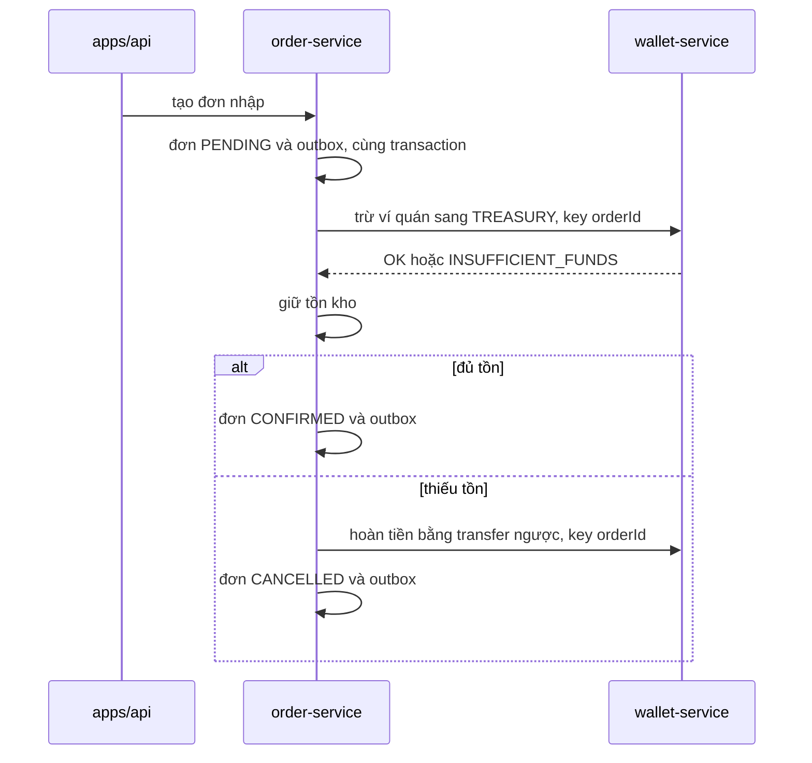

# Kiến trúc theo giai đoạn — OmniPOS & FinLedger Hub

> v1.0 · 27/10/2026 · Giai đoạn hiện tại: **chưa dựng**, sắp vào v1.0. Đi cặp: [software-requirements-specification.md](./software-requirements-specification.md) (gọi tắt SRS).

|Ngày|Big update|ADR|Tag|
|---|---|---|---|
|27/10/2026|Thiết kế v1.0 → v3.0|ADR-001…005 Accepted, còn lại Proposed|—|
|27/10/2026|Chốt phiên bản nền: NestJS 12.2, Next.js 16.4, React 19.3; Node 24 LTS + Jest 30.5|ADR-019 Accepted|—|

|Giai đoạn|Cụm|Thay đổi lớn|Chế độ chạy|Tag cuối|
|---|---|---|---|---|
|v1.0|1|Monolith template; sổ cái, voucher|`core`|`m1`|
|v1.0 + Redis|2|Thêm Redis 6380|`cache`|`m2`|
|v2.0|3|4 tầng cho module có bất biến|`cache`|`m3`|
|v3.0-a|4|Kafka, `fraud-worker`, `packages/building-blocks`|`stream`|`m4`|
|v3.0-b|5|Tách `wallet-service`, `order-service`; outbox, Debezium; saga|`cdc`|`m5`|
|v3.0-c|6|Partition, short-link, feed|`cdc`|`m6`|

## 1. Nguyên tắc và quy tắc big update

Nguyên tắc:
1. Chỉ thêm thành phần khi FR của cụm đang làm cần đến nó.
2. Kiến trúc đổi, bất biến sổ cái không đổi.
3. Hợp đồng HTTP trên 3101 giữ từ M1; client không cần biết bên trong đã tách service.
4. Mỗi big update có ADR, tag git, và một lần hồi quy trước/sau.
5. Chỉ bật container cần cho test đang chạy (mục 5).

**Thế nào là big update:**

|Thay đổi|Ví dụ|Bắt buộc|
|---|---|---|
|Quy tắc cấu trúc code|v1.0 → 4 tầng|Giai đoạn mới, ADR, cập nhật `.agent/projectRules/`|
|Topology dịch vụ|Tách service|Giai đoạn mới, ADR|
|Thêm container hoặc app|Redis, Kafka, worker|ADR, cập nhật mục 5|
|Kiểu giao tiếp|Gọi hàm → gRPC; producer → outbox|ADR|
|Sở hữu hoặc cách lưu dữ liệu|Tách DB, partition|ADR, chạy đối soát|
|Hợp đồng công khai|Route, body lỗi, enum role|ADR, sửa `checks/` trong cùng commit|

Không phải big update: thêm route đúng quy tắc hiện hành, thêm index, DTO, UI. Chỉ cần thêm FR vào SRS.

**Giữ nguyên qua mọi giai đoạn:** I-01…I-15 (SRS mục 6, mỗi cái có hiệu lực từ milestone ghi kèm), cộng thêm:
- K-01: không đụng container dự án công ty và các cổng 3000, 3001, 5433, 6379.
- K-02: `checks/` của mọi milestone trước vẫn pass.
- K-03: khóa nhiều ví theo id tăng dần, dù khóa nằm ở tầng hay service nào.
- K-04: không có bí mật trong git.

**Quy trình khi big update xảy ra:**
1. Viết ADR (Proposed) vào mục 6; Đạt đồng ý thì đổi sang Accepted.
2. Chạy `checks/` trên tag trước, lưu kết quả.
3. Làm trên nhánh riêng.
4. Chạy lại `checks/`; kết quả phải giống hệt, trừ phần ADR cho phép đổi.
5. Sửa mục giai đoạn trong file này; không xóa giai đoạn cũ, chỉ ghi "đã thay bởi …".
6. Sửa SRS: FR, NFR, ma trận truy vết, thẻ cụm, bảng thay đổi.
7. Merge, gắn tag, thêm 1 dòng vào bảng đầu của cả 2 file.

## 2. Giai đoạn v1.0 (Cụm 1–2, 26/10–08/11)

Theo `.agent/projectRules/backend-architecture.md` của template: controller mỏng; service facade, tách `-read`/`-workflow`/`-shared` khi vượt 500 dòng hoặc hơn 6 dependency; gọi thẳng `PrismaService`, không có repository. Module không query bảng của module khác mà inject service đã export.

|Module|Trách nhiệm|Nhóm|Cụm|
|---|---|---|---|
|`access-control`|Login cookie, `JwtAuthGuard`, `PermissionsGuard`, `OriginCheckGuard` (có sẵn)|2|—|
|`health`|`GET /health` public|2|—|
|`stores`, `products`|Danh mục; menu theo quán và best-sellers từ Cụm 2|2, cache và ZSET là 1|1–2|
|`wallets`, `vouchers`|Chuyển tiền, đọc ví; campaign, claim|1 + 2|1|
|`pos-invoices`|Hóa đơn POS|2|2|
|`common/`|`@Idempotent()`, guard Token Bucket|1|2|

|Cổng|Thành phần|Trạng thái|
|---|---|---|
|5434, 3101, 3100, 6380|PG hub, API, web, Redis|Đã chốt|
|9192|Kafka, listener cho host|Giả định; `netstat` phải rỗng|
|8183|Debezium Connect REST|Giả định|
|50061, 50062|gRPC `wallet-service`, `order-service`|Giả định|
|3000, 3001, 5433, 6379|Hệ thống khác|Cấm dùng|

Luồng `POST /wallets/transfers`:

Guard toàn cục gồm Throttler, JwtAuth, Permissions, OriginCheck; NestJS không đảm bảo thứ tự giữa `ThrottlerGuard` và guard của `AccessControlModule` (template đã ghi). Lỗi raw của Prisma 7.9 là P2010; có kèm SQLSTATE hay không thì chưa kiểm.

Cụm 2 (vẫn v1.0) thêm: interceptor `@Idempotent()` chạy sau guard, trước controller; guard Token Bucket chỉ gắn route claim; cache-aside nằm trong read service của menu; `ThrottlerGuard` toàn cục giữ lại, giới hạn đặt qua env.

## 3. Giai đoạn v2.0 (Cụm 3, 09/11–17/11)

Kích hoạt sau AB-04 và AB-13. Cây thư mục theo page.yaml 26/10 dòng 259–293; file này không chi tiết hơn.

|Tầng|Được import|Cấm import|
|---|---|---|
|`domain/`|Chính nó, `Result`|Prisma, NestJS, tầng khác|
|`application/`|`domain/`|Prisma, `infrastructure/`, `presentation/`|
|`infrastructure/`|`domain/`, Prisma|`presentation/`|
|`presentation/`|`application/`|Prisma, `infrastructure/`|
|`*.module.ts`|Mọi tầng|—|

`application/` có được dùng decorator DI của NestJS không: Đạt chốt sau AB-04, ghi vào ADR-008. `Result<T,E>` ở v2.0 nằm trong `apps/api`; v3.0-a chuyển vào `packages/building-blocks` (giả định).

Phạm vi (ADR-008): chỉ `wallets`, `vouchers`, `pos-invoices` lên 4 tầng. `stores`, `products`, `health`, `access-control` giữ v1.0 vì chỉ là CRUD.

Đường refactor, mỗi module một lượt, `wallets` đi đầu:

|Bước|Việc|Ai|Kiểm|
|---|---|---|---|
|1|Chạy `checks/m1`, `m2`, lưu phân bố mã|AI|File kết quả|
|2|Viết `domain/`: aggregate, value object, port|Đạt|`tsc --noEmit`|
|3|Chuyển SQL khóa nguyên văn sang adapter|AI chuyển, Đạt rà|Không đổi dòng SQL nào|
|4|Use case trả `Result<T,E>`|Đạt|1 test domain chạy không cần DB|
|5|Controller đổi `Result` sang HTTP, body RFC 7807|AI|Mã lỗi giữ nguyên|
|6|Retry SQLSTATE, breaker Redis, guard IDOR|Đạt|AC FR-M3-03…06|
|7|Chạy lại `checks/`|AI|Giống hệt bước 1|

Bất biến v2.0: I-01…I-10. Hợp đồng HTTP chỉ đổi body lỗi (ADR-009); trường mã lỗi giữ nguyên nên `checks/` vẫn đếm được.

## 4. Giai đoạn v3.0 (Cụm 4–6, 18/11–14/12)

- **v3.0-a (Cụm 4):** thêm Kafka, `fraud-worker`, `packages/building-blocks`; `apps/api` vẫn là monolith v2.0 và gửi sự kiện thẳng sau commit.
- **v3.0-b (Cụm 5):** tách service, thay producer bằng outbox + Debezium, thêm saga. Tầng `domain/` chuyển nguyên sang service.
- **v3.0-c (Cụm 6):** partition, short-link, feed. Không thêm service.

|Thành phần|Từ|Trách nhiệm|Dữ liệu sở hữu|Giao tiếp|
|---|---|---|---|---|
|`apps/api`|v1.0|Gateway: auth, throttle, idempotency, rate limit, cache menu, short-link, feed|`omnipos_hub`: User, AuthSession, Store, ShareLink, Promotion|REST vào, gRPC ra|
|`wallet-service`|v3.0-b|Sổ cái, chuyển tiền, khóa ví|`omnipos_wallet`: Wallet, LedgerEntry, outbox|gRPC vào; outbox ra; đọc cờ gian lận|
|`order-service`|v3.0-b|Hóa đơn POS, voucher, đơn nhập, tồn kho, điều phối saga, ZSET bán chạy|`omnipos_order`: Product, PosInvoice, voucher, SupplyOrder, outbox|gRPC vào và ra; outbox ra|
|`fraud-worker`|v3.0-a|Cửa sổ trượt, gắn cờ ví|Không DB; cửa sổ trên Redis|Đọc `wallet.transfers`; ghi `fraud.wallet-flagged`|
|`packages/building-blocks`|v3.0-a|`Result`, base entity, VO, envelope sự kiện; không chứa luật nghiệp vụ|—|Thư viện|
|Gói proto (tên giả định)|v3.0-b|Hợp đồng gRPC; nội dung `.proto` do Đạt viết|—|Thư viện|

Quy tắc phụ thuộc v3.0: app được import `building-blocks` và gói proto, không chiều ngược lại; service không import code của service khác, chỉ gọi qua gRPC hoặc Kafka; 4 tầng bên trong mỗi service giữ như v2.0. Topic `pos.invoices` chưa có consumer cho tới Nhóm 3 (đối soát POS↔SAP).

Sở hữu dữ liệu (ADR-014, Proposed): mỗi service một database trong cùng instance PG 5434; tham chiếu chéo chỉ bằng id, không FK; mỗi service một schema Prisma và migration riêng (cần kiểm trên Prisma 7.9). Khi tách thì seed lại rồi đối soát. Redis dùng chung, mỗi service một tiền tố khóa.

|Luồng|Kiểu|Lý do|
|---|---|---|
|web, cURL → gateway|REST đồng bộ|Hợp đồng M1 giữ nguyên|
|gateway → service|gRPC (HTTP/2) đồng bộ|Cần trả 201/409 ngay|
|order → wallet|gRPC đồng bộ, idempotent theo `orderId`|Saga cần kết quả từng bước|
|service → Kafka|Outbox + Debezium|Không dual-write|
|Kafka → worker, service|At-least-once; bỏ qua `eventId` đã xử lý|Trùng lặp an toàn|

**Outbox/CDC (v3.0-b).** Ở v3.0-a, `apps/api` gửi thẳng sau commit; crash giữa commit và gửi làm mất sự kiện. ADR-013 ghi nhận rủi ro này, và Cụm 5 dùng chính bài test "dừng service sau commit" để đo trước/sau.

**Saga đơn nhập** (mặc định orchestration trong `order-service`, ADR-016; Đạt có thể đổi). Trừ ví thất bại thì đơn bị từ chối, không cần bù.

**Khóa ví do gian lận:** `fraud-worker` đếm số lần trừ của mỗi ví trong cửa sổ 10 giây trên Redis; quá 5 lần thì ghi `fraud.wallet-flagged`; `wallet-service` khóa ví; lệnh trừ sau đó trả 409 `WALLET_FROZEN`. Luồng này bất đồng bộ nên vài lệnh có thể lọt trước khi cờ tới.

**v3.0-c:** partition bút toán và hóa đơn theo tháng. Debezium chỉ đọc bảng outbox nên partition không ảnh hưởng CDC. Short-link và feed đặt trong `apps/api` (ADR-017).

## 5. Ngân sách tài nguyên và chế độ chạy

Sự thật lúc 13:40 ngày 27/10 (máy công ty): RAM 15,8 GB, trống 0,7 GB; Chrome 5,7 GB, bun 1,7 GB, node 1,1 GB, vmmem 1,3 GB. Mọi con số dưới đây là **giả định — cần đo** bằng `docker stats --no-stream` (container) và Task Manager (tiến trình node).

|Thành phần|Ước tính|Giới hạn đề xuất|Cách giới hạn|
|---|---|---|---|
|PG 16 hub|150–300 MB|512 MB|`mem_limit`|
|Redis|10–50 MB|128 MB|`mem_limit`, `maxmemory`|
|Kafka KRaft, 1 broker|600–900 MB|1 GB|`mem_limit`, heap JVM 512 MB|
|Debezium Connect|600–900 MB|1 GB|`mem_limit`, heap JVM 512 MB|
|Mỗi app NestJS chạy bản build|150–250 MB|256 MB heap|`node --max-old-space-size=256`|
|NestJS watch mode|thêm 200–400 MB|—|Chỉ bật khi đang sửa code|
|Next dev|0,5–1,5 GB|—|Chỉ bật khi demo UI|

|Chế độ|Bật gì|Dùng cho|Tổng ước tính|
|---|---|---|---|
|`learn`|Không gì của hub; DBX vào 5433 có sẵn|Pha A|0|
|`core`|PG, API|M1|0,3–0,6 GB|
|`cache`|`core` + Redis|M2, M3|0,3–0,6 GB|
|`stream`|`cache` + Kafka + 2 `fraud-worker`|M4|1,2–2,0 GB|
|`cdc`|PG, Redis, Kafka, Connect, gateway, 2 service, 1 worker|M5, M6|2,0–3,0 GB|
|`ui`|Thêm Next dev|Chụp ảnh, demo; tắt ngay|thêm 0,5–1,5 GB|

Kết luận thẳng: 0,7 GB trống chỉ vừa `core`/`cache`. `stream` và `cdc` **không chạy được** trên máy công ty nếu không giải phóng thêm 2–3 GB.

Quy tắc:
1. Mỗi lúc một chế độ (compose profile). Xong test thì `docker compose --profile <chế độ> stop` và tắt tiến trình node.
2. Trước khi bật `stream`/`cdc`: RAM trống phải ≥ tổng ước tính + 1 GB đệm (giả định).
3. Không chạy `ui` cùng `cdc` trên máy công ty. Không dùng Kafka UI; dùng CLI trong container.
4. Không sửa `.wslconfig` khi chưa hỏi Đạt, vì nó ảnh hưởng cả container dự án công ty.

Phương án khi thiếu RAM (theo thứ tự; Kafka KRaft và Debezium vẫn giữ):

|#|Phương án|Mất gì|
|---|---|---|
|1|Đóng Chrome, bun khi chạy test (giải phóng tới ~7 GB)|Bất tiện|
|2|Chạy `stream`/`cdc` ở máy nhà|Chưa biết máy nhà có Docker|
|3|Tách lần chạy: test saga thì tắt `fraud-worker`; test fraud thì tắt `order-service`|Không thấy toàn luồng cùng lúc|
|4|Trên máy yếu, tạm dùng relay đọc bảng outbox thay Debezium; vẫn giữ I-12|Mất CDC trên máy đó; AC KF-09 vẫn phải chạy với Debezium ở máy đủ RAM|

## 6. Danh mục ADR

|ID|Bối cảnh|Quyết định|Hệ quả|Cụm|Trạng thái|
|---|---|---|---|---|---|
|ADR-001|Cần nền có PG, Prisma, auth|Giữ template của Đạt; loại 3 repo tham khảo (2 MongoDB, 1 Drizzle)|Câu chuyện "tự nâng v1.0 → v3.0"|1|Accepted 27/10|
|ADR-002|Không được đụng hệ thống công ty, DB lab|PG riêng 5434, API 3101, web 3100, Redis 6380|Thêm 1 container, 1 kết nối DBX|1|Accepted 27/10|
|ADR-003|Cần mô hình tiền|Ví theo quán + 1 TREASURY; bút toán chỉ INSERT; số dư là cache|Bất biến I-01…I-05|1|Accepted 27/10|
|ADR-004|Chống race, deadlock|Khóa bi quan theo id tăng dần; `SKIP LOCKED` cho slot; Read Committed; không retry ở M1|Retry dời sang ADR-010|1|Accepted 27/10|
|ADR-005|Trình duyệt chỉ mở ~6 kết nối/host|Nghiệm thu bằng cURL `xargs -P30` và DBX|UI chỉ minh họa|1|Accepted 27/10|
|ADR-006|RAM trống 0,7 GB|Chạy theo chế độ, giới hạn RAM từng container|Mục 5|1|Proposed|
|ADR-007|M2 cần trạng thái nhanh|Redis riêng; key idempotency trên Redis có TTL; bucket khóa theo `storeId`|Redis chết thì 3 tính năng bị ảnh hưởng → ADR-010|2|Proposed|
|ADR-008|4 tầng tốn công|Chỉ module có bất biến lên 4 tầng; danh mục giữ v1.0|Hai kiểu module cùng tồn tại|3|Proposed|
|ADR-009|Lỗi nghiệp vụ đang là exception|`Result<T,E>`; body lỗi RFC 7807, giữ trường mã|Đổi hợp đồng lỗi; sửa `checks/` cùng commit|3|Proposed, Đạt chốt|
|ADR-010|`40P01`, Redis chết|Retry Full Jitter theo SQLSTATE; breaker quanh Redis; idempotency, rate limit fail-open hay fail-closed do Đạt chốt|Thứ tự khóa vẫn là lớp chính|3|Proposed|
|ADR-011|Role template không hợp F&B|Enum role mới, user gắn quán, chặn IDOR|Seed và `checks/` đổi|3|Proposed|
|ADR-012|Cụm 4 cần broker và worker đầu tiên|Kafka KRaft 1 broker; JSON có `schemaVersion`, chưa chạy Schema Registry; tách `fraud-worker`, `building-blocks`|Không kiểm schema lúc chạy|4|Proposed|
|ADR-013|Cần sự kiện trước khi có outbox|Gửi sau commit (dual-write có chủ đích), ghi rõ rủi ro mất sự kiện|Thay bởi ADR-015 ở Cụm 5|4|Proposed|
|ADR-014|Tách service|Mỗi service một database trong instance 5434; tham chiếu bằng id; seed lại khi tách|2 connector Debezium (cần kiểm); đối soát trong `checks/` đổi DB đích; xóa bảng ví cũ ở `omnipos_hub`|5|Proposed|
|ADR-015|Dual-write|Transactional Outbox + Debezium Outbox Event Router|Bật `wal_level=logical` trên 5434|5|Proposed|
|ADR-016|Kiểu saga|Mặc định orchestration trong `order-service`|Bước bù là transfer ngược, idempotent theo `orderId`|5|Proposed, Đạt chốt|
|ADR-017|Sơ đồ 26/10 có `growth-service`|Short-link, feed ở `apps/api`; tách khi có lý do tải|Bớt 1 tiến trình|6|Proposed|
|ADR-018|Bút toán, hóa đơn lớn dần|Range partition theo tháng|Khóa chính và unique phải xem lại; migration SQL viết tay|6|Proposed|
|ADR-019|Template khóa NestJS 10.4.22 (bản vá cuối 10/01/2026) và Next.js 15.5; `@nestjs/microservices`, `@nestjs/swagger` bản mới chỉ hỗ trợ Nest 12 (npm 27/10)|NestJS 12.2, Next.js 16.4, React 19.3; giữ Prisma 7.9.x (khớp drill Bài 14, không dùng 8.0 RC), TypeScript 5.9. Node 24 LTS + Jest 30.5 vì Jest chỉ nạp được gói ESM của Nest 12 từ Node 24.9 (Đạt đổi Node bằng nvm, `.nvmrc` trong repo). Thử tối đa 1 giờ khi dựng khung; hỏng thì lùi NestJS 11.2 + Next.js 15.5|Lõi Nest 12 là ESM, app giữ CommonJS (Node nạp được qua `require(esm)`); các dự án khác của Đạt vẫn chạy Node 22 qua nvm; route `'*'` trong `LoggerModule.forRoutes` phải đổi thành `'{*path}'` (Express 5)|1|Accepted 27/10|

## 7. Kiểm thử hồi quy xuyên giai đoạn

`checks/` là bộ hồi quy duy nhất. Mỗi milestone thêm một thư mục (`checks/m1` … `checks/m6`); không sửa suite cũ, trừ khi ADR đổi hợp đồng. Mỗi suite in phân bố mã (`sort | uniq -c`) rồi chạy đối soát I-01…I-06. Kết quả mỗi tag ghi vào README.

|Thời điểm|Suite bắt buộc|Chế độ|
|---|---|---|
|Cuối M1|m1|`core`|
|Cuối M2|m1, m2|`cache`|
|Cuối M3|m1–m3, grep NFR-12|`cache`|
|Cuối M4|m1–m4|`stream`|
|Cuối M5|m1–m5, qua 3101|`cdc`|
|Cuối M6|m1–m6|`cdc`|

Quy tắc chống nhiễu:
- Login 1 lần mỗi lượt (login giới hạn 5/phút), dùng lại cookie jar.
- Throttle toàn cục đặt cao qua env, để AC không lẫn 429.
- Token bucket khóa theo `storeId`: AC voucher M1 (30 quán khác nhau) vẫn phải ra 10×201, 20×409. Cấm đổi khóa sang user hoặc IP.
- `Idempotency-Key` tùy chọn ở chuyển tiền, nên suite m1 không phải sửa.
- Từ M3, suite m1–m2 chạy bằng user trụ sở để không dính chặn IDOR.
- Từ M5, suite m1–m4 chạy khi tắt `fraud-worker` (hoặc ngưỡng đặt cao qua env), vì Bắn 30 từ 1 ví sẽ kích hoạt khóa ví.
- Hồi quy luôn chạy trên seed gốc. Seed lớn (FR-M3-09) là lệnh riêng, chỉ dùng cho FR-M3-08, NFR-08, FR-M6-01.
- Chạy `prisma migrate reset` + seed gốc trước mỗi suite ghi tiền (từ M5: cho từng service).
- Khi áp ADR-014: truy vấn đối soát đọc DB đích từ env; xóa hoặc đổi tên bảng ví cũ ở `omnipos_hub` để suite không thể pass trên dữ liệu cũ.
- Từ M4, chờ lag về 0 rồi mới đối soát.

## 8. Rủi ro và cách lùi

Dự án học, không có dữ liệu thật: lùi = checkout tag trước + `prisma migrate reset` + seed.

|Big update|Rủi ro|Dấu hiệu|Cách lùi|
|---|---|---|---|
|Dựng khung (28/10)|Đường dẫn có dấu làm hỏng pnpm, Prisma, Next; RAM|Lỗi install, generate|Ánh xạ ổ ảo `subst` tới thư mục project (cần Đạt đồng ý); chạy từng bước nặng|
|v1.0|P2010 không mang SQLSTATE|Không phân biệt được `23505`, `40P01`|Đọc mã từ lỗi gốc của driver (kiểm 30/10)|
|v1.0 + Redis|AC M1 lẫn 429 hoặc 400|Phân bố mã m1 đổi|Revert merge, về tag `m1`|
|v2.0|Refactor đổi hành vi hoặc quá 3 ngày|Hồi quy lệch|Lùi từng module (1 module = 1 commit); module chưa xong giữ v1.0|
|v3.0-a|Thư viện Kafka với NestJS 12 chưa kiểm; RAM|Không boot; `docker stats` vượt|AI kiểm tương thích trước 24/11; về tag `m3`|
|v3.0-b|gRPC, Debezium chưa kiểm; saga kẹt|Connector FAILED; đơn PENDING mãi|AI kiểm trước 03/12; về tag `m4`; phương án RAM số 4|
|v3.0-c|Prisma không quản partition; khóa chính đổi|Migration lỗi; đối soát lệch|Seed lại từ tag `m5`; làm bảng bút toán trước|

## 9. Câu hỏi mở

1. Máy nhà có Docker không, bao nhiêu RAM? Quyết định `stream`/`cdc` chạy ở đâu.
2. gRPC, Kafka client, Debezium có hợp NestJS 12 không? AI kiểm trước 24/11.
3. Nhiều project Prisma 7.9 trong 1 monorepo, mỗi project 1 database, có vướng gì không? Kiểm trước 03/12.
4. Đạt có chấp nhận đóng Chrome khi chạy `stream`/`cdc` không?
5. Có cần `growth-service` như sơ đồ 26/10 không (ADR-017)?
