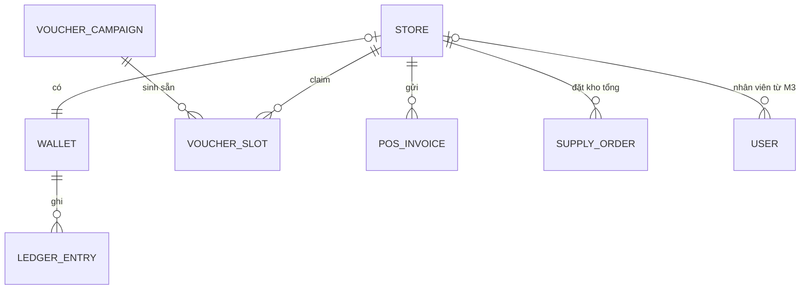

# SRS — OmniPOS & FinLedger Hub

> v1.1 · 27/10/2026 · Đã phân tích, **chưa build**. Đi cặp: [architecture-evolution.md](./architecture-evolution.md).

|Ngày|Bản|Thay đổi|ADR|
|---|---|---|---|
|27/10/2026|1.0|Bản đầu, viết trước Pha B Cụm 1|ADR-001…006|
|27/10/2026|1.1|Chốt phiên bản nền: NestJS 12.2, Next.js 16.4, React 19.3; giữ Prisma 7.9.x, TypeScript 5.9|ADR-019|
|27/10/2026|1.2|Nâng Node lên 24 LTS + Jest 30.5 (Jest không nạp được Nest 12 trên Node 22); có `.nvmrc`|ADR-019|
|27/10/2026|1.3|Sau red-team plan M1: claim lại kiểm trên campaign còn slot; thêm 3 mã lỗi (400 `SAME_WALLET` ở DTO, 404 `WALLET_NOT_FOUND`, 404 `CAMPAIGN_NOT_FOUND` tính trong transaction); NFR-06 cho phép file `*.example`; đổi tên container công ty thành tên trung tính|—|

## 1. Mục đích, phạm vi, người đọc

Mục đích: chốt một lần "làm gì, ai làm, kiểm bằng gì", để mỗi cụm chỉ cần mở thẻ ở mục 8 là vào việc. Phạm vi: POS và ví sổ cái kép cho chuỗi F&B 300 cửa hàng (dữ liệu giả lập). Đây là dự án CV, repo sẽ public. Lịch: 6 cụm từ 26/10 đến 14/12/2026; Nhóm 3 từ 15/12 đến Tết.

|Người đọc|Đọc gì trước|
|---|---|
|Đạt (làm Nhóm 1)|Mục 8, rồi mục 6|
|Phiên AI sau (dựng Nhóm 2, rà code)|Bảng thay đổi → thẻ cụm hiện tại → FR, NFR, ADR mà thẻ trỏ tới|
|Người phỏng vấn|Mục 2, 6, 7 và danh mục ADR|

Tài liệu này thay roadmap 26/10 làm nguồn tra cứu. Khi hai bên mâu thuẫn, tài liệu này thắng.

## 2. Bối cảnh và persona (giả định)

Mỗi quán có máy POS và một ví nội bộ. Trụ sở giữ ví TREASURY để cấp vốn cho quán.

|Persona|Việc chính|Danh tính|
|---|---|---|
|Máy POS, thu ngân|Gửi hóa đơn, săn voucher|Gọi API thay một `storeId`|
|Quản lý quán|Xem ví, sổ cái, bảng tin của quán mình|Role cửa hàng (từ Cụm 3)|
|Kế toán trụ sở|Chuyển tiền, tạo campaign, đối soát|`ADMIN` của template; role trụ sở từ Cụm 3|
|Đạt (vận hành)|Chạy `checks/`, đọc log, soi DBX|—|

## 3. Phân tầng tính năng

|Nhóm|Là gì|Ai làm|Khi nào|
|---|---|---|---|
|1|Lõi kiến thức 3 khóa: dòng chịu lực|Đạt gõ ≤ 15 dòng mỗi hàm, rà phần còn lại theo checklist|Pha B mỗi cụm|
|2|UI, CRUD, hạ tầng, seed, codegen, compose, bản naive, `checks/`|AI làm 100%, Đạt tốn 0 phút|Trước hoặc đầu Pha B|
|3|QR Order, BOM, BI dashboard, đối soát POS↔SAP qua Kafka Stream, video Playwright E2E|Đạt chọn, làm cùng AI|15/12 → Tết|

Kẹt Nhóm 1 quá 20 phút thì AI chỉ dòng code trong chat, Đạt giải thích lại. Không dùng worktree blueprint.

## 4. Yêu cầu chức năng

ID `FR-M<n>-<nn>`: milestone Mn thuộc Cụm n. Cột N là Nhóm. "Bắn 30" theo mẫu lệnh ở mục 5.

### M0 — Khung (AI dựng, trước 30/10)

|ID|Mô tả|N|Bài|AC đo được|
|---|---|---|---|---|
|FR-M0-01|Health, login cookie (có sẵn); `GET /stores`, `GET /products` (id `Int autoincrement`); `wallets/`, `vouchers/` trả 501 `TODO(Đạt)`; thư mục `checks/`|2|—|`/health` trên 3101 → 200; đếm được 300 quán, 77 món; transfer → 501|
|FR-M0-02|Xóa nhãn khách hàng cũ, mật khẩu admin lấy từ env, đổi tên dự án|2|—|grep tên cũ → 0; git chỉ có `.env.example`|

### M1 — Sổ cái kép, Flash-Voucher (Cụm 1)

|ID|Mô tả|N|Bài|AC đo được|
|---|---|---|---|---|
|FR-M1-01|Ví (1/quán + 1 TREASURY), bút toán, campaign, slot. Seed: TREASURY chuyển 1.000.000 cho mỗi quán|1 DDL, 2 seed|AB-07|Ví quán âm bị chặn `23514`; có 300 ví quán|
|FR-M1-02|`POST /wallets/transfers`: khóa 2 ví theo id tăng dần, kiểm số dư trong transaction, ghi 2 bút toán. Ví nguồn = ví đích → 400 `SAME_WALLET` (kiểm ở DTO, không đọc DB); ví không tồn tại → 404 `WALLET_NOT_FOUND` (tính từ số dòng khóa được, trong transaction)|1|AB-12, AB-14|Rút quá (30 lệnh 200.000 từ ví C = 1.000.000): 5×201, 25×409 `INSUFFICIENT_FUNDS`, C = 0. Chuyển chéo (A, B khác C, D) 15 A→B + 15 B→A, mỗi lệnh 10.000: 30×201, 0 `40P01`, A và B về số cũ. Luôn 0×5xx|
|FR-M1-03|`GET /wallets/:id`: số dư và tổng bút toán|2|AB-07|Hai số bằng nhau|
|FR-M1-04|`POST /vouchers/campaigns` sinh sẵn N slot|2|AB-07|Tạo 10 slot trống|
|FR-M1-05|`POST /vouchers/campaigns/:id/claims` dùng `SKIP LOCKED`|1|AB-14|30 quán: 10×201, 20×409 `SOLD_OUT`. Trên một campaign khác còn slot: cùng 1 quán claim 2 lần → 201 rồi 409 `ALREADY_CLAIMED`. Campaign không tồn tại → 404 `CAMPAIGN_NOT_FOUND`|
|FR-M1-06|`GET /vouchers/campaigns/:id`: đã claim/tổng|2|—|Khớp DBX; id lạ → 404 `CAMPAIGN_NOT_FOUND`|
|FR-M1-07|Bản naive để đo trước/sau|2 code, 1 đo|AB-12|README có 2 dòng số; naive > 5×201 hoặc sổ lệch|
|FR-M1-08|UI ví, voucher; nút "Bắn 30" chỉ để minh họa|2|—|Mở được trên 3100|

### M2 — Redis, idempotency, rate limit (Cụm 2)

|ID|Mô tả|N|Bài|AC đo được|
|---|---|---|---|---|
|FR-M2-01|`POST /pos/invoices`: POS gửi hóa đơn bán|2|—|201, có bản ghi|
|FR-M2-02|`@Idempotent()` qua header `Idempotency-Key`: bắt buộc ở hóa đơn, tùy chọn ở chuyển tiền (giả định)|1|AB-01, AB-06|Bắn 30 cùng key → 1 hóa đơn, 0×5xx; cùng key khác body → 422 (giả định); transfer thiếu key chạy như M1|
|FR-M2-03|`GET /stores/:id/menu` kèm Cache-Aside, Singleflight, TTL Jitter|2 route, 1 cache|AB-02, SD-04|Bắn 30 vào key nguội → log 1 lần nạp DB; `TTL` của 10 key mẫu không bằng nhau hết|
|FR-M2-04|Xếp hạng bán chạy bằng ZSET; `GET /products/best-sellers`; lệnh dựng lại từ SQL|1|AB-06|Top 10 khớp SQL gom theo món|
|FR-M2-05|Token Bucket bằng Lua cho claim, khóa theo `storeId`, tham số từ env|1|SD-04, AB-06|1 quán bắn 30, sức chứa 10, nạp rất chậm khi test (giả định) → đúng 20×429 có `Retry-After`; AC voucher M1 vẫn pass|
|FR-M2-06|Redis riêng 6380; UI bấm đúp thanh toán, trang tải, bảng xếp hạng|2|—|`redis-cli ping` → `PONG`|

### M3 — v2.0, bảo mật, độ bền (Cụm 3)

|ID|Mô tả|N|Bài|AC đo được|
|---|---|---|---|---|
|FR-M3-01|`wallets`, `vouchers`, `pos-invoices` lên 4 tầng; HTTP giữ nguyên|1 domain, port, use case; 2 di chuyển file|AB-04, SD-10|Hồi quy M1–M2 giống hệt; NFR-12 = 0|
|FR-M3-02|Use case trả `Result<T,E>`; body lỗi RFC 7807, giữ trường mã lỗi|1; 2 filter|AB-13, AB-01|Không `throw` lỗi nghiệp vụ trong `domain/`, `application/`; body có `type`, `title`, `status`|
|FR-M3-03|Retry Full Jitter cho `40P01`, `40001`, tối đa 3 lần (giả định)|1|AB-16, AB-12|Deadlock tạo từ DBX → 0×5xx; log có retry với độ trễ khác nhau|
|FR-M3-04|Circuit Breaker quanh Redis; Redis chết thì menu đọc DB. Đạt chốt idempotency, rate limit fail-open hay fail-closed (ADR-010)|1|AB-16|Dừng Redis → menu 200; breaker mở thì không request nào chờ timeout Redis|
|FR-M3-05|Enum role F&B (trụ sở, quản lý quán, thu ngân), user gắn với quán|2|AB-08|grep `TRAINER\|TRAINEE` → 0|
|FR-M3-06|Chặn IDOR ví giữa các quán|1|AB-08|User quán A vào ví B → 403 hoặc 404, không lộ số dư, ví B không đổi|
|FR-M3-07|Regex an toàn cho input DTO (mã voucher, ô tìm món)|1|AB-11|Chuỗi tấn công 50.000 ký tự → 400 trong < 100 ms (giả định — cần đo)|
|FR-M3-08|`GET /wallets/:id/statement.csv` dạng stream|1|AB-15, AB-16|1 triệu dòng (giả định): RAM API tăng < 50 MB (giả định — cần đo)|
|FR-M3-09|Seed lớn nhiều tháng (lệnh riêng, không dùng cho hồi quy), giữ bất biến|2|—|Đối soát 0 lệch|

Lưu ý phỏng vấn: stream từ DB không phải zero-copy kiểu `sendfile`; zero-copy chỉ đúng khi gửi file có sẵn.

### M4 — Kafka (Cụm 4)

|ID|Mô tả|N|Bài|AC đo được|
|---|---|---|---|---|
|FR-M4-01|Kafka KRaft 1 broker; topic `wallet.transfers` (key `walletId` ví nguồn), `pos.invoices` (key `storeId`)|2|KF-03, KF-08|`kafka-topics.sh --describe` đúng số partition|
|FR-M4-02|Producer chuẩn tài chính, gửi sau commit; `eventId` = `transferId` hoặc id hóa đơn|1|KF-03, KF-04|N transfer = N sự kiện (`kafka-get-offsets.sh`); thứ tự theo key giữ nguyên|
|FR-M4-03|`apps/fraud-worker` dùng Cooperative Sticky, xử lý trùng an toàn|1; 2 khung app|KF-06, KF-07|Thêm instance thứ 2 → log chỉ thu hồi partition bị chuyển; lag về 0|
|FR-M4-04|Sự kiện JSON có `eventId`, `schemaVersion`; chưa chạy Schema Registry|2|KF-05|Mọi sự kiện có 2 trường này|

### M5 — Microservices, Outbox, Saga (Cụm 5)

|ID|Mô tả|N|Bài|AC đo được|
|---|---|---|---|---|
|FR-M5-01|Tách `wallet-service`, `order-service`; `apps/api` gọi gRPC; HTTP giữ nguyên|1 `.proto`; 2 khung|SD-05, SD-06|Hồi quy M1–M4 qua 3101 giống hệt|
|FR-M5-02|Outbox ghi cùng transaction; Debezium đẩy vào Kafka; bỏ producer của M4|1 outbox; 2 Debezium|KF-09|Dừng service ngay sau commit → sự kiện vẫn tới; số dòng outbox = số sự kiện|
|FR-M5-03|Đơn nhập hàng từ kho tổng (giả định): trừ ví quán sang TREASURY, giữ tồn; thiếu tồn → saga hoàn tiền bằng transfer ngược|1 saga; 2 CRUD|SD-06|Đặt vượt tồn → đơn `CANCELLED`, ví về số cũ, đối soát 0 lệch|
|FR-M5-04|Trừ ví > 5 lần trong 10 giây → khóa ví (sliding window); ngưỡng, cửa sổ đọc từ env|1|KF-10, SD-04|7 lần trong 10 s → ví bị khóa; lệnh trừ sau khi cờ tới → 409 `WALLET_FROZEN`|
|FR-M5-05|Consumer idempotent|1|KF-09, AB-16|Reset offset về đầu → số dư không đổi|
|FR-M5-06|Trụ sở mở khóa ví|2|—|200, giao dịch lại được|

### M6 — Quy mô (Cụm 6)

|ID|Mô tả|N|Bài|AC đo được|
|---|---|---|---|---|
|FR-M6-01|Range Partitioning theo tháng cho bút toán và hóa đơn POS|1|SD-03|`EXPLAIN` truy vấn 1 tháng chỉ quét 1 partition; đối soát 0 lệch|
|FR-M6-02|Short-link chia sẻ campaign (Snowflake + Base62); `GET /s/:code` → 302|1 sinh mã; 2 route|SD-08|10.000 mã song song: 0 trùng; dài ≤ 11 ký tự (vì 2^64 < 62^11)|
|FR-M6-03|Bảng tin khuyến mãi: trụ sở đăng tới 300 quán, quán đăng tới nhóm theo dõi nhỏ; hybrid fan-out trên ZSET|1 fan-out; 2 CRUD|SD-09, AB-06|Bài trụ sở không ghi vào 300 feed; bài quán có trong feed người theo dõi; mới nhất đứng trước|
|FR-M6-04|Ước lượng QPS, dung lượng/tháng, RAM cache 80/20 cho 300 quán|1|SD-01, SD-02|Có công thức; mọi đầu vào ghi "giả định"|
|FR-M6-05|Bộ ADR trong `docs/` của repo|1; 2|SD-10|Mọi ADR có trạng thái cuối|

## 5. Yêu cầu phi chức năng

Mẫu "Bắn 30" (Git Bash; `{}` là số thứ tự, dùng để đổi `storeId` hoặc key):

```bash
seq 1 30 | xargs -P30 -I{} curl -s -o /dev/null -w "%{http_code}\n" \
  -b cookies.txt -H "Content-Type: application/json" \
  -d '<body có {}>' http://localhost:3101/<route> | sort | uniq -c
```

|ID|Thuộc tính|Cách đo|Ngưỡng|
|---|---|---|---|
|NFR-01|Sổ cái đúng|Truy vấn đối soát trong `checks/` (viết sau DDL Bài 07)|0 dòng vi phạm I-01…I-06 sau mọi test|
|NFR-02|Đúng khi đồng thời|Bắn 30|0×5xx; phân bố mã đúng AC|
|NFR-03|Không deadlock|Log API khi chạy Chuyển chéo|0 lần `40P01`|
|NFR-04|Chờ khóa có hạn|DBX giữ khóa 1 ví, cURL vào ví đó, xem `pg_locks`|≥ 1 dòng chưa granted; COMMIT trong < 5 s → 201; `$transaction` maxWait 5000, timeout 5000 ms|
|NFR-05|Không đụng hệ thống khác|`docker ps` trước/sau; `netstat -ano` cho 5434, 3100, 3101, 6380; grep 3000, 3001, 5433, 6379 trong hub|container dự án công ty giữ CONTAINER ID; cổng rảnh trước khi bật; 0 dòng có tác dụng|
|NFR-06|Bí mật|`git ls-files \| grep -E '(^\|/)\.env'`|Chỉ file `*.example` (`.env.example`, `apps/web/.env.local.example`)|
|NFR-07|RAM|`docker stats --no-stream`, Task Manager|Trong ngân sách của chế độ chạy ([kiến trúc mục 5](./architecture-evolution.md)); giả định — cần đo|
|NFR-08|Dùng index|`EXPLAIN (ANALYZE, BUFFERS)` sổ cái theo ví|Index Scan, không Seq Scan|
|NFR-09|Độ trễ menu|100 lần `curl -w "%{time_total}"`, lấy p95|p95 hit < p95 miss; số tuyệt đối giả định — cần đo|
|NFR-10|Throttle không làm bẩn AC|Giới hạn throttle đặt qua env|0×429 ngoài test rate limit|
|NFR-11|Hồi quy|Toàn bộ `checks/` trước và sau big update|Phân bố mã và đối soát giống hệt|
|NFR-12|Tuân thủ tầng (từ M3)|grep `@prisma`, `PrismaService`, `@nestjs` trong `modules/*/domain`|0 dòng|
|NFR-13|Không mất sự kiện (từ M5)|Số sự kiện trên topic so với số bản ghi trong DB|Bằng nhau; M4 chấp nhận lệch khi crash (ADR-013)|
|NFR-14|Lag consumer (từ M4)|`kafka-consumer-groups.sh --describe` sau tải|Về 0; thời gian giả định — cần đo|
|NFR-15|Dễ đọc|Rà code|Comment tiếng Việt; hàm Nhóm 1 ≤ 15 dòng chịu lực|
|NFR-16|Boot ở máy khác|Làm theo README|Máy công ty pass; máy nhà chưa biết|

## 6. Mô hình dữ liệu mức khái niệm

Không có DDL: cột và ràng buộc của ví, bút toán, voucher là bài tập Bài 07 của Đạt.



|Thực thể|Từ|Ý nghĩa|Chủ ở v3.0 (đề xuất)|
|---|---|---|---|
|`Store`, `Product`|M0|300 quán, 77 món|`Store` ở `apps/api`; `Product` và tồn kho ở `order-service`|
|`User`, `AuthSession`|template|Đăng nhập, phiên refresh|`apps/api`|
|`Wallet`|M1|1 ví/quán + 1 TREASURY; số dư là cache của tổng bút toán|`wallet-service`|
|`LedgerEntry`|M1|Bút toán ±, nhóm theo `transferId`|`wallet-service`|
|`VoucherCampaign`, `VoucherSlot`|M1|Campaign, slot sinh sẵn|`order-service`|
|`PosInvoice`|M2|Hóa đơn bán từ POS|`order-service`|
|Key idempotency, ZSET, bucket|M2|Trạng thái Redis có TTL|Redis, tiền tố theo chủ|
|`SupplyOrder`, tồn kho tổng|M5|Đơn nhập, trạng thái saga|`order-service`|
|`OutboxEvent`|M5|Sự kiện chờ Debezium đọc|Service ghi nó|
|`ShareLink`, `Promotion`, feed|M6|Short-link, bài khuyến mãi, feed ZSET|`apps/api`|

|ID|Bất biến|Từ|
|---|---|---|
|I-01|Mỗi transfer có đúng 2 bút toán, tổng bằng 0|M1|
|I-02|Số dư mỗi ví = tổng bút toán của ví đó|M1|
|I-03|Ví quán không âm; chỉ TREASURY được âm|M1|
|I-04|Tổng số dư mọi ví = 0 (hệ quả của I-01, I-02)|M1|
|I-05|Bút toán chỉ thêm, không sửa, không xóa|M1|
|I-06|Slot đã claim ≤ tổng slot; mỗi quán ≤ 1 slot mỗi campaign|M1|
|I-07|Khóa nhiều ví luôn theo id tăng dần|M1|
|I-08|Một `Idempotency-Key` gây tối đa 1 tác động ghi|M2|
|I-09|ZSET bán chạy dựng lại được từ SQL; lệch thì SQL đúng|M2|
|I-10|`domain/` không import Prisma hay NestJS|M3|
|I-11|Mỗi thay đổi sổ cái có đúng 1 `eventId`; xử lý trùng không đổi kết quả|M4|
|I-12|Dòng outbox nằm cùng transaction với thay đổi trạng thái|M5|
|I-13|Đơn `CANCELLED` có tác động ròng lên ví quán bằng 0|M5|
|I-14|Ví đang khóa không có bút toán ghi nợ mới|M5|
|I-15|Partition không đổi kết quả I-01…I-04|M6|

## 7. Ma trận truy vết 38 bài

|Bài|Cụm|Artifact trong dự án|
|---|---|---|
|AB-01|C2, C3|FR-M2-02, FR-M3-02|
|AB-02|C2|FR-M2-03|
|AB-03|trước C1|NFR-08|
|AB-04|C3|FR-M3-01, NFR-12|
|AB-05|C3|Chỉ lý thuyết; dùng để giải thích HTTP/2 của gRPC ở FR-M5-01|
|AB-06|C2|FR-M2-02, FR-M2-04, FR-M2-05, FR-M6-03|
|AB-07|C1|FR-M1-01, FR-M1-03, FR-M1-04, mục 6|
|AB-08|C3|FR-M3-05, FR-M3-06|
|AB-10|—|Không có: PDF rỗng, đã gộp vào AB-03|
|AB-11|C3|FR-M3-07|
|AB-12|C1|FR-M1-02, FR-M1-07, FR-M3-03|
|AB-13|C3|FR-M3-02, checklist rà code|
|AB-14|C1|FR-M1-02, FR-M1-05, NFR-03, NFR-04|
|AB-15|C3|FR-M3-08|
|AB-16|C3|FR-M3-03, FR-M3-04, FR-M3-08, FR-M5-05|
|SD-01|C6|Chỉ lý thuyết; nền cho FR-M6-04|
|SD-02|C6|FR-M6-04|
|SD-03|C6|FR-M6-01|
|SD-04|C2|FR-M2-03, FR-M2-05, FR-M5-04|
|SD-05|C5|FR-M5-01|
|SD-06|C5|FR-M5-01, FR-M5-03|
|SD-07|C6|Chỉ lý thuyết; Disruptor có trong sơ đồ 26/10 nhưng không có trong Pha B Cụm 6, để Nhóm 3|
|SD-08|C6|FR-M6-02|
|SD-09|C6|FR-M6-03|
|SD-10|C3, C6|FR-M3-01, FR-M6-05|
|KF-01|C4|Chỉ lý thuyết|
|KF-02|C4|Chỉ lý thuyết; nối với lưu ý zero-copy ở FR-M3-08|
|KF-03|C4|FR-M4-01, FR-M4-02|
|KF-04|C4|FR-M4-02|
|KF-05|C4|FR-M4-04; Schema Registry chỉ học|
|KF-06|C4|FR-M4-03|
|KF-07|C4|FR-M4-03|
|KF-08|C4|FR-M4-01 (AI cấu hình broker, Đạt rà)|
|KF-09|C5|FR-M5-02, FR-M5-05, NFR-13|
|KF-10|C5|FR-M5-04|
|KF-11|C5|Chỉ lý thuyết (ôn CCDAK)|
|KF-12|C5|Chỉ lý thuyết (đề luyện)|
|KF-13|C5|Chỉ lý thuyết (đề luyện)|

## 8. Milestone và thẻ khởi động

|M|Pha A (học)|Pha B (dự án)|Tag git|
|---|---|---|---|
|M1|26/10–29/10|30/10–01/11|`m1`|
|M2|02/11–05/11|06/11–08/11|`m2`, hết v1.0|
|M3|09/11–14/11|15/11–17/11|`m3`, v2.0|
|M4|18/11–23/11|24/11–26/11|`m4`|
|M5|27/11–02/12|03/12–05/12|`m5`|
|M6|06/12–11/12|12/12–14/12|`m6`, v3.0|

Mỗi thẻ có 7 mục. Ô "Đạt làm" ghi nhiệm vụ → cách kiểm.

### Thẻ Cụm 1 — M1

|Mục|Nội dung|
|---|---|
|FR/NFR|FR-M0-* (AI), FR-M1-*; NFR-01…08, NFR-10, NFR-15|
|Bài|AB-12, AB-14, AB-07; AB-03 đã học|
|Bất biến|I-01…I-07|
|Đạt làm|1) Bài 07: cột, ràng buộc 4 bảng trên schema lab → CHECK chặn ví âm (`23514`). 2) Bắn Rút quá vào bản naive, ghi số. 3) Dòng chịu lực: khóa 2 ví theo id tăng dần, kiểm số dư trong transaction, ghi bút toán qua `tx`, claim bằng `SKIP LOCKED` → AC FR-M1-02, FR-M1-05. 4) Rà file AI theo checklist 8 mục (Bài 12 #2, #6 + drill Bài 14)|
|AI dựng|Khung M0; route, DTO, UI; `checks/m1` (login 1 lần, Bắn 30). Sau DDL của Đạt: migrate, seed ví, bản naive, API đọc, SQL đối soát|
|Nghiệm thu|Bắn 30 cho Rút quá, Chuyển chéo, Voucher; DBX `pg_locks` (NFR-04); `docker ps` trước/sau; NFR-06; README có số trước/sau; public 01/11 khi Đạt đồng ý|
|ADR|ADR-001…006|

### Thẻ Cụm 2 — M2

|Mục|Nội dung|
|---|---|
|FR/NFR|FR-M2-*; NFR-02, NFR-09, NFR-10, NFR-11|
|Bài|Học AB-06, SD-04; áp dụng AB-01, AB-02|
|Bất biến|I-01…I-07; thêm I-08, I-09|
|Đạt làm|1) `@Idempotent()`: lưu key, chặn request trùng đang chạy, trả lại kết quả cũ → Bắn 30 cùng key, 1 hóa đơn. 2) Cache-Aside, Singleflight, TTL Jitter cho menu → 1 lần nạp DB. 3) Lua Token Bucket theo `storeId` → 20×429. 4) Cộng ZSET sau commit hóa đơn, lệnh dựng lại → khớp SQL|
|AI dựng|Redis 6380 có giới hạn RAM; module `pos-invoices`; route menu, best-sellers; env cho bucket; UI; `checks/m2`|
|Nghiệm thu|AC FR-M2-*; `checks/m1` giống hệt; `redis-cli TTL` trên 10 key menu; `docker stats --no-stream`|
|ADR|ADR-007|

### Thẻ Cụm 3 — M3 (v2.0)

|Mục|Nội dung|
|---|---|
|FR/NFR|FR-M3-*; NFR-11, NFR-12|
|Bài|AB-04, AB-13, AB-08, AB-11, AB-15, AB-05, AB-16; SD-10 tr.268–294|
|Bất biến|I-01…I-09; thêm I-10|
|Đạt làm|1) Aggregate `Wallet`, VO `Money`, port `IWalletRepository`, `TransferFundsUseCase` trả `Result` → hồi quy giống hệt. 2) Retry theo SQLSTATE → deadlock từ DBX không ra 5xx. 3) Breaker quanh Redis → dừng Redis, menu 200. 4) Guard IDOR → 403/404. 5) Sửa regex nguy hiểm → < 100 ms. 6) Stream CSV → RAM API phẳng. 7) Viết `.agent/projectRules/` v2.0|
|AI dựng|Di chuyển file theo cây v2.0, nối DI; filter RFC 7807; enum role, user theo quán; seed lớn; `checks/` dùng role mới|
|Nghiệm thu|`checks/m1`–`m3`; grep NFR-12; `curl -w "%{time_total}"` cho regex; Task Manager khi xuất CSV|
|ADR|ADR-008…011|

### Thẻ Cụm 4 — M4

|Mục|Nội dung|
|---|---|
|FR/NFR|FR-M4-*; NFR-07, NFR-14|
|Bài|KF-01…KF-08|
|Bất biến|I-01…I-10; thêm I-11|
|Đạt làm|1) Producer: chọn `acks`, idempotence, key; gửi sau commit → N transfer = N sự kiện. 2) Consumer `fraud-worker`: Cooperative Sticky, bỏ qua `eventId` đã xử lý → bật instance 2, đọc log rebalance. 3) Viết phần "hệ quả" của ADR-013|
|AI dựng|Kafka KRaft trong compose có giới hạn RAM; script tạo topic; khung `apps/fraud-worker`; `packages/building-blocks`|
|Nghiệm thu|`kafka-get-offsets.sh` so với số transfer; `kafka-consumer-groups.sh --describe`; `checks/m1`–`m3`; `docker stats --no-stream`|
|ADR|ADR-012, ADR-013|

### Thẻ Cụm 5 — M5

|Mục|Nội dung|
|---|---|
|FR/NFR|FR-M5-*; NFR-11, NFR-13, NFR-14|
|Bài|SD-05, SD-06, KF-09, KF-10; ôn KF-11…KF-13|
|Bất biến|I-01…I-11; thêm I-12…I-14|
|Đạt làm|1) Viết `.proto` cho ví và đơn → hồi quy qua 3101 giống hệt. 2) Ghi outbox cùng transaction → dừng service sau commit, sự kiện vẫn tới. 3) Bước saga và bước bù → đặt vượt tồn, ví về số cũ. 4) Sliding window → 7 lần trong 10 s, ví bị khóa. 5) Chọn orchestration hay choreography, chốt ADR-016|
|AI dựng|Khung 2 service, gói proto; tách DB, seed lại; Debezium Connect; `wal_level=logical` trên PG 5434; CRUD đơn nhập, tồn kho; API mở khóa ví|
|Nghiệm thu|`checks/m1`–`m4` chạy khi tắt `fraud-worker`, rồi `checks/m5`; `curl` trạng thái connector; reset offset rồi đối soát; RAM chế độ `cdc`|
|ADR|ADR-014…016|

### Thẻ Cụm 6 — M6

|Mục|Nội dung|
|---|---|
|FR/NFR|FR-M6-*; NFR-08, NFR-11|
|Bài|SD-01, SD-02, SD-03, SD-07, SD-08, SD-09, SD-10|
|Bất biến|I-01…I-14; thêm I-15|
|Đạt làm|1) Chọn khóa partition, xử lý khóa chính → `EXPLAIN` quét 1 partition, đối soát 0. 2) Sinh mã Snowflake + Base62 → 10.000 mã, 0 trùng. 3) Ngưỡng pull/push, gộp feed → AC FR-M6-03. 4) Bảng ước lượng. 5) Hoàn thiện ADR|
|AI dựng|Script tạo partition tháng tới; route short-link, trang chia sẻ; CRUD bài khuyến mãi, seed quan hệ theo dõi; chép ADR sang repo|
|Nghiệm thu|`checks/m1`–`m6`; `EXPLAIN (ANALYZE, BUFFERS)`; SQL đếm mã trùng = 0|
|ADR|ADR-017, ADR-018|

## 9. Ràng buộc, giả định, ngoài phạm vi

|Ràng buộc|Nội dung|
|---|---|
|Nền|Template của Đạt, nâng phiên bản khi dựng khung (ADR-019): Turborepo, pnpm 11.2.2, Node 24 LTS (`.nvmrc`, đổi bằng nvm), NestJS 12.2 + Jest 30.5, Prisma 7.9.x + `@prisma/adapter-pg` (`prisma.config.ts`), PG 16, Next.js 16.4 + React 19.3, TypeScript 5.9, Orval, shadcn/ui|
|Cổng|PG 5434 (`omnipos_hub`), API 3101, web 3100, Redis 6380. Cấm 3000, 3001 (`dự án công ty-dự án công ty`), 5433 (DB lab, northwind chỉ đọc), 6379|
|Prisma|Khóa dòng qua `tx.$queryRaw`; `P2034` không phủ `40P01`|
|File|Chỉ trong `D:/học/advance-be`; không in mật khẩu, URL kết nối DB|
|Public|Không dùng tên thương hiệu thật; bản public bỏ tên container công ty; public khi AC M1 pass và Đạt đồng ý|
|Nhịp|Pha A không mở repo; Pha B 2–3 ngày|

Giả định (đổi thì ghi ADR): không có ví khách; menu là 77 món chung, mỗi quán 1 key cache; "kho báo lỗi" nghĩa là đơn nhập hàng từ kho tổng; tên role, sức chứa bucket, số lần retry, số partition, mọi ngưỡng thời gian; P2010 trên Prisma 7.9 mang SQLSTATE (chưa kiểm).

Ngoài phạm vi đến 14/12: Nhóm 3; ví khách; SSE; LMAX Disruptor trong code; chạy Schema Registry; Kafka nhiều broker; deploy cloud; retry ở M1; bài D Bài 14; buổi riêng Bài 12 chặng 8.

## 10. Câu hỏi mở

1. Mỗi ngày học được mấy giờ? Lịch đang giả định 1,5–2,5 giờ.
2. Máy nhà có Docker không, bao nhiêu RAM? Quyết định M4–M5 chạy ở đâu.
3. "Kho báo lỗi" có đúng là đơn nhập hàng từ kho tổng (FR-M5-03)?
4. P2010 trên Prisma 7.9 có mang SQLSTATE không? Kiểm ngày 30/10.
5. Đường dẫn có dấu `D:/học` có làm hỏng pnpm, Prisma, Next không? Kiểm khi dựng khung.
