# Cụm 1 — M0 (khung) + M1 (sổ cái kép, Flash-Voucher)

## Overview
Giai đoạn 1 = chỉ Cụm 1. AI dựng khung M0 và mọi phần Nhóm 2. Đạt làm phần kiến thức: DDL Bài 07, dòng khóa Bài 14, rà code theo Bài 12. Plan viết cho executor yếu hơn: mỗi task có lệnh kiểm cơ học, mỗi phase có Failure Protocol (STOP → `kongming`).

Repo: `D:/học/advance-be/omnipos-finledger-hub/` → GitHub `NgoDat2003/omnipos-finledger-hub` (private; public 01/11 khi Đạt đồng ý).

**advance-be là repo PUBLIC.** Không ghi output nào vào advance-be; mọi snapshot/log/kết quả nằm ở `omnipos-finledger-hub/checks/out/` (bị ignore). Tên container công ty, container PG lab, nhãn khách hàng cũ chỉ nằm trong biến shell (`checks/guard.local.sh`, không commit), không bao giờ viết chữ trong file được track.

## Goals
| # | Mục tiêu | Đo bằng |
|---|---|---|
| 1 | Hub boot ở cổng riêng, không đụng hệ thống khác | `/health` 3101 = 200; container của Đạt không bị restart (G5) |
| 2 | Bộ phiên bản ADR-019 chạy được (hoặc lùi có đề xuất ADR) | Spike S1–S10 pass |
| 3 | M1 đúng khi đồng thời | Bảng AC dưới, 0×5xx, đối soát 0 dòng |
| 4 | Đạt tự tay làm phần kiến thức | DDL của Đạt; khối `TODO(Đạt)` do Đạt gõ; phiếu rà 8/8 |

## Phases
| # | Phase | Owner | Phụ thuộc | Effort |
|---|---|---|---|---|
| 1 | [Môi trường + snapshot + spike](./phase-01-moi-truong-va-spike-phien-ban.md) | Đạt (Node, Docker) + executor | — | Đạt 0.5–1h · exec 1h |
| 2 | [Khung repo M0](./phase-02-khung-repo-m0.md) | executor | 1 | 2.5h |
| 3 | [Dữ liệu nền + API đọc + stub + checks/](./phase-03-du-lieu-nen-api-doc-stub-checks.md) | executor | 2 | 2.5h |
| 4 | [Gate Bài 07 — DDL của Đạt](./phase-04-gate-bai-07-ddl-cua-dat.md) | **Đạt** (executor soạn đề + phát lại) | 3 | Đạt 2h · exec 0.5h |
| 5 | [Tích hợp M1 sau DDL](./phase-05-tich-hop-m1-sau-ddl.md) | executor | 4 | 4h |
| 6 | [Slot của Đạt + nghiệm thu M1](./phase-06-slot-cua-dat-va-nghiem-thu-m1.md) | **Đạt** (executor hỗ trợ) | 5 | Đạt 3h · exec 1h |

```mermaid
flowchart LR
  N["T1.1 Đạt: nvm + Node 24 (ngoài phiên)"] --> P1["P1 snapshot, Docker mốc, pin, S1–S5"]
  P1 --> P2["P2 cổng, guard DB, nhãn, S6–S10, repo private"]
  P2 --> P3["P3 stores/products, stub 501, checks/"]
  P3 --> P4{{"P4 Đạt: DDL Bài 07 (hạn 31/10 12:00)"}}
  P4 -->|"bai07-ddl.sql + replay pass"| P5["P5 Prisma, seed ví, naive, khung TODO(Đạt), checks/m1 (UI tùy chọn)"]
  P5 --> P6{{"P6 Đạt: reset, số trước, gõ dòng khóa, rà 8 câu"}}
  P6 --> T["tag m1 → public 01/11 nếu Đạt nói 'đồng ý public'"]
```



Executor dừng hẳn ở phase 4 cho tới khi `docs/design/bai07-ddl.sql` qua tiền kiểm và replay.

## Lịch
| Ngày | Việc | Ai |
|---|---|---|
| T4 28/10 | Sáng: Đạt làm T1.1 (Node) + T1.0b (Docker, file guard). AI: phase 1–3, cuối ngày T4.1 (đề Bài 07). Đạt học Bài 14 chặng 5–8 | Đạt, AI |
| T5 29/10 | Phase 4 — Bài 07 (hạn cứng 31/10 12:00) | Đạt |
| T6 30/10 | Phase 5 + 30 phút X-ray luồng request cùng Đạt | AI, Đạt |
| T7 31/10 → CN 01/11 | Phase 6; 01/11 là ngày đệm + public | Đạt, AI hỗ trợ |

## Success Criteria
- [ ] Không đụng thứ khác: G5 không in gì (container của Đạt còn đủ, không bị restart); advance-be `git status` có 0 dòng hub; không file output nào trong advance-be
- [ ] Cổng sạch: `git grep -nwE '3000|3001|5433|6379'` trong hub = 0; API, web bind `127.0.0.1`
- [ ] Bí mật: env trong git chỉ là `*.example` (NFR-06); secret sinh ngầm; guard DB chặn URL khác `localhost:5434/omnipos_hub`
- [ ] Seed: 300 quán, 77 món, 301 ví; tổng số dư = 0
- [ ] Rút quá (30×200.000 từ ví C = 1.000.000): 5×201, 25×409 `INSUFFICIENT_FUNDS`, C = 0, 0×5xx, 0 dòng log `SQLSTATE=23514`
- [ ] Chuyển chéo (15 A→B + 15 B→A, 10.000): 30×201, 0 `40P01`, A và B về số cũ
- [ ] Voucher: campaign 1 (10 slot, 30 quán) → 10×201, 20×409 `SOLD_OUT`, DB đúng 10 slot có chủ; campaign 2 (còn slot) → quán X 201 rồi 409 `ALREADY_CLAIMED`
- [ ] Lỗi: 400 `SAME_WALLET` (DTO); 404 `WALLET_NOT_FOUND`, 404 `CAMPAIGN_NOT_FOUND`
- [ ] `pg_locks WHERE NOT granted` ≥ 1 dòng khi DBX giữ khóa; COMMIT trong timeout drill → 201
- [ ] Đối soát I-01…I-04, I-06 = 0 dòng sau mọi test (bản `locked`)
- [ ] README có số Trước (naive trên DB sạch: > 5×201 hoặc sổ lệch) và Sau, từ 2 file riêng; tag `m1`
- [ ] Dọn tiến trình: 0 node trên 3100/3101; chỉ `omnipos-hub-pg` của hub còn Up

## Rủi ro chính
| # | Rủi ro | Khả năng × Ảnh hưởng | Giảm thiểu |
|---|---|---|---|
| 1 | Lộ tên công ty/khách hàng qua advance-be (public) hoặc lịch sử hub | Trung bình × Cao | Tên chỉ trong `checks/guard.local.sh`; cổng chặn dưới; orphan commit ở T2.11; quét lịch sử T6.9 |
| 2 | Nest 12/Jest 30/Next 16 hỏng | Trung bình × Trung bình | Đồng hồ 60 + 45 phút; bảng fallback phase 1 |
| 3 | Executor lỡ viết đáp án của Đạt | Trung bình × Cao | Ranh giới đầu phase 4–6; khung `todoDat`; grep chặn rò T5.11 |
| 4 | Lệnh Prisma/seed trỏ nhầm DB, hoặc ghi vào 5433 | Thấp × Cao | Guard trong `prisma.config.ts`; export lab chỉ-đọc |
| 5 | Burst 30 ra P2028/429/400 giả | Trung bình × Cao | Pool 20, `maxWait` 5000; `THROTTLE_LIMIT` 10000 cục bộ; `burst` phát theo chỉ số + kiểm `3 501` |

## Cổng chặn trước khi commit advance-be (khi đụng plan này)
```bash
source "D:/học/advance-be/omnipos-finledger-hub/checks/guard.local.sh"
cd "D:/học/advance-be"
git diff --cached -U0 | grep -ciE "$LEAK_REGEX"                               # 0
grep -rliE "$LEAK_REGEX" plans/261027-0907-cluster1-m0-m1-implementation      # không in gì
```
Pattern chỉ nằm trong biến môi trường, không viết chữ trong file được track.

## Quyết định & xung đột đã xử lý
| Vấn đề | Chốt | Lý do |
|---|---|---|
| Ngân sách transaction | `maxWait 5000`; `timeout` = `M1_TX_TIMEOUT_MS` (5000; drill khóa 15000 rồi trả về); pool 20 | SRS NFR-04 thắng researcher-02 (10000) |
| Chuyển naive ↔ locked | Env `M1_IMPL`, restart API | 1 codebase, cùng route và `checks/` |
| Naive ghi số dư | Gán giá trị tuyệt đối (lost update) | Trừ tương đối sẽ bị CHECK chặn → không có số "trước" |
| `23514` / `23505` | `sqlState(e)` + kiểm tại chỗ ở 2 call site, log `SQLSTATE=... -> ...` | Bỏ bảng map chung; log là bằng chứng thật |
| 404 ví/campaign | Suy từ số dòng câu khóa của Đạt, trong transaction (code AI sau TODO) | Không đọc trước ngoài transaction |
| Output | `HUB/checks/out/` | advance-be public; luật dự án cấm ghi ra thư mục global |
| Snapshot template | Commit cục bộ + tag, bỏ khỏi lịch sử bằng orphan commit trước push | Rollback được mà không đẩy nhãn cũ lên remote |
| Header `Origin`, thư mục check, AC env | Bỏ; `checks/m1/`; `*.example` | Guard cho qua; kiến trúc §7; NFR-06 |

## Out of scope
- M2+ (Redis 6380, idempotency, rate limit, pos-invoices), retry, Clean Architecture, đổi enum role, IDOR.
- Bài D của Bài 14; buổi riêng Bài 12 chặng 8; câu hỏi partition (Cụm 6).
- Chép SRS/kiến trúc của advance-be vào hub. Executor không sửa `docs/**` hay `plans/reports/**` của advance-be.
- Worktree blueprint; `subst`; `next build`.

## Sources
- SRS: `docs/omnipos-finledger-hub/software-requirements-specification.md` (§4, §5, §6, §8 Thẻ Cụm 1)
- Kiến trúc: `docs/omnipos-finledger-hub/architecture-evolution.md` (§2, §5, §7, ADR-001…006, ADR-019)
- Hợp đồng khung: `plans/reports/brainstorm-261027-1333-hub-skeleton-contract.md`
- Hợp đồng B: `plans/reports/brainstorm-261027-1109-cluster1-project-buildup/brainstorm.md` — **executor KHÔNG đọc bảng "M1 bảng" (đáp án Bài 07)**
- Research: `./research/scout-template-facts.md`, `./research/researcher-01-nest12-next16-migration.md`, `./research/researcher-02-prisma-postgres-checks.md`
- Drill: `reports/advanced_backend/lesson_14_locking_teacher_guide.html` (dòng 1429–1521), `lesson_12_transaction_teacher_guide.html` (dòng 1004–1048)

## Red Team Review
Reviewer: Security, Failure Mode, Assumption, Scope. 27 phát hiện thô → gộp còn 26; nhận 26, bác 0. Dòng 27 thêm sau kongming checkpoint 28/10.

| # | Phát hiện (đã gộp) | Reviewer | Mức | Xử lý | Áp ở |
|---|---|---|---|---|---|
| 1 | Claim lại trên campaign đã hết slot ra `SOLD_OUT`, không bao giờ tới `ALREADY_CLAIMED` | Failure Mode | High | Claim lại trên campaign 2 còn slot | P5 T5.8, P6 T6.5, plan |
| 2 | advance-be public: tên công ty/khách hàng, output ghi vào advance-be | Security | Critical | Tên trung tính; biến trong `checks/guard.local.sh`; output → `checks/out`; cổng chặn commit | Mọi phase, research/, plan |
| 3 | Rollback dựa `git clean`, không có mốc | Failure Mode | High | T1.0 commit snapshot + tag; `git reset --hard`; orphan trước push | P1, P2 |
| 4 | Node MSI + nvm chưa cấu hình là hiện trạng; hook gọi đường dẫn MSI | Assumption | High | T1.1 giữ MSI cho hook, bỏ khỏi PATH Machine, nvm 2.0 shim cho shell (thay bản "gỡ MSI" sau kongming 28/10) | P1 |
| 5 | Chưa kiểm Docker; G5 chỉ so ID | Assumption | Medium | T1.0b; G5 so `StartedAt`, lệch → hỏi Đạt | P1, P2 |
| 6 | Lệnh Prisma có thể trỏ nhầm DB | Security | High | Guard trong `prisma.config.ts` + `db:assert` | P2, P3, P5 |
| 7 | Export lab không ép chỉ-đọc; chỗ Đạt thử DDL | Security | Medium | `default_transaction_read_only=on`; Đạt tự quyết lab hoặc 5434 | P3, P4 |
| 8 | Replay vỡ khi file có `COMMIT`/schema/BOM | Failure Mode | High | Tiền kiểm, `DROP SCHEMA IF EXISTS`, so bảng `public`; hạn 31/10 12:00 | P4 |
| 9 | Shell của Đạt chưa rõ | Assumption | Medium | Git Bash, `uname -s`; dạng PowerShell cho lệnh có env | P3, P6 |
| 10 | `xargs` làm vỡ body JSON | Failure Mode | High | Phát theo chỉ số, `-d '\n'`; kiểm `3 501` | P3 |
| 11 | Timeout 5 s quá ngắn cho drill tay; reset khi còn tx treo | Failure Mode | Medium | `M1_TX_TIMEOUT_MS`; drill 15000 có script polling; `pre-reset-check.sh` | P5, P6 |
| 12 | Cookie 15 phút hết hạn giữa chừng | Failure Mode | Medium | `ensure-login.sh`; login tường minh | P2, P5, P6 |
| 13 | Số "trước" đo trên DB bẩn; `tee` ghi đè | Assumption | Medium | Reset trước; file before/after riêng có giờ | P6 |
| 14 | So ràng buộc thiếu FK, cột, default | Failure Mode | High | 4 query (a)–(d), bảng map Prisma, diff → hỏi Đạt | P5 |
| 15 | Kiểu id chưa biết (int/bigint/uuid) | Assumption | High | T5.0 bảng biến thể; BigInt → string; bỏ Q8 | P4, P5 |
| 16 | Rò đáp án qua code/research/nguồn | Security | High | Grep chặn rò rộng; bỏ field list trong research; đánh dấu nguồn; Q7 so naive | P5, P6, research/ |
| 17 | Mã lỗi: đọc trước ngoài tx | Scope | Medium | 400 `SAME_WALLET` ở DTO; 404 trong tx | P3, P5 |
| 18 | `mapDbError` + spec giả là thừa | Scope | Low | `sqlState()` + kiểm tại chỗ; SRS Q4 từ log thật | P5, P6 |
| 19 | `DB_POOL_MAX` 2 nguồn | Scope | Low | Qua `ConfigService`, validate `min(1)` | P5 |
| 20 | Throttle/secret/bind mặc định yếu | Security | Medium | `.env.example` 100; cục bộ 10000; secret sinh ngầm; bind 127.0.0.1 | P2 |
| 21 | Chuỗi cung ứng | Security | Medium | `minimumReleaseAge: 4320`; bỏ `@scarf/scarf`; rà lockfile | P1 |
| 22 | Quét trước public thiếu | Security | High | Pattern env + ảnh từng thêm + gitleaks tùy chọn | P6 |
| 23 | Đồng hồ spike chung; trigger S4 hẹp | Assumption | Medium | 60 + 45 phút; mọi lỗi ESM; lỗi đường dẫn → FP | P1, P2 |
| 24 | Người dùng cũ của `seed-admin.ts` | Scope | Low | Sửa `docs/backend-config-baseline-explained.md`; bỏ claim no-op | P2 |
| 25 | Executor sửa docs của advance-be | Scope | Medium | Ghi đề xuất vào `OUT/proposed-doc-deltas.md` | P1, P6 |
| 26 | AC env "chỉ `.env.example`" | Scope | Low | Giữ luật `*.example`; lead sửa NFR-06 | P2, plan |
| 27 | Kongming checkpoint 28/10 (go/no-go): nvm 2.0 ở chế độ shim, không có symlink path; hook privacy chặn lệnh có tên file dạng env; hook scout chặn đường dẫn `.git`; UI không thuộc AC | Failure Mode | High | T1.1 viết lại (giữ MSI, sửa PATH Machine); file guard đổi tên `checks/guard.local.sh` và ghi vào `.gitignore` ở T1.0; bỏ ghi `.git/info/exclude`; báo trước hộp duyệt khi ghi `apps/api/.env`; UI thành T5.12 tùy chọn; regex lệch ở T1.0b không STOP | P1, P2, P5, plan |

## Validation Log
| # | Câu hỏi | Đạt trả lời | Hệ quả |
|---|---|---|---|
| 1 | Áp dụng các phát hiện red-team? | Áp dụng tất cả | 26 thay đổi ở bảng trên |
| 2 | Tên công ty/khách hàng trong plan? | Dùng tên trung tính | Thay trong mọi file; tên thật chỉ ở `checks/guard.local.sh` |
| 3 | Node MSI 22.18 hiện có? | Giữ MSI cho hook, bỏ khỏi Machine PATH, nvm 2.0 shim quản lý Node cho shell (Đạt chốt 28/10 sau kongming) | T1.1 phase 1 |
| 4 | `SAME_WALLET` và đọc trước? | Giữ 400 ở DTO, bỏ đọc trước | P3 T3.5, P5 T5.5/T5.6 |

### Whole-Plan Consistency Sweep
Chạy 28/10 trên `plan.md`, 6 phase, `research/`.

| Thuật ngữ cũ | Còn lại | Ghi chú |
|---|---|---|
| `git clean` | 0 trong phase | Chỉ còn trong mô tả red-team #3 |
| `REPORTS` / output trong advance-be | 0 | Thay bằng `OUT` = `HUB/checks/out` |
| Tên container công ty, container PG lab, nhãn khách hàng cũ | 0 | Lệnh đọc từ `$COMPANY_CONTAINERS_REGEX`, `$LAB_PG_CONTAINER`, `$LEAK_REGEX` |
| `mapDbError`, spec lỗi giả | 0 trong phase | Chỉ còn trong mô tả red-team #18 |
| Claim lại trên campaign đã hết slot | 0 | P5 T5.8, P6 T6.5, plan dùng campaign 2 |
| `xargs` không có `-d` | 0 | `burst` phát theo chỉ số với `-d '\n'` |
| Danh sách field Bài 07 trong research | 0 | Đã che ở researcher-02 |
| Mật khẩu dev cũ viết chữ | 0 | Grep theo dạng gán `ADMIN_PASSWORD = '` |
| Q8 (partition) | 0 trong phase 4 | Chỉ còn trong mô tả red-team #15 |
| "riêng tư" về advance-be | 0 | — |
| SQL khóa ngoài dòng `TODO(Đạt)` | 0 | Chỉ còn trong pattern grep và mô tả luật |
| Failure Protocol nguyên văn | 6/6 phase | — |
| Phase ≤ 250 dòng | 6/6 (lớn nhất 227) | — |
