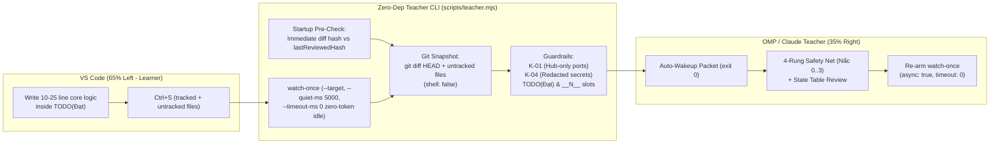

# Live Coding AI Teacher Mode (Level 2/3, 4-Rung Safety Net & Auto-Advisor Watcher)

## Overview

The **Live Coding AI Teacher Mode** turns Oh-My-Pi (OMP) and Claude Code into an offline-style 1-on-1 backend engineering mentor ("Thầy giáo ngồi cạnh bàn") tailored for live coding practice and technical interview preparation.

### Key Pedagogical & Architectural Tenets
1. **"Thầy Ngồi Cạnh — Có Lưới Đỡ 4 Nấc"**: The learner writes 100% of core backend logic (Locks, Transactions, Indexes, Caching strategies, Redis Lua scripts) in compact 10–25 line interview-sized blocks, backed by a 4-rung safety net (`Nấc 0` syntax cheat-sheet -> `Nấc 1` line nudge -> `Nấc 2` 70/30 fill-in slots -> `Nấc 3` model solution + variant repeat).
2. **Dual-Axis Level 2 Default + Level 3 Interview Grill**:
   - **Level 2 (`middle`, default)**: Axis A enforces mid-strong engineering depth (patterns, concurrency, failure modes, 100 vs 10,000 RPS trade-offs); Axis B provides plain-Vietnamese glossaries for unfamiliar CLI/Lua/SQL syntax and strictly bans walls of prose in favor of short code + fill-in state tables (`Step | Who | Command | Cache | DB`).
   - **Level 3 (`senior`)**: Post-coding Mock Interviewer mode asking 3 targeted production/concurrency/failure-mode questions on the learner's `git diff`.
3. **Zero External Dependencies**: Pure Node.js built-ins (`node:fs`, `node:path`, `node:child_process`, `node:crypto`, `node:test`, `node:assert/strict`). Zero `npm install`.
4. **Strict Project-Local Scope & Public Repo Safety (`NgoDat2003/advance` is PUBLIC)**:
   - Tracked defaults live in `.teacher/config.json`.
   - Ephemeral session state (`.teacher/state.local.json`), isolated test fixtures (`.teacher/tmp/`), and worktrees (`/.worktrees/`) are git-ignored. Never use `node:os.tmpdir()` or write to `~` / `$HOME` / `%USERPROFILE%`.
   - Detected secrets in `K-04` are strictly redacted (`***REDACTED***`) in all stdout/JSON outputs, and `--save` writes only `defaultLevel` and `defaultRung`.
5. **Non-Goals & Invariant Boundaries**:
   - Leaves `k2-lesson-04-caching` and all existing HTML teacher guides untouched.
   - Scopes `K-01` forbidden port checks (`3000`, `3001`, `5433`, `6379`) strictly to `omnipos-finledger-hub` targets so legitimate `advance-be` Redis/PG lab ports (`6379`, `5433`) never false-positive.

---

## Architecture



---

## Caller Usage & CLI Contract

```bash
# 1. Inspect current status, level, rung, and resolved hub path
node scripts/teacher.mjs status [--root <dir>] [--json] [--save]

# 2. Switch pedagogical level (1|2|3|junior|middle|mid|senior)
node scripts/teacher.mjs level <1|2|3|junior|middle|mid|senior> [--root <dir>] [--save] [--json]

# 3. Query, set, or advance the 4-Rung safety net ladder (alias: hint)
node scripts/teacher.mjs rung [0|1|2|3|next] [--root <dir>] [--json]
node scripts/teacher.mjs hint [0|1|2|3|next] [--root <dir>] [--json]

# 4. Inspect tracked + staged + untracked diffs and run K-01 / K-04 / slot checks
node scripts/teacher.mjs diff [--target <auto|local|hub|dir>] [--root <dir>] [--json]

# 5. One-shot debounced watcher for OMP zero-prompt auto-advisor wakeups
node scripts/teacher.mjs watch-once [--target <auto|local|hub|dir>] [--quiet-ms <ms>] [--timeout-ms <ms>] [--root <dir>] [--json]
```

### CLI Command Specifications & Exit Codes

| Command | Arguments / Flags | Behavior | Exit Codes |
| :--- | :--- | :--- | :--- |
| `status` | `[--root <dir>] [--json] [--save]` | Resolves config hierarchy (`CLI > state.local.json > config.json > defaults`). `--save` persists ONLY `defaultLevel` and `defaultRung` into `.teacher/config.json`. | `0`: OK · `2`: Bad flag |
| `level` | `<level> [--root <dir>] [--save] [--json]` | Accepts `1\|2\|3\|junior\|middle\|mid\|senior` (case-insensitive). Writes `.teacher/state.local.json` (and `.teacher/config.json` when `--save` is set). | `0`: OK · `2`: Invalid level |
| `rung` / `hint` | `[0\|1\|2\|3\|next] [--root <dir>] [--json]` | `rung` with no arg prints current rung; `hint` with no arg (or `next` on either) advances `min(3, currentRung + 1)`; numeric `0..3` sets exact rung. | `0`: OK · `2`: Invalid rung |
| `diff` | `[--target <auto\|local\|hub\|dir>] [--root <dir>] [--json]` | Aggregates `git diff HEAD --` + untracked files (`git ls-files --others --exclude-standard`). Runs `K-01` (hub targets only, port-context regex), `K-04` (redacted secrets), and `TODO(Đạt)` / `__1__`..`__9__` counts. Explicit non-existent `--target <dir>` exits `2`. | `0`: Clean · `1`: Guardrail violation · `2`: Bad target |
| `watch-once` | `[--target <...>] [--quiet-ms <ms>] [--timeout-ms <ms>] [--root <dir>] [--json]` | Runs startup pre-check against `lastReviewedHash` first; if unchanged, watches target dir (handling Windows `filename === null` safely), debounces writes (`default quietMs: 5000`), and waits indefinitely (`default timeoutMs: 0`) or until `--timeout-ms` expires. | `0`: Diff wakeup or clean timeout · `2`: Invalid numeric/target flag |

---

## Goals

| # | Goal | Priority | Success Measure |
|---|------|----------|-----------------|
| 1 | **TDD CLI & Watcher Engine** | P1 | `node --test scripts/teacher.test.mjs` passes 100% covering status, level, rung/hint, tracked+untracked diff, startup pre-check, debounce, null-filename safety, and hash deduplication. |
| 2 | **Context-Aware Guardrails (`K-01`, `K-04`, Slots)** | P1 | `K-01` triggers only on Hub port contexts (never on `advance-be` labs or `setTimeout(..., 3000)`); `K-04` redacts secret values and skips env placeholders. |
| 3 | **Pair-Teacher Protocol Parity** | P1 | Identical `## Live Coding Pair-Teacher Protocol` section in `AGENTS.md` and `CLAUDE.md` enforced by automated parity test (with `-1` missing-section guard). |
| 4 | **OMP & Claude Command + Skill + Guide** | P1 | `.claude/commands/thay.md` + `.claude/skills/thay/SKILL.md` discoverable in both OMP and Claude Code, paired with `docs/live-coding-teacher-guide.md`. |
| 5 | **Zero Dependencies & Public Repo Safety** | P1 | Zero `npm install`, zero `os.tmpdir()` / global writes, zero unredacted secrets or local user paths in tracked files. |

---

## Implementation Phases

| # | Phase | Effort | Dependencies | Status |
|---|-------|--------|--------------|--------|
| 1 | [Phase 1: TDD Teacher CLI and Watcher Engine](./phase-01-tdd-teacher-cli-and-watcher.md) | 1h | None | `todo` |
| 2 | [Phase 2: Teacher Protocol, Slash Command/Skill & Integration Smoke](./phase-02-protocol-skill-and-smoke.md) | 1h | Phase 1 | `todo` |

---

## Success Criteria

- [x] `.gitignore` ignores `/.worktrees/`, `/.teacher/state.local.json`, and `/.teacher/tmp/`.
- [x] `.teacher/config.json` defines `version: 1`, `defaultLevel: 2`, `defaultRung: 0`, `quietMs: 5000`, `timeoutMs: 0`, `hubPath: "../omnipos-finledger-hub"`, and `forbiddenHubPorts: [3000, 3001, 5433, 6379]`.
- [x] `scripts/teacher.test.mjs` written TDD-first and passes 100% via `node --test scripts/teacher.test.mjs`.
- [x] `scripts/teacher.mjs` uses `spawnSync(..., { shell: false })`, redacts `K-04` matches, scopes `K-01` to Hub targets in port context, includes untracked files, resolves Hub across worktrees/junctions, and handles Windows `filename === null` events safely.
- [x] `AGENTS.md` and `CLAUDE.md` share byte-identical `## Live Coding Pair-Teacher Protocol` sections.
- [x] `.claude/commands/thay.md`, `.claude/skills/thay/SKILL.md`, and `docs/live-coding-teacher-guide.md` exist and align on all subcommands (`status`, `level`, `watch`, `hint`, `mau`, `quiz`).
- [x] Isolated smoke check in `.teacher/tmp/` passes with zero leftover staged/untracked pollution in the repository.

---

## Red Team Review

### Session — 2026-11-03
**Findings:** 11 deduplicated (5 Critical, 3 High, 3 Medium — 11 accepted, 0 rejected)

| # | Finding | Severity | Disposition | Applied To |
|---|---------|----------|-------------|------------|
| RT-01 | Redact plaintext secrets in `diff --json` & restrict `--save` to `defaultLevel`/`defaultRung` | Critical | Accept | `plan.md`, Phase 1 |
| RT-02 | Scope `K-01` to Hub port contexts (avoid lab `6379`/`5433` & `setTimeout 3000` false positives) + harden `K-04` regex & allowlist | Critical | Accept | `plan.md`, Phase 1 |
| RT-03 | Include staged + untracked files (`git diff HEAD` + `git ls-files --others --exclude-standard`) | Critical | Accept | `plan.md`, Phase 1 |
| RT-04 | Add `/.teacher/tmp/` to `.gitignore`, ban `os.tmpdir()`, isolate test fixtures via `--root` without `.teacher/` watch deadlock | Critical | Accept | `plan.md`, Phase 1, Phase 2 |
| RT-05 | Add `--target` to `watch-once` & resolve Hub dynamically across worktrees (`--git-common-dir`) and junctions | Critical | Accept | `plan.md`, Phase 1 |
| RT-06 | Ship `.claude/commands/thay.md` alongside `.claude/skills/thay/SKILL.md` for native OMP + Claude Code `/thay` discovery | High | Accept | `plan.md`, Phase 2 |
| RT-07 | Startup diff pre-check in `watch-once` + default `quietMs: 5000`, `timeoutMs: 0` (zero idle token burn) + `NaN` validation | High | Accept | `plan.md`, Phase 1, Phase 2 |
| RT-08 | Enforce `shell: false`, `--` git pathspec separator, and reject `--target` starting with `-` | High | Accept | Phase 1, Phase 2 |
| RT-09 | Guard `filename === null` in Windows `fs.watch` callback by scheduling debounced diff check safely | Medium | Accept | Phase 1 |
| RT-10 | Unify `rung` and `hint` subcommands with `next` / zero-arg hint auto-advance | Medium | Accept | `plan.md`, Phase 1, Phase 2 |
| RT-11 | Guard `indexOf(...) === -1` in `AGENTS.md` / `CLAUDE.md` parity verification | Medium | Accept | Phase 1, Phase 2 |

### Whole-Plan Consistency Sweep
- Reconciled `--quiet-ms` (`5000` default, `<ms>` synopsis) and `--timeout-ms` (`0` default indefinite idle, `<ms>` synopsis) across `plan.md`, Phase 1, and Phase 2.
- Reconciled `rung` and `hint` CLI aliases, `.gitignore` entries (`/.worktrees/`, `/.teacher/state.local.json`, `/.teacher/tmp/`), and `.claude/commands/thay.md` + `.claude/skills/thay/SKILL.md` across all three files.
- Zero unresolved contradictions remain.

## Validation Log

### Verification Results
- Claims checked: 20 (Standard Tier: Fact Checker + Contract Verifier)
- Verified: 20 | Failed: 0 | Unverified: 0
- Tier: Standard
- Decisions locked from user brainstorm contract: Project-local scope only, Level 2 Dual-Axis default with Level 3 interview toggle, 4-Rung safety net, 3-column role boundary, zero external dependencies, and non-interference with `k2-lesson-04-caching`.

### Whole-Plan Consistency Sweep
- Verified all file paths, CLI flags, exit codes (`0`, `1`, `2`), and JSON payload fields match identically across `plan.md`, `phase-01-tdd-teacher-cli-and-watcher.md`, and `phase-02-protocol-skill-and-smoke.md`.

<!-- slug: live-coding-teacher-mode -->
