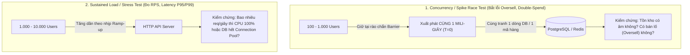

# Báo Cáo Nghiên Cứu: Công Cụ & GitHub Repositories Test Hệ Thống Đông Người Dùng (High Concurrency / Flash Sale)

- **Ngày thực hiện:** 2026-10-30
- **Phạm vi:** Các công cụ giả lập tải cao (Load/Stress/Spike Testing), công cụ ép xung đồng thời (Concurrency Race Harness), và các GitHub Repository mẫu về Flash Sale / Seckill / High-Concurrency Booking.
- **Ngữ cảnh áp dụng:** Lộ trình học Advanced Backend & dự án thực chiến **OmniPOS + FinLedger Hub** (Node.js/TypeScript, PostgreSQL, Redis).

---

## Mục Lục

1. [Tóm tắt Kết luận (Executive Summary)](#1-tóm-tắt-kết-luận-executive-summary)
2. [Phân biệt 2 bài toán: Load Testing vs. Concurrency Race Testing](#2-phân-biệt-2-bài-toán-load-testing-vs-concurrency-race-testing)
3. [Top Công cụ Giả lập Nhiều User Cùng Lúc (2026 Benchmark)](#3-top-công-cụ-giả-lập-nhiều-user-cùng-lúc-2026-benchmark)
4. [Top GitHub Repositories Mẫu về Flash Sale / Seckill / Ticket Booking](#4-top-github-repositories-mẫu-về-flash-sale--seckill--ticket-booking)
5. [3 Kịch bản Code Thực Chiến cho Flash Sale (Dùng ngay được)](#5-3-kịch-bản-code-thực-chiến-cho-flash-sale-dùng-ngay-được)
6. [Đề xuất Áp dụng vào Lộ trình Học & Dự án của Đạt](#6-đề-xuất-áp-dụng-vào-lộ-trình-học--dự-án-của-đạt)
7. [Nguồn tham khảo (References)](#7-nguồn-tham-khảo-references)

---

## 1. Tóm tắt Kết luận (Executive Summary)

Để test tính năng **Flash Sale / Giành vé / Trừ tồn kho / Chuyển tiền đồng thời**, bạn không chỉ cần một công cụ "bắn nhiều request", mà cần **đúng công cụ cho đúng tầng muốn phá**:

1. **Test kịch bản Flash Sale chuẩn Production (1.000 – 10.000 user cùng ập vào + kiểm tra không âm kho):** Dùng **Grafana k6** (`grafana/k6`). Viết kịch bản bằng JavaScript, hỗ trợ `shared-iterations` / `ramping-arrival-rate` để dồn hàng nghìn Virtual Users (VUs) vào đúng 1 giây mở bán.
2. **Test nhanh ngay trong hệ sinh thái Node.js không cần cài đặt ngoài:** Dùng **Autocannon** (`mcollina/autocannon`, chạy thẳng bằng `npx autocannon`) hoặc **Barrier Script bằng Node.js (`Promise.allSettled`)** để bắn 100 request chạm DB cùng 1 mili-giây.
3. **Dội bom HTTP xem ngưỡng chịu tải tối đa + xem biểu đồ trực tiếp trên Terminal:** Dùng **oha** (`hatoo/oha` - viết bằng Rust, có giao diện TUI realtime cực đẹp) hoặc **Locust** (`locustio/locust` - có Web UI trên trình duyệt để kéo thanh trượt tăng user).
4. **GitHub Repo mẫu đáng học nhất để xem cách thiết kế + test Flash Sale:**
   - [`Praciller/stockrush-go`](https://github.com/Praciller/stockrush-go): Chuẩn mực về kiểm chứng **Zero Overselling** (1.000 người mua 100 món -> đúng 100 đơn thành công, 900 sold-out, 0 âm kho, có sẵn k6 + bộ kiểm tra bất biến DB).
   - [`VladyslavSeliukov/TicketCore`](https://github.com/VladyslavSeliukov/TicketCore): Hệ thống đặt vé tải cao (PostgreSQL `SELECT FOR UPDATE SKIP LOCKED` + Redis Lua Script Gatekeeper + Idempotency + Locust test 1.000 user / 2.500 RPS).

---

## 2. Phân biệt 2 bài toán: Load Testing vs. Concurrency Race Testing

Rất nhiều bạn mới học nhầm giữa **Stress Test băng thông (Throughput)** và **Test tranh chấp dữ liệu (Race Condition / Flash Sale)**:



- **Nếu mục tiêu là bắt bug bán lố (Overselling) / trừ tiền 2 lần:** Chỉ cần **50 – 200 request** nhưng phải **đồng bộ nổ súng cùng 1 thời điểm** (Synchronized Barrier) nhắm vào **cùng 1 `product_id` hoặc `account_id`**.
- **Nếu mục tiêu là xem server chịu được bao nhiêu người dùng:** Dùng công cụ Load Test (**k6, oha, autocannon, Locust**) bơm tải liên tục trong 30s – 5 phút để đo **RPS (Requests/sec)** và **P95/P99 Latency**.

---

## 3. Top Công cụ Giả lập Nhiều User Cùng Lúc (2026 Benchmark)

Số liệu thực nghiệm từ [Fusillade Load Testing Benchmarks (02/2026)](https://fusillade.io/blog/load-testing-benchmarks-2026) và [CodeNote OSS Load Testing Comparison (02/2026)](https://codenote.net/en/posts/k6-alternatives-permissive-license-load-testing-tools/) khi chạy **1.000 concurrent users** trong 60 giây trên cùng phần cứng (Ryzen 7 5800X, 32GB RAM):

| Công cụ | GitHub Repo | Ngôn ngữ / Viết kịch bản | Thông lượng (RPS @ 1K VUs) | Độ trễ P50 | RAM tiêu thụ | Điểm mạnh nhất khi test Flash Sale |
| :--- | :--- | :--- | ---: | ---: | ---: | :--- |
| **k6** | [`grafana/k6`](https://github.com/grafana/k6) | Engine Go / Script **JS/TS** | 121,972 | 4.55 ms | 1,608 MB | Viết kịch bản Flash Sale bằng JS cực dễ, có `checks`, `thresholds`, `Counter` đếm chính xác số đơn 200 OK vs 409 Sold Out. |
| **Autocannon** | [`mcollina/autocannon`](https://github.com/mcollina/autocannon) | **Node.js** (CLI + JS API) | ~30,000 - 50,000 | ~2.00 ms | ~150 MB | Chạy ngay bằng `npx autocannon`, không cần cài ngoài; nhúng thẳng vào file test `.mjs` của Node.js. |
| **oha** | [`hatoo/oha`](https://github.com/hatoo/oha) | **Rust** (CLI + Terminal UI) | 523,284 | 1.58 ms | 6,634 MB | Giao diện đồ họa TUI ngay trong Terminal, nhìn biểu đồ sóng bắn request nhảy theo thời gian thực. |
| **bombardier** | [`codesenberg/bombardier`](https://github.com/codesenberg/bombardier) | **Go** (CLI đơn) | 564,944 | 1.50 ms | 39 MB | Siêu nhẹ (39MB RAM), bắn nửa triệu RPS để dội bom 1 endpoint xem server gục ở ngưỡng nào. |
| **Locust** | [`locustio/locust`](https://github.com/locustio/locust) | **Python** (Có Web Dashboard) | 2,374 (1 core) | 22.00 ms | 116 MB | Có giao diện Web (`localhost:8089`) cực trực quan để bật cho sếp/interviewer xem biểu đồ RPS tăng dần. |
| **Gatling OSS** | [`gatling/gatling`](https://github.com/gatling/gatling) | JVM / **JS, TS, Java, Scala** | 16,606 | 29.00 ms | 659 MB | Xuất file báo cáo HTML tĩnh cực đẹp sau khi chạy xong. |

---

## 4. Top GitHub Repositories Mẫu về Flash Sale / Seckill / Ticket Booking

Nếu Đạt muốn xem "người ta dựng hệ thống Flash Sale và viết bộ test đập phá nó như thế nào", đây là 5 repo thực tế nhất (từ gọn nhẹ dễ đọc đến quy mô lớn):

| Repository | Tech Stack | Bài toán giải quyết & Cách họ Test | Độ phù hợp với Đạt |
| :--- | :--- | :--- | :--- |
| **[`Praciller/stockrush-go`](https://github.com/Praciller/stockrush-go)** | Go + PostgreSQL + React + **k6** | **1.000 người tranh 100 món hàng.** Chứng minh `Zero Overselling` bằng khóa DB, Idempotency Key, Worker thu hồi đơn hết hạn. Có cả k6 script lẫn tool `cmd/loadgen` dùng `sync.WaitGroup` + `chan struct{}` giữ 1.000 goroutines xuất phát cùng 1 lúc rồi đối soát DB. | ⭐⭐⭐⭐⭐ **(Đáng đọc số 1)** Cách viết báo cáo đối soát bất biến (`Available + Reserved + Sold == Total`) cực kỳ chuẩn để áp dụng vào OmniPOS. |
| **[`VladyslavSeliukov/TicketCore`](https://github.com/VladyslavSeliukov/TicketCore)** | Python FastAPI + PostgreSQL 16 + Redis 7 + **Locust** | **10.000 fan tranh 100 vé concert.** Kết hợp 2 tầng: **Redis Lua Script** chặn ở cửa (Gatekeeper) + **PostgreSQL `SELECT ... FOR UPDATE SKIP LOCKED`** ở tầng DB. Có sẵn thư mục `load_tests/locustfile.py` giả lập vừa xem sự kiện (`@task(4)`) vừa bấm mua vé (`@task(1)`). | ⭐⭐⭐⭐⭐ Kiến trúc giống hệt bài toán Caching + Locking + Idempotency trong khóa học của Đạt. |
| **[`mayurbadgujar03/Distributed-Flash-Sale-Engine`](https://github.com/mayurbadgujar03/Distributed-Flash-Sale-Engine)** | **Node.js (Express)** + Redis + MongoDB + **k6** | **"Bài toán 1.000 chiếc iPhone cho 10.000 người".** Viết bằng Node.js rất dễ đọc. Có sẵn `scripts/attack.js` (dùng `Promise.allSettled` bắn đồng thời) và `scripts/stress-test.js` (dùng **k6** tăng tải từ 20 -> 100 -> 200 VUs). | ⭐⭐⭐⭐ Cùng ngôn ngữ **Node.js**, rất dễ đọc hiểu trong 15 phút. |
| **[`shij8396/miaosha`](https://github.com/shij8396/miaosha)** & **[`qiurunze123/miaosha`](https://github.com/qiurunze123/miaosha)** (26.5k ⭐) | Go / Java + Redis Cluster + Lua + MQ + Prometheus | Hệ thống **"Miaosha" (Seckill / Flash Sale kiểu Shopee, Taobao)** kinh điển: Ẩn URL mua hàng, Captcha chống bot, Redis Lua trừ kho nguyên tử, đẩy vào Message Queue (Kafka/RabbitMQ) xử lý bất đồng bộ, Dead-Letter Queue hoàn kho khi quá hạn thanh toán. | ⭐⭐⭐⭐ Kho tàng kiến trúc System Design cho phỏng vấn Backend Senior. |
| **[`azophy/loadtest-tools-benchmark`](https://github.com/azophy/loadtest-tools-benchmark)** | Docker + k6 + Locust + JMeter + Gatling + Vegeta | Repo tổng hợp sẵn cấu hình Docker và script mẫu của 6 công cụ load test cùng bắn vào 1 server mẫu để bạn chạy thử và so sánh. | ⭐⭐⭐ Tiện để copy-paste cấu hình Docker của từng công cụ. |

---

## 5. 3 Kịch bản Code Thực Chiến cho Flash Sale (Dùng ngay được)

### Cách 1: Không cần cài gì thêm — Dùng `npx autocannon` bắn thẳng từ Terminal (Node.js)

Khi Đạt vừa viết xong 1 API (ví dụ `POST http://localhost:3000/api/flash-sale/buy`), chỉ cần mở terminal gõ 1 dòng lệnh:

```bash
# Giả lập 100 kết nối đồng thời (-c 100), bắn tổng cộng 1000 requests (-a 1000) vào API mua hàng
npx autocannon -c 100 -a 1000 -m POST \
  -H "Content-Type: application/json" \
  -b '{"productId": 1, "quantity": 1}' \
  http://localhost:3000/api/flash-sale/buy
```

Kết quả trả về bảng thống kê độ trễ (P50, P90, P99), số request/giây (Req/Sec) và số mã lỗi 2xx / 4xx / 5xx ngay trên màn hình.

---

### Cách 2: "Súng bắn tỉa Race Condition" bằng Node.js thuần (`flash-sale-race.mjs`)

Công cụ CLI đôi khi bắn tuần tự theo đợt. Muốn ép **200 user chạm vào câu lệnh SQL cùng 1 mili-giây** để kiểm tra xem code có bị **Oversell (bán lố 100 món thành 105 món)** hay không, hãy dùng kỹ thuật **Synchronized Start Barrier** trong 30 dòng Node.js:

```javascript
// Chạy bằng: node flash-sale-race.mjs
const TOTAL_USERS = 200;       // 200 người cùng bấm nút Mua
const INITIAL_STOCK = 50;      // Trong kho chỉ có 50 chiếc iPhone
const API_URL = 'http://localhost:3000/api/flash-sale/buy';

async function runFlashSaleAttack() {
  console.log(`Chuẩn bị ${TOTAL_USERS} users cùng săn ${INITIAL_STOCK} sản phẩm...`);

  // Tạo rào chắn (Barrier) để cả 200 promises khởi động sẵn và xuất phát cùng 1 tích tắc
  let releaseBarrier;
  const startGate = new Promise((resolve) => { releaseBarrier = resolve; });

  const workers = Array.from({ length: TOTAL_USERS }, async (_, i) => {
    const userId = `user_${i + 1}`;
    await startGate; // Đứng chờ hiệu lệnh nổ súng
    const res = await fetch(API_URL, {
      method: 'POST',
      headers: {
        'Content-Type': 'application/json',
        'Idempotency-Key': `flashsale-key-${userId}`,
      },
      body: JSON.stringify({ userId, productId: 'IPHONE_16_PRO', quantity: 1 }),
    });
    return { status: res.status, body: await res.json().catch(() => ({})) };
  });

  // NỔ SÚNG! Tất cả 200 request đập vào server cùng lúc
  const t0 = performance.now();
  releaseBarrier();
  const results = await Promise.all(workers);
  const elapsedMs = (performance.now() - t0).toFixed(1);

  const successCount = results.filter((r) => r.status === 200 || r.status === 201).length;
  const soldOutCount = results.filter((r) => r.status === 409 || r.status === 400).length;
  const errorCount = results.length - successCount - soldOutCount;

  console.table({
    'Tổng số người bấm mua': TOTAL_USERS,
    'Tồn kho ban đầu': INITIAL_STOCK,
    'Mua thành công (200/201)': successCount,
    'Hết hàng (409/400)': soldOutCount,
    'Lỗi hệ thống (5xx)': errorCount,
    'Thời gian xử lý (ms)': elapsedMs,
    'Kết luận Oversell': successCount === INITIAL_STOCK ? 'PASS (Chuẩn tuyệt đối)' : `FAIL (Bán lố ${successCount - INITIAL_STOCK} đơn!)`,
  });
}

runFlashSaleAttack();
```

---

### Cách 3: Kịch bản **Grafana k6** chuẩn Công nghiệp (`flash-sale.k6.js`)

Khi muốn đưa vào CV hoặc demo phỏng vấn chuyên nghiệp, dùng **k6** với executor `shared-iterations` (ép đúng 1.000 lượt mua từ 200 người dùng đồng thời và tự động chấm điểm Pass/Fail):

```javascript
// Chạy bằng: k6 run flash-sale.k6.js
import http from 'k6/http';
import { check } from 'k6';
import { Counter } from 'k6/metrics';

const successOrders = new Counter('flashsale_success_orders');
const soldOutResponses = new Counter('flashsale_sold_out_responses');

export const options = {
  scenarios: {
    flash_sale_spike: {
      executor: 'shared-iterations',
      vus: 200,            // 200 người dùng cùng lúc
      iterations: 1000,    // Tổng cộng 1.000 cú click mua hàng
      maxDuration: '30s',
    },
  },
  thresholds: {
    http_req_failed: ['rate<0.01'],       // Lỗi 5xx phải dưới 1%
    http_req_duration: ['p(95)<500'],     // 95% request phải phản hồi dưới 500ms
    flashsale_success_orders: ['count==100'], // BẤT BIẾN: Kho có 100 món thì ĐÚNG 100 đơn thành công!
  },
};

export default function () {
  const uniqueUser = `buyer_${__VU}_${__ITER}`;
  const payload = JSON.stringify({
    productId: 'FLASH_ITEM_01',
    quantity: 1,
  });

  const res = http.post('http://localhost:3000/api/flash-sale/buy', payload, {
    headers: {
      'Content-Type': 'application/json',
      'Idempotency-Key': `idem_${uniqueUser}`,
    },
    // Báo cho k6 biết 409 (Sold Out) là phản hồi hợp lệ của nghiệp vụ, không phải lỗi sập server
    responseCallback: http.expectedStatuses(200, 201, 409),
  });

  if (res.status === 200 || res.status === 201) {
    successOrders.add(1);
  } else if (res.status === 409) {
    soldOutResponses.add(1);
  }

  check(res, {
    'Chỉ trả về 200/201 (Mua được) hoặc 409 (Hết hàng)': (r) =>
      r.status === 200 || r.status === 201 || r.status === 409,
  });
}
```

---

## 6. Đề xuất Áp dụng vào Lộ trình Học & Dự án của Đạt

Trong repo `D:/study/advance-be` hiện tại:
1. **Ở mức Database thuần (như `labs/lesson-14-locking`):** Đạt đã có sẵn bộ `lock-kit.mjs` và `homework-booking-grader.mjs` bắn 8-20 kết nối PostgreSQL song song để test `FOR UPDATE`, `SKIP LOCKED`, Optimistic Locking.
2. **Khi dựng API cho dự án OmniPOS + FinLedger Hub (Cluster 1 -> Cluster 3):**
   - **Bước 1 (Dev local nhanh):** Dùng `npx autocannon` hoặc script Node.js Barrier (Cách 2 ở trên) để tự đập API của mình sau mỗi bài học.
   - **Bước 2 (Đóng gói Portfolio / Đi phỏng vấn):** Thêm 1 thư mục `loadtest/flash-sale.k6.js` (dùng **k6**) học theo mẫu của repo [`Praciller/stockrush-go`](https://github.com/Praciller/stockrush-go) — in ra bảng chứng minh: *1.000 người mua 100 món -> 100 thành công, 900 hết hàng, 0 âm kho, 0 đơn trùng*. Đây là "vũ khí" cực mạnh khi đưa vào CV Backend.

---

## 7. Nguồn tham khảo (References)

1. [Fusillade Blog — We Benchmarked 7 Load Testing Tools (Feb 2026)](https://fusillade.io/blog/load-testing-benchmarks-2026)
2. [CodeNote — Comparing Permissive-Licensed OSS Load Testing Tools & k6 Alternatives (Feb 2026)](https://codenote.net/en/posts/k6-alternatives-permissive-license-load-testing-tools/)
3. [GitHub — `Praciller/stockrush-go`: Concurrency-safe flash-sale and inventory-reservation platform with k6 & invariant verifier](https://github.com/Praciller/stockrush-go)
4. [GitHub — `VladyslavSeliukov/TicketCore`: High-Load Event Booking API with Redis Lua, PostgreSQL SKIP LOCKED & Locust](https://github.com/VladyslavSeliukov/TicketCore)
5. [GitHub — `mayurbadgujar03/Distributed-Flash-Sale-Engine`: Node.js Flash Sale Simulation with k6 & Concurrency Attack Script](https://github.com/mayurbadgujar03/Distributed-Flash-Sale-Engine)
6. [GitHub — `qiurunze123/miaosha`: High-Concurrency Seckill System Design (26.5k+ stars)](https://github.com/qiurunze123/miaosha)
7. [GitHub — `grafana/k6`](https://github.com/grafana/k6) | [`mcollina/autocannon`](https://github.com/mcollina/autocannon) | [`hatoo/oha`](https://github.com/hatoo/oha) | [`locustio/locust`](https://github.com/locustio/locust)
