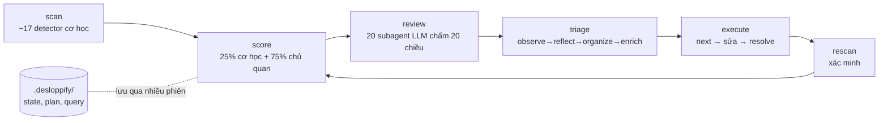

# Báo cáo: desloppify — dùng để làm gì, có cần setup không, sức mạnh thực tế

- **Thời điểm nghiên cứu:** 2026-11-02 08:49–09:15 (Asia/Bangkok)
- **Đối tượng:** https://github.com/peteromallet/desloppify — nhánh `main`, PyPI `desloppify==1.0`
- **Cách làm:** đọc README, docs và code scoring (gói bằng repomix), xem issue/PR/commit qua `gh`, tìm nguồn ngoài, rồi **cài thật và chạy thật** trên 2 codebase của Đạt (Python và TypeScript/NestJS).

## Kết luận nhanh

1. **Nó là gì:** một CLI Python chạy local, dùng làm "khung điều khiển" (harness) cho AI coding agent (Claude Code, Codex, Cursor…). Công cụ quét code tìm lỗi cơ học, nhờ chính agent của bạn chấm điểm chủ quan về thiết kế, rồi đưa agent vào vòng lặp `next → sửa → resolve → next` cho đến khi điểm đạt mục tiêu. Nó không phải SaaS và không có web dashboard.
2. **Giải quyết vấn đề gì:** code "vibe coding" do AI viết chạy được nhưng mục dần: file khổng lồ, abstraction lệch, mỗi chỗ xử lý lỗi một kiểu. desloppify biến "chất lượng" thành một con số (0–100) có chống gian lận, đủ để agent tự cày dần qua nhiều phiên.
3. **Có cần setup không:** **Có.** Phải cài Python ≥ 3.11, chạy `pip install "desloppify[full]"`, chạy trong repo, và nạp skill vào agent. Công cụ không tự gọi API LLM; phần review chủ quan dùng agent/subagent của bạn, tức là tốn token của bạn.
4. **Sức mạnh thực tế (đã đo):**
   - Scan cơ học **rất nhanh**: 5 giây cho 4.7k dòng Python, 9 giây cho 65 file TS.
   - Độ chính xác **trung bình**: khoảng 65–78% finding đúng trên mẫu Python. Phát hiện tốt file/hàm quá lớn và thiếu test. Sai ở "orphaned" và ở chỗ bắt nhầm chữ trong string.
   - **Bỏ sót lỗi thật:** 4 escape không hợp lệ và **33 escape bị Python decode âm thầm** làm hỏng nội dung, ví dụ `$\rightarrow$` biến thành ký tự CR cộng chữ "ightarrow".
   - Trên Windows gặp **bug thật**: detector security phớt lờ exclude (cả cờ `--exclude` lẫn config `desloppify exclude`) và quét luôn venv, sinh ra 2575 issue rác.
   - Phần đắt giá nhất là review chủ quan (chiếm 75% điểm) và cần khoảng **20 subagent cho mỗi vòng**. Mình chưa chạy phần này vì tốn token.
5. **Khuyến nghị cho Đạt:** **không bắt buộc, chưa nên đưa vào workflow chính lúc này.**
   - Có thể dùng **phần scan cơ học** (miễn phí, chạy trong vài giây) như một checklist sức khỏe định kỳ cho `omnipos-finledger-hub`.
   - **Không nên** bật chế độ autopilot "fix loop", vì nó trái với cách học "tự làm" và dễ đốt token.

## Mục lục

1. [Tổng quan repo và độ trưởng thành](#1-tổng-quan-repo-và-độ-trưởng-thành)
2. [Cách hoạt động](#2-cách-hoạt-động)
3. [Setup — cần gì, tốn gì](#3-setup--cần-gì-tốn-gì)
4. [Kết quả chạy thử thực tế](#4-kết-quả-chạy-thử-thực-tế)
5. [Điểm mạnh, điểm yếu, rủi ro](#5-điểm-mạnh-điểm-yếu-rủi-ro)
6. [Khuyến nghị và bước tiếp theo](#6-khuyến-nghị-và-bước-tiếp-theo)
7. [Nguồn](#7-nguồn)
8. [Câu hỏi chưa giải quyết](#8-câu-hỏi-chưa-giải-quyết)

## 1. Tổng quan repo và độ trưởng thành

| Mục | Giá trị (tại 2026-11-02) |
|---|---|
| Stars / forks | 3,746 / 297, đang tăng đều (hàng chục star mỗi ngày) |
| Ngày tạo | 2026-02-11 |
| Bản phát hành | v1.0 (2026-05-13), trùng với PyPI `1.0` |
| Commit cuối trên `main` | 2026-05-13. Sau đó **không có commit nào vào main** |
| Nhánh treo | `1.0.1` (3 commit docs/version, chưa release); `chore/apache-2-license-20261027` (đổi sang Apache-2.0, chưa merge) |
| Người đóng góp | `peteromallet` 874 commit; người đóng góp thứ hai chỉ có 17. Gần như một người duy trì |
| Issue/PR mới | Rất nhiều issue và PR mở trong khoảng 29/10–01/11, hầu hết 0 comment và chưa merge |
| Ngôn ngữ | 29 ngôn ngữ. Hỗ trợ sâu cho TypeScript, Python, C#, C++, Dart, GDScript, Go, Rust; các ngôn ngữ còn lại qua linter + tree-sitter |
| License (main) | OSNL v0.2: **miễn phí cho cá nhân và dùng nội bộ, kể cả trong công ty thương mại**. Chỉ tính phí khi nhúng vào sản phẩm bán ra **và** công ty không open source **và** có từ $1M funding/doanh thu trở lên |

**Đánh giá độ trưởng thành:** repo nổi tiếng nhanh nhưng mới khoảng 9 tháng tuổi. Main đứng yên gần 6 tháng trong khi backlog bug tăng nhanh. Phụ thuộc vào một người duy trì, nên **bus factor thấp**. Cần coi đây là công cụ beta có số phiên bản 1.0.

## 2. Cách hoạt động



**Hai nhóm điểm** (xem `docs/scoring.md` và output CLI):

- **Cơ học (25%):** File health, Code quality, Duplication, Test health, Security. Mỗi chiều tính bằng `(potential − failures có trọng số) / potential`. Chiều nào có dưới 200 lượt kiểm tra thì bị giảm trọng số.
- **Chủ quan (75%):** khoảng 20 chiều như High/Mid/Low elegance, Contracts, Type safety, Design coherence… do LLM chấm trên một "blind packet". Blind packet là gói dữ liệu không chứa điểm cũ, để reviewer không bị neo vào kết quả trước.
- **Bốn loại điểm:**
  - `overall`: điểm tổng, bản dễ dãi.
  - `strict`: tính cả các issue bị đánh `wontfix` là nợ. Đây là "north star".
  - `objective`: chỉ tính phần cơ học.
  - `verified`: chỉ cộng điểm cho fix đã được scan xác minh.
- **Chống gian lận:**
  - Phải có attestation khi resolve.
  - Đánh `wontfix` làm giãn khoảng cách giữa lenient và strict.
  - Review lại có thể làm điểm giảm.
  - Điểm khớp đúng target thì bị reset.

## 3. Setup — cần gì, tốn gì

**Bắt buộc:** Python ≥ 3.11 và `pip install "desloppify[full]"`. Gói `[full]` kéo theo tree-sitter, bandit, Pillow, PyYAML và defusedxml; venv thử nghiệm nặng 68 MB. Lệnh `desloppify update-skill claude` (hoặc `setup` để cài global) ghi skill/workflow guide vào cấu hình agent.

**Công thức chạy an toàn trên Windows của Đạt** (rút ra từ lần thử):

```powershell
# 1. Dùng lại venv đã cài và đã kiểm chứng (nằm ngoài path sẽ scan, vì detector security bỏ qua exclude)
#    Đưa Scripts lên đầu PATH để bandit được thấy, không cần Activate.ps1 (tránh lỗi execution policy)
$env:PATH = "D:\học\advance-be\labs\desloppify-trial\py-env\Scripts;$env:PATH"
$env:PYTHONUTF8 = "1"; $env:PYTHONIOENCODING = "utf-8"

# 2. Chạy trong repo; mỗi --path là MỘT project mạch lạc
cd D:\học\advance-be\omnipos-finledger-hub
Add-Content .gitignore ".desloppify/"   # đừng dùng `echo >>`: PowerShell 5.1 ghi UTF-16, git không đọc được
desloppify --lang typescript scan --path apps/api --no-badge
desloppify status            # dashboard
desloppify show smells       # xem chi tiết theo detector
```

Chưa kiểm chứng: lần thử chỉ chạy trên bản copy không có `node_modules` và `tsc`. Chạy trên hub thật (đã `npm install`) có thể ra số khác.

**Chi phí thật sự nằm ở review chủ quan.**

- `review --run-batches --dry-run` sinh ra **20 file prompt** (tổng khoảng 152 KB), mỗi chiều cần một subagent.
- Mỗi subagent còn phải tự đọc code. Ước lượng thô cho codebase cỡ 5k dòng là **vài trăm nghìn đến khoảng 1 triệu token mỗi vòng**. Con số này chưa đo, chỉ là ước lượng.
- Sau mỗi đợt refactor lớn lại phải review lại.
- Nếu bỏ qua review, điểm `overall`/`strict` bị kẹt ở mức ≤ 25.

## 4. Kết quả chạy thử thực tế

Toàn bộ sandbox nằm ở `labs/desloppify-trial/` (đã gitignore riêng bằng `*`). Thư mục này chứa venv, log, bản copy code và state.

### 4.1 Lần 1 — scan root advance-be (thất bại, nhưng lộ ra bug)

- **Lệnh:** `--lang python --exclude labs --exclude omnipos-finledger-hub ... scan --path D:/học/advance-be`
- **Kết quả:** detector security quét **2178 file**, gồm cả `labs/desloppify-trial/py-env/Lib/site-packages/...`, và sinh ra **2575 issue security rác**. Ví dụ là B108/B319 của bandit nằm ngay trong code của chính desloppify và defusedxml.
- Output cùng lúc báo "bandit is not installed" dù kết quả có mã của bandit. Lý do là venv chưa được activate nên preflight không thấy bandit trên PATH.
- **Hệ quả:** các "potential" bị thổi phồng nên điểm objective là 63.3, **cao hơn** lần chạy sạch (43.2). Scope sai làm điểm sai theo cả hai chiều.
- Thử lại bằng exclude lưu bền (`desloppify exclude labs`, config xác nhận `exclude: labs, omnipos-finledger-hub, .claude`) vẫn ra **2575 issue / 2184 file**. Vậy lỗi không phụ thuộc cách khai báo exclude.
- Bug này trùng nhóm với issue mở #916 (exclusions của Bandit bị sai).

### 4.2 Lần 2 — 6 script Python ở root (bản copy cô lập, 4,688 LOC)

| Chỉ số | Giá trị |
|---|---|
| Thời gian scan | 5 giây |
| Issue | 43 = 23 cơ học + 20 placeholder chủ quan (chưa review) |
| Điểm | overall 10.8 · objective 43.2 · strict 10.8 · verified 43.2 |
| Theo chiều | File health 41.7 · Code quality 84.8 · Duplication 100 · Security 94.2 · Test health 0 |

Mình kiểm tra tay **cả 23 finding cơ học** so với source:

| Phân loại | Số lượng | Ví dụ |
|---|---|---|
| Đúng, hữu ích | ~15 | `build_reports.py` 1470 LOC; monster function trên 150 LOC tại `build_reports.py:681` và `generate_master_curriculum_reports.py:11`; complexity 849; 4 hàm cyclomatic trên 12 trong `convert_pdf_to_md.py`; không có test |
| **Sai (false positive)** | 4 | `sys.exit` tại `convert_pdf_to_md.py:338` bị báo "ngoài CLI entry point" dù nằm trong `if __name__ == "__main__"`. "Insecure random" tại `generate_master_curriculum_reports.py:59` thực chất là **một đoạn chữ** nói về TTL jitter. 2 file "orphaned, not an entry point" (`build_reports.py`, `convert_pdf_to_md.py`) có guard `__main__` |
| Tranh cãi được | 3 | `generate_html_roadmap.py`, `generate_md_report.py` và `update_calendar_roadmap.py` bị báo orphaned. Chúng là script chạy một lần, không có guard `__main__` và không được tài liệu nào nhắc tới. Nếu bạn vẫn chạy tay thì đây là false positive; nếu đã bỏ thì tool đúng |
| Đáng ngờ | 1 | ReDoS trên `DOMAIN_RE`: nested quantifier được phân tách bởi `\.`, nên rủi ro backtracking thấp |

**Precision ≈ 65–78%**, tùy 3 script kia còn dùng hay không.

**Bỏ sót lỗi thật về escape.** Mình viết thêm `labs/desloppify-trial/check-silent-escapes.py`, đọc AST và kiểm tra giá trị string **sau khi Python decode**. Kết quả:

- **4 escape không hợp lệ** (`\w`, `\l`, `\d`): Python có in `SyntaxWarning` nhưng vẫn giữ nguyên dấu `\`. Vị trí: `generate_html_roadmap.py:891`, `generate_master_curriculum_reports.py:40`, `generate_master_curriculum_reports.py:385`, `generate_md_report.py:206`.
- **33 escape hợp lệ bị decode âm thầm**, đã làm hỏng nội dung xuất ra **ngay bây giờ** mà không có cảnh báo nào:
  - `$\rightarrow$` biến thành ký tự CR cộng "ightarrow" (khoảng 25 chỗ, đa số trong `generate_master_curriculum_reports.py`).
  - `$\times$` biến thành TAB cộng "imes" (dòng 385, 386, 388).
  - `$\approx$` biến thành ký tự BEL cộng "pprox" (dòng 541).
  - Đường dẫn `D:\học\advance-be` tại `generate_md_report.py:7` chứa `\a`, thành ký tự BEL.

desloppify không ghi nhận cái nào. Với 4 escape không hợp lệ, cảnh báo của Python chỉ trôi qua như stderr rác trong log scan. Với 33 chỗ decode âm thầm thì không có gì báo cả.

### 4.3 Lần 3 — `omnipos-finledger-hub/apps/api` (NestJS, bản copy, 65 file .ts)

| Chỉ số | Giá trị |
|---|---|
| Thời gian scan | 9 giây |
| Issue | 75 = 55 cơ học (42 test coverage, 9 smells, 2 single-use, 1 orphaned, 1 security) + 20 placeholder chủ quan |
| Điểm | overall 18.9 · objective 75.8 |
| Theo chiều | Code quality 98.5 · Duplication 100 · File health 100 · Security 99.8 · Test health 22.5 |

**Nhận xét:**

- Code hub sạch **theo các detector đã thực sự chạy**. Finding chủ yếu ở mức thấp.
- **Có ích:** chuỗi `http://localhost:3100` lặp ở 3 chỗ (`env.schema.ts:20` đã có default, còn `main.ts:43` và `origin-check.guard.ts:28` lại thêm fallback `??` thừa). Tool gắn nhãn là "hardcoded URL", nhưng giá trị thật là gợi ý gom về một chỗ (DRY).
- **Sai hoặc nhiễu:**
  - `prisma.config.ts` bị báo orphaned, dù đây là config do Prisma CLI đọc.
  - Filter/interceptor global bị báo "single-use", dù đăng ký trong `main.ts` là cách làm chuẩn của NestJS.
- **Bug nhãn tái hiện được:** log ghi "274 production files" trong khi zone thực tế chỉ có 56. Trùng với issue mở #921 và #936.
- **Lỗ hổng âm thầm:** máy không có `tsc` và bản copy không có `node_modules`, vậy mà bước "Unused (tsc)" vẫn báo "0 instances" mà **không cảnh báo gì**. Python thì có cảnh báo khi thiếu bandit. Muốn bắt dead code TS đúng thì phải chạy trên repo đã `npm install`.

### 4.4 Mâu thuẫn trong chính tài liệu của dự án

1. `docs/scoring.md` viết "chưa review thì điểm 100% cơ học". CLI thực tế lại tính phần chủ quan bằng 0, nên `overall = 0.25 × objective` (43.2 × 0.25 = 10.8 và 75.8 × 0.25 ≈ 18.9, đúng với số đo).
2. `docs/CLAUDE.md` dặn "gom thành 3–4 batch theo chủ đề". CLI lại nói "batches are pre-defined — do NOT regroup, launch 20 subagents in parallel". Còn `docs/SKILL.md` khuyên chạy 3–5 subagent mỗi đợt vì 20+ subagent có thể cạn quota.

## 5. Điểm mạnh, điểm yếu, rủi ro

**Điểm mạnh**

- Ý tưởng đúng: một con số có chống gian lận và state lưu qua nhiều phiên, giúp agent làm việc dài hơi thay vì sửa vụn vặt.
- Scan cơ học nhanh, đa ngôn ngữ và có chế độ CI (`--profile ci`, `status --json`).
- Thiết kế review khá cẩn thận: blind packet, persona luân phiên, attestation.
- Miễn phí cho cá nhân và dùng nội bộ.

**Điểm yếu**

- Precision cơ học chỉ khoảng 65–78%, nên agent sẽ mất công "sửa" cả false positive. Tệ hơn, nó có thể xóa file "orphaned" mà thực ra là script đang dùng. Trong khi đó, nó lại bỏ sót 37 lỗi escape thật.
- 75% điểm phụ thuộc vào LLM review, vừa tốn token vừa không tái lập được tuyệt đối.
- Main đứng yên từ tháng 5, backlog bug tăng nhanh, một người duy trì.
- Bug gặp trên Windows: exclude bị bỏ qua, preflight bandit sai khi venv chưa activate, nhãn đếm file sai. Chưa xác định được các bug này có chỉ xảy ra trên Windows hay không. Ngoài ra còn các issue mở riêng cho Windows: #909 (JS bị đánh orphaned hết), #917 và #918 (triage runner cần UTF-8 và không chạy bằng Bash).

**Rủi ro khi để agent tự chạy (quan trọng với chế độ bypass permissions):**

- Output của CLI chứa khối `INSTRUCTIONS FOR LLM` và hộp "No need to reply, just continue". Chúng được thiết kế để **lái agent chạy liên tục**, nên agent có thể đốt token rất lâu.
- `docs/SKILL.md` mục 4 dặn agent: khi thấy tool sai thì **clone repo upstream, sửa, push và mở PR/issue công khai trên GitHub**. Repro có thể chứa đường dẫn hoặc đoạn code của bạn. Nhiều issue gần đây có đúng template "Problem / Fix / Minimal reproduction", khớp với hành vi này, nhưng mình chưa chứng minh được do agent viết.
- `update-skill` / `setup` ghi file vào cấu hình agent; `setup` còn ghi ở mức global.

**Nguồn bên ngoài:** chưa tìm thấy đánh giá độc lập nào (HN, Reddit, X). Kết quả tìm kiếm chỉ ra PyPI, các trang liệt kê skill, DeepWiki và bài quảng bá. Mọi tuyên bố kiểu "trên 98 điểm là code đẹp" mới chỉ là tuyên bố của tác giả.

## 6. Khuyến nghị và bước tiếp theo

**Kết luận cho Đạt:** không cần setup để học tiếp lộ trình advance-be. Nếu muốn khai thác thì chỉ lấy phần **scan cơ học làm checklist** và tự đọc kết quả, tự quyết sửa gì. Cách này hợp với nguyên tắc "Đạt tự làm, AI phản biện" trong `CLAUDE.md`.

1. **[15 phút] Sửa 37 lỗi escape** ở mục 4.2. Đây là lỗi thật, không phụ thuộc desloppify.
   - Literal nào không cố ý dùng `\n` thì thêm tiền tố `r"..."`.
   - Literal nào có `\n` cố ý thì nhân đôi `\\` ở các chỗ còn lại.
   - Sửa xong, chạy lại `py -3.13 -I labs/desloppify-trial/check-silent-escapes.py <6 file>` để kiểm tra output rỗng.
2. **[10 phút] Gom `http://localhost:3100`** trong hub về một nguồn duy nhất là `env.schema.ts` và bỏ 2 fallback `??` thừa.
3. **[15 phút, tùy chọn] Chạy lại scan trên hub thật** (đã `npm install`) theo công thức ở mục 3 để có số liệu `tsc` và dead export chính xác. Cần thêm `.desloppify/` vào `.gitignore` của hub.
4. **[Chỉ khi chấp nhận tốn token] Thử review chủ quan** cho 1–3 chiều (`review --prepare --dimensions high_level_elegance,...`) bằng ít subagent, xem chất lượng nhận xét có đáng tiền không. Chưa nên chạy đủ 20 chiều.
5. **Không làm:** `desloppify setup` ở mức global, hoặc để agent tự chạy `next`/`resolve` vô hạn ở chế độ bypass permissions.

**Dọn dẹp:** muốn bỏ hẳn thì xóa `labs/desloppify-trial/` (đã gitignore, không ảnh hưởng git). Bản pack repomix nằm ở `plans/reports/desloppify-pack/desloppify-scoped-pack.md`: 29 file (README, docs, `engine/_scoring`, pyproject) trên nhánh main, 28,159 token, security check sạch.

## 7. Nguồn

- Repo: https://github.com/peteromallet/desloppify (README, `docs/scoring.md`, `docs/SKILL.md`, `docs/CLAUDE.md`, LICENSE)
- Issue được nhắc tới: [#909](https://github.com/peteromallet/desloppify/issues/909), [#916](https://github.com/peteromallet/desloppify/issues/916), [#917](https://github.com/peteromallet/desloppify/issues/917), [#918](https://github.com/peteromallet/desloppify/issues/918), [#921](https://github.com/peteromallet/desloppify/issues/921), [#931](https://github.com/peteromallet/desloppify/issues/931), [#936](https://github.com/peteromallet/desloppify/issues/936)
- PyPI: https://pypi.org/project/desloppify/
- Trang chủ: https://desloppify.it/
- DeepWiki: https://deepwiki.com/peteromallet/desloppify
- Bài quảng bá (không độc lập): https://prompts.brightcoding.dev/blog/stop-letting-ai-agents-write-slop-use-desloppify-instead
- Libraries.io: https://libraries.io/pypi/desloppify
- Log đo đạc local: `labs/desloppify-trial/scan-python.log`, `scan-python-clean.log`, `scan-ts-api.log`, `status.json`

## 8. Câu hỏi chưa giải quyết

1. Chất lượng của review chủ quan (75% điểm) chưa được kiểm chứng, vì chưa chạy vòng subagent nào. Chưa biết nó có bắt được vấn đề lớn nhất của các script Python không (dữ liệu nội dung hardcode hàng trăm dòng trong code).
2. Chi phí token thực tế cho một vòng review mới là ước lượng, chưa đo.
3. Bug exclude của security xảy ra chỉ trên Windows hay ở mọi nền tảng? Đã thử cả cờ `--exclude` lẫn config `desloppify exclude` và cả hai đều bị bỏ qua, nhưng chưa có máy Linux/macOS để so sánh.
4. Nhánh Apache-2.0 có được merge không? Nếu có thì vấn đề license gần như biến mất.
5. Main đứng yên từ 2026-05-13: tác giả đang phát triển ở nơi khác, hay dự án đang chậm lại?
