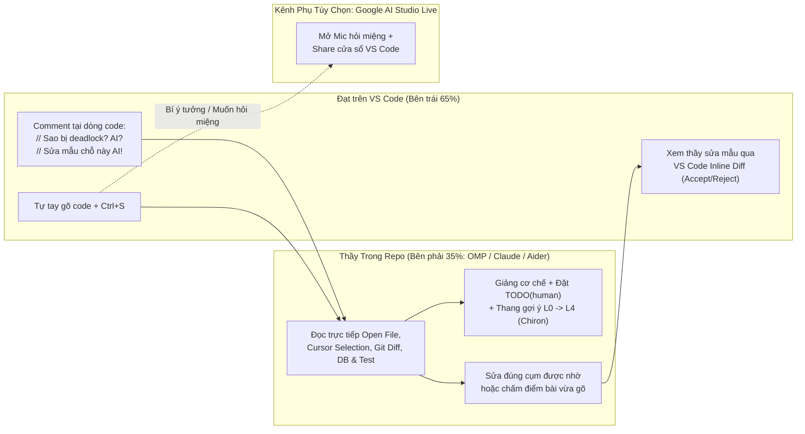

# Báo cáo Nghiên cứu: Giải pháp & Repo Mã nguồn mở biến AI thành "Thầy Giáo Dạy Offline Ngồi Cạnh" khi Live Coding

- **Thời điểm nghiên cứu:** `2026-11-03 09:38 +07` (Asia/Bangkok)
- **Phạm vi & Bài toán:** Tìm kiếm các repository mã nguồn mở, công cụ và quy trình (workflow) giúp AI đồng hành **song song theo thời gian thực** khi Đạt tự tay live coding — đóng đúng vai trò **một người thầy dạy kèm trực tiếp (offline 1-on-1)**: vừa giảng lý thuyết/cơ chế, vừa quan sát code học trò đang gõ để nhắc lỗi hoặc sửa mẫu tại chỗ, vừa trả lời câu hỏi tức thì mà không "giật bàn phím" làm hộ từ A–Z.
- **Đối chiếu thực nghiệm trên máy trạm (`[Direct]`):** Windows 10 x64 (`10.0.19045`), đã cài sẵn `omp/18.16.0` (Oh-My-Pi + Orca/Herdr `0.9.3`), `Claude Code CLI 2.1.317`, `VS Code` kèm extension `anthropic.claude-code`, và Multi-Root Workspace `advance-be-omnipos.code-workspace`.

---

## Kết luận nhanh (Executive Verdict)

1. **Không có một "siêu repo đơn lẻ" nào làm trọn vẹn cả hai việc (nhìn màn hình nói chuyện miệng + chạm trực tiếp vào Git/file để sửa mẫu), nhưng ghép đúng 2 mảnh sẵn có sẽ ra trải nghiệm giống 95% thầy dạy kèm offline.**
2. **Đạt ĐÃ CÓ SẴN 80% bộ công cụ mạnh nhất ngay trên máy mà chưa bật đúng chế độ (`[Direct]`):**
   - Bản `Claude Code 2.1.317` + extension `anthropic.claude-code` trên máy Đạt đã có sẵn chế độ **`/output-style Learning`** (giảng bằng khối `★ Insight`, dựng khung rồi chừa `TODO(human)` cho học trò tự gõ, đợi gõ xong mới đọc diff chấm bài), tính năng **tự động nhìn file đang mở & vùng bôi đen** (`attachOpenFile` / `attachSelection`), **sửa mẫu từng cụm bằng Inline Diff** (`Manual` mode), và hộp hỏi ngang xương **`/btw`** không làm loãng luồng bài học `[Direct]`.
   - Với **`OMP 18.16.0`** đang chạy, Đạt có thể mở chia đôi màn hình cạnh VS Code: Đạt chỉ việc gõ code và bấm `Ctrl+S`, cần hỏi hay nhờ sửa chỉ gõ 1 câu ngắn (*"coi hàm vừa viết"*, *"sửa mẫu đoạn bắt lỗi"*), OMP tự đọc `git diff`, DB (`dbx`) và terminal mà không cần copy-paste bất kỳ dòng code nào `[Direct]`.
3. **3 Repo mã nguồn mở ĐÁNG DÙNG NHẤT nếu muốn nâng cấp trải nghiệm "Thầy ngồi cạnh":**
   - **Hỏi & nhờ sửa ngay trong dòng code đang gõ (không cần rời tay khỏi editor):** [`Aider-AI/aider`](https://github.com/Aider-AI/aider) (`~49.9k ⭐`, chế độ `--watch-files`) — gõ `// Sao chỗ này cần khóa FOR UPDATE? AI?` rồi `Ctrl+S` để thầy giảng, hoặc `// Viết mẫu hàm parse giúp em AI!` để thầy sửa ngay vào file `[Direct]`. (Trên hệ Pi/OMP có gói tương đương [`pi-file-watcher`](https://pi.dev/packages/pi-file-watcher) cho lệnh `#pi!`).
   - **Bộ giáo án & thang gợi ý sư phạm (L0 → L4) gắn thẳng vào OMP / Claude Code:** [`xDido/chiron`](https://github.com/xdido/chiron) (MIT, hỗ trợ sẵn `.pi/skills/` và `.claude/skills/`) kết hợp [`rodbv/socratic-skills`](https://github.com/rodbv/socratic-skills) (`/guide-me`, `/quiz-me`) và chế độ tuần tra diff tự động từ [`Pontinn/mentor-skill`](https://github.com/Pontinn/mentor-skill) (`/mentor patrol`) `[Direct]`.
   - **Mở mic hỏi đáp bằng giọng nói + chia sẻ màn hình VS Code trực tiếp (miễn phí trên Windows):** **Google AI Studio (Stream Realtime)** hoặc tự chạy repo chính chủ [`google-gemini/live-api-web-console`](https://github.com/google-gemini/live-api-web-console) (`2,566 ⭐`) dùng Gemini Multimodal Live API `[Direct]`.
4. **Cảnh báo các "bẫy tên gọi" KHÔNG NÊN CÀI:**
   - [`timwuhaotian/the-pair`](https://github.com/timwuhaotian/the-pair) (`386 ⭐`): Tuy đặt tên là *Mentor + Executor*, thực chất là 2 con AI tự kiểm tra chéo để code tự động 100% khi người dùng đi uống cà phê — hoàn toàn trái ngược mục tiêu tự tay học live coding `[Direct]`.
   - Tính năng *"Work with Apps"* của ChatGPT Desktop đọc trực tiếp cửa sổ VS Code hiện vẫn ưu tiên hệ sinh thái macOS; trên Windows 10 giải pháp IDE-native hoặc Gemini Live Screen Share thực tế hơn nhiều `[Supported]`.
   - Các VS Code extension nhỏ lẻ mang mác "Socratic Tutor" (`DevSENSEI` — repo GitHub đã trả về HTTP 404, `socratic-ai-tutor` chỉ ~117 lượt cài) bị bó hẹp trong 1 đoạn code bôi đen, mù ngữ cảnh kiến trúc đa file và database `[Direct]`.

---

## Mục lục

1. [Giải phẫu hành vi "Thầy dạy kèm Offline" sang Kiến trúc Công cụ](#1-giải-phẫu-hành-vi-thầy-dạy-kèm-offline-sang-kiến-trúc-công-cụ)
2. [Bảng so sánh các Repo & Giải pháp thực chiến (11/2026)](#2-bảng-so-sánh-các-repo--giải-pháp-thực-chiến-112026)
3. [Phân tích chi tiết 4 Mô hình Triển khai tốt nhất cho Đạt](#3-phân-tích-chi-tiết-4-mô-hình-triển-khai-tốt-nhất-cho-đạt)
4. [Các Repo & Công cụ cần tránh (Đánh giá thẳng thắn)](#4-các-repo--công-cụ-cần-tránh-đánh-giá-thẳng-thắn)
5. [Thiết lập Thực hành ngay trên máy Đạt (Copy-Paste chạy luôn)](#5-thiết-lập-thực-hành-ngay-trên-máy-đạt-copy-paste-chạy-luôn)
6. [Nguồn tham chiếu & Câu hỏi mở](#6-nguồn-tham-chiếu--câu-hỏi-mở)

---

## 1. Giải phẫu hành vi "Thầy dạy kèm Offline" sang Kiến trúc Công cụ

Một người thầy ngồi cạnh bàn máy tính của học viên thực hiện liên tục 4 hành động:
1. **Giảng & Làm mẫu (Explain & Scaffold):** Vẽ luồng chạy, giải thích bản chất, viết khung sườn hoặc làm mẫu 1 ví dụ nhỏ rồi chừa phần cốt lõi cho học trò tự viết.
2. **Đứng sau lưng quan sát (Live Observation):** Nhìn thấy file học trò đang mở, dòng con trỏ đang đứng, đoạn code vừa gõ thêm (`git diff`) và lỗi đỏ trên terminal/test mà không bắt học trò phải copy-paste báo cáo.
3. **Nhắc bài theo bậc & Cầm tay sửa khi bí (Hint Ladder & Surgical Co-edit):** Khi trò sai nhẹ thì hỏi gợi mở ("Dòng 42 nếu 2 request vào cùng lúc thì biến `stock` bị gì?"); khi trò bí thật sự hoặc nhờ làm mẫu thì thầy gõ sửa trực tiếp đúng mấy dòng đó trên màn hình để trò thấy sự khác biệt.
4. **Trả lời ngang xương tức thì (Zero-Friction Q&A):** Trò đang gõ dở có thể hỏi nhanh ngay tại dòng code hoặc mở miệng hỏi trực tiếp, trả lời xong quay lại luồng bài chính ngay.



---

## 2. Bảng so sánh các Repo & Giải pháp thực chiến (11/2026)

| Giải pháp / Repo | Stars / Độ chín (`[Direct]`) | Giảng bài & Chừa chỗ tập gõ | Nhìn code live không cần copy-paste | Cầm tay sửa trực tiếp trên file | Hỏi đáp tức thì (Chat / Comment / Voice) | Chi phí cài thêm trên máy Đạt |
| :--- | :--- | :--- | :--- | :--- | :--- | :--- |
| **Claude Code VS Code (`Learning` + Custom Style + `/btw`)** | Có sẵn `v2.1.317` trên máy | Rất mạnh (`★ Insight` + `TODO(human)`) | Tự thấy file đang mở & vùng chọn (`Alt+K`) | Mở Inline Diff 2 cột, duyệt từng cụm | Hộp `/btw` hỏi phụ + khung chat cạnh bên | **0 cài đặt** (đã có sẵn) |
| **OMP (`18.16.0`) + Split Pane + Skill [`xDido/chiron`](https://github.com/xdido/chiron)** | Có sẵn OMP; `chiron` MIT (hỗ trợ `.pi/skills`) | Rất mạnh (11 lệnh sư phạm, gợi ý L0–L4, chấm `/10`) | Đọc trực tiếp `git diff`, LSP, Docker & DBX | Sửa chính xác qua `edit` khi được yêu cầu | Chat trực tiếp ở pane bên cạnh (Orca/Herdr) | Chỉ chép thư mục skill (~30 giây) |
| **[`Aider-AI/aider`](https://github.com/Aider-AI/aider) (`--watch-files`)** | **49,914 ⭐** (Apache-2.0, chuẩn ngành) | Trung bình (thiên về pair-coding thực dụng) | Tự bắt sự kiện lưu file (`Ctrl+S`) toàn repo | Sửa ngay khi gặp comment `// ... AI!` | Hỏi ngay trong file code bằng `// ... AI?` | Cài thêm Python CLI (`aider-install`) |
| **[`rodbv/socratic-skills`](https://github.com/rodbv/socratic-skills) + [`Pontinn/mentor-skill`](https://github.com/Pontinn/mentor-skill)** | 20 ⭐ & 2 ⭐ (Markdown Skills gọn nhẹ) | Rất tốt (`/guide-me` chia bước, `/quiz-me` vấn đáp) | Có chế độ `/mentor patrol` tự quét `git diff` định kỳ | Cấm AI tự viết code (chỉ giảng & chấm) | Hỏi đáp Socratic qua terminal/panel | Chép 1–2 file `SKILL.md` |
| **Gemini Live ([`live-api-web-console`](https://github.com/google-gemini/live-api-web-console) / AI Studio)** | **2,566 ⭐** (Apache-2.0, Google chính chủ) | Giảng miệng tự nhiên như gọi Meet với thầy | Nhìn trực tiếp hình ảnh cửa sổ VS Code live | **Không** (chỉ nhìn màn hình, không chạm file) | **Nói chuyện giọng nói 2 chiều** tiếng Việt | **0 cài đặt** nếu mở trên trình duyệt |
| **[`timwuhaotian/the-pair`](https://github.com/timwuhaotian/the-pair)** | 386 ⭐ (Apache-2.0, Tauri Rust) | **Không** (AI giảng cho... con AI kia nghe) | Tự theo dõi git giữa 2 agent | AI tự viết từ đầu đến cuối | Không tối ưu cho thầy–trò tương tác từng dòng | **Không khuyến nghị cho mục đích học** |

---

## 3. Phân tích chi tiết 4 Mô hình Triển khai tốt nhất cho Đạt

### Mô hình 1: Dùng ngay vũ khí sẵn có — VS Code + `Claude Code` chế độ `Learning` / Custom Teacher Style (`[Direct]`)
Trên máy Đạt đã cài sẵn `anthropic.claude-code` (`v2.1.317`) `[Direct]`. Từ bản `2.1.257+`, Anthropic tích hợp sẵn cơ chế **Output Styles** và **IDE Context** giải quyết trúng bài toán "thầy dạy kèm":
- **Tự động nhìn theo tay học trò:** Extension tự động gửi tên file đang mở (`claudeCode.attachOpenFile`) và đoạn code Đạt đang bôi đen (`claudeCode.attachSelection`) vào ngữ cảnh của thầy `[Direct]`. Đạt bôi đen 5 dòng code khó hiểu và gõ *"sao đoạn này chạy sai?"* là thầy hiểu ngay đang trỏ vào dòng nào, không cần copy-paste.
- **Vừa giảng vừa chừa chỗ cho trò làm (`Learning` style):** Khi bật `/output-style Learning`, AI không viết hết cả bài. Nó viết phần khung nhàm chán, giảng lý do thiết kế trong khung `★ Insight`, đặt thẻ `TODO(human)` ngay chỗ quyết định kỹ thuật quan trọng (ví dụ: viết điều kiện khóa chống race condition), rồi **dừng lại chờ Đạt tự gõ** `[Direct]`. Đạt gõ xong báo *"xong rồi thầy"*, nó đọc code Đạt vừa gõ để nhận xét đúng/sai.
- **Cầm tay sửa mẫu minh bạch (`Manual` permission mode):** Khi Đạt bí và nhờ *"thầy sửa mẫu đoạn này giúp em"*, thay vì âm thầm ghi đè mất code cũ của Đạt, chế độ `Manual` bật khung **Diff hai cột ngay trong VS Code** kèm nút *Accept / Reject this change* dưới từng cụm sửa `[Direct]`.
- **Hỏi ngang xương không loạn bài (`/btw`):** Đang học dở về Redis Lua mà chợt quên cú pháp TypeScript generic, gõ `/btw generic keyof viết sao thầy?` — một cửa sổ phụ mở riêng để giải đáp ngắn gọn mà không làm bẩn lịch sử buổi học chính `[Direct]`.

### Mô hình 2: OMP (`Oh-My-Pi`) + Bộ giáo trình tương tác `xDido/chiron` & `rodbv/socratic-skills`
Khi Đạt làm lab nặng về hệ thống (Docker, PostgreSQL, Redis qua `dbx` MCP, multi-repo `advance-be` + `omnipos-finledger-hub`) trên **OMP**:
- Repo **[`xDido/chiron`](https://github.com/xdido/chiron)** đóng gói sẵn thư mục `.pi/skills/` và `.claude/skills/` với 3 nguyên tắc vàng rất hợp tính cách kỹ sư: **(1) Không bao giờ từ chối sửa/viết mẫu khi học viên yêu cầu thẳng**, **(2) Không giáo điều dài dòng**, **(3) Không xả rác bài giảng vào file code** `[Direct]`.
- Điểm ăn tiền nhất của `chiron` là **Thang gợi ý 5 bậc (`/hint` L0 → L4)** và lệnh **`/challenge <đường-dẫn-file>`**: nó đọc chính file code thật trong `omnipos-finledger-hub`, ra đề bài tập thực hành nhỏ (giới hạn mặc định sửa ≤ 20 dòng trong 5–15 phút), đợi Đạt sửa rồi chấm điểm thang `/10` `[Direct]`.
- Ghép thêm `/quiz-me` từ **[`rodbv/socratic-skills`](https://github.com/rodbv/socratic-skills)**: ngay sau khi Đạt code xong một tính năng (hoặc vừa được thầy sửa mẫu cho), gõ `/quiz-me` để thầy đọc `git diff` và hỏi vặn 3–5 câu ("Nếu xóa dòng số 38 này đi thì chuyện gì xảy ra khi DB mất kết nối?") — đảm bảo hiểu tới tận gốc trước khi `git commit` `[Direct]`.

### Mô hình 3: Hỏi & Nhờ sửa ngay trong Editor bằng Comment Trigger (`Aider --watch-files` hoặc Watcher Extension)
Nếu Đạt ghét việc đang gõ code hăng say bên trái lại phải đưa chuột sang khung chat bên phải để gõ câu hỏi:
- Repo **[`Aider-AI/aider`](https://github.com/Aider-AI/aider)** (`--watch-files`) cho phép giao tiếp với thầy **100% thông qua comment ngay tại dòng code đang gõ** `[Direct]`:
  - Gõ `// Tại sao dùng pipeline ở đây lại không đảm bảo tính nguyên tử vậy thầy? AI?` -> Bấm `Ctrl+S` -> Aider tự phát hiện dấu chấm hỏi `AI?`, đọc toàn bộ file kèm bản đồ repo (RepoMap) và **chỉ giảng giải trên terminal**, tuyệt đối không sửa file `[Direct]`.
  - Gõ `// Em viết thử vòng lặp retry như dưới, thầy sửa lại chỗ backoff cho chuẩn giúp em AI!` -> Bấm `Ctrl+S` -> Aider thấy dấu chấm than `AI!`, tự sửa đúng đoạn đó trên file và dọn sạch dòng comment nháp `[Direct]`.
- Trên hệ sinh thái Pi/OMP cũng đã có gói **[`pi-file-watcher`](https://pi.dev/packages/pi-file-watcher)** (`v1.3.6`, MIT) bắt comment `#pi!` khi lưu file `[Direct]`. Nếu muốn giữ nguyên môi trường OMP quen thuộc mà có đủ cả 2 chế độ `#thay?` (chỉ giảng/review) và `#thay!` (sửa mẫu), có thể viết một extension nội bộ ~45 dòng trong `~/.omp/agent/extensions/` dựa trên API của OMP `[Inferred]`.
- Kết hợp thêm VS Code Extension miễn phí **[`DamianEdwards.file-change-follower`](https://marketplace.visualstudio.com/items?itemName=DamianEdwards.file-change-follower)**: mỗi khi thầy sửa mẫu vào file qua CLI, màn hình VS Code tự động mở và cuộn mượt tới đúng dòng vừa sửa để Đạt nhìn theo trực tiếp `[Direct]`.

### Mô hình 4: Kênh Giọng Nói + Nhìn Màn Hình Trực Tiếp như gọi Google Meet với Thầy (`Gemini Multimodal Live`)
Khi đang bí hướng giải quyết hoặc muốn vừa gõ code vừa nói chuyện bằng miệng bằng tiếng Việt mà không phải gõ phím hỏi:
- Mở **[Google AI Studio — Stream Realtime](https://aistudio.google.com/)** trên Chrome (hoặc chạy local repo chính chủ **[`google-gemini/live-api-web-console`](https://github.com/google-gemini/live-api-web-console)**), bật **Share Screen** chọn cửa sổ VS Code, bật Mic và dán System Instruction đóng vai thầy dạy kèm Backend `[Direct]`.
- **Ưu điểm:** Cảm giác tự nhiên nhất giống người thật ngồi cạnh — Đạt vừa gõ vừa nói *"Thầy nhìn dòng 25 em viết nè, sao TypeScript nó báo gạch đỏ kiểu dữ liệu vậy?"*, thầy nhìn thấy gạch đỏ trên màn hình và nói đáp lại ngay lập tức, có thể ngắt lời bất cứ lúc nào `[Supported]`.
- **Nhược điểm bắt buộc phải biết:** Nó chỉ nhìn **ảnh chụp luồng video màn hình**, không tự lật sang đọc file khác đang đóng, không chạy lệnh SQL/Redis kiểm chứng và không gõ sửa vào file giúp Đạt được `[Direct]`. Vì vậy chỉ nên bật kèm như **tai nghe đàm thoại phụ** khi cần trao đổi ý tưởng nhanh.

---

## 4. Các Repo & Công cụ cần tránh (Đánh giá thẳng thắn)

1. **[`timwuhaotian/the-pair`](https://github.com/timwuhaotian/the-pair) (`pair-code`):** Thiết kế cho kịch bản tự động hóa hoàn toàn (1 con AI đóng vai Mentor kiểm duyệt 1 con AI khác đóng vai Executor viết code). Người dùng bị đẩy ra rìa làm người đứng xem 2 con bot nói chuyện với nhau — dùng công cụ này khi đang học sẽ làm thui chột kỹ năng tự gõ và tự gỡ lỗi `[Direct]`.
2. **Các extension VS Code "AI Tutor" tự phát ít người dùng (`DevSENSEI`, `CodeMentor`, `socratic-ai-tutor`):** Phần lớn là đồ án sinh viên hoặc bản thử nghiệm hackathon (dưới 200 lượt cài, repo gốc `georgiaprahamov/devsensei` hiện đã lỗi 404 `[Direct]`). Chúng chỉ gửi đoạn text bôi đen lên API miễn phí cỡ nhỏ, không biết đọc cấu trúc dự án Clean Architecture hay database thật của Đạt.
3. **Bật chế độ `Auto-Edit` + Default Prompt khi đang làm bài tập:** Đây là lý do phổ biến nhất khiến AI biến thành "thợ làm hộ" thay vì "thầy giáo". Hễ học viên hỏi *"chỗ này bị lỗi gì?"* là AI tự tiện sửa luôn 5 file trong 3 giây, học viên chưa kịp hiểu lỗi ở đâu thì bài đã xong mất.

---

## 5. Thiết lập Thực hành ngay trên máy Đạt (Copy-Paste chạy luôn)

### Cách A (Khuyên dùng số 1 — 0 cài phần mềm mới): Tạo chế độ `"Thầy Dạy Off"` ngay trong dự án cho Claude Code VS Code / OMP

Tạo file `.claude/output-styles/thay-day-off.md` ngay trong repo học tập để khóa hành vi "vừa giảng, vừa nhìn, vừa sửa có chừng mực, vừa trả lời":

```markdown
---
name: Thay Day Off
description: Thầy dạy kèm live coding 1-1: vừa giảng bản chất, vừa nhìn code trò gõ để nhắc/chấm, chỉ sửa mẫu khi trò yêu cầu
keep-coding-instructions: true
---

Bạn là người thầy dạy kèm Backend thực chiến ngồi ngay cạnh Đạt trong buổi live coding.

## Quy tắc đồng hành thời gian thực
1. **Không giật bàn phím:** Mặc định KHÔNG tự ý viết hết lời giải hay tự sửa file khi Đạt chỉ mới hỏi lỗi hoặc hỏi hướng làm.
2. **Nhìn code thật, nói đúng dòng:** Trước khi trả lời, luôn đọc file Đạt đang mở hoặc chạy `git diff` để biết chính xác Đạt vừa gõ gì. Chỉ rõ `tên_file:số_dòng`.
3. **3 chế độ phản hồi linh hoạt theo lời Đạt nói:**
   - Khi Đạt hỏi lý thuyết / hỏi lỗi ("sao chỗ này đỏ?", "giải thích đoạn này"): Giải thích ngắn gọn cơ chế ngầm (tối đa 5-7 dòng, kèm sơ đồ ASCII/Mermaid nhỏ nếu có luồng đồng thời), sau đó gợi ý 1 bước nhỏ hoặc đặt 1 câu hỏi dẫn đường để Đạt tự sửa.
   - Khi bắt đầu phần mới ("dạy em phần X", "ra đề đoạn này"): Giảng nhanh nguyên lý, tạo khung hàm (boilerplate) kèm comment `// TODO(Đạt): ...` tại đúng phần logic cốt lõi, rồi dừng lại chờ Đạt tự gõ.
   - Khi Đạt nhờ sửa / làm mẫu rõ ràng ("sửa mẫu giúp em đoạn này", "làm mẫu 1 hàm đi thầy"): Sửa gọn đúng phạm vi đó, giữ nguyên code xung quanh, và giải thích ngắn gọn vì sao sửa như vậy để Đạt làm tương tự cho phần tiếp theo.
```

Cách bật khi bắt đầu buổi học trên VS Code:
1. Mở `advance-be-omnipos.code-workspace`, bật khung Claude Code bên phải (`Ctrl+Shift+P` -> `Claude Code: Open in Side Bar`), chuyển quyền sửa file ở góc dưới ô chat sang **`Manual`** (để mọi lần thầy sửa mẫu đều hiện bảng so sánh Diff trực quan).
2. Gõ `/output-style Thay Day Off` (hoặc `/output-style Learning` có sẵn).
3. Vừa gõ code bên trái vừa hỏi trực tiếp bên phải (dùng `Alt+K` để đính nhanh dòng đang đứng, hoặc `/btw <câu hỏi>` để hỏi nhanh ngoài lề).

### Cách B: Cài thêm bộ kỹ năng sư phạm `xDido/chiron` vào OMP & Claude Code (2 phút)

Nếu muốn có sẵn các lệnh `/hint` (gợi ý từng nấc L0→L4), `/challenge` (ra đề từ chính code dự án) và `/quiz-me`:

```bash
# Tải bộ skill chiron về thư mục tạm và chép vào dự án hoặc cấu hình cá nhân
git clone --depth 1 https://github.com/xDido/chiron.git temp-chiron
# Cho Claude Code trong dự án:
cp -r temp-chiron/.claude/skills/* .claude/skills/
# Cho hệ Pi / OMP:
cp -r temp-chiron/.pi/skills/* ~/.omp/agent/skills/
rm -rf temp-chiron
```

### Cách C: Nếu thích kiểu gõ câu hỏi `// ... AI?` và nhờ sửa `// ... AI!` ngay trong dòng code

```bash
python -m pip install aider-install && aider-install
aider --watch-files --architect
```
- Gõ `// Giải thích giùm em sao hàm này bị N+1 query? AI?` + `Ctrl+S` -> Thầy trả lời bên terminal.
- Gõ `// Viết mẫu giùm em câu query JOIN tối ưu chỗ này AI!` + `Ctrl+S` -> Thầy sửa trực tiếp vào file.

---

## 6. Nguồn tham chiếu & Câu hỏi mở

### Nguồn tham chiếu xác thực
1. **Claude Code Output Styles (`Learning`, `Explanatory`, Custom Styles):** [https://code.claude.com/docs/en/output-styles](https://code.claude.com/docs/en/output-styles)
2. **Claude Code VS Code Integration (`attachSelection`, `attachOpenFile`, `/btw`, Inline Diff):** [https://code.claude.com/docs/en/vs-code](https://code.claude.com/docs/en/vs-code)
3. **Aider IDE Watch Mode (`--watch-files`, `AI?` / `AI!`):** [https://aider.chat/docs/usage/watch.html](https://aider.chat/docs/usage/watch.html) & [https://github.com/Aider-AI/aider](https://github.com/Aider-AI/aider)
4. **Chiron — Teach-first mentor mode (`L0–L4 hints`, `/challenge`):** [https://github.com/xDido/chiron](https://github.com/xDido/chiron)
5. **Socratic Skills (`/guide-me`, `/quiz-me` trên Git diff):** [https://github.com/rodbv/socratic-skills](https://github.com/rodbv/socratic-skills)
6. **Mentor Skill (`/mentor patrol` định kỳ quét `git diff`):** [https://github.com/Pontinn/mentor-skill](https://github.com/Pontinn/mentor-skill)
7. **Pi File Watcher (`#pi!` comment trigger):** [https://pi.dev/packages/pi-file-watcher](https://pi.dev/packages/pi-file-watcher)
8. **Google Gemini Multimodal Live API Web Console (Voice + Screen Share):** [https://github.com/google-gemini/live-api-web-console](https://github.com/google-gemini/live-api-web-console)
9. **The Pair (Đối chứng kiến trúc 2-agent tự hành):** [https://github.com/timwuhaotian/the-pair](https://github.com/timwuhaotian/the-pair)

### Câu hỏi mở (Unresolved Questions)
1. **Độ tương thích trực tiếp của `pi-file-watcher` trên `omp/18.16.0`:** Gói `pi-file-watcher@1.3.6` khai báo `peerDependencies` cho `@earendil-works/pi-coding-agent >=0.81.1` và chỉ hỗ trợ 1 marker hành động (`#pi!`). Nếu Đạt muốn dùng cơ chế gõ `// thầy?` (chỉ giảng) và `// thầy!` (sửa mẫu) ngay trên **OMP** mà không cần cài thêm Python `aider`, việc viết mới một extension `.ts` ~50 dòng đặt tại `~/.omp/agent/extensions/live-teacher-watch.ts` sẽ gọn và chủ động hơn cài gói npm gốc.
2. **Thói quen tương tác ưa thích của Đạt:** Cần xác nhận Đạt thích giao tiếp với "ông thầy" qua **gõ comment trực tiếp trong file code (`// thầy?`)**, qua **khung chat chia đôi màn hình**, hay muốn **vừa gõ vừa nói chuyện bằng giọng nói (Mic + Screen Share)** để tinh chỉnh cấu hình mặc định cho dự án.
