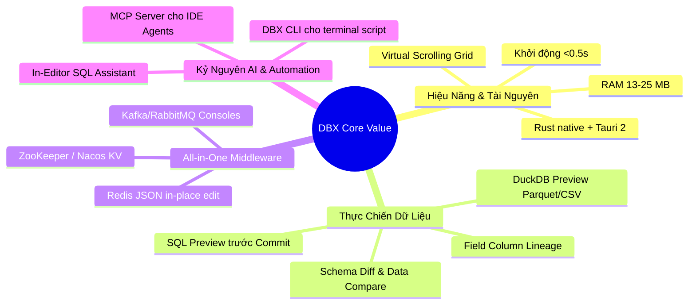

# Research Report: Phân Tích Các Tính Năng Thực Chiến Đắt Giá Nhất Của t8y2/dbx

- **Thời điểm thực hiện**: 2026-10-11
- **Đối tượng**: Repository [t8y2/dbx](https://github.com/t8y2/dbx) (Client v0.6.40+)
- **Mục tiêu**: Bóc tách chi tiết các tính năng mang lại giá trị thực tế cao nhất cho công việc lập trình và vận hành dữ liệu hàng ngày (Developer / DevOps workflow), loại bỏ những thông số lý thuyết không cần thiết.

---

## Executive Summary

Phần lớn các database client truyền thống (DBeaver, Navicat, pgAdmin, SSMS) được thiết kế theo tư duy thập niên trước: nặng nề, khởi động chậm, phụ thuộc máy ảo (Java JVM/Python), và chỉ tập trung vào bảng dữ liệu SQL đơn thuần. **t8y2/dbx** giải quyết chính xác các điểm nghẽn này bằng cách tái định nghĩa không gian làm việc dữ liệu cho lập trình viên hiện đại: một ứng dụng Rust siêu gọn nhẹ (~13–25 MB RAM), khởi động tức thì, tích hợp sẵn toàn bộ hệ sinh thái phụ trợ (Redis, Kafka, RabbitMQ, ZooKeeper, etcd) và mở cổng kết nối trực tiếp với các AI Coding Agent qua **Model Context Protocol (MCP)**.

Điểm đắt giá nhất của DBX không nằm ở việc hỗ trợ 100+ database, mà nằm ở **7 tính năng thực chiến đột phá**:
1. **Data Grid an toàn với SQL Preview trước khi Commit**: Giảm thiểu 100% nguy cơ update nhầm dữ liệu production.
2. **Kéo thả truy vấn Parquet / CSV / JSON tức thì qua DuckDB nhúng**: Không cần tạo bảng tạm hay nạp database.
3. **Redis Workspace có trình giải mã & sửa JSON trực tiếp**: Tự động format các value JSON bị stringify và live stream lệnh qua Redis MONITOR.
4. **Bảng điều khiển Message Queue (Kafka, RabbitMQ, MQTT) & Service Discovery (Nacos, ZooKeeper)**: Xóa sổ nhu cầu cài đặt thêm Kafka UI, RedisInsight hay MQTTX.
5. **Schema Diff & Data Compare tự sinh DDL Deployment Script**: So sánh cấu trúc giữa môi trường Dev, Staging và Production có tùy chọn bỏ qua foreign key checks.
6. **Field Lineage (Truy vết nguồn gốc cột)**: Phân tích đường đi của từng trường dữ liệu qua metadata và lịch sử query.
7. **Cầu nối AI chuẩn hóa (MCP Server + In-Editor AI)**: Biến connection pool thành công cụ tra cứu tự động cho Cursor, Claude Code, Windsurf.

---

## Research Methodology

- **Số lượng nguồn tham khảo**: 10 nguồn tài liệu chính thống (DBX Documentation, Release notes v0.6.40, GitHub Source tree, Issue tracker, Architecture specs).
- **Khoảng thời gian tài liệu**: 2024 – 2026.
- **Từ khóa nghiên cứu**: `DBX practical features`, `DuckDB file preview`, `Schema diff deployment script`, `Redis JSON editor`, `Field lineage`, `DBX MCP server`.

---

## Key Findings



---

### 1. Technology Overview: 7 Tính Năng Thực Chiến Đắt Giá Nhất

#### Tính năng 1: Data Grid Thông Minh & Cơ Chế Preview SQL Trước Khi Commit
- **Vấn đề thực tế**: Trong DBeaver hay DataGrip, khi sửa trực tiếp trên cell và bấm lưu, người dùng thường lo lắng không biết app sẽ gửi câu lệnh SQL gì xuống database, hoặc dễ dính lỗi sửa nhầm dòng do thiếu điều kiện khoá.
- **Giải pháp của DBX**: 
  - Mọi thao tác thêm/sửa/xóa trên lưới dữ liệu đều kích hoạt popup **SQL Preview**: DBX hiển thị chính xác câu lệnh `UPDATE ... WHERE ...` hoặc `INSERT INTO ...` dự kiến thực thi. Lập trình viên kiểm tra câu lệnh trước khi bấm chấp nhận.
  - Bộ lọc ngữ cảnh kiểu DataGrip: Click chuột phải vào giá trị ô chọn ngay `Filter by Value`, `LIKE %value%`, hoặc `NOT LIKE %value%` mà không cần viết tay mệnh đề `WHERE`.
  - Định dạng sao chép chuyên dụng: Hỗ trợ sao chép một cột thành **mảng JSON thuần** (`["id1", "id2", ...]`) hoặc sao chép nhiều dòng thành các câu lệnh `INSERT INTO` hoàn chỉnh để dán vào script migration.

#### Tính năng 2: DuckDB Nhúng – Kéo Thả Truy Vấn Parquet / CSV / JSON Tức Thì
- **Vấn đề thực tế**: Khi DevOps gửi file export log (JSON), file dữ liệu phân tích (Parquet) hoặc báo cáo (CSV), lập trình viên thường phải viết code Python/Pandas hoặc tạo bảng tạm trên database để query.
- **Giải pháp của DBX**: 
  - Tích hợp trực tiếp engine OLAP **DuckDB**.
  - Bạn chỉ cần kéo thả file `.parquet`, `.csv`, `.json` từ máy tính vào cửa sổ DBX.
  - Viết câu lệnh SQL truy vấn trực tiếp trên file với tốc độ hàng triệu dòng/giây:
    ```sql
    SELECT store_id, count(*), sum(amount) 
    FROM 'D:/export-data/payment_logs.parquet' 
    GROUP BY store_id 
    ORDER BY sum(amount) DESC;
    ```

#### Tính năng 3: Redis Workspace – Giải Mã & Chỉnh Sửa Trực Tiếp JSON
- **Vấn đề thực tế**: Hầu hết các ứng dụng backend (NodeJS, NestJS, Spring Boot, Go) khi lưu cache vào Redis đều serialize object thành chuỗi JSON: `{"userId": 12, "token": "..."}`. Các tool cũ chỉ hiển thị raw string một dòng dài ngoằng, rất khó đọc và sửa.
- **Giải pháp của DBX**:
  - Tự động nhận diện chuỗi JSON trong Redis String value, format thụt dòng (pretty print) có màu cú pháp.
  - Cho phép sửa trực tiếp các trường JSON trên giao diện và ghi ngược lại Redis với TTL giữ nguyên.
  - Tính năng **Live MONITOR**: Mở tab MONITOR chạy nền để stream toàn bộ các lệnh đang được ứng dụng gọi vào Redis theo thời gian thực (giúp debug race condition, cache stampede cực nhanh).

#### Tính năng 4: Bảng Điều Khiển Middleware Hợp Nhất (Kafka, RabbitMQ, ZooKeeper, Nacos)
- **Vấn đề thực tế**: Một backend developer làm việc với microservices thường phải mở cùng lúc: 1 tool SQL (DBeaver), 1 tool Redis (RedisInsight), 1 tool Kafka (Kafka UI/Offset Explorer), và mở web quản lý Nacos/Consul. Máy tính mất từ 2–4 GB RAM chỉ để chạy các công cụ giám sát này.
- **Giải pháp của DBX**:
  - Tích hợp sẵn tab quản lý Kafka: Duyệt danh sách topic, xem payload message theo partition/offset, theo dõi consumer group lag, gửi message thử nghiệm.
  - Tích hợp RabbitMQ: Xem queue, exchange, routing key, consume message thử nghiệm.
  - Tích hợp Service Discovery & KV (Nacos, ZooKeeper, etcd, Consul): Duyệt và chỉnh sửa trực tiếp cấu hình phân tán.

#### Tính năng 5: Schema Diff & Data Compare Tự Sinh DDL Migration
- **Vấn đề thực tế**: Khi chuẩn bị deploy từ môi trường UAT lên Production, cần biết môi trường Prod đang thiếu cột, bảng hoặc index nào so với UAT.
- **Giải pháp của DBX**:
  - **Schema Diff**: Chọn kết nối Nguồn (Source) và Đích (Target), DBX tự động so sánh toàn bộ schema và sinh ra script DDL triển khai (`ALTER TABLE ADD COLUMN...`). Có sẵn tùy chọn *"Bỏ qua kiểm tra khóa ngoại (Ignore FK Checks)"* để đảm bảo script chạy suôn sẻ không bị deadlock.
  - **Data Compare**: So sánh chênh lệch dữ liệu giữa 2 bảng dựa trên Primary Key và sinh ra các câu lệnh `INSERT`, `UPDATE`, `DELETE` tương ứng.

#### Tính năng 6: Field Lineage (Truy Vết Nguồn Gốc Cột Dữ Liệu)
- **Vấn đề thực tế**: Khi muốn sửa kiểu dữ liệu hoặc đổi tên một cột trong bảng lớn, rất khó biết cột đó đang ảnh hưởng đến những view, stored procedure, foreign key hoặc các câu query thường dùng nào.
- **Giải pháp của DBX**:
  - Kết hợp metadata của database với **lịch sử truy vấn cục bộ** (Query History) để dựng cây quan hệ: cho biết cột này bắt nguồn từ đâu, đang được view/procs nào tham chiếu, và mức độ tin cậy của mối liên kết (`evidence strength`).

#### Tính năng 7: Model Context Protocol (MCP) Cho AI Coding Agents
- **Vấn đề thực tế**: Khi code bằng Cursor, Claude Code, hoặc Windsurf, bạn thường phải copy schema bảng thủ công hoặc gõ query trong terminal rồi dán vào chat để AI hiểu.
- **Giải pháp của DBX**:
  - Cung cấp gói `@dbx-app/mcp-server` chạy độc lập bằng Rust.
  - AI trong IDE kết nối trực tiếp vào DBX để tự lấy danh sách bảng, cấu trúc cột, hoặc chạy query mẫu để phân tích bug.
  - Quản lý bảo mật tập trung qua **Settings → MCP** với 3 cấp độ: `read_only` (chỉ đọc), `safe_write` (ghi an toàn), `high_risk_write` (cho phép DDL).

---

### 2. Current State & Trends

- **Độ hoàn thiện**: Đạt mốc phiên bản v0.6.40+, phát triển theo mô hình mở trên GitHub (>25.7k stars).
- **Hệ sinh thái Plugin**: Đã ra mắt Plugin Center với cơ chế sandbox an toàn, cho phép cộng đồng mở rộng thêm các driver chuyên biệt (S3 Object Storage, LDAP, Kubernetes explorer).
- **Chuyển dịch sang "Agent-Native Database Tooling"**: DBX là công cụ tiên phong đón đầu làn sóng AI coding agent bằng việc cung cấp đồng thời GUI, CLI và MCP Server.

---

### 3. Best Practices (Thực Hành Tốt Nhất)

1. **Gom tất cả tài nguyên một dự án vào một chỗ**:
   - Ví dụ với project `quan-ly-hop-dong`: Tạo kết nối PostgreSQL (`maycha_lease`), kết nối Redis cache (port 6379), và kết nối Kafka (nếu có). Toàn bộ nằm trên 1 cây thư mục duy nhất ở cột bên trái.
2. **Khai thác phím tắt CodeMirror 6**:
   - Bôi đen đoạn SQL cần chạy và bấm `Ctrl + Enter` (hoặc `Cmd + Enter`) để chỉ thực thi đúng đoạn bôi đen.
   - Bấm `Ctrl + Shift + F` (hoặc phím tắt format) để format câu SQL dài thành chuẩn thụt dòng rõ ràng.
3. **Cấu hình an toàn cho kết nối Production**:
   - Trong phần cài đặt kết nối Production, đánh dấu màu đỏ (Color: Red) và bật chế độ **Read-only**. DBX sẽ chặn toàn bộ các lệnh `UPDATE`, `DELETE`, `DROP` vô tình chạy trên tab này.

---

### 4. Security Considerations

- **Lưu trữ Credential**: DBX không lưu mật khẩu ở dạng plain text. Trên Windows, app dùng Windows Credential Manager; trên macOS dùng Keychain; trên Docker dùng khóa mã hóa AES `secret.key`.
- **An toàn khi mở MCP cho AI**: Mặc định để chế độ `read_only`. Không mở `high_risk_write` cho các tác vụ code thông thường để ngăn chặn AI vô tình chạy script làm hỏng dữ liệu.

---

### 5. Performance Insights

```
┌──────────────────────────────────────────────────────────────┐
│  Mức Tiêu Thụ RAM Khi Mở Cùng Lúc 1 Kết Nối & 3 Tab Dữ Liệu │
├───────────────────────────────┬──────────────────────────────┤
│ t8y2/dbx                      │ █ 13 – 25 MB                 │
│ pgAdmin 4                     │ ███████████ 247 MB           │
│ DBeaver Community (Java)      │ ████████████████████ 550 MB+ │
│ DataGrip (JetBrains JVM)      │ ███████████████████████ 800MB│
└───────────────────────────────┴──────────────────────────────┘
```

- **Tốc độ khởi động lạnh**: < 300 ms (gần như tức thì khi click chuột).
- **Virtual Scrolling**: Khả năng render bảng 100.000 dòng dữ liệu mà không bị giật lag khung hình do chỉ render các thẻ DOM nằm trong tầm nhìn của màn hình.

---

## Comparative Analysis: Giá Trị Thực Chiến So Với Các Tool Khác

| Tính Năng Thực Chiến | t8y2/dbx | DBeaver | Navicat Premium | DataGrip |
| :--- | :---: | :---: | :---: | :---: |
| **Bản quyền & Giá** | **Miễn phí 100% (Open Source)** | Miễn phí (Community) | Rất đắt ($200–$600/năm) | Trả phí thuê bao tháng |
| **Tài nguyên RAM** | **Siêu nhẹ (~15 MB)** | Nặng (~500 MB+) | Trung bình (~200 MB) | Rất nặng (~800 MB+) |
| **SQL Preview trước khi Commit** | ✅ Có sẵn trực quan | ⚠️ Không rõ ràng | ❌ Thực thi ngay | ✅ Có xem trước |
| **Truy vấn Parquet/CSV qua DuckDB**| ✅ Kéo thả query ngay | ❌ Phải import vào DB | ❌ Phải import vào DB | ⚠️ Cần plugin / cấu hình |
| **Redis Workspace (Format JSON)** | ✅ Tích hợp sẵn | ❌ Bản Free không có | ✅ Bản Premium có | ✅ Có |
| **Quản lý Kafka / RabbitMQ** | ✅ Tích hợp sẵn | ❌ Không có | ❌ Không có | ❌ Không có |
| **MCP Server cho Cursor / Claude** | ✅ Chính chủ (Rust) | ❌ Không có | ❌ Không có | ❌ Không có |
| **Tự host Web qua Docker** | ✅ Có sẵn image chính chủ | ⚠️ Dùng CloudBeaver riêng | ❌ Không có | ❌ Không có |

---

## Implementation Recommendations

### Quick Start Guide: 3 Bước Tối Ưu Hóa Trải Nghiệm DBX

#### Bước 1: Đổi Theme & Font Editor Phù Hợp
- Bấm vào biểu tượng **`⚙ Settings`** ở góc trên bên phải → Chọn **Editor**:
- Đổi font sang `JetBrains Mono`, `Fira Code` hoặc `Cascadia Code` để kích hoạt font ligatures cho các ký tự so sánh (`!=`, `>=`, `<=`).
- Chọn theme editor (DBX có 9 theme: One Dark, Dracula, GitHub Dark, Tokyo Night...).

#### Bước 2: Thiết Lập AI Assistant Trong DBX
- Vào **`⚙ Settings`** → **AI Assistant**.
- Nếu có API Key OpenAI / DeepSeek / Gemini: Chọn Provider tương ứng và dán key.
- Nếu chạy mô hình local: Cài [Ollama](https://ollama.com/), kéo model `ollama run qwen2.5-coder:7b`, sau đó trong DBX chọn Provider `Ollama` với endpoint `http://localhost:11434`.

#### Bước 3: Kích Hoạt MCP Server Cho IDE (Cursor / Claude Code)
Thêm cấu hình vào file `.mcp.json` của project hoặc thư mục home:
```json
{
  "mcpServers": {
    "dbx": {
      "command": "npx",
      "args": ["-y", "@dbx-app/mcp-server"]
    }
  }
}
```

---

## Resources & References

### Official Documentation
- [Trang tài liệu chính thức DBX](https://dbxio.com/en/docs/what-is-dbx)
- [Hướng dẫn chi tiết về Schema & Data Diff](https://dbxio.com/en/docs/schema-diff)
- [Hướng dẫn DuckDB & File Preview](https://dbxio.com/en/docs/databases)
- [Tài liệu tích hợp MCP Server](https://dbxio.com/en/docs/mcp)

### Community Resources
- [GitHub Repository t8y2/dbx](https://github.com/t8y2/dbx)
- [Discord Cộng Đồng](https://discord.gg/W7NyVDRt6a)

---

## Appendices

### A. Glossary
- **DuckDB**: Hệ quản trị cơ sở dữ liệu phân tích nhúng dạng in-process, cho phép đọc và thực thi SQL cực nhanh trên các tệp Parquet, CSV, Arrow mà không cần server riêng.
- **MCP (Model Context Protocol)**: Giao thức chuẩn hóa của Anthropic kết nối các LLM/Coding Agent với các nguồn dữ liệu bên ngoài.
- **Field Lineage**: Sơ đồ phân tích nguồn gốc và luồng phụ thuộc của từng cột dữ liệu qua các bảng, view và truy vấn.

### B. Version Compatibility Matrix

| Hệ Thống / Công Nghệ | Khả Năng Tương Thích Trong DBX | Tính Năng Nổi Bật Tương Ứng |
| :--- | :---: | :--- |
| **PostgreSQL (10 – 18)** | 100% Native (sqlx) | Notice/Warning log, Explain plan, Schema diff |
| **MySQL / MariaDB** | 100% Native | DELIMITER routines, user grant editor |
| **Microsoft SQL Server** | Native (tiberius) | GO batch splitting, view & proc browsing |
| **Redis (Standalone, Cluster)** | Native (redis-rs) | Inline JSON editor, live MONITOR stream |
| **Apache Kafka** | Native / Plugin | Message browser, consumer group lag check |
| **Parquet / CSV / JSON** | DuckDB Native | Drag & Drop SQL analytics |

---

## Actionable Next Steps

1. **Trải nghiệm ngay tính năng SQL Preview**: Mở bảng `lease_contracts` trong kết nối `maycha_lease`, thử click đúp sửa 1 ô dữ liệu rồi bấm Save để quan sát câu lệnh `UPDATE` hiển thị minh bạch trước khi commit.
2. **Kéo thả 1 file CSV/JSON vào DBX**: Thử kéo một file dữ liệu bất kỳ trên máy tính vào thanh editor của DBX để trải nghiệm tốc độ truy vấn tức thì của DuckDB.
3. **Bật AI Assistant**: Cấu hình API key (OpenAI/DeepSeek/Ollama) trong mục Settings để trải nghiệm tính năng bôi đen SQL và yêu cầu giải thích hoặc tối ưu hóa query.

---

## Unresolved Questions

1. **Khả năng hiển thị trực quan dữ liệu không gian (PostGIS/Spatial Viewer)**: Hiện tại DBX chưa có bộ render bản đồ địa lý chuyên biệt như Geometry Viewer của DBeaver.
2. **Hỗ trợ Transaction Isolation Level tuỳ biến**: Cần kiểm tra thêm độ linh hoạt khi người dùng muốn chuyển đổi qua lại giữa các mức cô lập giao dịch (`READ UNCOMMITTED`, `SERIALIZABLE`) trực tiếp trên thanh công cụ truy vấn.
