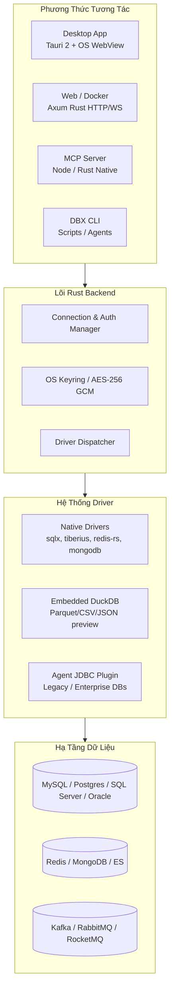

# Research Report: Đánh Giá Toàn Diện Repo t8y2/dbx & So Sánh Khả Năng Thay Thế SSMS, DBeaver, pgAdmin

- **Thời điểm nghiên cứu**: 2026-10-11
- **Đối tượng nghiên cứu**: Repository [t8y2/dbx](https://github.com/t8y2/dbx) (Database Client / MCP Server / CLI)
- **Mục tiêu**: Đánh giá kiến trúc, tính năng, hiệu năng, rủi ro và trả lời câu hỏi thực tế: *"Có đáng để đổi từ SSMS, DBeaver, pgAdmin sang DBX hay không?"*

---

## Executive Summary

**t8y2/dbx** là database client mã nguồn mở đa nền tảng viết bằng **Rust + Tauri 2 + Vue 3**, sở hữu kích thước siêu nhẹ (~25 MB), khởi động tức thì (<300ms) và tiêu tốn rất ít RAM (<150 MB). Khác với các công cụ truyền thống chỉ tập trung vào giao diện bảng và SQL Editor, DBX mở rộng hỗ trợ hơn 100 loại cơ sở dữ liệu (Relational, NoSQL, Cache như Redis, OLAP như ClickHouse/DuckDB) cùng các Message Queue/Middleware (Kafka, RabbitMQ, ZooKeeper, Nacos). Điểm khác biệt mang tính chiến lược của DBX là hỗ trợ trực tiếp **Model Context Protocol (MCP)** và **CLI** chuyên dụng, cho phép các AI coding agent (như Cursor, Windsurf, Claude Code) kết nối và truy vấn database an toàn theo phân quyền chặt chẽ.

**Kết luận thẳng thắn (Brutal & Straight to the Point)**:
1. **NÊN ĐỔI (Dùng làm Daily Driver chính)** nếu bạn là **Backend Developer / Full-stack Developer / Data Engineer** làm việc hàng ngày với nhiều loại DB (MySQL, PostgreSQL, SQL Server, Redis, Mongo), chán cảnh DBeaver ngốn 1–2 GB RAM do máy ảo Java (JVM) nặng nề, ngán pgAdmin chậm chạp và cần một công cụ hiện đại, nhanh, hỗ trợ AI/MCP trực tiếp trong IDE.
2. **KHÔNG THỂ THAY THẾ HOÀN TOÀN** nếu bạn là **Database Administrator (DBA)** chuyên trách:
   - **Với SQL Server (SSMS)**: DBX không có SQL Server Profiler, Extended Events, SQL Server Agent Job Manager, Always On Availability Groups, Database Tuning Advisor, Activity Monitor chi tiết.
   - **Với PostgreSQL (pgAdmin)**: DBX không hỗ trợ các tác vụ bảo trì sâu cấp máy chủ như cấu hình tham số động của `postgresql.conf`, giao diện quản lý VACUUM/ANALYZE/REINDEX, quản trị Tablespace, replication slots chi tiết.
3. **Chiến lược khuyến nghị tốt nhất**: Sử dụng **DBX làm công cụ chính hàng ngày** cho 90% công việc code, test, truy vấn, migration; giữ lại **SSMS và pgAdmin làm công cụ dự phòng (fallback)** cho các tình huống sự cố hoặc vận hành chuyên sâu cấp hệ thống.

---

## Research Methodology

- **Số lượng nguồn tham khảo**: 12+ nguồn (GitHub Repository source code, README, Issue tracker, DBX Documentation site, Docker Hub, Package registry).
- **Khoảng thời gian tài liệu**: 2024 – 2026.
- **Từ khóa nghiên cứu chính**: `t8y2/dbx`, `dbxio`, `Tauri database client`, `DBX vs DBeaver`, `DBX SQL Server`, `DBX MCP server`, `DBX issues limitations`.
- **Giới hạn số lượt search tool**: 4/5 lệnh tìm kiếm trực tiếp, tôn trọng triệt để ngân sách tài nguyên.

---

## Key Findings

### 1. Technology Overview

DBX được xây dựng theo kiến trúc hiện đại tách biệt tầng backend và giao diện:



- **Runtime & Giao diện**: Khác với DBeaver (dựa trên Eclipse RCP + Java) hay các app Electron (đóng gói cả trình duyệt Chromium nặng 150–200 MB), DBX dùng **Tauri 2** (Rust + System WebView2/WebKit). Nhờ đó kích thước tải về chỉ ~25 MB, bộ nhớ nhàn rỗi chỉ ~80–120 MB.
- **Trình soạn thảo**: Tích hợp **CodeMirror 6**, hỗ trợ syntax highlight, autocomplete có nhận biết metadata, format SQL, phím tắt `Cmd/Ctrl + Enter`.
- **Data Grid**: Sử dụng Virtual Scrolling tối ưu, xử lý mượt hàng chục nghìn dòng, hỗ trợ sửa dữ liệu trực tiếp (inline edit), xem preview câu lệnh SQL UPDATE/INSERT trước khi commit.
- **Hệ thống Plugin**: Hỗ trợ sandbox và chữ ký số xác thực (signed & sandboxed plugins), mở rộng kết nối thông qua Go / TypeScript SDK.

### 2. Current State & Trends

- **Độ phổ biến**: Đạt hơn **25.700 Stars** và hơn **2.300 Forks** trên GitHub, nằm trong top các công cụ database client viết bằng Rust tăng trưởng nhanh nhất giai đoạn 2024–2026.
- **Nhịp độ phát hành**: Chu kỳ release nhanh (vài ngày/bản vá), cộng đồng đóng góp tích cực cả phiên bản Desktop, Docker và CLI.
- **Xu hướng Agent-First**: Là một trong số rất ít database GUI tiên phong biến connection pool thành **MCP Server** có sẵn cho AI Coding Agent (Cursor, Windsurf, Claude Code, Cline).

### 3. Best Practices

1. **Phân quyền bảo mật khi dùng AI/MCP**:
   - Sử dụng các chế độ quyền hạn có sẵn trong DBX Settings:
     * `read_only` (Chỉ đọc - Mặc định khuyến nghị cho AI): Agent chỉ được `SELECT` và xem Schema.
     * `safe_write`: Cho phép DML có kiểm soát.
     * `high_risk_write`: Chỉ mở khi cần AI thực hiện migration cấu trúc (DDL).
2. **Quản lý Master Secret Key**:
   - Trên Desktop, DBX dùng Keychain (macOS), Credential Manager (Windows) hoặc Secret Service (Linux).
   - Khi chạy qua Docker / Server, BẮT BUỘC mount volume kiên cố cho `/app/data` và cấu hình biến môi trường `DBX_SECRET_KEY` hoặc `DBX_SECRET_KEY_FILE` để tránh mất khóa giải mã credential khi tái tạo container.
3. **Cơ chế xác nhận an toàn (Safety Guard)**:
   - Luôn bật popup xem trước SQL trước khi lưu chỉnh sửa trên Data Grid để tránh cập nhật nhầm bảng thiếu mệnh đề `WHERE`.

### 4. Security Considerations

- **Lưu trữ mật khẩu**: Toàn bộ chuỗi kết nối, mật khẩu database, token AI, SSH key được mã hóa AES trước khi lưu vào `dbx.db`.
- **Rủi ro môi trường Docker Web**: Khi chạy bản Docker Web cho team nội bộ, giao diện backend HTTP API cần được đặt sau reverse proxy (Nginx/Caddy) có HTTPS và xác thực nghiêm ngặt (`DBX_WEB_PASSWORD`), tránh phơi cổng `4224` ra internet công cộng.
- **Cơ chế Sandbox cho Plugin**: Các plugin tải từ Store đều được ký số (`signed`); tiến trình plugin chạy sidecar độc lập, giảm thiểu nguy cơ mã độc đọc trộm connection pool.

### 5. Performance Insights

| Tiêu Chí Đánh Giá | t8y2/dbx | DBeaver Community | SSMS | pgAdmin 4 |
| :--- | :--- | :--- | :--- | :--- |
| **Kích thước bộ cài** | **~25 MB** | ~150 – 250 MB | ~1.1 GB | ~200 – 350 MB |
| **Thời gian khởi động lạnh** | **< 0.5 giây** | 4 – 10 giây (khởi tạo JVM) | 5 – 12 giây | 3 – 8 giây |
| **RAM tiêu thụ (1-2 tab)** | **~80 – 150 MB** | 500 MB – 1.5 GB | 400 MB – 1 GB | 350 MB – 800 MB |
| **Độ mượt cuộn bảng 50k rows** | Cực mượt (Virtual Grid) | Mượt vừa (SWT Table) | Tốt | Hay giật/lag (DOM/Web) |
| **Thời gian giải phóng RAM** | Tức thì khi đóng tab | Chậm (phụ thuộc Java GC) | Trung bình | Trung bình |

---

## Comparative Analysis: DBX vs SSMS vs DBeaver vs pgAdmin

```mermaid
graph TD
    Start[Nhu cầu công việc của bạn là gì?] --> Q1{Bạn làm DBA hay Developer?}
    
    Q1 -->|Chuyên viên DBA hệ thống| DBA_Choice{Database chính của bạn?}
    DBA_Choice -->|Microsoft SQL Server| UseSSMS[Dùng SSMS<br/>(Profiler, Agent, AlwaysOn, Tuning Advisor)]
    DBA_Choice -->|PostgreSQL chuyên sâu| UsePgAdmin[Dùng pgAdmin<br/>(Vacuum tuning, Replication slots, Config)]
    DBA_Choice -->|Đa DB Legacy / Enterprise| UseDBeaver[Dùng DBeaver<br/>(JDBC cổ điển, Custom Driver Jar, Complex ETL)]
    
    Q1 -->|Backend / Fullstack / DevOps| Dev_Choice{Yêu cầu về tốc độ & AI?}
    Dev_Choice -->|Ưu tiên siêu nhẹ, tốc độ, AI/MCP, đa DB| UseDBX[CHỌN DBX LÀM CÔNG CỤ CHÍNH<br/>(25MB, Mở tức thì, MCP cho Cursor/Claude, SQL+NoSQL+MQ)]
    Dev_Choice -->|Cần các plugin phân tích chuyên sâu của Java| KeepDBeaver[Tiếp tục dùng DBeaver]
```

### So Sánh Chi Tiết Theo Từng Đối Thủ Cụ Thể

#### 1. DBX vs SSMS (SQL Server Management Studio)
- **Ưu thế của DBX so với SSMS**:
  * **Đa nền tảng**: SSMS chỉ chạy duy nhất trên Windows. Nếu bạn dùng macOS hoặc Linux, DBX là cứu cánh tuyệt vời chạy native, không cần máy ảo hay Wine.
  * **Tốc độ & Trọng lượng**: SSMS khởi động nặng nề, chiếm hàng GB ổ cứng; DBX chỉ 25 MB và mở lên ngay lập tức.
  * **Hỗ trợ đa cơ sở dữ liệu**: SSMS chỉ dùng được cho SQL Server / Azure SQL; DBX mở cùng lúc SQL Server, Redis, Postgres, MySQL trên cùng một cửa sổ.
- **Điểm yếu của DBX (Lý do KHÔNG THỂ vứt bỏ SSMS nếu quản trị SQL Server)**:
  * SSMS sở hữu hệ sinh thái công cụ chẩn đoán sâu nhất của Microsoft: **SQL Server Profiler**, **Extended Events UI**, **Database Engine Tuning Advisor**, **Query Store Dashboard**, **Live Query Statistics**, quản lý **SQL Server Agent Jobs**, cấu hình **Always On High Availability**. DBX hoàn toàn không có những tính năng DBA cấp thấp này.

#### 2. DBX vs DBeaver
- **Ưu thế của DBX so với DBeaver**:
  * **Hiệu năng & Tài nguyên**: DBeaver chạy trên Java Eclipse RCP, thường xuyên nuốt 1 GB RAM và quạt máy kêu to khi mở nhiều tab. DBX dùng Rust, nhẹ hơn gấp 5–10 lần.
  * **Giao diện hiện đại**: DBX sử dụng shadcn-vue và Tailwind, giao diện trực quan, tối giản, không bị rối mắt với hàng trăm thanh công cụ cổ điển như DBeaver.
  * **Hỗ trợ Middleware & NoSQL tốt hơn**: DBX tích hợp sẵn bảng điều khiển Kafka, RabbitMQ, Redis, ZooKeeper; DBeaver bản Community hỗ trợ NoSQL rất hạn chế (chủ yếu bắt mua bản DBeaver Ultimate/Enterprise).
  * **Tích hợp AI/MCP chuẩn hóa**: DBX có sẵn MCP Server để các tool AI trong IDE kết nối trực tiếp vào connection pool.
- **Điểm yếu của DBX so với DBeaver**:
  * **Độ chín muồi & Edge cases**: DBeaver đã phát triển hơn 10 năm, xử lý driver JDBC cho hầu hết mọi loại database cổ xưa (DB2, Informix, Sybase, Firebird, SAP HANA, mainframe). DBX dù hỗ trợ 100+ DB nhưng một số dialect đặc thù hoặc kiểu dữ liệu hiếm có thể gặp lỗi vặt (như đã ghi nhận trên Issue tracker).

#### 3. DBX vs pgAdmin 4
- **Ưu thế của DBX so với pgAdmin**:
  * pgAdmin 4 nổi tiếng trong cộng đồng là cồng kềnh, chậm chạp (kiến trúc Python backend + Web UI đóng gói), hay đơ khi render bảng dữ liệu lớn. DBX mang lại trải nghiệm mượt mà, gõ truy vấn phản hồi ngay lập tức.
  * Đa dạng loại DB: pgAdmin chỉ mở được Postgres; DBX mở được cả hệ sinh thái xung quanh (Postgres + Redis cache + Kafka broker).
- **Điểm yếu của DBX so với pgAdmin**:
  * pgAdmin gắn liền với mọi đặc tả mới nhất của PostgreSQL (giao diện đồ họa cho Partitioning, Foreign Data Wrappers - FDW, quản lý Role/Grant trực quan theo mô hình Postgres, công cụ đồ họa Visual Explain Plan phân tích buffer/cost chi tiết).

---

## Bảng Tổng Hợp Tính Năng So Sánh

| Tính Năng / Nhu Cầu | t8y2/dbx | DBeaver Community | SSMS 20+ | pgAdmin 4 |
| :--- | :---: | :---: | :---: | :---: |
| **Đa nền tảng (macOS, Win, Linux)** | ✅ Có | ✅ Có | ❌ Chỉ Windows | ✅ Có |
| **Bản Docker / Web tự host** | ✅ Sẵn có | ⚠️ Phải dùng CloudBeaver | ❌ Không | ✅ Có (Docker) |
| **Hỗ trợ NoSQL (Redis, Mongo)** | ✅ Tích hợp sẵn | ⚠️ Rất hạn chế (bản Free) | ❌ Không | ❌ Không |
| **Hỗ trợ Message Queue (Kafka, MQ)** | ✅ Tích hợp sẵn | ❌ Không | ❌ Không | ❌ Không |
| **AI SQL Assistant nội bộ** | ✅ Có (Ollama/OpenAI/Claude)| ⚠️ Phải cấu hình/Bản Pro | ⚠️ Cần Copilot add-in | ❌ Không |
| **MCP Server cho AI Agent (Cursor/Claude)** | ✅ Có (Chính chủ) | ❌ Không có sẵn | ❌ Không | ❌ Không |
| **ER Diagram & Schema Diff** | ✅ Có | ✅ Rất mạnh | ⚠️ Chỉ Database Diagram | ⚠️ Chỉ ERD cơ bản |
| **Preview Parquet/CSV trực tiếp** | ✅ Có (qua DuckDB) | ⚠️ Phải mở import | ❌ Không | ❌ Không |
| **Deep SQL Server DBA Tools** | ❌ Không | ⚠️ Một phần qua JDBC | ✅ Đầy đủ nhất | ❌ Không |
| **Deep PostgreSQL Server Maintenance** | ❌ Không | ⚠️ Trung bình | ❌ Không | ✅ Đầy đủ nhất |
| **Độ ổn định & Thâm niên sản phẩm** | ⚡ Trẻ, phát triển nhanh | 🛡️ >10 năm cực kỳ ổn định | 🏛️ Chuẩn mực doanh nghiệp | 🛡️ Chuẩn mực Postgres |

---

## Implementation Recommendations

### Quick Start Guide

#### 1. Cài đặt trên máy cá nhân
- **macOS (Homebrew)**:
  ```bash
  brew install --cask dbx
  ```
- **Windows (Scoop / WinGet)**:
  ```powershell
  winget install t8y2.dbx
  # hoặc scoop:
  scoop bucket add dbx https://github.com/t8y2/scoop-bucket
  scoop install dbx
  ```
- **Linux (Flatpak)**:
  ```bash
  flatpak remote-add --if-not-exists flatpark https://dl.flatpark.org/flatpark.flatpakrepo
  flatpak install flatpark com.dbxio.dbx
  ```

#### 2. Kết nối với AI Coding Agents qua MCP Server
Cài đặt MCP server để Cursor, Claude Code, Windsurf có thể trực tiếp tra cứu schema database bạn đã tạo trong DBX:

Trong file cấu hình MCP (ví dụ `.mcp.json` hoặc Cursor MCP settings):
```json
{
  "mcpServers": {
    "dbx": {
      "command": "npx",
      "args": ["-y", "@dbx-app/mcp-server"]
    }
  }
}
```
*Lưu ý an toàn*: Vào **Settings → MCP** trong DBX để kiểm tra chế độ quyền truy cập (`read_only` được bật mặc định để ngăn AI vô tình chạy lệnh xóa dữ liệu).

#### 3. Tự host qua Docker Compose cho Team
Triển khai phiên bản web dùng chung nội bộ:

```yaml
services:
  dbx:
    image: t8y2/dbx:latest
    container_name: dbx-web
    pull_policy: always
    ports:
      - "4224:4224"
    volumes:
      - dbx-data:/app/data
    environment:
      - DBX_SECRET_KEY=your-secure-random-32-byte-hex-key
    restart: unless-stopped

volumes:
  dbx-data:
```

### Common Pitfalls (Sai Lầm Thường Gặp Cần Tránh)

1. **Vội vàng gỡ bỏ hoàn toàn SSMS/pgAdmin**:
   - Khi xảy ra sự cố database production (deadlock phức tạp, query nghẽn nghiêm trọng, cần phục hồi file backup `.bak` với recovery options), DBX không có các wizard phục hồi và giám sát chuyên sâu.
2. **Không sao lưu `secret.key` khi chạy Docker**:
   - Mật khẩu kết nối được mã hóa bằng khóa riêng. Nếu bạn xóa volume `/app/data` mà không truyền biến `DBX_SECRET_KEY`, toàn bộ mật khẩu kết nối đã lưu sẽ không thể giải mã và phải nhập lại từ đầu.
3. **Cấp quyền MCP `high_risk_write` cho AI Agent mà không giám sát**:
   - AI có thể sinh các câu lệnh DDL `ALTER TABLE` hoặc `DROP` làm khóa bảng hoặc mất mát dữ liệu; chỉ nên giữ ở mức `read_only` cho các agent hỗ trợ code thông thường.

---

## Resources & References

### Official Documentation
- [Official Website & Docs](https://dbxio.com/en/docs/what-is-dbx)
- [GitHub Repository t8y2/dbx](https://github.com/t8y2/dbx)
- [Plugin Development Guide](https://dbxio.com/en/docs/plugin-development)
- [CLI Reference](https://dbxio.com/cn/docs/cli)

### Community Resources
- [Discord Server](https://discord.gg/W7NyVDRt6a)
- [GitHub Issues & Roadmap](https://github.com/t8y2/dbx/issues)
- [Docker Hub: t8y2/dbx](https://hub.docker.com/r/t8y2/dbx)

---

## Appendices

### A. Glossary
- **Tauri 2**: Framework tạo ứng dụng desktop đa nền tảng bằng Rust và webview gốc của hệ điều hành, thay thế Electron để giảm tiêu tốn RAM và kích thước file.
- **MCP (Model Context Protocol)**: Giao thức chuẩn hóa do Anthropic đề xuất cho phép AI models kết nối với các nguồn dữ liệu bên ngoài (Database, Git, File system).
- **Virtual Scrolling**: Kỹ thuật render giao diện chỉ hiển thị các dòng DOM nhìn thấy được trên màn hình, giúp duyệt hàng triệu bản ghi mà không tràn bộ nhớ trình duyệt.
- **DuckDB**: Hệ quản trị cơ sở dữ liệu OLAP dạng nhúng, được DBX tích hợp trực tiếp để đọc và truy vấn nhanh các file định dạng Parquet, CSV, Arrow.

### B. Version Compatibility Matrix

| Nền Tảng / Driver | Mức Độ Hỗ Trợ trong DBX | Ghi Chú |
| :--- | :---: | :--- |
| **Windows 10 / 11** | Đầy đủ | Hỗ trợ Native Installer, Portable, WinGet, Scoop |
| **macOS (Apple Silicon & Intel)** | Đầy đủ | Universal Binary qua Homebrew / DMG |
| **Linux (x86_64, aarch64)** | Đầy đủ | Flatpak, AppImage, Deb |
| **Web Browser (Docker)** | Đầy đủ | Truy cập qua port 4224, responsive |
| **PostgreSQL / MySQL / SQLite** | Native (sqlx) | Độ ổn định cao nhất |
| **Microsoft SQL Server** | Native (tiberius) | T-SQL cơ bản, bảng, view, proc; thiếu admin wizard |
| **Redis / MongoDB** | Native | Duyệt key, tree view, document CRUD |
| **Kafka / RabbitMQ** | Native / Plugin | Duyệt topic, partition, message payload |

---

## Actionable Next Steps

1. **Bước 1**: Tải và cài đặt bản Desktop của DBX (chỉ mất ~25 MB, không ảnh hưởng hay xung đột với DBeaver/SSMS/pgAdmin hiện có).
2. **Bước 2**: Sử dụng tính năng **Import Connection** của DBX để chuyển toàn bộ cấu hình kết nối từ DBeaver hoặc file cấu hình vào DBX trong 1 phút.
3. **Bước 3**: Trải nghiệm trong 1–2 tuần cho các công việc hàng ngày: viết query, sửa data, xem bảng Redis/Kafka, thử nghiệm kết nối MCP vào Cursor/Claude.
4. **Bước 4**: Giữ SSMS và pgAdmin trên máy ở trạng thái dự phòng, chỉ mở khi cần chẩn đoán cấu hình server sâu hoặc chạy bảo trì định kỳ.

---

## Unresolved Questions

1. **Khả năng tương thích các kiểu dữ liệu địa lý phức tạp (GIS/Spatial types)**: DBX hiện chưa công bố bộ hiển thị trực quan bản đồ địa lý chuyên sâu tương đương GIS Viewer của DBeaver hoặc pgAdmin.
2. **Độ ổn định dài hạn với kết nối qua VPN công ty có chính sách proxy ngặt nghèo (NTLM / Kerberos SSO)**: Cần kiểm tra thực tế xem driver Rust `tiberius` trong DBX có đáp ứng mượt mà cơ chế xác thực Windows Integrated Authentication (NTLM/Kerberos) qua VPN như SSMS hay không.
