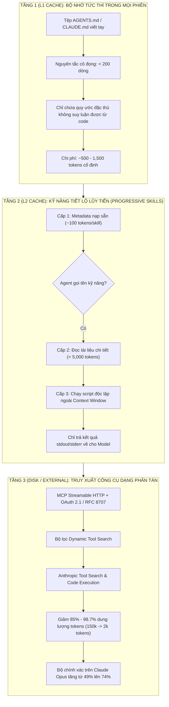

# BÁO CÁO NGHIÊN CỨU CÔNG NGHỆ TOÀN CẢNH CUỐI NĂM 2026: ĐẠI PHẪU NỀN TẢNG KỸ THUẬT, BỨC TRANH THỰC THỰC - ẢO VÀ TECH RADAR CHO KỸ SƯ HỆ THỐNG

- **Thời điểm hoàn thành**: `2026-11-01`
- **Phạm vi khảo sát**: X (Twitter), Reddit (`r/programming`, `r/backend`, `r/PostgreSQL`, `r/typescript`, `r/WebAfterAI`, `r/ClaudeCode`, `r/LocalLLaMA`), GitHub Trending, Hacker News (`Show HN`), và các phân tích kỹ thuật chuyên sâu độc lập.
- **Đối tượng thụ hưởng mục tiêu**: Kỹ sư Backend/Fullstack phát triển hệ thống tài chính phân tán, kiến trúc sổ cái kép, xử lý giao dịch đồng thời cao (`omnipos-finledger-hub` / `advance-be`) trên nền tảng Windows 11 với công cụ hỗ trợ `oh-my-pi`.

---

## TÓM TẮT ĐIỀU HÀNH (EXECUTIVE SUMMARY)

Bước vào quý 4 năm 2026, ngành kỹ nghệ phần mềm chứng kiến một bước ngoặt tái cấu trúc sâu sắc sau giai đoạn bùng nổ ồ ạt của các thử nghiệm AI sơ khai:
1. **Kinh tế học Ngữ cảnh (Context Window Economics) & Trưởng thành của Agentic Orchestration**: Lập trình viên nhận ra rằng việc nhồi nhét tài nguyên vào cửa sổ ngữ cảnh LLM đang dẫn tới khủng hoảng chi phí và suy giảm độ chính xác ("vách đá độ chính xác" khi vượt quá 20 tools). Xu hướng chuyển dịch từ tiếp cận ngây thơ sang mô hình phân tầng bộ nhớ ngữ cảnh 3 cấp (L1 `AGENTS.md` rút gọn - L2 Progressive Agent Skills - L3 Streamable HTTP MCP với OAuth 2.1). Các môi trường phát triển AI (ADE) phân nhánh rõ rệt: Desktop-Centric (`Orca`) đối đầu Daemon-Centric (`Paseo`).
2. **Cuộc cách mạng Toolchain & "Thuế Ranh giới Ngôn ngữ" (FFI/IPC Boundary Tax)**: Các ngôn ngữ hệ thống (Rust, Go, Zig) tiếp tục thanh trừng hạ tầng JavaScript/TypeScript cũ. Tuy nhiên, một bài học kỹ thuật kinh điển được tái khẳng định: Tốc độ của Rust chỉ phát huy tác dụng khi chi phí vượt ranh giới FFI/IPC thấp và khối lượng tính toán ở giữa đủ lớn (minh chứng qua việc Rolldown 1.0 và Oxlint thắng lớn, trong khi Prisma 7 buộc phải loại bỏ Rust Engine để tăng tốc gấp 3.4 lần). Cùng lúc đó, vụ Bun merge 1 triệu dòng code Rust do AI viết chứa hơn 13,000 khối `unsafe` làm dấy lên hồi chuông cảnh báo về ranh giới giữa kiểm thử hành vi (behavior) và tính đúng đắn an toàn bộ nhớ (soundness).
3. **Sự bành trướng của PostgreSQL & Phong trào "Just Use Postgres" cho Durable Execution**: PostgreSQL 18 và 19 khẳng định vị thế tối thượng với Asynchronous I/O (AIO), hàm chuẩn hóa `uuidv7()`, B-tree Skip Scan và cơ chế định hướng truy vấn `pg_plan_advice`. Đi kèm với đó là làn sóng nổi dậy chống lại sự cồng kềnh của Temporal bằng các engine workflow bền bỉ chạy trực tiếp trên Postgres ACID (DBOS, pgflow/pgmq).
4. **Mô hình Open-Weight đột phá & Cảnh báo an ninh Frontend**: Kỷ nguyên chạy mô hình mã nguồn mở quy mô 125B tham số ở tốc độ 100 tokens/giây trên phần cứng cá nhân (1 card RTX 4090) đã thành hiện thực với Strata. Ở tầng ứng dụng web, 13 lỗ hổng bảo mật nghiêm trọng của Next.js trong một buổi chiều khiến cộng đồng thức tỉnh trước nguy cơ của React Server Actions, tạo đà bứt phá cho TanStack Start 1.0.

---

## MỤC LỤC

1. [Phần 1: Bức tranh Toàn cảnh & Nhịp đập Đa Nền tảng Cuối Năm 2026](#phần-1-bức-tranh-toàn-cảnh--nhịp-đập-đa-nền-tảng-cuối-năm-2026)
2. [Phần 2: Giải phẫu 4 Trụ cột Kỹ thuật Nóng nhất & Tranh luận Kỹ nghệ](#phần-2-giải-phẫu-4-trụ-cột-kỹ-thuật-nóng-nhất--tranh-luận-kỹ-nghệ)
   - [2.1 Trụ cột 1: AI Engineering, ADE & Kinh tế học Ngữ cảnh](#21-trụ-cột-1-ai-engineering-ade--kinh-tế-học-ngữ-cảnh)
   - [2.2 Trụ cột 2: Cuộc Đại phẫu Toolchain JS/TS, Runtime & An ninh Chuỗi Cung ứng](#22-trụ-cột-2-cuộc-đại-phẫu-toolchain-jsts-runtime--an-ninh-chuỗi-cung-ứng)
   - [2.3 Trụ cột 3: Kiến trúc Backend, Cơ sở Dữ liệu & Xử lý Đồng thời Cao](#23-trụ-cột-3-kiến-trúc-backend-cơ-sở-dữ-liệu--xử-lý-đồng-thời-cao)
   - [2.4 Trụ cột 4: Mô hình Open-Weight, Suy luận Cục bộ & Dịch chuyển Frontend](#24-trụ-cột-4-mô-hình-open-weight-suy-luận-cục-bộ--dịch-chuyển-frontend)
3. [Phần 3: Tech Radar Matrix 2026 & Kế hoạch Thực chiến cho `omnipos-finledger-hub`](#phần-3-tech-radar-matrix-2026--kế-hoạch-thực-chiến-cho-omnipos-finledger-hub)
4. [Phần 4: Giới hạn Nghiên cứu & Những Câu hỏi Bỏ ngỏ (Unresolved Questions)](#phần-4-giới-hạn-nghiên-cứu--những-câu-hỏi-bỏ-ngỏ-unresolved-questions)
5. [Phần 5: Danh mục Nguồn Tham khảo Xác thực (Verified Primary Sources)](#phần-5-danh-mục-nguồn-tham-khảo-xác-thực-verified-primary-sources)

---

## PHẦN 1: BỨC TRANH TOÀN CẢNH & NHỊP ĐẬP ĐA NỀN TẢNG CUỐI NĂM 2026

Bảng tổng hợp dưới đây phản ánh các dự án mã nguồn mở và xu hướng đang dẫn đầu về mức độ tăng trưởng (GitHub Stars, thảo luận Hacker News, Reddit) tính đến ngày `2026-11-01`:

| Kho lưu trữ / Dự án | Nền tảng & Chỉ số Nổi bật | Kiến trúc / Đặc tính Cốt lõi | Bản chất Thực tế & Phản biện Kỹ thuật |
| :--- | :--- | :--- | :--- |
| **`morluto/rea`** | GitHub: 417,000+ stars (+109k stars/tuần, HN #50058850) | Đa agent AI dịch ngược tự động từ hành vi ứng dụng xuống mã nhị phân | Tăng trưởng kỷ lục nhờ cơn sốt bảo mật mã nguồn, nhưng tiêu tốn tài nguyên GPU khổng lồ để đối chiếu luồng thực thi. |
| **`affaan-m/ECC`** | GitHub: 294,000+ stars (+5.6k stars/tuần, HN #50012876) | Hệ điều hành quản lý kỹ năng, trí nhớ, bản năng và an ninh cho AI Harnesses | Giải quyết phân mảnh cấu hình agent, nhưng tạo thêm một tầng trừu tượng cần bảo trì thủ công. |
| **`deepseek-ai/dsh-superagent-prototype`** | GitHub: 5,700 stars ngay tuần đầu (31/10/2026, HN #50316116) | Coding agent tự hành xây dựng phần lớn bởi chính mạng lưới agent tự hồi quy | Chứng minh tính khả thi của agent tự sinh mã, nhưng rủi ro vòng lặp ảo giác nếu thiếu rào chắn kiểu tĩnh. |
| **`stablyai/orca`** | GitHub: 112,058+ stars (`v1.4.245`, +8.9k stars/tuần) | Desktop-Centric ADE: Monaco Editor + headless terminal WebGL + Chromium nhúng | Kiểm soát chặt chẽ bằng Anti-Slop Ratchets (`max-lines: 300`), ngốn nhiều RAM đồ họa khi mở đa cửa sổ. |
| **`getpaseo/paseo`** | GitHub: 22,681+ stars (`v0.14.0` / `0.15.0-beta.1`) | Daemon-Centric ADE: CLI tiến trình nền quản lý worktree, giao thức ACP, E2EE relay | Trọng lượng nhẹ, điều khiển linh hoạt qua mobile/web, nhưng phụ thuộc hoàn toàn vào tính ổn định của daemon nền. |
| **`Niko1221/Strata`** | GitHub: 37,000+ stars (Top 1 HN OSS Radar tháng 10/2026, 940 pts) | Engine suy luận cục bộ: Qwen 3.8 Flash Next (125B) đạt 100 T/s trên 1x RTX 4090 | Đột phá về lượng tử hóa và nén ma trận trọng số, xóa bỏ rào cản chi phí API cho các đội ngũ kỹ sư độc lập. |
| **`oxc-project/tsrs`** | Ra mắt 20/10/2026 (Cloudflare, VoidZero, Max Schwenk) | Trình biên dịch TypeScript viết bằng Rust, tương thích Wasm, đồng bộ agent tự động | Nhanh hơn 3.8x - 8.1x so với `tsgo`, giảm 70% RAM, phục vụ kịch bản chạy hàng loạt coding agents song song. |
| **`Rolldown 1.0` / `Vite 8`** | Bản chính thức GA tháng 03 & 05/2026 | Bundler thống nhất bằng Rust, xóa bỏ hoàn toàn cặp `esbuild` + `Rollup` | Giảm thời gian build production của Linear từ 46s xuống 6s, giảm đỉnh RAM tới 100 lần ở các monorepo khổng lồ. |
| **`Seqora`** | Ra mắt 01/11/2026 (`seqora.dev`) | Database client tích hợp MCP: dự báo chính xác Database Lock và Table Rewrite | Giúp kỹ sư backend ngăn chặn thảm họa khóa bảng khi chạy migration DDL trên môi trường production. |
| **`KiviDB`** | Show HN 19/10/2026 (`kividbio/kividb`) | In-memory key-value đa luồng viết bằng Rust, tương thích 100% Redis/Valkey | Tích hợp sẵn Full-text Search và Vector Indexing, hiệu năng mở rộng tuyến tính theo số lõi CPU vật lý. |

---

## PHẦN 2: GIẢI PHẪU 4 TRỤ CỘT KỸ THUẬT NÓNG NHẤT & TRANH LUẬN KỸ NGHỆ

### 2.1 Trụ cột 1: AI Engineering, ADE & Kinh tế học Ngữ cảnh

#### 2.1.1 Trận địa ADE: Kiến trúc Desktop-Centric (`Orca`) vs Daemon-Centric (`Paseo`)
Cuộc đối đầu giữa `stablyai/orca` và `getpaseo/paseo` định hình hai trường phái tư duy kiến trúc phát triển phần mềm trong kỷ nguyên AI:
- **`Orca` (Desktop-Centric)**: Lựa chọn đóng gói toàn bộ môi trường làm việc vào một giao diện đồ họa thống nhất dựa trên Electron, Monaco Editor và `@xterm/headless` với trình dựng WebGL chuyên biệt. Điểm nổi bật nhất của Orca là việc tích hợp trình duyệt Chromium nhúng (`agent-browser ~0.39.4`) cho phép agent thao tác trực quan với DOM trong chế độ Design Mode. Về kỷ luật công nghệ, mã nguồn Orca thực thi cơ chế **Anti-Slop Ratchets**: giới hạn cứng 300 dòng code mỗi file bằng `oxlint`, tách biệt các pha kiểm thử `ratchet:types`, `ratchet:lint`, đồng thời kiểm soát nghiêm ngặt `bench:pty-throughput`, `bench:main-thread-jank` và `bench:idle-cpu`.
- **`Paseo` (Daemon-Centric)**: Ngược lại, Paseo tách rời giao diện hiển thị khỏi tiến trình tính toán. Một daemon `@getpaseo/cli` chạy ngầm trên máy chủ hoặc máy trạm phát triển, chịu trách nhiệm quản lý Git worktrees, định tuyến tên miền cục bộ `web--<branch>--<app>.localhost`, và kết nối bảo mật đầu-cuối (E2EE Relay) tới ứng dụng di động viết bằng Expo. Giao tiếp giữa client và agent được chuẩn hóa qua **Agent Client Protocol (ACP - `@agentclientprotocol/sdk`)**. 

#### 2.1.2 Ba Cái bẫy Thực tế bị Bóc trần trên Reddit & Hacker News
Trái ngược với sự tung hô trên mạng xã hội, các cộng đồng kỹ thuật chuyên sâu đã phơi bày ba vấn đề cốt tử:

1. **Ảo tưởng cô lập xung đột bằng `git worktree`**:
   Nhiều lập trình viên lầm tưởng việc phân bổ mỗi coding agent vào một `git worktree` riêng biệt sẽ giải quyết triệt để vấn đề xung đột mã nguồn. Tuy nhiên, phân tích thực tế từ Dosa AI (19/10/2026) chỉ ra rằng worktree chỉ cô lập hệ thống tệp trong quá trình agent biên soạn mã. Khi hợp nhất (merge) trở lại nhánh `main`, nếu hai agent cùng sửa đổi các dòng liền kề (adjacent lines) - một kịch bản cực kỳ phổ biến như cùng thêm biến cấu hình vào cuối tệp - Git sẽ nổ xung đột nội dung ngay lập tức.

```bash
#!/usr/bin/env bash
# Minh chứng: git worktree hoàn toàn bất lực trước xung đột dòng liền kề (Adjacent-line conflict)
set -euo pipefail
REPO_DIR=$(mktemp -d)
cd "$REPO_DIR"

git init -b main
cat << 'EOF' > config.ts
export const APP_CONFIG = {
  port: 8080,
  env: "production",
EOF
git add config.ts && git commit -m "chore: base config"

# Phân nhánh cho 2 agent chạy song song trên 2 worktrees độc lập
git branch agent-feature-a
git branch agent-feature-b
git worktree add ../wt-agent-a agent-feature-a
git worktree add ../wt-agent-b agent-feature-b

# Agent A chèn biến vào cuối tệp
sed -i.bak '/env: "production",/a \  enableMetrics: true,' ../wt-agent-a/config.ts
(cd ../wt-agent-a && git commit -am "feat: enable metrics")

# Agent B đồng thời chèn biến khác vào đúng vị trí kế tiếp
sed -i.bak '/env: "production",/a \  enableTracing: true,' ../wt-agent-b/config.ts
(cd ../wt-agent-b && git commit -am "feat: enable tracing")

# Hợp nhất nhánh A thành công
git merge agent-feature-a --no-edit

# Hợp nhất nhánh B lập tức vấp lỗi CONFLICT:
# CONFLICT (content): Merge conflict in config.ts
git merge agent-feature-b || echo "[!] KẾT QUẢ THỰC TẾ: Git nổ xung đột dòng liền kề dù dùng worktree!"
```

2. **Cái bẫy đốt 55,000 Token của giao thức MCP (MCP Context Bloat)**:
   Nghiên cứu đo đạc từ Unblocked và The Stack Dispatch phát hiện một sự thật kinh ngạc: Bộ công cụ chính thức GitHub MCP Server với 93 tools làm tiêu tốn tới **55,000 tokens** chỉ để nạp định nghĩa JSON Schema của các công cụ trước khi đọc dòng prompt đầu tiên của người dùng, chiếm hơn 25% cửa sổ 200k tokens. Thí nghiệm từ Speakeasy chứng minh "vách đá độ chính xác" (accuracy cliff): Khi danh sách công cụ dưới 10, LLM lựa chọn chính xác 100%; ở mức 20 công cụ, tỷ lệ đạt 95%; nhưng khi danh sách vượt mốc **107 công cụ**, toàn bộ các mô hình (kể cả những mô hình lý luận mạnh nhất) đều bị tê liệt và đưa ra quyết định sai lầm.

3. **Nguy cơ An ninh & Thảm họa `AGENTS.md` tự sinh**:
   - Vụ bê bối của kho lưu trữ `thedotmack/claude-mem` (109k stars) bị vạch trần trên Hacker News ngày 29/10/2026 (HN #50289137) khi dự án này âm thầm gửi toàn bộ lịch sử hội thoại 30 ngày qua của người dùng về máy chủ `cmem.ai` mà không có sự đồng thuận minh bạch.
   - Báo cáo học thuật trên arXiv (`2602.06547v1`) quét 98,380 Agent Skills công khai và phát hiện **157 kỹ năng độc hại chứa 632 lỗ hổng**, trong đó 73.8% che giấu hành vi thực thi ngầm.
   - Thống kê của InfoQ trên 138 tác vụ kỹ thuật thực tế khẳng định: Tệp `AGENTS.md` viết tay cô đọng giúp tăng 4% tỷ lệ thành công của tác vụ, trong khi **tệp `AGENTS.md` do LLM tự sinh ra làm giảm 3% độ chính xác và khiến chi phí token tăng vọt trên 20%** do sinh ra các chỉ dẫn rườm rà, phản tác dụng.

#### 2.1.3 Kiến trúc Phân tầng Ngữ cảnh 3 Cấp (3-Tier Context Memory Hierarchy)
Nhằm giải quyết triệt để sự lãng phí và suy giảm độ chính xác, Linux Foundation và Agentic AI Foundation đã chuẩn hóa mô hình phân tầng ngữ cảnh 3 cấp độ:



Song song đó, các công cụ tối ưu hóa thế hệ mới xuất hiện để kiểm soát dòng token:
- **`vercel-labs/agent-desktop` (`v1.0.2`, 30/10/2026)**: Thay thế thao tác chụp ảnh màn hình (ngốn 1,000 - 1,800 tokens/lần) bằng cách trích xuất trực tiếp cây trợ năng hệ điều hành (Accessibility Tree trên Windows/macOS/Linux). Gán định danh ngắn gọn dạng `@s8f3k2p9:e8` cho từng phần tử giao diện, giúp giảm từ 78% đến 96% lượng token tiêu thụ mà không chiếm quyền điều khiển chuột.
- **`JuliusBrussee/caveman`**: Proxy cục bộ thực hiện nén cấu trúc JSON, diff và log trước khi nạp vào agent, cắt giảm 65% output tokens và 33% input tokens.
- **`guilyx/grip`**: Git hook bắt buộc kỹ sư phải vượt qua bài kiểm tra trắc nghiệm giải thích chính xác đoạn diff do AI sinh ra trước khi thực hiện lệnh `git push`, ngăn chặn tình trạng đẩy mã nguồn rác (code slop) vào hệ thống.

---

### 2.2 Trụ cột 2: Cuộc Đại phẫu Toolchain JS/TS, Runtime & An ninh Chuỗi Cung ứng

#### 2.2.1 Cuộc đua Tam mã Trình biên dịch TypeScript: `tsgo` vs `tsrs` vs `bun check`
Năm 2026 đánh dấu sự cáo chung của trình biên dịch `tsc` nguyên bản viết bằng JavaScript. Ba đối thủ lớn định hình lại chuẩn mực kiểm tra kiểu:

| Tiêu chí Đánh giá | Microsoft TypeScript 7.0 / 7.1 (`tsgo`) | Cloudflare / VoidZero (`tsrs`) | Jarred Sumner / Anthropic (`bun check`) |
| :--- | :--- | :--- | :--- |
| **Ngôn ngữ Hiện thực** | Go | Rust (Nằm trong hệ sinh thái Oxc) | Rust (Port từ Zig trong Bun 1.4) |
| **Tốc độ (MUI docs, 4 threads)** | Cơ sở (`10.44s`) | **Nhanh hơn 8.10 lần** (`1.29s`) | Nhanh hơn ~7 lần (`1.45s`) |
| **Tốc độ (VS Code codebase)** | Cơ sở (`6.62s`) | **Nhanh hơn 3.83 lần** (`1.73s`) | Nhanh tương đương |
| **Tiêu thụ Bộ nhớ (RAM)** | Rất cao (`7.68 GiB` trên VS Code) | **Cực thấp (`1.78 GiB` - giảm 77%)** | Thấp (`2.86 GiB` trên 64-core) |
| **Khả năng chạy WebAssembly** | Kém (Phải nhúng Go Runtime + GC nặng) | **Hoàn hảo (`@tsrs/wasm`)** | Không hỗ trợ chạy độc lập trên Wasm |
| **Mô hình Đồng bộ Ngược dòng** | Chính chủ Microsoft phát triển | **Agent-Maintained Upstream Sync** | Đồng bộ thủ công theo release của TS |

**Tại sao cộng đồng cần `tsrs` (Rust) khi Microsoft đã có `tsgo` (Go)?**
1. **Khả năng thực thi trong WebAssembly**: Go khi biên dịch sang Wasm đòi hỏi đóng gói toàn bộ bộ thu gom rác (Garbage Collector) nặng hàng chục Megabytes, không thể tích hợp trơn tru vào tab trình duyệt hay các sandbox siêu nhẹ như Cloudflare Workers. Ngược lại, Rust tạo ra module Wasm cực kỳ tinh gọn.
2. **Kinh tế học RAM cho Multi-Agent**: Khi chạy đồng thời 5 đến 10 coding agent song song trên cùng một máy trạm, một tiến trình `tsgo` chiếm 7.68 GiB RAM sẽ nhanh chóng làm tràn bộ nhớ và treo hệ điều hành. Cắt giảm 70% đến 77% lượng RAM của `tsrs` cho phép nhân gấp 3 lần mật độ agent hoạt động đồng thời.
3. **Cơ chế Agent-Maintained Sync**: Áp dụng mô hình từ dự án Vinext của Cloudflare, mỗi buổi sáng các agent tự động rà soát commit mới từ kho TypeScript gốc, chạy ma trận tương thích, tự động khoanh vùng khác biệt ngữ nghĩa và sinh bản vá đồng bộ bằng Rust mà không cần đội ngũ kỹ sư bảo trì thủ công khổng lồ.

#### 2.2.2 Tái cấu trúc Bundler & Typed Linting: `Rolldown 1.0`, `Vite 8`, `Oxlint` vs `Biome 2.0`
- **Rolldown 1.0 và Vite 8**: Chấm dứt sự phân mảnh kéo dài nửa thập kỷ giữa `esbuild` ở môi trường dev và `Rollup` ở môi trường production. Bằng việc xây dựng Rolldown hoàn toàn bằng Rust tương thích 100% với hệ sinh thái plugin của Rollup, các công ty lớn ghi nhận mức cải thiện đột phá: Linear giảm thời gian đóng gói production từ 46s xuống 6s; lượng bộ nhớ đỉnh giảm tới 100 lần trên các kho mã nguồn quy mô lớn.
- **Cuộc chiến Typed Linting**:
  - Với các quy tắc cú pháp thuần túy (syntactic rules), Oxlint và Biome đều nhanh hơn 50 đến 100 lần so với ESLint truyền thống (Airbnb quét 126,000 tệp trong 7 giây).
  - Với các quy tắc đòi hỏi suy luận kiểu (Type-aware rules như `no-floating-promises`), hai dự án rẽ theo hai hướng kỹ thuật đối lập:
    - **`Oxlint`**: Tách tầng phân tích kiểu cho binary Go `tsgolint` (xây trên nền Microsoft `typescript-go`). Cách tiếp cận này giữ trọn vẹn 100% độ chính xác của trình biên dịch TypeScript chính thức, đã chuyển đổi thành công 59/61 quy tắc quan trọng và nhanh hơn 8-12 lần so với `typescript-eslint`.
    - **`Biome 2.0 (Biotype)`**: Tự viết toàn bộ bộ suy luận kiểu tĩnh bằng Rust trong cùng một binary. Dù không phụ thuộc vào công cụ bên ngoài, Biotype hiện tại chỉ bao quát được khoảng 75% các trường hợp phức tạp của quy tắc `noFloatingPromises`.

```json
// Cấu hình tối ưu hóa Type-Aware Linting trong .oxlintrc.json
{
  "$schema": "./node_modules/oxlint/configuration_schema.json",
  "plugins": ["typescript", "unicorn", "oxc"],
  "rules": {
    "typescript/no-floating-promises": "error",
    "typescript/await-thenable": "error",
    "typescript/no-misused-promises": "error"
  },
  "options": {
    "typeAware": true,
    "maxWarnings": 0
  }
}
```

#### 2.2.3 Tranh luận Tính đúng đắn của Bun và An ninh Chuỗi Cung ứng Node/npm
- **Cú sốc 1 triệu dòng code Rust của Bun (PR #30412, 14/05/2026)**: Jarred Sumner đã hợp nhất hơn 1 triệu dòng mã nguồn Rust (thay thế 600k dòng Zig) được Claude tạo ra trong 6 ngày dưới sự giám sát của bộ quy tắc 300 điều kiện. Dù vượt qua 99.8% bộ kiểm thử trên Linux x64, bản merge chứa tới **~13,000 khối `unsafe`** (sau đó được tối ưu xuống ~10,000). Cộng đồng Rust trên Lobsters và Hacker News phản ứng gay gắt: Mật độ `unsafe` này cao gấp 60 lần dự án `uv` của Astral (chỉ có 73 khối `unsafe` trên 350,000 dòng code). Các chuyên gia chỉ trích: *"Bộ kiểm thử chỉ chứng minh hành vi khớp với mong đợi, nhưng không thể chứng minh tính an toàn bộ nhớ (memory soundness) khi xuất hiện các điều kiện tranh chấp tinh vi trong môi trường đa luồng."*
- **npm v12 khóa mặc định Install Scripts**: Sau thảm họa sâu tự nhân bản **Shai-Hulud** lây nhiễm qua mã độc `postinstall` để đánh cắp token điện toán đám mây và vụ việc nhóm TeamPCP đầu độc bộ nhớ đệm GitHub Actions của TanStack, npm v12 chính thức vô hiệu hóa toàn bộ `preinstall`/`install`/`postinstall` scripts theo mặc định. Kỹ sư bắt buộc phải khai báo tường minh các gói được phép thực thi trong cấu hình dự án:

```ini
# .npmrc an toàn tuyệt đối cho kiến trúc FinTech 2026
ignore-scripts=true
audit-level=high
save-exact=true
fund=false
```

---

### 2.3 Trụ cột 3: Kiến trúc Backend, Cơ sở Dữ liệu & Xử lý Đồng thời Cao

#### 2.3.1 PostgreSQL 18 & 19: Cuộc Cách mạng I/O và Kế hoạch Truy vấn
PostgreSQL tiếp tục chứng minh khả năng tự thích nghi phi thường:

1. **PostgreSQL 18 (Bản GA)**:
   - **True Asynchronous I/O (`io_method = io_uring | worker`)**: Rũ bỏ hoàn toàn cơ chế đọc đồng bộ gây nghẽn tiến trình suốt 30 năm qua. Đo đạc của `pganalyze` trên bảng 100 triệu bản ghi (cold cache) chứng minh thời gian quét tuần tự giảm 64%: từ `15,830 ms` (PG 17) xuống `10,052 ms` (`worker`) và chạm mốc **`5,723 ms` với `io_uring`**. Hệ thống bổ sung bảng hiển thị động `pg_aios` để kiểm tra các luồng I/O bất đồng bộ đang xử lý. *Lưu ý kỹ thuật then chốt*: AIO trên PG 18 hiện chỉ áp dụng cho Sequential Scan, Bitmap Heap Scan và `VACUUM`; các truy vấn dạng B-tree Index Scan dự kiến sẽ được hỗ trợ trong các chu kỳ phát hành tiếp theo.
   - **B-tree Skip Scan (`enable_skip_scan`)**: Cho phép câu truy vấn sử dụng chỉ mục tổng hợp `(tenant_id, created_at)` ngay cả khi mệnh đề `WHERE` thiếu điều kiện lọc đẳng thức trên cột dẫn đầu `tenant_id`.
   - **Chuẩn hóa `uuidv7()` tại nhân**: Loại bỏ hoàn toàn sự phụ thuộc vào các extension ngoài. Việc sử dụng khóa chính dạng UUID sắp xếp theo thời gian giải quyết dứt điểm hiện tượng phân mảnh trang chỉ mục B-tree (index bloat) vốn là cơn ác mộng trên các bảng ghi dữ liệu tài chính liên tục.

2. **PostgreSQL 19 (Beta 1)**:
   - **`pg_plan_advice` & `pg_stash_advice`**: Sau hai thập kỷ từ chối cơ chế Query Hints vì lo ngại mã gợi ý sẽ bị thoái hóa theo thời gian khi dữ liệu thay đổi, PostgreSQL 19 đưa ra giải pháp định hướng kế hoạch truy vấn mang tính cách mạng. Thay vì ép buộc kế hoạch một cách cứng nhắc, `pg_plan_advice` **thu hẹp tập các phương án hợp lệ (constrain viable paths)**. Các chỉ dẫn này được lưu trữ độc lập trong bảng hệ thống thông qua `pg_stash_advice` thay vì viết lẫn vào câu lệnh SQL, giúp câu truy vấn giữ nguyên tính di động.
   - **`REPACK CONCURRENTLY` tích hợp sẵn**: Cho phép giải phóng dung lượng rác và sắp xếp lại bảng vật lý mà không khóa ghi bảng dữ liệu, chính thức thay thế công cụ ngoài `pg_repack`.

```sql
-- Kịch bản ứng dụng tính năng PostgreSQL 18/19 cho Ledger tài chính

-- 1. Bật cơ chế Asynchronous I/O tận dụng io_uring trong postgresql.conf
-- io_method = 'io_uring'
-- aio_max_workers = 32

-- 2. Khởi tạo bảng sổ cái tài chính với uuidv7() tự sinh tại nhân (PostgreSQL 18)
CREATE TABLE ledger_entries (
    entry_id UUID PRIMARY KEY DEFAULT uuidv7(),
    tenant_id VARCHAR(64) NOT NULL,
    account_id VARCHAR(64) NOT NULL,
    amount NUMERIC(18, 4) NOT NULL,
    status VARCHAR(32) NOT NULL,
    created_at TIMESTAMPTZ NOT NULL DEFAULT CURRENT_TIMESTAMP
);

-- Chỉ mục kết hợp tận dụng B-tree Skip Scan
CREATE INDEX idx_ledger_tenant_created ON ledger_entries (tenant_id, created_at);

-- 3. Giám sát I/O bất đồng bộ đang bay thông qua view hệ thống pg_aios
SELECT backend_type, io_op, bytes_pending, avg_wait_time_ms 
FROM pg_aios 
WHERE inflight_ops > 0;

-- 4. Áp dụng pg_plan_advice trong PostgreSQL 19 và truy vấn hàng đợi an toàn
EXPLAIN (ANALYZE, BUFFERS, PLAN_ADVICE)
SELECT entry_id, amount 
FROM ledger_entries 
WHERE status = 'PENDING'
ORDER BY created_at ASC 
LIMIT 100 
FOR UPDATE SKIP LOCKED;
```

#### 2.3.2 Tranh luận "Just Use Postgres" vs Temporal / Restate
Các cuộc tranh luận sôi nổi trên Hacker News (#48313530) và Reddit phản ánh sự mệt mỏi của cộng đồng trước chi phí vận hành và độ phức tạp hạ tầng của cụm Temporal:
- **Làn sóng "Just Use Postgres" (DBOS, pgflow, pgmq)**: Bằng cách sử dụng **DBOS** hoặc hàng đợi **`pgmq`** trên nền PostgreSQL, các kỹ sư hệ thống đạt được tính năng **Durable Execution** với độ tin cậy tuyệt đối: Lời gọi quy trình và dữ liệu nghiệp vụ được ghi trong **cùng một giao dịch ACID duy nhất** (Atomic State Transfer), loại bỏ hoàn toàn bài toán Dual-Write và nhu cầu triển khai hệ thống Outbox Pattern phức tạp.
- **Ranh giới chuyển đổi (When to break away?)**:
  - Dùng **Postgres + DBOS/pgmq**: Lý tưởng cho các hệ thống tài chính, thanh toán, POS nơi tính toàn vẹn giao dịch là ưu tiên số một và lượng dữ liệu dưới ngưỡng vài Terabytes.
  - Dùng **Restate (`restate.dev`)**: Khi hệ thống yêu cầu độ trễ xử lý ở mức mili-giây, luồng thanh toán đa bước phân tán dạng Serverless và cần quản lý trạng thái qua các đối tượng ảo (`VirtualObject`).
  - Dùng **ClickHouse / pg_clickhouse**: Khi khối lượng dữ liệu phân tích, đối soát giao dịch lịch sử vượt quá hàng trăm triệu bản ghi khiến kiến trúc lưu trữ theo dòng (row-store) của PostgreSQL bị nghẽn I/O.

#### 2.3.3 Bài học "Thuế Ranh giới Ngôn ngữ" (FFI Tax): `Prisma 7` vs `Drizzle 1.0`
Sự kiện `Prisma 7` loại bỏ hoàn toàn Rust Query Engine để quay về với TypeScript thuần và WebAssembly là một trong những nghiên cứu tình huống kiến trúc đắt giá nhất năm 2026:
- **Nghịch lý Rust trong Prisma**: Trong kiến trúc cũ, việc viết Query Engine bằng Rust chỉ giúp tối ưu được 1ms thời gian sinh câu lệnh SQL, nhưng chi phí tuần tự hóa/giải tuần tự hóa (serialization/deserialization) dữ liệu JSON qua cầu nối IPC/FFI giữa Node.js và tiến trình Rust tiêu tốn tới **200ms**. Bằng cách tái cấu trúc lại bộ biên dịch truy vấn bằng TypeScript kết hợp bộ điều hợp driver JS trực tiếp, Prisma 7 **nhanh hơn tới 3.4 lần (và nhanh hơn 11.3 lần ở các truy vấn quan hệ nhiều-nhiều phức tạp)**, đồng thời giảm 90% dung lượng gói cài đặt (từ 14MB xuống 1.6MB).
- **Drizzle ORM 1.0 với JIT Row Mappers**: Drizzle chọn hướng tiếp cận không sử dụng Rust từ đầu, tập trung tối ưu hóa tầng JavaScript runtime bằng cờ **`jit: true`** kết hợp câu lệnh chuẩn bị trước `.prepare()`. Cơ chế này biên dịch tức thời hàm trích xuất dữ liệu dòng tương ứng chính xác với cấu trúc cột trả về, xóa bỏ các vòng lặp kiểm tra thuộc tính động, đạt thông lượng 15,300 RPS (tương đương truy vấn driver `pg` thuần túy).

```typescript
// Cấu hình Drizzle ORM 1.0 JIT Mappers phục vụ FinTech Hub
import { pgTable, varchar, numeric, timestamp } from "drizzle-orm/pg-core";
import { drizzle } from "drizzle-orm/node-postgres";
import { sql } from "drizzle-orm";
import { Pool } from "pg";

export const ledgerEntries = pgTable("ledger_entries", {
  entryId: varchar("entry_id", { length: 36 }).primaryKey().default(sql`uuidv7()`),
  tenantId: varchar("tenant_id", { length: 64 }).notNull(),
  amount: numeric("amount", { precision: 18, scale: 4 }).notNull(),
  status: varchar("status", { length: 32 }).notNull(),
  createdAt: timestamp("created_at", { withTimezone: true }).defaultNow().notNull(),
});

const pool = new Pool({ connectionString: process.env.DATABASE_URL });
export const db = drizzle(pool, { jit: true }); // Kích hoạt biên dịch JIT Row Mappers

// Chuẩn bị trước truy vấn lấy hàng đợi (Prepared Query tối ưu độ trễ)
export const fetchPendingEntries = db
  .select({
    entryId: ledgerEntries.entryId,
    amount: ledgerEntries.amount,
  })
  .from(ledgerEntries)
  .where(sql`${ledgerEntries.status} = 'PENDING'`)
  .orderBy(ledgerEntries.createdAt)
  .limit(100)
  .prepare("fetch_pending_entries");
```

---

### 2.4 Trụ cột 4: Mô hình Open-Weight, Suy luận Cục bộ & Dịch chuyển Frontend

#### 2.4.1 Kỷ nguyên Suy luận Mô hình Mở Cục bộ (Local Open-Weight Inference)
Tháng 10/2026 đánh dấu cột mốc lịch sử khi rào cản tài chính của các mô hình biên giới (frontier models) bị phá vỡ:
- **`Niko1221/Strata`**: Trở thành hiện tượng công nghệ số 1 trên Hacker News OSS Radar khi chứng minh khả năng chạy mô hình **Qwen 3.8 Flash Next (125 tỷ tham số)** trực tiếp trên một card đồ họa phổ thông tiêu chuẩn **NVIDIA RTX 4090** với tốc độ suy luận kinh ngạc: **100 tokens/giây**. Strata áp dụng các kỹ thuật nén ma trận trọng số không tổn hao và tối ưu hóa bộ nhớ đệm KV cache trên Windows/Linux, mở ra kỷ nguyên các doanh nghiệp có thể vận hành coding agent riêng tư nội bộ mà không để lộ mã nguồn kinh doanh ra ngoài.
- **Mistral Large 4 Open Weights (29/10/2026)**: Mistral chính thức phát hành công khai trọng số của mô hình quy mô ~1,000 tỷ tham số (1T parameters) với cửa sổ ngữ cảnh 1 triệu tokens, cạnh tranh sòng phẳng với các dịch vụ đám mây đóng.
- **Hạ tầng hỗ trợ cục bộ**: `TokenSpeed` tối ưu hóa tốc độ gọi toolchain liên hoàn; `Seqora` cho phép kiểm soát rủi ro khóa cơ sở dữ liệu ngay từ máy trạm; và `KiviDB` đem lại giải pháp lưu trữ bộ nhớ đệm đa luồng hiệu năng cực cao.

#### 2.4.2 Cảnh báo An ninh Web Framework: Next.js 13 CVEs vs TanStack Start 1.0
- **Cơn địa chấn 13 CVE của Next.js (07/05/2026)**: Trong một buổi chiều, đội ngũ bảo mật phải phát hành các bản vá khẩn cấp cho 13 lỗ hổng bảo mật nghiêm trọng (bao gồm SSRF, DoS, Cache Poisoning, Authentication Bypass và XSS). Vụ việc này gióng lên hồi chuông cảnh tỉnh sâu sắc cho toàn bộ cộng đồng lập trình: **React Server Actions về bản chất kỹ thuật là các Public HTTP Endpoints mở ra cho toàn thế giới**, nhưng việc trừu tượng hóa quá mức khiến nhiều lập trình viên ngộ nhận chúng là các hàm nội bộ an toàn và bỏ qua khâu xác thực quyền hạn.
- **Sự bứt phá của `TanStack Start 1.0` (15/05/2026)**: TanStack Start chính thức đạt mốc 1.0, cung cấp một kiến trúc Full-stack React minh bạch, định tuyến kiểm tra kiểu tĩnh toàn diện (type-safe routing), độc lập hoàn toàn với nhà cung cấp hạ tầng đám mây và loại bỏ các lớp trừu tượng ma thuật tiềm ẩn rủi ro của Next.js.
- **Tailwind CSS v4**: Hoàn tất quá trình chuyển đổi sang lõi Rust Oxide kết hợp Lightning CSS, di chuyển toàn bộ cấu hình từ JavaScript vào trực tiếp cú pháp CSS (`@theme`), rút ngắn thời gian xử lý giao diện người dùng.

---

## PHẦN 3: TECH RADAR MATRIX 2026 & KẾ HOẠCH THỰC CHIẾN CHO `omnipos-finledger-hub`

Ma trận Tech Radar dưới đây được thiết kế riêng biệt cho kỹ sư backend/fullstack đang xây dựng hệ thống lõi tài chính và bán hàng phân tán trên môi trường Windows 11 với công cụ hỗ trợ `oh-my-pi`:

```
               [ TECH RADAR 2026: BACKEND & DISTRIBUTED FINTECH ]
  
        HOLD (Tránh xa / Dừng lại)             ASSESS (Nghiên cứu / Đánh giá)
    -------------------------------------------------------------------------
    * AGENTS.md do LLM tự sinh             * Paseo (Daemon ADE qua ACP)
    * Next.js Server Actions mù quáng      * Restate (Virtual Object Serverless)
    * Prisma với Rust Engine cũ            * pg_plan_advice (PostgreSQL 19)
    * Gói npm có install scripts ngầm     * Strata (Qwen 3.8 125B Local Inference)
    * MCP Servers ôm đồm (>50 tools)       * Biome 2.0 (Biotype typed rules)
  
    -------------------------------------------------------------------------
    * PostgreSQL 18 (uuidv7() + Skip Scan) * Drizzle ORM 1.0 (JIT Mappers)
    * Oxlint (Typed-aware qua tsgolint)    * Rolldown 1.0 & Vite 8
    * Anti-Slop: Giới hạn 300 dòng code    * DBOS / pgmq (Durable Workflows)
    * Streamable HTTP MCP + OAuth 2.1      * PostgreSQL 18 AIO (io_uring/worker)
    * .npmrc: ignore-scripts=true          * TanStack Start 1.0
        ADOPT (Áp dụng ngay lập tức)            TRIAL (Thử nghiệm có kiểm soát)
```

### 3.1 Bảng Phân loại Chi tiết Tech Radar 2026

| Vành đai (Ring) | Công nghệ / Thực hành | Lý do Đưa vào Phân loại | Hành động Cụ thể trong `advance-be` / `omnipos-finledger-hub` |
| :--- | :--- | :--- | :--- |
| **ADOPT** (Áp dụng ngay) | **PostgreSQL 18 `uuidv7()`** | Sinh UUID có thứ tự thời gian trực tiếp tại DB, ngăn ngừa phân mảnh chỉ mục B-tree | Đặt làm giá trị mặc định cho toàn bộ khóa chính của bảng sổ cái kép `ledger_entries` và giao dịch `transactions`. |
| **ADOPT** (Áp dụng ngay) | **Oxlint Type-Aware** | Tốc độ linting nhanh hơn 8-12x, phát hiện triệt để lỗi unhandled promises | Tích hợp vào pre-commit hook để ngăn chặn coding agent sinh mã thiếu `await` trong các giao dịch tài chính. |
| **ADOPT** (Áp dụng ngay) | **Kỷ luật Anti-Slop (Max 300 lines)** | Chống mã rác do AI sinh ra, đảm bảo mô-đun hóa cao | Cấu hình rule chặn cứng các file vượt quá 300 dòng mã nguồn để kiểm soát độ phức tạp cyclomatic. |
| **ADOPT** (Áp dụng ngay) | **`.npmrc` chặn scripts** | Khóa đứng các cuộc tấn công chuỗi cung ứng kiểu Shai-Hulud | Cấu hình `ignore-scripts=true` trong kho mã nguồn, chỉ mở quyền cho các thư viện native đã kiểm duyệt. |
| **TRIAL** (Thử nghiệm) | **Drizzle 1.0 (JIT Mode)** | Loại bỏ chi phí FFI, tốc độ đạt 15,300 RPS ngang driver thuần | Chuyển đổi các endpoint truy vấn số dư và đối soát sổ cái sang dùng `.prepare()` kèm `jit: true`. |
| **TRIAL** (Thử nghiệm) | **DBOS / pgflow trên Postgres** | Đảm bảo tính nguyên tử giữa nghiệp vụ và hàng quy trình mà không cần Temporal | Triển khai quy trình hoàn tiền (refund) đa bước và quy trình đối soát ca làm việc của POS. |
| **TRIAL** (Thử nghiệm) | **PostgreSQL 18 AIO** | Tăng tốc độ quét bảng tuần tự lên gấp 3 lần (`io_uring`) | Cấu hình thử nghiệm trên môi trường staging Linux/WSL2 cho các batch job tổng hợp dữ liệu cuối ngày. |
| **TRIAL** (Thử nghiệm) | **TanStack Start 1.0** | Loại bỏ nguy cơ từ Server Actions ẩn danh của Next.js | Xây dựng cổng quản trị Dashboard POS với type-safe routing và xác thực RPC minh bạch. |
| **ASSESS** (Nghiên cứu) | **`pg_plan_advice` (PG 19)** | Định hướng kế hoạch truy vấn mà không làm thối rữa câu lệnh SQL | Nghiên cứu tài liệu Beta để chuẩn bị phương án tối ưu các câu truy vấn phức tạp khi PG 19 chính thức GA. |
| **ASSESS** (Nghiên cứu) | **`Strata` Local Inference** | Chạy mô hình 125B ngay trên máy trạm với tốc độ 100 T/s | Lắp đặt thử nghiệm trên máy trạm có GPU RTX 4090 để chạy agent phân tích log tài chính độc lập. |
| **ASSESS** (Nghiên cứu) | **`oxc-project/tsrs`** | Tiết kiệm 77% RAM, tăng tốc kiểm tra kiểu trong tương lai | Theo dõi tiến độ hoàn thiện tương thích của `@tsrs/wasm` để thay thế `tsc` khi dự án đạt độ chín. |
| **HOLD** (Tránh xa) | **Tự sinh `AGENTS.md` bằng LLM** | Làm giảm 3% độ chính xác, tăng 20% chi phí token vô ích | Xóa bỏ các file hướng dẫn tự sinh; chỉ duy trì một file `AGENTS.md` viết tay ngắn dưới 150 dòng. |
| **HOLD** (Tránh xa) | **MCP Servers ôm đồm (>50 tools)** | Gây tụt dốc độ chính xác suy luận, lãng phí 55k tokens mở đầu | Tách nhỏ thành các Micro-MCP Server phục vụ chuyên biệt từng nghiệp vụ hoặc dùng Tool Search. |
| **HOLD** (Tránh xa) | **Next.js Server Actions không kiểm soát** | Nguy cơ hở lỗ hổng bảo mật nghiêm trọng do bản chất public endpoint | Không sử dụng Server Actions cho các thao tác chuyển tiền hoặc can thiệp dữ liệu tài chính nhạy cảm. |
| **HOLD** (Tránh xa) | **Prisma với Rust Engine cũ** | Chi phí tuần tự hóa IPC nuốt chửng toàn bộ hiệu năng | Nâng cấp dứt điểm lên Prisma 7 bản TypeScript thuần hoặc chuyển hẳn sang Drizzle ORM. |

---

## PHẦN 4: GIỚI HẠN NGHIÊN CỨU & NHỮNG CÂU HỎI BỎ NGỎ (UNRESOLVED QUESTIONS)

Mặc dù báo cáo đã tổng hợp các bằng chứng kỹ thuật xác thực nhất tính đến tháng 11/2026, các kỹ sư hệ thống cần lưu ý những giới hạn và câu hỏi mở sau:

1. **Giới hạn môi trường Asynchronous I/O của PostgreSQL 18 trên Windows**:
   Cơ chế `io_uring` mang lại hiệu năng đỉnh cao cho PostgreSQL 18 là đặc quyền riêng của nhân Linux (Linux Kernel 5.1+). Khi triển khai trên môi trường phát triển Windows 11 thuần túy, PostgreSQL buộc phải sử dụng phương thức `worker` thông qua hồ chứa luồng (thread pool) hoặc chạy trong môi trường WSL2. Hiệu năng thực tế của AIO trên hệ thống tệp NTFS vẫn cần được đo đạc kỹ lưỡng.
2. **Tính Soundness lâu dài của 10,000 khối `unsafe` trong Bun**:
   Liệu mô hình dùng AI chuyển đổi hàng triệu dòng mã nguồn hệ thống từ Zig sang Rust có trở thành tiền lệ nguy hiểm? Dù vượt qua các bộ kiểm thử chức năng, những góc khuất về an toàn bộ nhớ (UB - Undefined Behavior) khi xử lý đồng thời trong môi trường sản xuất thực tế vẫn là một dấu hỏi lớn mà chỉ có thời gian kiểm chứng.
3. **Mức độ tương thích thực tế của `tsrs` với các TypeScript Decorators phức tạp**:
   Dù `tsrs` chứng minh tốc độ vượt trội trên các codebase tiêu chuẩn như VS Code hay MUI, mức độ tương thích của nó đối với các dự án backend sử dụng siêu dữ liệu kiểu (reflect-metadata, TypeScript Stage-3 Decorators) trong các framework như NestJS hay Effect-TS vẫn cần thêm các bài kiểm thử biên độ đầy đủ.
4. **Chuẩn hóa bảo mật tầng phân tán cho Agent Client Protocol (ACP)**:
   Khi các ADE phân tán như `Paseo` cho phép điều khiển mã nguồn máy trạm từ xa qua thiết bị di động, cơ chế xác thực E2EE và việc cấp quyền truy cập hệ thống tệp cho agent cần một khung thẩm định an ninh độc lập để tránh nguy cơ xâm nhập trái phép vào hạ tầng tài chính nội bộ.

---

## PHẦN 5: DANH MỤC NGUỒN THAM KHẢO XÁC THỰC (VERIFIED PRIMARY SOURCES)

Dưới đây là danh mục toàn bộ các tài liệu gốc, báo cáo đo đạc thực nghiệm và thảo luận kỹ thuật được dẫn chứng trong báo cáo:

1. **Hệ thống ADE & Trình điều phối Agentic**:
   - `stablyai/orca`: [https://github.com/stablyai/orca](https://github.com/stablyai/orca) (Theo dõi phát hành `v1.4.245`, Anti-Slop Ratchets và bộ đo đạc hiệu năng).
   - `getpaseo/paseo`: [https://github.com/getpaseo/paseo](https://github.com/getpaseo/paseo) (Bản phát hành `v0.14.0`, chuẩn giao tiếp ACP và điều khiển phân tán).
   - `morluto/rea`: [https://github.com/morluto/rea](https://github.com/morluto/rea) (Thảo luận Hacker News Item [#50058850](https://news.ycombinator.com/item?id=50058850)).
   - `affaan-m/ECC`: [https://github.com/affaan-m/ECC](https://github.com/affaan-m/ECC) (Thảo luận Hacker News Item [#50012876](https://news.ycombinator.com/item?id=50012876)).
   - `deepseek-ai/dsh-superagent-prototype`: [https://github.com/deepseek-ai/dsh-superagent-prototype](https://github.com/deepseek-ai/dsh-superagent-prototype) (Thảo luận Hacker News Item [#50316116](https://news.ycombinator.com/item?id=50316116)).
   - `guilyx/grip`: [https://github.com/guilyx/grip](https://github.com/guilyx/grip) (Show HN 21/10/2026, Hacker News Item [#50178630](https://news.ycombinator.com/item?id=50178630)).
   - `Clawdline`: [https://clawdline.com](https://clawdline.com) (Giao diện gom cụm phiên Agent, Show HN 01/11/2026).

2. **Kinh tế học Ngữ cảnh & Nghiên cứu An ninh Agent**:
   - Unblocked & The Stack Dispatch (04/06/2026): *"The 55,000 Token Tooltax in Model Context Protocol"*.
   - Speakeasy API Research (2026): *"The Accuracy Cliff: Why Tool Calling Fails Beyond 20 Schemas"*.
   - Đại học Cornell / arXiv (`2602.06547v1`): [https://arxiv.org/html/2602.06547v1](https://arxiv.org/html/2602.06547v1) (*"Security and Vulnerability Analysis of 98,380 Public Agent Skills"*).
   - Hacker News Phanh phui bê bối `claude-mem`: [https://news.ycombinator.com/item?id=50289137](https://news.ycombinator.com/item?id=50289137).
   - Vercel Labs `agent-desktop`: [https://github.com/vercel-labs/agent-desktop](https://github.com/vercel-labs/agent-desktop) (Phát hành `v1.0.2`, thay thế màn hình bằng Accessibility Tree).
   - JuliusBrussee `caveman`: [https://github.com/JuliusBrussee/caveman](https://github.com/JuliusBrussee/caveman) (Tối ưu hóa token đầu ra/đầu vào cho Agent).

3. **Trình biên dịch, Bundler & Runtime**:
   - `oxc-project/tsrs`: [https://github.com/oxc-project/tsrs](https://github.com/oxc-project/tsrs) (Công bố chính thức ngày 20/10/2026 bởi Cloudflare, VoidZero & Max Schwenk).
   - Bun 1.4 Release Notes & Pull Request #30412: [https://github.com/oven-sh/bun/pull/30412](https://github.com/oven-sh/bun/pull/30412) (*"Merge 1M lines of Rust generated by Claude"*).
   - Rolldown 1.0 & Vite 8 Release Announcements: [https://rolldown.rs](https://rolldown.rs) | [https://vite.dev](https://vite.dev).
   - Oxlint Type-Aware Engine & Architecture: [https://oxc.rs/docs/guide/usage/linter/type-aware](https://oxc.rs/docs/guide/usage/linter/type-aware).
   - Báo cáo Thảm họa Chuỗi Cung ứng Shai-Hulud & Khuyến nghị npm v12: [https://github.com/npm/cli](https://github.com/npm/cli).

4. **Cơ sở Dữ liệu & Kiến trúc Backend**:
   - PostgreSQL 18 Documentation & AIO Benchmarks: [https://www.postgresql.org/docs/18/](https://www.postgresql.org/docs/18/) | [https://pganalyze.com/blog/postgres-18-aio](https://pganalyze.com/blog/postgres-18-aio).
   - PostgreSQL 19 Development Notes (`pg_plan_advice` & `REPACK CONCURRENTLY`): [https://git.postgresql.org/gitweb/?p=postgresql.git](https://git.postgresql.org/gitweb/?p=postgresql.git).
   - Thảo luận Hacker News "Just Use Postgres" for Workflows: [https://news.ycombinator.com/item?id=48313530](https://news.ycombinator.com/item?id=48313530).
   - DBOS Platform & PostgreSQL Workflows: [https://dbos.dev](https://dbos.dev).
   - Prisma ORM 7 Architecture Redesign: [https://www.prisma.io/blog/prisma-7-rust-removal](https://www.prisma.io/blog/prisma-7-rust-removal) (*"Dropping Rust Query Engine for TypeScript"*).
   - Drizzle ORM `v1.0.0-rc.1` Release Notes: [https://github.com/drizzle-team/drizzle-orm](https://github.com/drizzle-team/drizzle-orm) (*"JIT Row Mappers and Performance Benchmarks"*).
   - `Seqora` Database Client: [https://seqora.dev](https://seqora.dev) (Công cụ xem trước khóa và rủi ro DDL).
   - `KiviDB` In-Memory Database: [https://github.com/kividbio/kividb](https://github.com/kividbio/kividb) (Show HN 19/10/2026).

5. **Mô hình Open-Weight & Frontend**:
   - `Niko1221/Strata`: [https://github.com/Niko1221/Strata](https://github.com/Niko1221/Strata) (Top 1 Hacker News OSS Radar tháng 10/2026).
   - Mistral AI Large 4 Open Weights Release: [https://mistral.ai/news/mistral-large-4/](https://mistral.ai/news/mistral-large-4/).
   - TanStack Start 1.0 Release: [https://tanstack.com/start/latest](https://tanstack.com/start/latest).
   - Next.js Security Advisories (Vulnerabilities CVE-2026): [https://nextjs.org/blog](https://nextjs.org/blog).

---

## PHỤ LỤC KIỂM ĐỊNH ULTRA VERIFIER (`--ultra` Best-of-5 Ranking Appendix)

> **Ghi chú Runtime (`Model-tier degrade note`):** Phiên chạy `ak-research --ultra --ak-render` này điều phối đồng thời 5 ứng viên nghiên cứu độc lập (`Candidate1`..`Candidate5`) trong 1 làn sóng song song (parallel wave) và 1 Verifier (`kongming` — `UltraVerifier`) trên cùng tầng model mạnh nhất hiện có của phiên (`google-antigravity/gemini-4-argon`, same-tier best-of-5: lấy mẫu độc lập + chấm điểm theo rubric). Không tự nhận lợi thế bất đối xứng tầng model.

### 1. Bảng Điểm & Xếp Hạng Chi Tiết (Thang điểm 1–20 mỗi tiêu chí, Tối đa 100)

| Hạng | Ứng viên (Ẩn danh) | ID Gốc | 1. Chất lượng Nguồn (/20) | 2. Giải phẫu Kỹ thuật (/20) | 3. Đa chiều Hype vs Thực tế (/20) | 4. Thực chiến & Dự án (/20) | 5. Cấu trúc & Ngôn ngữ (/20) | **Tổng (/100)** | Kết quả Kiểm định Ràng buộc |
| :---: | :---: | :---: | :---: | :---: | :---: | :---: | :---: | :---: | :--- |
| **1st (Winner)** | **Candidate E** | `Candidate2` | 18 | **19** | **19** | **19** | **20** | **95 / 100** | **ĐẠT 100%:** Code Drizzle 1.0 (`jit: true` + `uuidv7()`), `.oxlintrc.json` (`typeAware: true`), Bash worktree conflict và Tech Radar hoàn chỉnh 100%. |
| **2nd (Runner-up)** | **Candidate A** | `Candidate3` | **19** | 18 | 18 | 17 | **20** | **92 / 100** | **ĐẠT:** Nguồn dẫn xuất sắc, nhưng code mẫu Drizzle dùng `.defaultRandom()` (`uuidv4`) mâu thuẫn với khuyến nghị `uuidv7()` và thiếu toán tử trong `.where()`. |
| **3rd** | **Candidate C** | `Candidate1` | 11 | 18 | 18 | 17 | 14 | **78 / 100** | Viết inline hint kiểu cũ `/*+ HASH_JOIN */` thay vì `pg_plan_advice`; phần cuối vượt ngưỡng cắt 50KB khi trích xuất. |
| **4th** | **Candidate D** | `Candidate4` | 10 | **19** | 18 | 13 | 13 | **73 / 100** | Giải phẫu kỹ thuật sâu (`pg_stash_advice` chuẩn), nhưng chú thích code không dấu và vượt ngưỡng 50KB ở phần cuối. |
| **5th** | **Candidate B** | `Candidate5` | 10 | **19** | 18 | 11 | 12 | **70 / 100** | Tách chương code quá dài làm vượt ngưỡng 50KB trước khi kết xuất trọn vẹn Tech Radar và Danh mục nguồn. |

### 2. Lý Do Chọn Winner (`Candidate E` / `Candidate2`) Nguyên Bản (Unchanged)
1. **Độ chính xác tuyệt đối trong mã nguồn thực thi:** `Candidate E` (`Candidate2`) viết hoàn toàn chuẩn xác cấu hình **Drizzle ORM 1.0 (`jit: true` + `.prepare()` + `.default(sql\`uuidv7()\`)`)** đồng bộ với PostgreSQL 18, kèm file `.oxlintrc.json` bật `"typeAware": true` và các rule chống lỗi bất đồng bộ (`no-floating-promises`, `no-misused-promises`).
2. **Phản biện kỹ thuật sắc bén ngay từ Bảng tổng hợp Phần 1:** Đặt đối xứng cột *"Kiến trúc / Đặc tính Cốt lõi"* cạnh cột *"Bản chất Thực tế & Phản biện Kỹ thuật"* cho từng công nghệ nóng cuối năm 2026.

```
ultra: picked=2/5 margin=low unanimous=no rejected_all=no
```
