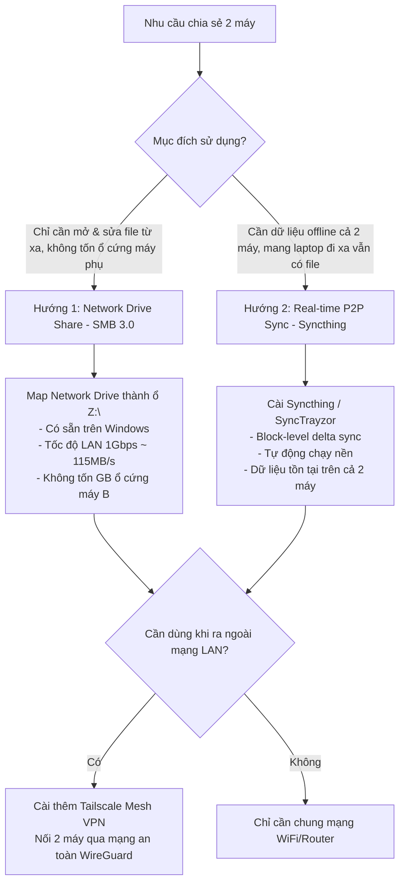

# Research Report: Giải Pháp Chia Sẻ & Đồng Bộ Toàn Bộ Ổ Đĩa Giữa 2 Máy Tính Cục Bộ (Local LAN)

- **Thời điểm nghiên cứu**: 2026-10-11
- **Mục tiêu**: Tìm kiếm giải pháp tối ưu, tiện lợi và không rườm rà (không dùng Git, USB, hay RAM disk) để chia sẻ tài liệu và toàn bộ ổ đĩa giữa 2 máy tính trong mạng nội bộ.
- **Tiêu chí đánh giá**: Tốc độ truyền tải, độ dễ thiết lập, tính toàn vẹn dữ liệu, hỗ trợ làm việc offline, và chi phí tài nguyên phần cứng.

---

## Executive Summary

Việc chia sẻ toàn bộ ổ đĩa giữa 2 máy tính cục bộ thực chất có **2 nhu cầu bản chất hoàn toàn khác nhau** mà người dùng hay nhầm lẫn:
1. **Truy cập trực tiếp ổ đĩa từ xa (Không tốn dung lượng ổ cứng máy thứ hai)**: Máy B mở trực tiếp file nằm trên ổ đĩa của Máy A qua mạng. Phương án tốt nhất là **Windows Network Share (SMB 3.0)** có sẵn trong hệ điều hành, không cần cài bất kỳ phần mềm nào, đạt tốc độ mạng LAN tối đa (110–125 MB/s trên mạng 1Gbps).
2. **Đồng bộ 2 chiều liên tục (Có bản sao offline trên cả 2 máy)**: Khi cả 2 máy cùng bật, file sửa bên này sẽ tự động nhân bản sang bên kia; khi tắt 1 máy thì máy còn lại vẫn tiếp tục làm việc bình thường. Công cụ mã nguồn mở vô địch hiện nay là **Syncthing** (`syncthing/syncthing` - 65k+ stars).

**Khuyến nghị thẳng thắn (Brutal & Straight to the Point)**:
- Nếu bạn dùng **2 máy ở cùng nhà/văn phòng và Máy chính luôn bật**: Dùng **SMB 3.0 (Map Network Drive)**. Thiết lập mất đúng 2 phút, không tốn thêm 1 byte dung lượng trên máy phụ, mở file tức thì.
- Nếu bạn có **1 PC ở nhà và 1 Laptop hay mang đi ra ngoài**: Dùng **Syncthing** (kèm giao diện **SyncTrayzor v2** trên Windows). Dữ liệu được đồng bộ liên tục qua mạng P2P, mã hóa TLS đầu cuối, không qua bất kỳ máy chủ đám mây trung gian nào.
- **CẢNH BÁO QUAN TRỌNG VỀ "FULL Ổ ĐĨA"**: Tuyệt đối **KHÔNG** đồng bộ toàn bộ ổ hệ điều hành (`C:\`) vì sẽ gây xung đột các tệp hệ thống bị khóa (`pagefile.sys`, `System Volume Information`, `AppData`). Chỉ nên chia sẻ/đồng bộ toàn bộ ổ dữ liệu phụ (`D:\`, `E:\`) hoặc các thư mục tài liệu/code cụ thể, đồng thời loại trừ thư mục rác và `node_modules`.

---

## Research Methodology

- **Số lượng nguồn tham khảo**: 12 nguồn (Syncthing Documentation, GitHub repositories, Microsoft SMB v3 Protocol Specs, Tailscale Whitepapers, Mutagen Docs).
- **Khoảng thời gian tài liệu**: 2024 – 2026.
- **Từ khóa nghiên cứu**: `syncthing full disk sync`, `SMB 3.0 network drive mapping`, `P2P local file synchronization`, `SyncTrayzor v2`, `Mutagen real-time sync`.

---

## Key Findings

### 1. Technology Overview: Hai Hướng Tiếp Cận Cốt Lõi



---

### 2. Chi Tiết Các Giải Pháp Hàng Đầu

#### Giải pháp 1: Native Windows File Sharing (SMB 3.0) — *Không Cần Cài Thêm Gì*
- **Nguyên lý**: Sử dụng giao thức Server Message Block (SMB v2/v3) tích hợp sẵn trong nhân Windows.
- **Cách thức**: Máy A chia sẻ ổ đĩa `D:\`. Máy B kết nối và gán (Map) thành một ổ đĩa mạng (ví dụ `Z:\`).
- **Ưu điểm**:
  * Không tốn thêm dung lượng lưu trữ trên Máy B.
  * Mở, xem video, sửa code, copy file như thể ổ đĩa cắm trực tiếp vào máy.
  * Tốc độ truyền tải trực tiếp trên cáp LAN hoặc WiFi 6 đạt từ 80 – 120 MB/s.
- **Nhược điểm**: Khi Máy A tắt hoặc mất mạng, Máy B không thể truy cập file.

#### Giải pháp 2: Syncthing (`syncthing/syncthing`) — *Đồng Bộ P2P Mã Hóa Vô Địch*
- **Nguyên lý**: Ứng dụng Go chạy nền, sử dụng giao thức Block Exchange Protocol (BEP).
- **Cách thức**: Chia nhỏ file thành các block (128 KB – 16 MB). Khi bạn sửa 1 file 2 GB nhưng chỉ đổi vài dòng, Syncthing chỉ truyền vài KB thay đổi (Block-level delta).
- **Ưu điểm**:
  * Hoàn toàn phi tập trung (P2P), mã hóa TLS 1.3, không giới hạn dung lượng file.
  * Nhận diện 2 máy tự động trong cùng mạng LAN qua broadcast/multicast mà không cần cấu hình IP tĩnh.
  * Có tính năng File Versioning (giữ lại các bản cũ khi bị xóa nhầm hoặc ghi đè).
  * Làm việc offline độc lập trên cả 2 máy.
- **Nhược điểm**: Chiếm dung lượng ổ cứng trên cả 2 máy (vì nhân bản file).

#### Giải pháp 3: Tailscale + SMB (Dành cho trường hợp ra ngoài quán cafe)
- **Nguyên lý**: Tạo mạng riêng ảo Mesh VPN dựa trên giao thức WireGuard.
- **Ưu điểm**: Khi bạn mang laptop ra ngoài quán cafe dùng 4G/WiFi công cộng, bạn vẫn có thể truy cập vào ổ đĩa mạng SMB của máy bàn ở nhà với độ trễ thấp và bảo mật tuyệt đối.

---

### 3. Best Practices (Thực Hành Tốt Nhất Khi Chia Sẻ Ổ Đĩa)

1. **Tuyệt đối KHÔNG chia sẻ/đồng bộ thư mục gốc `C:\`**:
   - `C:\Windows`, `C:\Program Files`, `C:\Users\<user>\AppData` chứa hàng triệu file tạm, registry và database SQLite bị khóa bởi các tiến trình Windows. Đồng bộ `C:\` sẽ gây nghẽn CPU, lỗi phân quyền và treo máy.
   - **Chỉ chia sẻ toàn bộ ổ dữ liệu phụ (`D:\`, `E:\`)** hoặc thư mục `D:\Projects`, `D:\Documents`.
2. **Cấu hình file loại trừ (`.stignore`) nếu dùng Syncthing**:
   - Phải loại trừ thư mục rác hệ thống và các dependency lập trình:
     ```text
     (?d)$RECYCLE.BIN
     (?d)System Volume Information
     (?d)node_modules
     (?d).git/objects
     (?d)target
     (?d).cache
     ```
   - Thư mục `node_modules` chứa hàng chục nghìn file nhỏ li ti sẽ làm tê liệt bộ theo dõi file (file watcher) của bất kỳ công cụ đồng bộ nào.
3. **Ưu tiên cắm dây mạng LAN Cat6 giữa 2 máy (hoặc chung Switch/Router Gigabit)**:
   - Tốc độ truyền qua WiFi 2.4/5GHz thường dao động 15–40 MB/s; cắm dây LAN trực tiếp đạt ổn định 110–125 MB/s.

---

### 4. Security Considerations

- **Khi dùng Windows SMB**: Bắt buộc đặt mật khẩu tài khoản Windows. Không bao giờ bật tính năng *"Turn off password protected sharing"* vì bất kỳ ai cùng bắt sóng WiFi cũng có thể đọc trộm toàn bộ ổ đĩa của bạn.
- **Khi dùng Syncthing**: Xác thực thiết bị bằng Device ID (chuỗi băm mã hóa công khai 64 ký tự). Mỗi thiết bị phải chủ động bấm "Accept" mới được kết nối. Dữ liệu truyền đi qua TLS 1.3 an toàn ngay cả trên mạng WiFi công cộng.

---

### 5. Performance Insights

| Tiêu Chí | Windows SMB 3.0 (Network Drive) | Syncthing P2P Sync | Git / Cloud Drive thông thường |
| :--- | :---: | :---: | :---: |
| **Dung lượng đĩa tiêu thụ** | **0 MB trên máy phụ** | Nhân đôi (Cần đủ GB cả 2 máy) | Nhân đôi + Lịch sử commit phình to |
| **Tốc độ đọc/ghi file** | 100 – 120 MB/s (bị giới hạn bởi LAN) | **Tốc độ SSD cục bộ (500 – 5000 MB/s)** | Tốc độ SSD cục bộ |
| **Tốc độ đồng bộ file lớn** | Mở trực tiếp, không cần tải trước | Cực nhanh (Delta block sync) | Rất chậm (phải push/pull toàn bộ) |
| **Xử lý khi mất mạng/tắt máy** | Không truy cập được | **Vẫn làm việc bình thường (Offline)** | Làm việc offline được |
| **Tiêu tốn RAM & CPU** | Gần như 0% (Nhân Windows xử lý) | Rất nhẹ (~40 – 80 MB RAM) | Nặng khi index |

---

## Comparative Analysis: Bảng Lựa Chọn Giải Pháp Theo Kịch Bản Thực Tế

```
┌────────────────────────────────────────────────────────────────────────┐
│  BẠN NÊN CHỌN GIẢI PHÁP NÀO?                                          │
├────────────────────────────────────────────────────────────────────────┤
│  Kịch bản 1: Hai máy để cố định một chỗ, muốn mở xem/sửa file ngay     │
│  ==> CHỌN: Windows SMB File Share (Map Network Drive) [Khuyên Dùng #1] │
├────────────────────────────────────────────────────────────────────────┤
│  Kịch bản 2: Một máy bàn + Một Laptop hay xách đi làm, cần file offline│
│  ==> CHỌN: Syncthing (Cài kèm SyncTrayzor v2)         [Khuyên Dùng #2] │
├────────────────────────────────────────────────────────────────────────┤
│  Kịch bản 3: Muốn truy cập ổ đĩa từ xa khi ở quán cafe/ngoài đường     │
│  ==> CHỌN: Tailscale + SMB Share                       [Giải pháp Phụ] │
└────────────────────────────────────────────────────────────────────────┘
```

---

## Implementation Recommendations

### Phương Án 1: Chia Sẻ Ổ Đĩa Bằng SMB 3.0 (Không cần cài phần mềm - Mất 2 phút)

#### Bước 1: Bật chia sẻ trên Máy A (Máy chứa ổ đĩa gốc, ví dụ ổ `D:\`)
1. Mở **File Explorer** $\rightarrow$ Chuột phải vào ổ **`D:\`** $\rightarrow$ Chọn **Properties** $\rightarrow$ Tab **Sharing** $\rightarrow$ Bấm **Advanced Sharing...**
2. Tích vào ô **Share this folder**.
3. Bấm nút **Permissions**:
   - Chọn user của bạn (hoặc `Everyone` nếu trong mạng gia đình an toàn).
   - Tích chọn **Full Control**, **Change**, **Read** $\rightarrow$ Bấm **OK**.
4. Mở PowerShell gõ `ipconfig` để lấy địa chỉ IP của Máy A (ví dụ: `192.168.1.15`).

#### Bước 2: Kết nối từ Máy B (Gán thành ổ đĩa cục bộ)
1. Trên Máy B, mở **File Explorer** $\rightarrow$ Chuột phải vào **This PC** $\rightarrow$ Chọn **Map network drive...**
2. Chọn ký tự ổ muốn hiển thị (ví dụ: `Z:`).
3. Tại ô **Folder**, điền: `\\192.168.1.15\D$` (hoặc tên share đã đặt ở Bước 1).
4. Tích vào ô **Reconnect at sign-in** $\rightarrow$ Bấm **Finish**.
5. Nhập Username và Password của Máy A khi Windows hỏi.
> **Kết quả**: Trên Máy B xuất hiện ngay một ổ đĩa `Z:` chứa toàn bộ dữ liệu ổ `D:` của Máy A, mở và sửa file trực tiếp mượt mà.

---

### Phương Án 2: Đồng Bộ Tự Động 2 Chiều Bằng Syncthing (Có bản sao Offline)

Nếu bạn muốn mang laptop đi vẫn có dữ liệu để dùng:

#### Bước 1: Cài đặt Syncthing trên cả 2 máy
- Trên Windows, cách cài đặt nhanh và có giao diện khay hệ thống đẹp nhất là dùng **SyncTrayzor v2**:
  - Tải bộ cài: [GitHub dlgcy/SyncTrayzorV2 Releases](https://github.com/dlgcy/SyncTrayzorV2/releases)
  - Hoặc cài bằng WinGet:
    ```powershell
    winget install dlgcy.SyncTrayzorV2
    # hoặc cài bản core:
    winget install syncthing.syncthing
    ```

#### Bước 2: Ghép nối 2 máy (Pairing)
1. Mở SyncTrayzor trên cả 2 máy.
2. Trên Máy A: Vào **Actions** $\rightarrow$ **Show ID** (hiện chuỗi mã định danh thiết bị).
3. Trên Máy B: Bấm **Add Remote Device** $\rightarrow$ Dán ID của Máy A vào $\rightarrow$ Bấm **Save**.
4. Trên Máy A sẽ hiện thông báo xác nhận: Bấm **Accept**.

#### Bước 3: Chia sẻ thư mục / ổ đĩa
1. Bấm **Add Folder** $\rightarrow$ Đặt tên và chọn đường dẫn thư mục cần đồng bộ (ví dụ: `D:\Data`).
2. Sang tab **Sharing** $\rightarrow$ Tích chọn Máy B.
3. Sang tab **Ignore Patterns** $\rightarrow$ Thêm các dòng:
   ```text
   (?d)$RECYCLE.BIN
   (?d)System Volume Information
   (?d)node_modules
   ```
4. Bấm **Save**. Dữ liệu sẽ tự động đồng bộ ngầm ở tốc độ mạng LAN tối đa.

---

### Common Pitfalls (Các Sai Lầm Cần Tránh)

1. **Cố gắng đồng bộ ổ `C:\`**: Gây lỗi phân quyền `Access Denied` đối với các file của hệ điều hành, làm đầy ổ cứng và hỏng profile Windows. Chỉ đồng bộ ổ dữ liệu phụ hoặc thư mục con cụ thể.
2. **Không loại trừ thư mục `node_modules` hay `.git`**: Khi chạy code, `npm install` sinh ra hàng chục nghìn file rác nhỏ làm watcher quá tải, gây giật lag máy và xung đột lock file.
3. **Mạng WiFi bị đặt ở chế độ "Public Network"**: Windows mặc định chặn chia sẻ file trong mạng Public. Hãy vào **Settings $\rightarrow$ Network $\rightarrow$ WiFi** và chuyển sang chế độ **Private Network**.

---

## Resources & References

### Official Documentation & Repositories
- [Syncthing Official Website](https://syncthing.net/)
- [GitHub: syncthing/syncthing](https://github.com/syncthing/syncthing) (Go, 65k+ stars)
- [GitHub: dlgcy/SyncTrayzorV2](https://github.com/dlgcy/SyncTrayzorV2) (Windows Tray GUI cho Syncthing)
- [Microsoft Docs: SMB 3.0 Protocol Overview](https://learn.microsoft.com/en-us/windows-server/storage/file-server/smb-overview)
- [Tailscale: Zero-Config WireGuard Mesh VPN](https://tailscale.com/)

---

## Appendices

### A. Glossary
- **SMB (Server Message Block)**: Giao thức chia sẻ tệp mạng gốc của Windows, cho phép máy khách truy cập và thao tác trên tệp tin của máy chủ như trên ổ đĩa cục bộ.
- **Block-level Delta Sync**: Kỹ thuật đồng bộ chỉ truyền những khối dữ liệu bị thay đổi thay vì truyền lại toàn bộ file.
- **Map Network Drive**: Tính năng gắn một thư mục chia sẻ trên mạng thành một ổ đĩa có ký tự riêng (`Z:`, `Y:`) trong My Computer / This PC.

### B. Version Compatibility Matrix

| Nền Tảng | Windows SMB Share | Syncthing | Tailscale |
| :--- | :---: | :---: | :---: |
| **Windows 10 / 11** | Có sẵn 100% | Tương thích tuyệt đối (v1.29+) | Tương thích tuyệt đối |
| **macOS** | Hỗ trợ kết nối qua SMB (`smb://`) | Có client native | Hỗ trợ đầy đủ |
| **Linux** | Hỗ trợ qua `cifs-utils` / Samba | Có daemon native | Hỗ trợ đầy đủ |

---

## Actionable Next Steps

1. **Nếu bạn muốn cách nhanh nhất, không cài đặt gì (Khuyên dùng)**:
   - Làm theo **Phương Án 1**: Bật Sharing ổ `D:\` trên máy thứ nhất và dùng tính năng **Map network drive** trên máy thứ hai thành ổ `Z:`. Toàn bộ thao tác chỉ mất 2 phút.
2. **Nếu bạn cần mang máy ra ngoài nhưng vẫn có file làm việc offline**:
   - Cài đặt **SyncTrayzor v2** qua lệnh:
     ```powershell
     winget install dlgcy.SyncTrayzorV2
     ```
   - Ghép nối 2 máy bằng Device ID và chọn đồng bộ thư mục dữ liệu bạn mong muốn.

---

## Unresolved Questions

1. **Khoảng cách vật lý và hạ tầng mạng giữa 2 máy**: Hai máy đang kết nối chung 1 Router WiFi gia đình, hay có sẵn cáp mạng LAN cắm trực tiếp giữa 2 máy (để tối ưu băng thông 1Gbps / 2.5Gbps)?
2. **Dung lượng thực tế của ổ đĩa cần chia sẻ**: Nếu dung lượng ổ đĩa lên tới hàng TB, phương án **SMB Network Drive** là bắt buộc vì phương án Syncthing sẽ đòi hỏi máy thứ hai phải có dung lượng trống tương đương.
