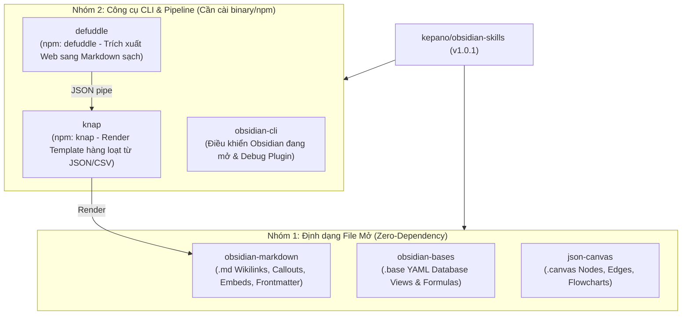

# Báo Cáo Nghiên Cứu & Đánh Giá: `kepano/obsidian-skills`

- **Thời gian nghiên cứu**: `2026-11-01`
- **Repository mục tiêu**: [https://github.com/kepano/obsidian-skills](https://github.com/kepano/obsidian-skills)
- **Tác giả**: Steph Ango (`@kepano` — CEO của Obsidian, tác giả Minimal Theme, JSON Canvas Spec, Defuddle, Knap)
- **Phiên bản / Commit kiểm tra**: `v1.0.1` (`3ccff5338ea700537839b21900aa5358a0402c98`, cập nhật nhánh `main` ngày `2026-09-15`)
- **Bản đóng gói Repomix cục bộ**: `reports/obsidian-skills-repomix.md` (15 files, 16,729 tokens, 61,407 chars, 0 cảnh báo bảo mật)

---

## Mục Lục

1. [Kết Luận Nhanh (Executive Verdict)](#1-kết-luận-nhanh-executive-verdict)
2. [Tổng Quan Repository & Chỉ Số Cộng Đồng](#2-tổng-quan-repository--chỉ-số-cộng-đồng)
3. [Kiến Trúc & Phân Tích Chi Tiết 6 Skills](#3-kiến-trúc--phân-tích-chi-tiết-6-skills)
4. [Phân Tích Dung Lượng Token (Repomix Audit)](#4-phân-tích-dung-lượng-token-repomix-audit)
5. [Ưu Điểm, Hạn Chế & Các Lỗi Thực Tế (Known Issues)](#5-ưu-điểm-hạn-chế--các-lỗi-thực-tế-known-issues)
6. [Đánh Giá: Bạn Có Nên Sử Dụng Không?](#6-đánh-giá-bạn-có-nên-sử-dụng-không)
7. [Hướng Dẫn Cài Đặt & Tích Hợp Khuyến Nghị](#7-hướng-dẫn-cài-đặt--tích-hợp-khuyến-nghị)

---

## 1. Kết Luận Nhanh (Executive Verdict)

**CÓ — Rất đáng sử dụng nếu bạn dùng Obsidian (hoặc quản lý tài liệu học tập `.md`, `.canvas`, `.base`) kết hợp với AI Coding Agent (OMP, Claude Code, OpenCode, Codex); KHÔNG CẦN cài toàn bộ nếu bạn chỉ code thuần và không dùng Obsidian.**

| Tiêu chí | Đánh giá | Lý do cốt lõi |
| :--- | :---: | :--- |
| **Độ tin cậy & Chính thống** | **10 / 10** | Do chính CEO của Obsidian (`@kepano`) viết và duy trì; đạt **50,533 Stars** và **3,575 Forks**. |
| **An toàn Bảo mật** | **10 / 10** | 100% là file Markdown/JSON tĩnh (Prompt & Reference); không chứa script ngầm hay mã thực thi độc hại (xác nhận qua Secretlint/Repomix). |
| **Hiệu quả Context / Token** | **9.5 / 10** | Toàn bộ 6 skills + tài liệu tham chiếu chỉ chiếm **16,729 tokens**; thiết kế tách `SKILL.md` và `references/*.md` giúp Agent chỉ nạp chi tiết khi cần. |
| **Độ phù hợp với repo `advance-be`** | **8.5 / 10** | Cực kỳ hữu ích cho các skill `obsidian-markdown`, `json-canvas` (vẽ sơ đồ kiến trúc `.canvas`), và `defuddle` (bóc tách bài viết kỹ thuật sạch tốn ít token). |

---

## 2. Tổng Quan Repository & Chỉ Số Cộng Đồng

`kepano/obsidian-skills` là bộ Agent Skills chuẩn hóa theo đặc tả mở [Agent Skills Specification](https://agentskills.io/specification), giúp các AI Agent hiểu chính xác cú pháp đặc thù của hệ sinh thái Obsidian thay vì suy đoán bằng Markdown thông thường.

| Chỉ số | Giá trị thực tế (GitHub API & Repomix) |
| :--- | :--- |
| **Stars / Watchers** | 50,533 |
| **Forks** | 3,575 |
| **Open Issues / PRs** | 75 |
| **Giấy phép (License)** | MIT License |
| **Tổng số file** | 15 files (2 manifest `.claude-plugin`, 6 `SKILL.md`, 5 file `references/*.md`, `README.md`, `LICENSE`) |
| **Tổng Token toàn repo** | 16,729 tokens (61,407 ký tự) |

---

## 3. Kiến Trúc & Phân Tích Chi Tiết 6 Skills



### Chi tiết từng Skill trong bộ công cụ:

1. **`obsidian-markdown`** (`skills/obsidian-markdown/SKILL.md` + 3 files `references/`):
   - **Chức năng**: Dạy Agent viết đúng chuẩn Obsidian Flavored Markdown: `[[Wikilinks]]`, liên kết tới heading/block (`[[Note#^block-id]]`), nhúng tài liệu/ảnh/PDF (`![[doc.pdf#page=3]]`), 13 loại Callouts (`> [!note]`, foldable `+`/`-`), YAML Frontmatter (`Properties`), LaTeX và Mermaid liên kết nội bộ (`class NodeName internal-link;`).
   - **Giá trị**: Ngăn chặn lỗi phổ biến của LLM khi dùng Markdown link thường thay vì Wikilink hoặc viết sai cú pháp Callout/Block ID.

2. **`json-canvas`** (`skills/json-canvas/SKILL.md` + `references/EXAMPLES.md`):
   - **Chức năng**: Tạo và chỉnh sửa file `.canvas` theo chuẩn [JSON Canvas Spec 1.0](https://jsoncanvas.org/spec/1.0/) gồm `nodes` (`text`, `file`, `link`, `group`) và `edges`.
   - **Giá trị**: Có quy tắc rõ ràng về sinh mã 16-char hex ID, khoảng cách tọa độ (`x`, `y` cách nhau 50–100px tránh đè hình), z-index theo thứ tự mảng, và cảnh báo lỗi xuống dòng `\\n` vs `\n`.

3. **`obsidian-bases`** (`skills/obsidian-bases/SKILL.md` + `references/FUNCTIONS_REFERENCE.md`):
   - **Chức năng**: Tạo file cơ sở dữ liệu `.base` (tính năng Bases mới của Obsidian thay thế nhiều tác vụ của plugin Dataview) với các chế độ xem `table`, `cards`, `list`, `map`, bộ lọc đệ quy (`and`/`or`/`not`) và công thức tính toán (`formulas`).
   - **Giá trị**: Đặc biệt hữu ích vì tính năng Obsidian Bases mới ra mắt, hầu hết các LLM chưa có đủ kiến thức trong tập huấn luyện gốc (ví dụ: trừ 2 ngày trả về kiểu `Duration` phải gọi `.days` trước khi `.round(0)`).

4. **`obsidian-cli`** (`skills/obsidian-cli/SKILL.md`):
   - **Chức năng**: Giao tiếp trực tiếp với ứng dụng Obsidian đang chạy qua CLI chính thức (`obsidian read`, `create`, `append`, `search`, `daily:append`, `property:set`) và hỗ trợ phát triển/debug plugin (`obsidian plugin:reload`, `dev:errors`, `dev:screenshot`, `dev:dom`, `eval`).
   - **Điều kiện**: Yêu cầu ứng dụng Obsidian Desktop đang mở và bật CLI.

5. **`defuddle`** (`skills/defuddle/SKILL.md`):
   - **Chức năng**: Sử dụng `defuddle` CLI (`npm install -g defuddle`) để bóc tách nội dung bài viết web sang Markdown/JSON sạch, loại bỏ quảng cáo/menu/rác HTML nhằm tiết kiệm token hơn `WebFetch` thông thường.

6. **`knap`** (`skills/knap/SKILL.md`):
   - **Chức năng**: Sử dụng `knap` CLI (`npm install -g knap`, yêu cầu Node.js >= 20) để kết xuất dữ liệu từ JSON/CSV hoặc pipe từ `defuddle` vào template Markdown (`{{ variable | filter }}`, ``) tạo hàng loạt ghi chú.

---

## 4. Phân Tích Dung Lượng Token (Repomix Audit)

Dữ liệu trích xuất từ lần chạy Repomix (`reports/obsidian-skills-repomix.md`):

| Hạng | Đường dẫn File | Số Tokens | Số Ký tự | Tỷ trọng (%) |
| :---: | :--- | ---: | ---: | ---: |
| 1 | `skills/obsidian-bases/SKILL.md` | 3,488 | 13,508 | 20.9% |
| 2 | `skills/json-canvas/references/EXAMPLES.md` | 2,793 | 6,803 | 16.7% |
| 3 | `skills/json-canvas/SKILL.md` | 2,249 | 7,866 | 13.4% |
| 4 | `skills/obsidian-bases/references/FUNCTIONS_REFERENCE.md` | 1,959 | 7,709 | 11.7% |
| 5 | `skills/obsidian-markdown/SKILL.md` | 1,406 | 5,561 | 8.4% |
| 6–15 | 10 files còn lại (`knap`, `obsidian-cli`, `defuddle`, `references`, v.v.) | 4,834 | 19,960 | 28.9% |
| **Tổng** | **15 files** | **16,729** | **61,407** | **100.0%** |

---

## 5. Ưu Điểm, Hạn Chế & Các Lỗi Thực Tế (Known Issues)

### Ưu điểm nổi bật
- **Chuẩn kiến trúc Progressive Disclosure**: Các file `SKILL.md` cực kỳ cô đọng (chỉ từ 150 – 3,400 tokens), phần ví dụ nặng và bảng tra cứu hàm được tách sang thư mục `references/` để không làm phình context window của Agent.
- **Tập trung vào "Pitfalls" (Bẫy thực tế của LLM)**: Chỉ rõ các lỗi LLM hay mắc phải như YAML quoting khi công thức chứa dấu ngoặc kép, lỗi kiểu `Duration` trong Bases, hay lỗi escape `\\n` trong JSON Canvas.

### Hạn chế & Edge Cases cần lưu ý (Tổng hợp từ Issue #149, #151 trên GitHub)
1. **Phụ thuộc công cụ ngoài ở 3 skills (`obsidian-cli`, `defuddle`, `knap`)**:
   - `obsidian-cli` bắt buộc phải có app Obsidian đang mở trên máy.
   - `defuddle` và `knap` yêu cầu cài thêm gói npm global (`npm i -g defuddle knap`).
2. **Bẫy thẻ HTML chưa đóng trong Obsidian Live Preview (PR #151)**:
   - Nếu Agent viết các thẻ như `<style>`, `<script>`, `<template>` mà không đóng ngay cả trong inline code, bộ dựng CodeMirror 6 của Obsidian sẽ bị kẹt ở chế độ HTML.
3. **Hành vi `sort` trong `obsidian-bases` trên Obsidian 1.14+ (Issue #149)**:
   - Nếu thuộc tính dùng trong `sort` không được liệt kê trong mảng `order` (các cột hiển thị), khối `sort` sẽ bị Obsidian bỏ qua âm thầm.

---

## 6. Đánh Giá: Bạn Có Nên Sử Dụng Không?

Đối chiếu trực tiếp với ngữ cảnh làm việc của bạn (học và xây dựng hệ thống Backend nâng cao trong repo `D:/study/advance-be`, thường xuyên chuyển đổi PDF sang Markdown trong `Tài Liệu/` và tổng hợp báo cáo học tập):

### 1. Nhóm RẤT NÊN DÙNG NGAY (`obsidian-markdown`, `json-canvas`, `defuddle`)
- Nếu bạn mở thư mục `Tài Liệu/` hoặc `reports/` bằng **Obsidian** để học System Design, Kafka, Database Locking:
  - **`obsidian-markdown`**: Giúp AI tạo ghi chú bài học có Callout (`> [!tip]`, `> [!warning]`), liên kết chéo `[[Bài 6 - Redis]]` -> `[[Bài 14 - Locking]]` đúng tinh thần tích lũy cuốn chiếu.
  - **`json-canvas`**: Cho phép bạn yêu cầu AI vẽ sơ đồ Mindmap / Architecture Flow ra file `.canvas` để kéo-thả trực quan trong Obsidian.
  - **`defuddle`**: Rất tiện khi bạn muốn nhờ AI đọc một bài blog kỹ thuật (High Scalability, Martin Fowler, Uber Engineering) và lưu thành note Markdown sạch vào project.

### 2. Nhóm CHỈ DÙNG KHI CÓ NHU CẦU CỤ THỂ (`obsidian-bases`, `obsidian-cli`, `knap`)
- **`obsidian-bases`**: Chỉ cần khi bạn dùng tính năng `.base` của Obsidian để quản lý bảng tiến độ học tập hoặc danh sách tài liệu.
- **`obsidian-cli`**: Chỉ cần khi bạn muốn AI điều khiển cửa sổ Obsidian đang mở hoặc tự viết plugin cho Obsidian.
- **`knap`**: Bạn đã có Python/Node.js và hệ thống Agent hiện tại nên ít khi cần thêm một template engine CLI riêng trừ khi muốn render hàng trăm note từ file CSV.

---

## 7. Hướng Dẫn Cài Đặt & Tích Hợp Khuyến Nghị

Thay vì cài đặt tràn lan toàn bộ hoặc cài thêm các CLI chưa dùng tới, bạn có thể áp dụng theo 2 cách gọn nhẹ nhất:

### Cách 1: Cài qua `npx skills` (Tự động nhận diện cho Agent)
```bash
npx skills add https://github.com/kepano/obsidian-skills
```

### Cách 2: Chỉ copy chọn lọc các skill cần thiết vào dự án (Khuyến nghị theo triết lý KISS)
Nếu bạn chỉ cần Agent viết Markdown chuẩn Obsidian và vẽ sơ đồ JSON Canvas mà không muốn nạp các skill CLI dư thừa:
- Chỉ giữ lại thư mục `skills/obsidian-markdown` và `skills/json-canvas` (tổng cộng chỉ ~7,800 tokens bao gồm cả ví dụ).
- Nếu muốn dùng thêm `defuddle` để cạo bài viết kỹ thuật sạch về học:
  ```bash
  npm install -g defuddle
  ```
