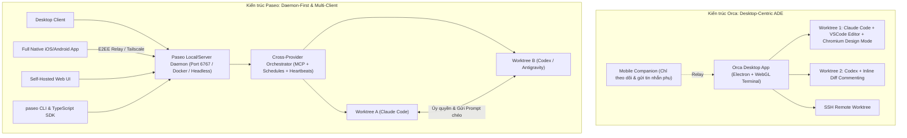

# Báo Cáo Nghiên Cứu & Đánh Giá Chuyên Sâu: `getpaseo/paseo` vs. `stablyai/orca`

- **Thời gian nghiên cứu**: `2026-11-01`
- **Nguồn dữ liệu kiểm chứng**:
  - **Paseo**: [github.com/getpaseo/paseo](https://github.com/getpaseo/paseo) (`v0.14.0`, phát hành `2026-10-29`) · [paseo.sh](https://paseo.sh)
  - **Orca**: [github.com/stablyai/orca](https://github.com/stablyai/orca) (`v1.4.245`, phát hành `2026-10-30`) · [onorca.dev](https://www.onorca.dev)
  - **Báo cáo độc lập & Benchmark cộng đồng**: [ai.dosa.dev (10/2026)](https://ai.dosa.dev/blog/run-multiple-coding-agents-in-parallel), [hynu.app Architecture Analysis (09/2026)](https://hynu.app/posts/paseo-vs-orca-agent-orchestrator)

---

## Mục Lục

1. [Kết Luận Nhanh (Executive Verdict): Chọn Paseo hay Orca?](#1-kết-luận-nhanh-executive-verdict-chọn-paseo-hay-orca)
2. [Bản Chất Bài Toán: Tại Sao Paseo và Orca Ra Đời?](#2-bản-chất-bài-toán-tại-sao-paseo-và-orca-ra-đời)
3. [Phân Tích Toàn Diện `getpaseo/paseo` (Kiến Trúc & Tính Năng)](#3-phân-tích-toàn-diện-getpaseopaseo-kiến-trúc--tính-năng)
4. [Phân Tích Toàn Diện `stablyai/orca` (Kiến Trúc & Tính Năng)](#4-phân-tích-toàn-diện-stablyaiorca-kiến-trúc--tính-năng)
5. [Bảng So Sánh Trực Diện: Paseo vs. Orca](#5-bảng-so-sánh-trực-diện-paseo-vs-orca)
6. [Nhược Điểm & Giới Hạn Thực Tế Của Cả Hai (Brutal Honesty)](#6-nhược-điểm--giới-hạn-thực-tế-của-cả-hai-brutal-honesty)
7. [Khuyến Nghị Dành Riêng Cho Bạn (Đặt Trong Hệ Sinh Thái OMP Hiện Tại)](#7-khuyến-nghị-dành-riêng-cho-bạn-đặt-trong-hệ-sinh-thái-omp-hiện-tại)

---

## 1. Kết Luận Nhanh (Executive Verdict): Chọn Paseo hay Orca?

Cả **Paseo** và **Orca** đều là **ADE (Agentic Development Environment)** — môi trường phát triển lấy việc điều phối nhiều AI Coding Agent chạy song song trên các nhánh `git worktree` độc lập làm trung tâm. Tuy nhiên, triết lý kiến trúc của hai bên **ngược nhau hoàn toàn**:

- **Chọn `Orca` (`stablyai/orca`) nếu bạn ngồi trước máy tính (Windows/macOS/Linux) và cần một "Siêu IDE cho Agent"**:
  - Orca **đáng xài hơn cho 80% lập trình viên làm việc trực tiếp trên máy bàn** (đặc biệt là Fullstack / Frontend hoặc khi cần review code trực quan).
  - Lý do: Có **Design Mode** (click phần tử web gửi thẳng HTML/CSS/ảnh chụp vào prompt), **Annotate AI Diffs** (comment từng dòng diff như GitHub PR để bắt AI sửa), **Hot-swap tài khoản** khi hết rate-limit, terminal WebGL cực mượt và đội ngũ YC hậu thuẫn ra bản cập nhật mỗi ngày (**112,058 Stars**).
- **Chọn `Paseo` (`getpaseo/paseo`) nếu bạn cần kiến trúc "Daemon / Server-first", điều khiển từ Điện thoại/Web/Docker hoặc cho các Agent tự gọi chéo nhau**:
  - Paseo **đáng xài hơn cho kỹ sư Backend / DevOps / Homelab** muốn treo Agent chạy ngầm trên server/VPS/Docker, ra ngoài đường mở app iOS/Android (full tính năng) kiểm tra, hoặc muốn **Claude Code tự động đẻ ra sub-agent chạy bằng Codex/Antigravity** thông qua MCP/SDK mà không có telemetry (**22,681 Stars**).

---

## 2. Bản Chất Bài Toán: Tại Sao Paseo và Orca Ra Đời?

Khi chạy 1 AI Agent (như Claude Code, Codex, OpenCode, Pi, hay OMP), điểm nghẽn không còn là tốc độ gõ code mà là **thời gian chờ Agent chạy xong**. Nếu bạn mở 3 tab terminal chạy 3 Agent trên cùng 1 thư mục dự án, chúng sẽ **ghi đè (clobber) file của nhau**.

Giải pháp của cả Paseo và Orca là tự động hóa `git worktree`:
- Mỗi nhiệm vụ (Task) được tự động tạo một thư mục `git worktree` và một nhánh (branch) riêng biệt.
- Bạn có thể giao 1 tính năng cho 3 Agent khác nhau làm cùng lúc (hoặc chia 3 tính năng độc lập), sau đó mở bảng Diff/Browser lên kiểm tra và Merge nhánh tốt nhất vào `main`.



---

## 3. Phân Tích Toàn Diện `getpaseo/paseo` (Kiến Trúc & Tính Năng)

### 3.1. Thông số Repository (Kiểm tra thực tế ngày 01/11/2026)
- **Tác giả**: Mohamed Boudra (`@boudra` / `@moboudra`) — dự án độc lập (indie open-source) được tài trợ bởi cộng đồng.
- **Giấy phép**: **Apache-2.0** (đã chuyển từ AGPL-3.0 sang Apache-2.0 vào tháng 08/2026).
- **Chỉ số GitHub**: **22,681 Stars** · **2,776 Forks** · **1,652 Open Issues**.
- **Phiên bản mới nhất**: **`v0.14.0`** (phát hành ngày `2026-10-29`).

### 3.2. Kiến trúc Monorepo (6 Packages)
1. **`packages/server`**: Trái tim của Paseo — **Daemon cục bộ** quản lý vòng đời tiến trình Agent, cung cấp WebSocket API (`ws://127.0.0.1:6767/ws`), MCP Server nội bộ và phục vụ giao diện Web.
2. **`packages/desktop`**: Ứng dụng Desktop (Electron) trên macOS, Windows, Linux (tự động đóng gói và bật Daemon).
3. **`packages/app`**: Ứng dụng Expo chạy đa nền tảng (**iOS, Android, Web**) — điểm khác biệt lớn là bản Mobile có **đầy đủ tính năng (Full App)** như bản Desktop chứ không chỉ là trình xem thông báo.
4. **`packages/cli`**: Công cụ dòng lệnh `@getpaseo/cli` (`paseo run`, `paseo ls`, `paseo attach`, `paseo send`, `paseo usage`).
5. **`packages/relay`**: Giao thức truyền tải và mã hóa đầu-cuối (E2EE) kết nối với relay phân tán viết bằng Elixir (`getpaseo/paseo-relay`).

### 3.3. Danh sách Tính năng Đầy đủ của Paseo
1. **Điều phối Đa nhà cung cấp (Multi-Provider Orchestration — Điểm mạnh nhất)**:
   - Hỗ trợ **6 Native Providers**: **Claude Code, Codex, OpenCode, Pi, Antigravity (`agy`), Muse Code**.
   - Hỗ trợ **37+ Agents qua chuẩn ACP (Agent Client Protocol)** cài 1-click trong app: *GitHub Copilot, Cursor, Gemini CLI, Grok, Cline, Factory Droid, Amp, Auggie, Goose, Hermes, Kimi, Qwen Code, Hoplite...*
2. **Agent Tự Điều Phối Agent (Agent-to-Agent Delegation)**:
   - Khi bật **Paseo MCP Tools** (hoặc qua CLI), một Agent đang chạy có thể tự tạo `git worktree` mới, khởi chạy một Agent của hãng khác (ví dụ: dùng Claude lập kế hoạch rồi gọi Codex viết code và gọi thêm 1 Agent thứ 3 review độc lập), gửi tin nhắn qua lại theo ID.
   - Hỗ trợ **Agent Profiles** (lưu sẵn cấu hình Model + mức độ suy luận + ghi chú *"When to use"* để Agent trưởng tự chọn Agent phụ phù hợp).
   - Hỗ trợ **Schedules** (hẹn giờ chạy prompt định kỳ) và **Heartbeats** (tự động nhắc Agent tiếp tục công việc dài hơi).
3. **Không gian làm việc All-in-One & Tự động hóa Trình duyệt**:
   - Mỗi workspace gồm: Cây thư mục, trình sửa code, bộ xem Diff, nhiều cửa sổ Terminal chia ô, quản lý Pull Request (qua `gh` CLI) và **Trình duyệt tích hợp (Built-in Browser)**.
   - Agent có thể tự mở `http://localhost:<port>` trong trình duyệt của Paseo, thao tác kiểm thử UI và chụp ảnh màn hình kết quả.
   - Hỗ trợ file cấu hình `paseo.json` để tự động cài đặt dependencies và gán port riêng cho từng worktree.
4. **CLI Mạnh Mẽ, Docker Self-Hosted & TypeScript SDK (`@getpaseo/client`)**:
   - Chạy độc lập trên server không màn hình (headless) qua `npm i -g @getpaseo/cli` hoặc Docker (`ghcr.io/getpaseo/paseo:latest` ở cổng `6767`).
   - Cung cấp SDK `@getpaseo/client` để bạn tự viết code TypeScript điều khiển các Agent qua WebSocket:
     ```ts
     import { createPaseoClient } from "@getpaseo/client";
     const client = createPaseoClient({ url: "ws://127.0.0.1:6767/ws" });
     await client.connect();
     const agent = await client.agents.create({
       config: { provider: "codex/gpt-5.5" },
       cwd: "/workspace/app",
       prompt: "Review the current diff and name the riskiest change.",
     });
     const result = await agent.waitForFinish();
     ```
5. **Hệ sinh thái Plugin Đa Thiết Bị & Voice Control (Cập nhật `v0.14.0`)**:
   - Plugin chạy trên Daemon và tự động đồng bộ giao diện lên cả Desktop, Web, iOS và Android; từ bản `v0.14.0`, plugin có thể cấp thêm công cụ (tools) và cấu hình MCP riêng cho từng Agent.
   - **Voice Mode**: Hỗ trợ tải các mô hình nhận diện giọng nói chạy cục bộ (Whisper, SenseVoice) với 1 cú nhấp chuột để ra lệnh bằng giọng nói không cần gửi âm thanh lên đám mây.
   - **Quyền riêng tư tuyệt đối**: **0% Telemetry**, không thu thập dữ liệu ẩn danh, không ép đăng nhập.

---

## 4. Phân Tích Toàn Diện `stablyai/orca` (Kiến Trúc & Tính Năng)

### 4.1. Thông số Repository (Kiểm tra thực tế ngày 01/11/2026)
- **Đơn vị phát triển**: **Stably AI** (Công ty được hậu thuẫn bởi quỹ **Y Combinator**).
- **Giấy phép**: **MIT License** (có thu thập telemetry ẩn danh mặc định, cho phép tắt trong Settings).
- **Chỉ số GitHub**: **112,058 Stars** (tăng trưởng kỷ lục dù mới tạo repo từ `2026-03-17`) · **7,088 Forks** · **7,866 Open Issues**.
- **Phiên bản mới nhất**: **`v1.4.245`** (phát hành ngày `2026-10-30`, tốc độ phát hành gần như mỗi ngày).

### 4.2. Các Tính Năng "Sát Thủ" Giúp Orca Đạt 112k Stars
1. **Design Mode (Vũ khí tối thượng cho Frontend / Fullstack)**:
   - Nhúng sẵn cửa sổ trình duyệt Chromium thực thụ. Bạn chỉ cần **click chuột vào bất kỳ nút bấm/khối giao diện nào bị lệch**, Orca tự động lấy mã HTML, CSS và chụp ảnh vùng giao diện đó đưa thẳng vào ô chat của Agent để yêu cầu sửa.
2. **Annotate AI Diffs (Review code chuẩn Senior ngay trong IDE)**:
   - Thay vì phải copy-paste tên file và số dòng vào khung chat bảo AI sửa lại, bạn bấm trực tiếp vào từng dòng code trong màn hình Diff của Orca, gõ bình luận (giống hệt lúc review Pull Request trên GitHub) rồi bấm gửi trả lại toàn bộ chuỗi nhận xét cho Agent xử lý một lượt.
3. **Ghostty-Class WebGL Terminals**:
   - Sử dụng bộ dựng terminal tăng tốc bằng GPU (WebGL) đạt độ mượt ngang ngửa Ghostty, hỗ trợ chia khung (split panes) vô hạn và **giữ nguyên toàn bộ lịch sử hiển thị (scrollback)** kể cả khi bạn tắt và mở lại ứng dụng.
4. **Account Switcher & Usage Tracking (Đổi nóng tài khoản khi kịch trần Quota)**:
   - Hiển thị trực quan thanh trạng thái dung lượng sử dụng và thời gian reset rate-limit của Claude/Codex, đồng thời cho phép **chuyển đổi nóng (hot-swap) giữa nhiều tài khoản** mà không cần đăng xuất/đăng nhập lại.
5. **Tích hợp sâu GitHub, Linear, Computer Use & 34+ CLI Agents**:
   - Xem danh sách Issues/PRs của GitHub và bảng công việc Linear ngay trong Orca; bấm 1 nút từ Issue để tách `git worktree` mới và giao cho Agent.
   - Hỗ trợ **Computer Use** (cho phép Agent điều khiển các ứng dụng desktop bên ngoài) và **SSH Worktrees** (kết nối máy chủ từ xa qua SSH có tự động port-forwarding).
   - Hỗ trợ trực tiếp hơn 34 CLI Agents, trong đó **có hỗ trợ chính thức `oh-my-pi` (`omp.sh`)** — chính là môi trường bạn đang sử dụng!

---

## 5. Bảng So Sánh Trực Diện: Paseo vs. Orca

| Tiêu chí so sánh | **Paseo (`getpaseo/paseo`)** | **Orca (`stablyai/orca`)** | Bên chiến thắng |
| :--- | :--- | :--- | :---: |
| **Triết lý Kiến trúc** | **Daemon-first** (Server chạy ngầm, mọi thiết bị Desktop/Mobile/Web/CLI kết nối vào) | **Desktop IDE-first** (Tất cả Editor, Terminal, Browser gom vào 1 siêu ứng dụng máy bàn) | Tùy nhu cầu |
| **Độ phổ biến (01/11/2026)** | **22,681 Stars** / 2,776 Forks | **112,058 Stars** / 7,088 Forks | **Orca** (Gấp ~5 lần) |
| **Đơn vị hậu thuẫn** | Indie Developer (`@moboudra`) + Sponsors | Startup **Stably AI (Y Combinator)** | **Orca** (Đội ngũ lớn, ship hàng ngày) |
| **Giấy phép & Quyền riêng tư** | **Apache-2.0** · **Không Telemetry**, không ép login | **MIT** · Có Telemetry ẩn danh (có thể opt-out) | **Paseo** (Sạch hoàn toàn) |
| **Trải nghiệm Review Code & UI** | Xem Diff cơ bản, trình duyệt nhúng & tự động hóa qua lệnh | **Annotate AI Diffs** (comment từng dòng diff) + **Browser Design Mode** (click chọn DOM/CSS) | **Orca thắng tuyệt đối** |
| **Khả năng Agent gọi Agent** | **Rất mạnh**: Agent tự đẻ Sub-agent khác hãng qua MCP/CLI, có `Schedules` & `Heartbeats` | Cơ bản: Chủ yếu do người dùng fan-out 1 prompt ra 5 worktrees hoặc gọi qua `orca` CLI | **Paseo thắng tuyệt đối** |
| **Ứng dụng Điện thoại (iOS/Android)** | **Full Native App** (Làm được mọi thứ như trên Desktop, kết nối qua E2EE Relay hoặc Tailscale) | **Mobile Companion** (Chủ yếu để nhận thông báo và nhắn tin tiếp tục cho Desktop) | **Paseo** |
| **Chạy trên Server / Docker / VPS** | **Chuẩn Cloud-Native**: Có Docker image chính thức (`ghcr.io/getpaseo/paseo`) + tự host Web UI | Hỗ trợ qua **SSH Worktrees** hoặc `orca serve` từ ứng dụng chính | **Paseo** |
| **Lập trình mở rộng (SDK / Plugin)** | Có **TypeScript SDK (`@getpaseo/client`)** + Hệ thống Plugin đồng bộ đa thiết bị | Điều khiển qua `orca` CLI (`orca worktree create`, `snapshot`, `click`) | **Paseo** |
| **Quản lý Tài khoản & Rate Limit** | Có lệnh `paseo usage` kiểm tra hạn mức | Có **Usage Tracking UI + Hot-swap Account Switcher** (đổi tài khoản 1-click) | **Orca** |
| **Hỗ trợ Windows (`win32 x64`)** | Có bộ cài `.exe` (`v0.14.0`) | Có bộ cài `.exe` được ký số chính thức bởi SignPath (`v1.4.245`) | Ngang nhau (Orca mượt hơn ở WebGL Terminal) |

---

## 6. Nhược Điểm & Giới Hạn Thực Tế Của Cả Hai (Brutal Honesty)

1. **Giới hạn vật lý của `git worktree` mà KHÔNG công cụ nào giải quyết tự động được**:
   - `git worktree` chỉ giúp các Agent không ghi đè file của nhau **trong lúc đang chạy**. Khi bạn gộp (merge) nhánh của 2 Agent vào `main`, nếu 2 Agent sửa vào cùng một vùng code (hoặc thậm chí 2 dòng liền kề nhau), **Git Merge Conflict vẫn xảy ra như thường**.
   - Ngoài ra, các worktree chỉ cô lập file chứ **không cô lập tiến trình mạng (Network Ports) hay Database**. Nếu 2 Agent cùng chạy `npm run dev` trên cổng `3000` hoặc cùng chạy migration lên 1 database PostgreSQL/Redis cục bộ, chúng vẫn đụng độ nhau nếu bạn không cấu hình tách port/DB.
2. **Vấn đề thực tế của Paseo**:
   - **Thay đổi CLI Flag gây gãy script cũ**: Vì đang ở nhánh `v0.x` (`v0.14.0`), API thay đổi khá nhanh (ví dụ: cờ `--background` vừa bị khai tử để đổi sang `--no-wait`).
   - **Lưu ý với Antigravity (`agy`)**: Tài liệu chính thức của Paseo cảnh báo rõ khi chạy Antigravity bên trong Paseo, nó bắt buộc chạy ở chế độ `--dangerously-skip-permissions` (tự động chạy mọi lệnh shell không hỏi lại) và không giữ lại lịch sử hiển thị trên giao diện Paseo nếu khởi động lại Daemon.
   - **Số lượng Issue tồn đọng**: Hơn 1,652 open issues do chỉ có 1 tác giả chính gánh vác.
3. **Vấn đề thực tế của Orca**:
   - **Nặng tài nguyên máy bàn hơn**: Vì mỗi worktree có thể kèm theo VS Code Editor + Chromium Design Mode + WebGL Terminal, mở nhiều worktree cùng lúc trên máy ít RAM sẽ ngốn bộ nhớ đáng kể.
   - **Cập nhật quá nhanh**: Tốc độ đẩy bản mới gần như mỗi ngày (`v1.4.230` -> `v1.4.245` chỉ trong hơn 10 ngày) đôi khi làm thay đổi vị trí nút bấm hoặc phát sinh lỗi vặt (hiện có **7,866 open issues** trên GitHub).

---

## 7. Khuyến Nghị Dành Riêng Cho Bạn (Đặt Trong Hệ Sinh Thái OMP Hiện Tại)

Hãy nhìn lại môi trường thực tế trên máy Windows của bạn lúc này:
- Bạn đang chạy **OMP (`oh-my-pi`)** — một Agent Harness vốn **đã tích hợp sẵn khả năng chạy song song 32 Sub-agents (`task` / `workpool`)**, có sẵn công cụ trình duyệt (`eval` `browser`), và bộ skill **`ak-worktree` / `ak-orchestrate` / `ak-team`**.

Do đó, lời khuyên thực tế và tiết kiệm thời gian nhất cho bạn là:

1. **Nếu bạn muốn cài 1 ứng dụng GUI trên máy Windows để quản lý nhiều phiên làm việc trực quan**:
   - **Hãy chọn `Orca` (`stablyai/orca`)**.
   - **Tại sao?** Orca hỗ trợ chính thức **`oh-my-pi` (OMP)** ngay trong danh sách Agent mặc định, có bộ cài Windows ký số chuẩn, có **Annotate AI Diffs** cực kỳ hợp để bạn tự review code trong quá trình học Backend/Fullstack, và có **Design Mode** giúp bạn chỉnh sửa các trang báo cáo HTML/UI nhanh gấp nhiều lần.
2. **Khi nào bạn mới nên cài `Paseo` (`getpaseo/paseo`)?**
   - Chỉ khi bạn có một **máy chủ Linux / VPS / Docker Homelab** muốn treo các Agent chạy 24/7 và điều khiển chúng từ **điện thoại iOS/Android** khi không ngồi ở bàn làm việc, hoặc muốn viết script TypeScript qua `@getpaseo/client` để kết nối nhiều CLI khác nhau.
3. **Nếu bạn chỉ đang làm việc trên 1 repo học tập (`D:/study/advance-be`)**:
   - Bạn **thậm chí chưa cần cài thêm cả hai** ngay lúc này nếu chỉ chạy 1 cửa sổ OMP, vì bản thân OMP đã có công cụ `task` tự chia sub-agent (`scout`, `fullstack-developer`, `code-reviewer`) chạy song song bên trong phiên chat của bạn rồi. Chỉ cài **Orca** khi bạn muốn mở **nhiều tính năng độc lập trên nhiều nhánh Git cùng lúc** và muốn có giao diện Review Diff / Browser trực quan.
